# Implementation Plan — Ghost Data Still Exists Deletion-Audit Agent

Status: **planning document, no code implemented**. Companion analysis: [`code/evaluation/sample_case_analysis.md`](../code/evaluation/sample_case_analysis.md).

Labels used throughout:

| Label | Meaning |
|---|---|
| **[REQ]** | Explicit requirement, quoted or paraphrased from a repository file (file named). |
| **[FACT]** | Verified by inspecting dataset/evidence files or by a script run during analysis. |
| **[PROPOSAL]** | Design decision made in this plan. |
| **[ASSUMPTION]** | Interpretation consistent with all evidence seen, but not stated by the challenge. |
| **[UNRESOLVED]** | Cannot be decided from participant-visible data; handled conservatively and flagged. |

---

## A. Challenge requirements

This section has two kinds of content:

- **Explicit requirements** (A.1–A.3, A.7), each tied to the repository file that states it.
- **Correctness contracts** (A.4–A.6) derived from those requirements. These contracts bind every later section.

A.8 lists decisions and items that are still open. A.9 lists the places in Sections B–J that must be brought in line with this section.

### A.1 Inputs and input contract

#### A.1.1 Input files [REQ: `problem_statement.md` "Files Provided", `AGENTS.md` §6.1–6.2; counts FACT]

| File | Rows | Columns | Role |
|---|---|---|---|
| `dataset/deletion_requests.csv` | 518 | `case_id,email,requested_at,reported_status,reported_at,audit_at,request_text` | Cases to answer (`case_33`–`case_550`, contiguous) |
| `dataset/sample_deletion_requests.csv` | 32 | same | Public sample inputs (`case_01`–`case_32`) |
| `dataset/sample_output.csv` | 32 | `case_id,deletion_status,steps_json` | Reference answers. **Evaluation only** (A.1.2). |
| `dataset/user_identities.csv` | 850 | `user_id,name,email,phone,email_hash,updated_at` | Current identity snapshot |
| `dataset/user_audit_log.csv` | 306 | `audit_id,user_id,event_time,field_name,old_value,new_value` | Historical identity changes |
| `dataset/system_activity.csv` | 4,011 | `activity_id,event_time,event_type,source_system,target_system,resource_id,reported_result,details` | Global operational stream. Every row is a **claim**. |
| `dataset/deletion_rules.csv` | 15 | `rule_id,data_category,condition,required_action` | Policy |
| `dataset/evidence_files.csv` | 94 | `file_id,file_path,origin,captured_at` | Evidence manifest |
| `dataset/evidence/**` | 94 files | 24 `.sql`, 26 `.log`, 28 `.json`, 1 `.txt`, 4 `.pdf`, 11 `.png` | Evidence |
| `dataset/output.csv` | 0 | header only | Template |

`reported_status` ∈ {`COMPLETE`, `PARTIALLY_COMPLETE`, `NOT_STARTED`}. It is "a claim from the existing deletion workflow, not proof of the true state" [REQ: problem_statement "Input"]. `audit_at` is the cutoff: "Use only information available at or before `audit_at`" [REQ: AGENTS §6.2].

#### A.1.2 Reference answers never reach production logic [REQ: AGENTS §4.3, §6.7 — no hardcoded labels or shortcuts] (fixes A1.1)

- Only `code/evaluation/` may open `dataset/sample_output.csv`. Production code under `code/audit/` and `code/main.py` must not reference that path, the string `sample_output`, or any value copied from it.
- The production pipeline treats `sample_deletion_requests.csv` exactly like `deletion_requests.csv`, i.e. as unlabeled input.
- **Enforcement (test):** `test_no_reference_leak` scans every production source file and fails if:
  - `sample_output` appears in it, or
  - a `case_\d+` literal appears in it, or
  - an `evidence_\d+` / `activity_\d+` / `audit_\d+` literal appears in it, or
  - a concrete resource-ID literal matching `\b[a-z_]+_\d+\b` appears outside an allow-list of format examples in docstrings.

  A second test runs the pipeline with `sample_output.csv` made unreadable (path redirected in the test) and asserts identical output.

#### A.1.3 The manifest does not establish case ownership [REQ: AGENTS §6.1, §6.6 — "The manifest does not identify which case or user a file concerns"] (fixes A1.2)

- `evidence_files.csv` supplies only `file_id → path, origin, captured_at`.
- File names and `origin` values are **not** evidence of content or ownership [FACT: `connector_configurations_20260812.json` contains account-profile lookups].
- Case scope is established only through:
  - evidence-based identity linking (Section C.5), and
  - cutoff admissibility rules (Section C.7).

#### A.1.4 Input validation before processing (fixes A1.3)

Row counts alone are insufficient. The loader (M1) must pass **all** checks below before any case is processed. Any failure aborts the run with file, row and column in the message.

| Check | Applies to | Rule |
|---|---|---|
| Header | every CSV | Exact column list and order as in A.1.1 |
| Encoding | every CSV | UTF-8 decodes; no NUL bytes |
| Timestamp format | all `*_at`, `event_time`, `updated_at`, `captured_at` | Strict `^\d{4}-\d{2}-\d{2}T\d{2}:\d{2}:\d{2}Z$`, parsed to aware UTC. [FACT: 0 violations in current data] |
| Request time order | request files | `requested_at ≤ reported_at ≤ audit_at` [FACT: 0 violations] |
| Unique keys | `case_id` (per file), `user_id`, `user_identities.email` (case-insensitive), `audit_id`, `activity_id`, `rule_id`, `file_id`, `file_path` | No duplicates [FACT: all unique] |
| Case-ID set | `deletion_requests.csv` | 518 IDs; format `case_\d+` |
| Enums | `reported_status` | {COMPLETE, PARTIALLY_COMPLETE, NOT_STARTED} |
| | `field_name` | {email, email_hash, phone} |
| | `reported_result` | {SUCCESS, FAILED, PARTIAL} |
| | `required_action` | {DELETE, REDACT, ANONYMIZE, RETAIN} [FACT: observed sets] |
| | `event_type` | Known set; unknown values are logged and treated as uninterpreted claims |
| Identifier formats | identities, audit log | `email_hash` is 64 lowercase hex. `sha256(lower(email)) == email_hash` for every identity row [FACT: 850/850]; a mismatch is a warning, not an abort. |
| Referential | audit log | Every `user_id` exists in `user_identities.csv` |
| Manifest paths | `evidence_files.csv` | Path is relative, resolves inside `dataset/evidence/`, exists, and is a regular file. Every file on disk under `evidence/` is listed in the manifest. [FACT: both hold] |
| Evidence capture header | `.sql` files | The in-file `Captured at` / `snapshot_completed_at` equals the manifest `captured_at`. A mismatch is a warning; the manifest value is used. [FACT: 24/24 match] |
| Rules table | `deletion_rules.csv` | Every `data_category` maps to an entry in the canonical policy table (A.3.2); unknown categories abort |

### A.2 Output contract [REQ: `problem_statement.md` "Required Output", AGENTS §6.3, README "Output"]

- File `output.csv` at the **repository root**. Header exactly `case_id,deletion_status,steps_json`. 518 data rows, one per input `case_id`, no extras.
- `deletion_status` ∈ {`COMPLETE`, `INCOMPLETE`, `NOT_APPLICABLE`}.
- `steps_json` is a valid JSON array. Each element has **exactly** the keys `step_no, phase, system_id, resource_id, operation, state, evidence_id`. Key order and whitespace are ignored; array order is significant.
- `NOT_APPLICABLE` ⇒ `[]` ("because no deletion or deletion verification is authorized").
- `step_no` is consecutive from 1. Phase order is FINDING → REMEDIATION → VERIFICATION. Within a phase, steps follow the operation-table order, then `system_id`, then `resource_id`, ascending [REQ: problem_statement "Rules"; README "Output"].
- `COMPLETE`: "include only verification steps proving the current state". Each step cites a `file_id`, `activity_id` or `audit_id`.
- `INCOMPLETE`: findings (citing evidence), "the complete remediation plan", and the checks that must pass afterward. Remediation and those checks use `evidence_id = ""`.
- Never cite organizer-only truth or evidence captured after the case's `audit_at` [REQ: AGENTS §6.6].

#### A.2.1 Row sort order — single implemented interpretation (fixes A2.2)

Repository sources say only "sorted by `case_id`" [REQ: AGENTS §6.3, problem_statement "Required Output", README "Output" and checklist]. None of them says whether that means numeric or lexicographic order.

Verified facts:

- [FACT] `deletion_requests.csv` is listed in **numeric** ascending order and is **not** lexicographically sorted (`case_99` precedes `case_100`).
- [FACT] `sample_output.csv` uses zero-padded IDs (`case_01`–`case_32`), so it is consistent with both interpretations and does not settle the question.
- The grader parses `steps_json` per row. Whether it matches rows by `case_id` or by position is **not stated** in the repository, so the evaluator's expectation cannot be confirmed from repo files.

**Decision:** implement exactly one order. Rows are written in **ascending numeric order of the integer suffix of `case_id`**, which is identical to the order of `deletion_requests.csv`. The validator enforces only this order.

- Rationale: it is the only order the challenge itself uses for the evaluation inputs, and it is a stable, documented key.
- **Open confirmation (Q-SORT, A.8):** ask the organizers/user whether lexicographic order is expected. If the answer differs, the single sort key is changed in `config.py`. The two orders are never both supported.

### A.3 Canonical operation and treatment tables — single source of truth (fixes A3.1, A3.2, A3.3)

#### A.3.1 `OPERATIONS` [REQ: problem_statement "Allowed Operations", AGENTS §6.4]

The table below is implemented once, in `code/audit/config.py` as `OPERATIONS`. The step builder (M8), the serializer/validator (M9) and the tests all import it; no module may restate these values. Row order **is** the sort order.

| idx | Phase | Operation | State |
|---|---|---|---|
| 0 | FINDING | REPORT_REMAINING_RECORD | PRESENT |
| 1 | FINDING | REPORT_EXPOSED_PII | PRESENT |
| 2 | FINDING | REPORT_ACTIVE_DATA_FLOW | ACTIVE |
| 3 | FINDING | REPORT_RESTORE_RISK | ACTIVE |
| 4 | REMEDIATION | DISABLE_DATA_FLOW | DISABLED |
| 5 | REMEDIATION | BLOCK_RESTORE | BLOCKED |
| 6 | REMEDIATION | DELETE_RECORD | ABSENT |
| 7 | REMEDIATION | REDACT_RECORD | REDACTED |
| 8 | REMEDIATION | ANONYMIZE_RECORD | ANONYMIZED |
| 9 | VERIFICATION | VERIFY_RECORD_ABSENT | ABSENT |
| 10 | VERIFICATION | VERIFY_RECORD_PRESENT | PRESENT |
| 11 | VERIFICATION | VERIFY_RECORD_REDACTED | REDACTED |
| 12 | VERIFICATION | VERIFY_RECORD_ANONYMIZED | ANONYMIZED |
| 13 | VERIFICATION | VERIFY_DATA_FLOW_DISABLED | DISABLED |
| 14 | VERIFICATION | VERIFY_RESTORE_BLOCKED | BLOCKED |

"Do not invent additional phases, operations, or states" [REQ: AGENTS §6.4].

#### A.3.2 `TREATMENTS` — category → policy → finding → remediation → verification

Also defined once in `config.py`. It relates each `deletion_rules.csv` category to the only valid operation chain. The step builder generates from it; the validator checks every chain against it. A step whose enum values are valid but whose chain does not match its resource's category is an error. Valid enums alone do not imply correct remediation (A3.2).

| Category (rule) | Required action | Violating state → finding | Remediation | Final verification | Dependency class |
|---|---|---|---|---|---|
| USER_PROFILE (01), SECONDARY_IDENTIFIER (02), SEARCH_INDEX_ENTRY (03), CACHE_ENTRY (04), SUPPORT_ATTACHMENT (06), USER_EXPORT (09), MARKETING_PROFILE (10) | DELETE | PRESENT → REPORT_REMAINING_RECORD | DELETE_RECORD | VERIFY_RECORD_ABSENT | record change |
| SUPPORT_MESSAGE (05), EMAIL_DELIVERY_LOG (11), ACCOUNT_TOMBSTONE (15) | REDACT | exposed identifiers → REPORT_EXPOSED_PII | REDACT_RECORD | VERIFY_RECORD_REDACTED | record change |
| ANALYTICS_PROFILE (07), PRODUCT_TELEMETRY (08) | ANONYMIZE | attributable → REPORT_EXPOSED_PII | ANONYMIZE_RECORD | VERIFY_RECORD_ANONYMIZED | record change |
| SECURITY_AUDIT_LOG (12), LEGAL_HOLD_RECORD (13) | RETAIN | — (A.4.3) | — | VERIFY_RECORD_PRESENT | none |
| BACKUP_ARCHIVE (14) | RETAIN, restore blocked | restorable → REPORT_RESTORE_RISK | BLOCK_RESTORE | VERIFY_RESTORE_BLOCKED | recreation path |
| DATA_FLOW (no rule row) [FACT: treatment taken from the operation table and samples] | disable | enabled → REPORT_ACTIVE_DATA_FLOW | DISABLE_DATA_FLOW | VERIFY_DATA_FLOW_DISABLED | recreation path |

Required tests, which derive their expectations from `TREATMENTS` and not from enum lists:

- every category produces exactly its chain;
- a mismatched chain (e.g. ANALYTICS_PROFILE with DELETE_RECORD) is rejected unless the resource is classified into a DELETE category with a recorded basis;
- every rule row in `deletion_rules.csv` has exactly one `TREATMENTS` entry.

#### A.3.3 Output order vs remediation dependencies (fixes A3.3)

These are two separate concepts and are validated separately.

- **Output order** is fixed by the explicit sort rule in A.2 (operation index, `system_id`, `resource_id`). It is never altered to express a dependency.
- **Dependency rules** [REQ: AGENTS §6.5]:
  - D1: disable data flows and block unsafe restores before changing dependent records.
  - D2: process downstream copies before their source records when the dependency requires it.

**D1 against the output order.** Every recreation-path remediation (idx 4–5) sorts before every record change (idx 6–8), so D1 is satisfied by construction. The validator still checks it explicitly: no record-change step may precede a recreation-path step for the same case.

**D2 against the output order.** The output order sorts by `system_id`/`resource_id` within an operation, so it can disagree with a downstream→source dependency. [FACT] In every sample, the copy and its source share one `resource_id` (e.g. a replica copy of `account_005`), so no sample exhibits D2.

- [UNRESOLVED Q-DEP] If a run detects a D2 dependency whose resources would sort source-first, the conflict is **not** resolved by reordering. The output follows the explicit sort rule, because it is the more specific instruction and is stated in both problem_statement "Rules" and README "Output".
- The conflict is recorded in the explain trace and counted in the evaluation report, and the user is asked to confirm before final generation.

### A.4 Decision requirements and correctness contracts

#### A.4.1 Explicit decision requirements [REQ: AGENTS §6.5, problem_statement]

- Determine intent first. Access, correction, export, marketing opt-out and other non-deletion requests are `NOT_APPLICABLE`.
- Resolve current and historical identifiers. The request email may be either.
- Reconstruct state at `audit_at`. `reported_status` / `reported_result` are not proof.
- A deletion is complete only when:
  - every relevant copy has the required treatment;
  - every required retained record remains available;
  - retained records contain only permitted identifiers;
  - no active sync, import or restore path can recreate prohibited data.
- `ACCOUNT_TOMBSTONE`: keep the stable subject reference; remove name, email, phone, email hash and any other direct identifier required by the REDACT rule.
- Report every relevant violation and recreation risk supported by participant-visible evidence.

#### A.4.2 Per-resource evaluation states (fixes A4.2)

Internally, each in-scope resource ends with exactly one of three verdicts:

| Verdict | Meaning | Basis |
|---|---|---|
| `COMPLIANT_PROVEN` | The required final state holds at `audit_at` | An admissible observation (A.4.4) that shows the compliant state |
| `VIOLATION_PROVEN` | The required final state does not hold | An admissible observation that shows the violating state |
| `UNKNOWN` | Not determinable | No admissible observation, only claims, or a non-qualifying snapshot |

**"Not found" vs "not observed".** ABSENT may be concluded only from:

- (a) **explicit negative evidence that names the resource**: `rows=0`, `http_status=404`, `status_code: 404`, `result=NOT_FOUND`, or an equivalent field on an observation whose `resource_id` is that resource; or
- (b) a **qualifying scope-aware snapshot** (Section C.8):
  - it declares coverage of the resource's system and collection;
  - it covers every copy table it contains;
  - it is admissible;
  - the resource is missing from it;
  - no later admissible positive observation exists.

An unnamed query miss, a missing mention in an unrelated file, a SUCCESS activity, or a `reported_status` of COMPLETE yields `UNKNOWN`, never ABSENT.

#### A.4.3 Retained records (fixes A4.3)

Retained records are SECURITY_AUDIT_LOG (rule_12), LEGAL_HOLD_RECORD (rule_13) and the archive itself in BACKUP_ARCHIVE (rule_14). For each such in-scope resource:

1. **Does the condition apply?** Evaluate the rule condition from admissible evidence.
   - rule_12: `retention_until > audit_at`.
   - rule_13: `retained_until > audit_at` and no evidence that the hold was released.
   - rule_14: the archive exists; restore access is a separate check.
   - Outcome is `TRUE`, `FALSE` or `UNKNOWN` (field not observed).
2. **Is presence established?** Only by an admissible positive observation (e.g. `rows=1`, `FOUND`, a row present). Otherwise presence is `UNKNOWN`, or `ABSENT` if the A.4.2 rules apply.
3. **Effect on the decision:**

| Condition | Presence | Verdict | Output effect |
|---|---|---|---|
| TRUE | PRESENT | COMPLIANT_PROVEN | VERIFY_RECORD_PRESENT (cited in COMPLETE; `""` in INCOMPLETE) |
| TRUE | ABSENT | VIOLATION_PROVEN, but **no finding operation exists** for a missing retained record | No invented step. The case cannot be COMPLETE (A.4.5). The violation is recorded in the explain trace and reported (Q-RETAIN). |
| TRUE | UNKNOWN | UNKNOWN | Blocks COMPLETE (A.4.5). In INCOMPLETE, a future VERIFY_RECORD_PRESENT check is still listed. |
| FALSE | any | Not a retained record under that rule; no applicable rule row | No step; logged (Q-RETAIN) |
| UNKNOWN | any | UNKNOWN | Blocks COMPLETE |

**Never invent an output operation** to represent a missing-record violation [REQ: AGENTS §6.4].

#### A.4.4 Admissibility (summary; details in C.7)

An observation proves state at `audit_at` only if **both** its file `captured_at ≤ audit_at` **and** its own observation time `≤ audit_at`. Capture time and event time are stored separately and are never substituted for each other. [FACT] evidence_13 and evidence_36 each contain a record dated after the file's own capture time.

Activities and `reported_status` are claims. They never prove state.

#### A.4.5 Completeness gate (fixes A2.1, A4.1)

- **Required resource set** `REQ(case)`: every resource established in scope by a grounded or catalog link (C.5) that has a required final state in `TREATMENTS`.
  - The primary account is always a member.
  - Candidates that are only ambiguously linked (C.6) are **not** members. They are recorded as unresolved scope, and never as proof of completeness.

```text
gate(case):
  V = {r: verdict(r) for r in REQ(case)}
  if any(v == VIOLATION_PROVEN with an expressible finding for v in V):  return INCOMPLETE
  if all(v == COMPLIANT_PROVEN and has_citable_proof(r) for r, v in V): return COMPLETE
  return UNDETERMINED          # internal only; never silently mapped to COMPLETE
```

- **UNKNOWN never counts as compliance.** A required resource whose state is unknown is never silently omitted from a COMPLETE answer.
- **[UNRESOLVED Q-UNDETERMINED]** The output contract has no status for "not provable". INCOMPLETE requires findings that cite evidence, which cannot exist for an unknown state.
- Until the user decides a policy, `UNDETERMINED` cases are:
  - listed in the run summary and the evaluation report, with per-resource reasons;
  - written to `output.csv` only after an explicit, documented decision on their mapping. The final-output readiness check (J) fails while any case is `UNDETERMINED` without such a decision.
- On the public samples, the gate must not change any COMPLETE answer. [FACT] Every expected COMPLETE verification step has citable proof. This is an acceptance test for the gate.

### A.5 Output validation semantics (fixes A2.3, A2.4)

The validator (M9) runs four layers. Layers L3 and L4 need the pipeline's internal case results (scope, observations, links); the validator receives them alongside `output.csv`.

**L1 Structural**

- header and row set;
- JSON parses to a list;
- exact 7 keys per step;
- types (`step_no` int, others str);
- enum values from `OPERATIONS`;
- `phase` and `state` consistent with `operation`.

**L2 Contract**

- sort order (A.2.1, A.3.1);
- consecutive `step_no`;
- `NOT_APPLICABLE` ⇔ `[]`;
- COMPLETE ⇒ VERIFICATION steps only, each with non-empty `evidence_id`;
- INCOMPLETE ⇒ ≥1 FINDING; every FINDING cites evidence; every REMEDIATION/VERIFICATION has `""`.

**L3 Citation meaning** (A2.3). For every non-empty `evidence_id`:

1. The ID exists (`file_id` in the manifest, or a known `activity_id` / `audit_id`).
2. Its time (file `captured_at`, or `event_time` for activities) is ≤ the case's `audit_at`.
3. The cited file contains an observation of **this** `resource_id` that is admissible for state, **or** it is the qualifying omission snapshot for the resource (A.4.2b).
4. That observation **supports the step's state**:
   - findings: PRESENT / exposed identifiers / enabled / restorable;
   - verifications: the compliant state matching the operation.
5. The resource is linked to the case subject by a recorded grounded or catalog link.
6. Activities and audit-log rows are not accepted as proof of state; citing them for a state claim is an error.

**L4 Remediation completeness and dependencies** (A2.4)

- For every `VIOLATION_PROVEN` resource with an expressible finding: exactly one finding with the operation from `TREATMENTS`, and the remediation from `TREATMENTS`.
- No remediation without a finding.
- Verification covers:
  - every remediated resource, with the chained final check;
  - every in-scope retained record (VERIFY_RECORD_PRESENT);
  - the primary account (VERIFY_RECORD_ABSENT);
  - every other member of `REQ(case)`.
- Dependency rule D1 holds. D2 conflicts are reported (A.3.3).
- Every in-scope recreation path (enabled flow, restorable backup) has a finding. A case with an active recreation path can never be COMPLETE.

### A.6 Evaluation-metric contract (fixes A5.4)

- `evaluation_report.md` and `usage_report.md` are **generated** from:
  - the evaluator's output (`code/evaluation/main.py`), and
  - the run's usage counters.
- Each report records the command, timestamp, git commit and input files used.
- Numbers are never typed by hand.
- A metric that cannot be computed (e.g. hidden-test accuracy, or LLM tokens when no LLM call was made) is written as **"not available"** with the reason.
- Cost figures state the price source and its date, and are labelled as estimates.
- No hidden-test score is claimed. Public-sample metrics are labelled as public-sample metrics.

### A.7 Process, logging, packaging and privacy requirements

| Requirement | Source |
|---|---|
| Append-only `log.txt` beside `AGENTS.md`; one entry per turn with populated `tool=` and `model=`; no secrets or personal data | AGENTS §2, §5 |
| Only participant-facing `dataset/` files; no organizer files, hardcoded labels or case-family shortcuts | AGENTS §4, §6.7 |
| Runnable from terminal; deterministic; secrets only from environment variables | AGENTS §6.7 |
| `evaluation_report.md` content (case, step, field, sequence accuracy; ≥3 custom cases; failures and improvements) and `usage_report.md` content (providers/models, calls, tokens, averages, costs, per-model and overall totals) | AGENTS §6.8, problem_statement |
| `code.zip` contents: code, prompts, config, README, reports. Exclusions: no dataset, venvs, caches, nested archives, secrets or real personal data | AGENTS §6.9, README "Packaging" |
| Agent trace ZIP, reviewed and redacted | `agent_trace_instructions.md` |
| Code judge ignores `.csv/.tsv/.json/.jsonl/.sql/.log`; metrics, custom cases and prompts must live in `.md` or source files | README "Evaluation" |

#### A.7.1 Report location — decided (fixes A5.1)

- AGENTS §6.8 and problem_statement say the zip must include `evaluation/evaluation_report.md` and `evaluation/usage_report.md`.
- README (line 99, marked **Important**) requires `code/evaluation/evaluation_report.md` and `code/evaluation/usage_report.md`, "matching `code/evaluation/main.py` in this starter layout".
- README packaging notes explicitly accept this layout: "Keep your evaluation reports in `code/evaluation/` so they are bundled automatically with `code`". The README checklist also lists `code/evaluation/…`.

**Decision:** reports live in `code/evaluation/`. The README is the most specific instruction and matches the starter layout and its packaging command.

Before packaging, the zip listing is checked to contain `code/evaluation/evaluation_report.md` and `code/evaluation/usage_report.md`. A top-level duplicate is **not** created; two copies could diverge.

#### A.7.2 README handling (fixes A5.2)

- The original challenge text in `README.md` is preserved verbatim.
- The solution's setup and run instructions are added as **one clearly delimited section** with the heading "Solution — Setup and Run" and begin/end markers. It contains:
  - prerequisites;
  - environment variables (names only);
  - the exact run, evaluate and test commands;
  - the output location;
  - the flag settings used.
- The addition is made only after the user confirms where it goes (top or bottom of the root README) **[pending Q-README]**. No other edits are made to challenge text.

#### A.7.3 Privacy rules for logs, traces and archives (fixes A5.3)

| Artifact | May contain | Must not contain | Check before submission |
|---|---|---|---|
| `log.txt` (submitted) | User prompts verbatim (secrets → `[REDACTED]`); summaries; file paths in repo; `case_id`, `user_id`, `resource_id`, `file_id` | Dataset emails, phones, names, hashes; API keys/tokens; credentials | Regex scan for email, phone, 64-hex, `sk-`/key patterns; manual review of hits |
| Run explain trace (`run_explain.jsonl`) | Full identifiers needed for debugging | — | **Never packaged or logged**; kept in scratch, deleted after use |
| `evaluation_report.md` / `usage_report.md` | IDs and metrics | Dataset personal values; secrets; sensitive configuration values | Same regex scan |
| `code.zip` | Code, prompts, `.md` reports, README | `dataset/`, explain traces, caches, `.env`, nested archives, personal values | Unzip listing reviewed; regex scan of all text files |
| `agent-trace.zip` | Session JSONL / `/export` files for this challenge | Credentials, auth/config files, unrelated sessions | Staged copy scanned. Session files contain dataset identifiers and the user's account details: redaction, or explicit user approval to include them, is required before upload. The listing is reviewed. |

All dataset persons are fictional [REQ: AGENTS §7], but personal-data handling applies as if they were real (organisation policy, DPDP Act 2023).

### A.8 Decision register

This register is the single place where decisions and open questions are recorded. Other sections reference IDs from here. Each row states the source of the decision ("user" = decided by the project owner in the session dated 2026-10-25) and any condition attached to it.

#### A.8.1 Decided

| ID | Topic | Decision | Source | Conditions / constraints |
|---|---|---|---|---|
| Q-SORT | Row order | Numeric suffix order of `case_id` (A.2.1) | plan | Organizer confirmation still requested; single implemented order |
| Q-REPORTS | Report location | `code/evaluation/evaluation_report.md`, `code/evaluation/usage_report.md` (A.7.1) | plan, README line 99/145 | — |
| Q-WEAK-VERIFY | Steps for resources linked only by workflow candidates (C.6) | **No.** No finding, remediation or verification step is generated for a resource whose only basis is a `WORKFLOW_CANDIDATE`. | user | A resource enters a case only through an independently grounded link (C.5.2: `RECORD_FIELD`, `TRACE_KEY`, `FREE_TEXT_MENTION`, `DERIVED_FROM`, `CATALOG_CLAIM`) or another basis explicitly approved later and recorded here. Workflow candidates stay a separate, non-proof category (C.6) and are reported as unresolved scope. Evidence requirements are not relaxed to improve sample matching. |
| Q-LATE-LINK | Late-captured files with inner timestamps ≤ `audit_at` | **Yes, for identity/scope linking only.** | user | Strict conditions are those of `admissible_for_link` (C.7): file `captured_at > audit_at`, inner `observed_at` present and `≤ audit_at`, no `observed_after_capture` anomaly. Such evidence **never** establishes resource state, never serves as state-verification evidence, and is never cited. Links carry the note `LINK_EVIDENCE_POST_CUTOFF`; provenance (file and inner times) is preserved; the separation is covered by `test_admissibility.py` cases 4–6 and the `PROOF`-role assertion (C.7). |
| Q-UNDETERMINED | Cases that fail the completeness gate without an expressible violation (A.4.5), plus `UNSURE` intent, `IDENTITY_UNRESOLVED`, `RETAINED_RECORD_MISSING`-only and `ERROR` cases | **Internal held path.** No new output status. Unknown evidence is never mapped to COMPLETE, INCOMPLETE or NOT_APPLICABLE. The output schema is not modified without authorization. | user | Before final output generation, the run must report the held-case count and the conflict in A.8.3. |
| Q-MEDIA-PROVIDER | PNG extraction provider | **OpenAI preferred.** | user | Two preconditions must be met before any extraction call: (1) confirm which vision-capable model is available to the account; (2) obtain explicit approval to transmit the 11 screenshots externally. Until both are met, no screenshot is sent and PNGs remain `EXTRACTION_FAILED` / `EVIDENCE_GAP` (B.1.3). Each cache entry preserves image SHA-256, prompt SHA-256, provider, model ID, extraction time and schema version, with deterministic hash validation at run time. Extracted facts are never fabricated or entered manually. [FACT] The `openai` Python SDK 2.29.0 is already installed, so no new dependency is needed for this choice. Model availability has **not** been verified: no API call has been made. |
| Q-DOCS-ZIP | Whether `docs/` goes into `code.zip` | **Excluded from `code.zip`. Repository-only.** | user rule applied to the packaging text | See the packaging check below. Revisit only if the organizers state that additional documentation folders are permitted. |

**Packaging check behind Q-DOCS-ZIP** [FACT: exact repository text inspected]:

- Permitted contents of `code.zip`: "Runnable solution, prompts, configuration, `README.md`, and `evaluation/` reports" (README line 122; AGENTS §6.9 line 363; problem_statement line 145).
- Packaging command: `README.md` and `code` only (README lines 134, 140).
- Exclusion list: `dataset/`, virtual environments, dependency caches, `__pycache__`, nested archives, API keys, credentials, real personal data, sensitive configuration (README lines 146–147; AGENTS line 368). `docs/` is neither listed as permitted nor listed as excluded.
- Submission items: `code.zip`, `output.csv`, `chat_transcript` (`log.txt`), AI interview (README lines 122–125; AGENTS lines 363–366). **No slot exists for a separate documents upload.**

Applying the rule "include only if permitted", `docs/` is not added to the zip, and it cannot be submitted separately. The plan therefore stays in the repository only. The submission README section (A.7.2) and the evaluation reports carry the explanations a reviewer needs.

#### A.8.2 Open

| ID | Topic | Status |
|---|---|---|
| Q-README | Position of the solution section in the root README (A.7.2) | Open: user confirmation |
| Q-RETAIN | Missing required retained record (audit record, active legal hold, tombstone reference, backup archive), and whether such a case's verification lists `VERIFY_RECORD_PRESENT` (D.3.9) | Open: held path; no invented step |
| Q-RETENTION-EXPIRED | Security audit record past `retention_until` (D.3.4) | Open: `POLICY_GAP`, held; [FACT] not exercised by current data |
| Q-HOLD-EXPIRED | Legal hold expired or released (D.3.5) | Open: `POLICY_GAP`, held; [FACT] not exercised by current data |
| Q-DEP | Downstream→source dependency that conflicts with the A.2 sort order | Open: output follows the sort rule; conflict reported (A.3.3, D.4.2) |
| D-assumptions | Section D [ASSUMPTION]s: legacy contact index → SECONDARY_IDENTIFIER; rule_05 context indicators; rule_14 default TRUE; handover "no direct identifier" counts as cleared slots; connector → target-system map; legal-hold `VERIFY_RECORD_PRESENT` | Open: user confirmation |

#### A.8.3 Blocking conflict: held cases vs the 518-row output contract

**The two requirements cannot both be satisfied when any case is held.**

- **Requirement (explicit):** `output.csv` must contain exactly 518 data rows, one per `case_id`. Each `deletion_status` must be COMPLETE, INCOMPLETE or NOT_APPLICABLE [REQ: AGENTS §6.3, problem_statement "Required Output", README checklist].
- **Decision (Q-UNDETERMINED):** held cases get no invented status and are not silently mapped.
- **Consequence:** if the final run has ≥1 held case, a compliant `output.csv` cannot be produced without either resolving the case with evidence or an **authorized** mapping decision.

This is not hypothetical. Projected from the sample analysis (not yet a measured run), the combination of Q-WEAK-VERIFY = No and the C.6 rule "a primary account established only by a workflow candidate is an unresolved required resource" holds **at least 6 of the 32 public samples**: case_01, 02, 04, 07, 08, 10. Their primary accounts have no grounded link in participant-visible evidence. Evaluation cases with the same pattern are expected but not yet counted.

Handling until authorization:

1. **Run behaviour.** The pipeline writes all non-held rows to a staging file under `runs/`. It writes the root `output.csv` **only** when the held count is 0. Otherwise it exits non-zero and prints the held cases with reasons. No partial or padded `output.csv` is produced.
2. **Reporting.** The held count, the reasons per case (`REQUIRED_RESOURCE_UNRESOLVED`, `UNSURE_INTENT`, `IDENTITY_UNRESOLVED`, `POLICY_GAP`, `RETAINED_RECORD_MISSING`, `CATEGORY_AMBIGUOUS`, `ERROR`), and the evidence gaps are listed in the run summary and in `evaluation_report.md`.
3. **Escalation.** Before the final submission run, the user is presented with the held-case list and decides one of the following:
   - (a) authorize an explicit, documented mapping policy for each reason class;
   - (b) authorize additional evidence work, e.g. the media cache for PNG-only links;
   - (c) accept that `output.csv` cannot be generated.

   No option is applied without that authorization. The output schema is never changed.

#### A.8.4 Plan text not yet aligned with these decisions

These passages predate the decisions above. They will be updated during the cross-section alignment pass. **They were not edited in this revision.**

| Location | Current text | Should reflect |
|---|---|---|
| C.6 | "Whether a compliant workflow candidate may appear as a verification step … is decision Q-WEAK-VERIFY. Default: not emitted." | Decided **No** (A.8.1) |
| C.7, B.4.1 | `late_inner_linking` "default is decided under Q-LATE-LINK" | Decided **Yes, link-only** |
| B.1.3 | "Choosing the provider, model and key is a user decision (Q-MEDIA-PROVIDER)" | OpenAI preferred, with the two preconditions |
| B.2 layout table | `docs/` "Inclusion is Q-DOCS-ZIP" | Excluded; repository-only |
| A.4.5, B.3 diagram, B.3.3 | "held … written to `output.csv` only after an explicit, documented decision" | Add the A.8.3 run behaviour (staging file, non-zero exit, escalation) |
| A.9, B.8, C.9, D.6 | Lists of pending cross-section alignments | Unchanged; still pending |
| I (R1, R3, R16, R17) and J | Older risk and gate wording | Reference A.8.1 decisions and the A.8.3 blocking gate |

### A.9 Required alignment of Sections B–J (not yet edited)

Section A now overrides the following statements in later sections. They must be updated before implementation of the affected module:

- **F.2** "If a COMPLETE-case resource has no citable proof, it is omitted from the steps and logged" conflicts with A.4.5. Replace with the completeness gate.
- **E** pseudocode, COMPLETE branch: apply `gate()`. Use the verdicts from A.4.2 and the retained-record table in A.4.3.
- **F.3** "[UNRESOLVED] sorted by `case_id`": replace with the A.2.1 decision.
- **F.4** validator: replace with layers L1–L4 (A.5).
- **B.2/B.5**: `config.py` holds `OPERATIONS` and `TREATMENTS` as the single source (A.3). M9 consumes internal case results for L3/L4.
- **D.3** "Retained record missing" and the security-audit/legal-hold bullets: align with A.4.3.
- **G.3** anti-leakage rules: align with the A.1.2 tests.
- **I**: update R14 (Q-RETAIN), R17 (decided), R18 (decided). Add Q-UNDETERMINED and Q-DEP.
- **J**: add the gate check (no undecided `UNDETERMINED` cases), the L3/L4 validator pass, and the privacy scans from A.7.3.

---

## B. Proposed architecture

Section B implements the contracts of Section A: the verdicts of A.4.2, the completeness gate of A.4.5, the validator layers of A.5, and the single source of truth in A.3. Where B.1 changes an option described in Section C, B.8 lists the alignment.

### B.1 Technology and evidence-extraction decisions

#### B.1.1 Deterministic core [PROPOSAL, decided]

The core uses the Python 3.13 standard library only: `csv`, `json`, `sqlite3`, `re`, `hashlib`, `base64`, `zlib`, `struct`, `datetime`, `dataclasses`, `unittest`. [FACT] Python 3.13.9 and SQLite 3.50.4 are available.

No third-party package is required for SQL, JSON, logs, TXT or PDF. No network call happens at run time unless the optional LLM fallback is explicitly enabled (B.1.4).

#### B.1.2 PDF extraction: decided, standard library only

[FACT, verified by a read-only probe on all 4 PDFs]:

- The PDFs are generated documents.
- Their page content streams use `/Filter [/ASCII85Decode /FlateDecode]`.
- Their text is stored as plain literal strings drawn with `(…) Tj` operators.
- The embedded ToUnicode CMaps cover single-byte codes `<00>`–`<7F>`.

Decoding with `base64.a85decode` + `zlib` and parsing `(…) Tj` literals (handling PDF escapes `\n \r \t \b \f \( \) \\ \ddd`) recovered the full text of all 4 PDFs. The resource and user references found match the visual inspection:

| PDF | References recovered |
|---|---|
| `support_001` attachment | `support_001` plus one email |
| Disputed-orders register | `user_08`, `user_12`, `user_17`, `user_21`, `user_24`, `user_29` |
| Compliance journal | `audit_record_003`, `user_03` |
| Customer statement | `user_18` plus one email |

Decision:

- `evidence/pdf_parser.py` implements this extractor. **No `pypdf` dependency.**
- The parser reports failure instead of guessing if a PDF uses an unsupported structure: other filters, hex/`TJ`-array text, or multi-byte CMaps. Future evidence would then show up as a coverage gap (B.3.2), not as silently missing data.

#### B.1.3 PNG extraction: approach decided, provider pending

[FACT] The 11 PNGs contain only `IHDR/IDAT/IEND` chunks, with no embedded text metadata. No OCR engine or image library is installed. Their content therefore requires OCR or a vision model.

**Decided approach: one-time scripted vision extraction into a hash-pinned cache, with a fixed extraction schema.**

Extraction tool, `code/tools/extract_media.py`. This is a separate command and is **not** part of the audit run.

1. It computes the `sha256` of each PNG listed in `evidence_files.csv`.
2. It sends the image to a vision model with the prompt `code/prompts/media_extraction.md`. The prompt asks for a fixed JSON schema: `records[]` with `resource_id`, `system_hint`, `fields{…}`, `identifiers[]`, `timestamps[]`, and `visible_text` verbatim. The model must transcribe, not infer.
3. It writes one cache entry per file to `code/media_cache/<file_id>.json`.
4. It appends a row to `code/media_cache/MANIFEST.md`.

Each cache entry records:

| Field | Purpose |
|---|---|
| `file_id`, `file_path`, `sha256` | Identify the original evidence |
| `extractor` | Provider and model ID |
| `prompt_sha256` | Pins the extraction prompt |
| `extracted_at` | When the extraction ran |
| `schema_version` | Version of the extraction schema |
| `records` | The extracted data |
| `review_status` | `unreviewed` / `spot_checked`, with the reviewer note |

Rules:

- **Reproducibility contract.** At audit run time the pipeline reads only the cache.
  - It re-hashes each PNG and compares it to the cached `sha256`.
  - A mismatch, a missing entry, or an unknown `schema_version` makes that file `EXTRACTION_FAILED` in the coverage report (B.3.2). It is never treated as an empty file.
- **No manual transcription into the cache.** Human review may mark entries `spot_checked` and record discrepancies. Corrections are made by re-running extraction with a revised prompt, never by editing values.
- **Provider and data-sharing approval.** The extraction sends dataset screenshots to an external service. Choosing the provider, model and key is a **user decision (Q-MEDIA-PROVIDER)**. The screenshots are fictional data, but sending data outward still needs approval.
  - The `openai` SDK is already installed [FACT]. A different provider needs its SDK installed, which also needs approval.
- **Gate.** The core pipeline (Stages 0–10) is built and evaluated without image facts. [FACT] No expected public-sample step cites a PNG, and every sample resource that appears in a PNG also appears in text evidence or activity rows.

  However, the PNGs contain grounded links for **evaluation** subjects: `user_11`, `user_13`, `user_14`, `user_16`, `user_18`, `user_20`, `user_22`, `user_03`, `user_17`, and `marketing_001`. Therefore:
  - the media cache is **required before the final 518-case run** (readiness checklist J);
  - until then, every case whose subject has a PNG-only link is reported as affected by the coverage gap.

#### B.1.4 LLM use for request intent: trigger and unavailability rules

The intent classifier returns one of three results, never a bare boolean:

| Result | Trigger (deterministic) | Recorded |
|---|---|---|
| `DELETION` | ≥1 deletion-intent pattern (delete / erase / remove / close + account / personal data; multilingual equivalents) **and** no explicit non-deletion pattern | matched phrases |
| `NON_DELETION` | ≥1 explicit non-deletion pattern: an explicit negation of deletion ("not asking for deletion", "don't delete", "do not close", "not a request to erase", "without removing"), a limiting "only" clause, or a stated non-deletion purpose (correct, change, copy, download, information held, stop promotional, reset login) | matched phrases |
| `UNSURE` | Neither pattern class matched, **both** classes matched in a way the precedence rules below do not resolve, or the text contains a script or language with no pattern coverage | reason |

Precedence:

- An explicit negation of deletion always wins over a deletion verb. "Remove me from marketing lists only" → `NON_DELETION`.
- A limitation that keeps something ("you may keep backups", "keeping an internal reference is fine") does **not** negate deletion. [FACT: such wording appears in samples case_04, 17, 23, 31.]

LLM fallback:

- It is called **only** for `UNSURE`, and only if `AUDIT_LLM_ENABLED=1` and an API key is present in the environment.
- The result is cached in `code/llm_cache/intent/<sha256(text)>.json`. The cache stores the model, prompt hash, raw answer and token counts, and is counted in `usage_report.md`.

If the fallback is unavailable (disabled, no key, error):

- the case keeps intent `UNSURE`;
- it is **not** bypassed: full analysis still runs (B.3.1);
- its final status is withheld by the readiness gate (J) until resolved.

[FACT] On current inputs, all 508 deletion-style texts begin with one of 17 known openers, and the 10 non-deletion texts each contain an explicit negation. The expected `UNSURE` count is 0, and the run reports the actual count.

`CLASSIFY_REQUEST` activities are claims. They are reported as a cross-check in evaluation and never used as decision input.

### B.2 Repository and package layout

The modular design is kept. Each directory below has exactly one role.

| Path | Role | Packaged in `code.zip` | Who writes it | Read by production run |
|---|---|---|---|---|
| `code/main.py`, `code/audit/**` | **Production source** | yes | developer | — |
| `code/prompts/*.md` | Prompts (intent fallback, media extraction) | yes [REQ: README "keep prompts in source code or Markdown"] | developer | only by tools / fallback |
| `code/tools/extract_media.py` | **Generation tool** (not part of the audit run) | yes | developer | no |
| `code/media_cache/` (`*.json`, `MANIFEST.md`) | **Generated runtime input**, hash-pinned to evidence | yes, so the run is reproducible without network | `extract_media.py` only | yes (read-only) |
| `code/llm_cache/` | **Generated runtime input** (intent fallback answers) | yes | pipeline in fallback mode only | yes (read-only unless fallback enabled) |
| `code/evaluation/main.py`, `code/evaluation/custom_cases/` | **Evaluation only** | yes | developer | **never** (A.1.2) |
| `code/evaluation/*.md` (reports, sample analysis) | **Deliverables** | yes [A.7.1] | evaluator + developer narrative | never |
| `code/tests/` | Tests | yes | developer | no |
| `runs/` (repo root, git-ignored) | **Scratch run artifacts**: explain traces, coverage reports, run summaries | **no** (contain dataset identifiers, A.7.3) | pipeline | no |
| `output.csv` (repo root) | **Submission artifact** | separate upload | pipeline | no |
| `docs/IMPLEMENTATION_PLAN.md` | Planning document | **not by default.** The README zip command packs only `README.md` and `code` [FACT]. Inclusion is **Q-DOCS-ZIP**. | developer | no |
| `dataset/` | Challenge input | **never** [REQ] | organizers | yes (read-only) |

Import rules, enforced by a test:

- `code/audit/**` may not import from `code/evaluation/**`, `code/tests/**` or `code/tools/**`.
- `code/tools/**` may import `code/audit/config.py` and the parsers.

Module tree:

```text
code/
  main.py                    # CLI: python code/main.py [--requests PATH] [--out PATH] [--cases ...] [--run-dir runs/<ts>]
  audit/
    config.py                # OPERATIONS, TREATMENTS, flags, system maps, sort key (A.2.1, A.3)
    models.py                # B.4 data model
    errors.py                # error and uncertainty enums (B.3.3, B.4.3)
    loader.py                # M1
    evidence/
      sql_parser.py  json_parser.py  log_parser.py  text_parser.py
      pdf_parser.py          # B.1.2
      media_cache.py         # B.1.3 reader + hash verification
      normalize.py           # identifier extraction / canonicalisation
      index.py               # ObservationIndex + ExtractionReport
    identity.py              # M3
    policy.py                # M4
    scope.py                 # M5
    state.py                 # M6
    intent.py                # B.1.4
    decision.py              # M7
    steps.py                 # M8
    serializer.py            # M9 (L1–L4 validator)
    runlog.py                # M10 runtime part: explain trace, coverage, usage counters
  tools/extract_media.py
  prompts/{intent_classifier.md, media_extraction.md}
  media_cache/   llm_cache/
  evaluation/{main.py, custom_cases/, evaluation_report.md, usage_report.md, sample_case_analysis.md}
  tests/
```

### B.3 Pipeline, failure handling and data flow

```mermaid
flowchart TD
  subgraph Inputs["Runtime inputs (read-only)"]
    RQ[deletion_requests.csv]
    ID[user_identities.csv + user_audit_log.csv]
    SA[system_activity.csv]
    DR[deletion_rules.csv]
    EF[evidence_files.csv]
    EV[(dataset/evidence/**)]
    MC[(code/media_cache)]
  end

  RQ & ID & SA & DR & EF --> M1[M1 Loader: schema + referential + time checks]
  M1 -- "SchemaError" --> ABORT[[Abort run: no output written]]
  EV & MC --> M2[M2 Parsers + normalizer]
  M1 --> M2
  M2 --> IDX[(Observation index)]
  M2 --> COV[(ExtractionReport: per-file status + gaps)]

  M1 --> INT{M7a Intent: DELETION / NON_DELETION / UNSURE}
  INT -- "UNSURE" --> LLM[Optional LLM fallback, cached]
  LLM --> INT2{Resolved?}

  M1 --> M3[M3 Identity resolver]
  M3 -- "UnresolvedSubject" --> M5
  M3 --> M5[M5 Scope + admissibility: include/exclude with reasons]
  IDX & SA --> M5
  COV --> M5
  M5 --> M4[M4 Classification + policy]
  DR --> M4
  M4 --> M6[M6 State analyzer: per-dimension conclusions]
  M5 --> M6
  COV --> M6
  M6 --> M7[M7 Decision: verdicts + completeness gate]
  INT -- "intent result" --> M7
  INT2 -- "result or still UNSURE" --> M7
  M7 -- "COMPLETE / INCOMPLETE / NOT_APPLICABLE" --> M8[M8 Steps + citations]
  M7 -- "UNDETERMINED / UNSURE / ERROR" --> HOLD[(Held cases list)]
  M8 --> M9[M9 Serializer + L1-L4 validator]
  M9 -- "validation errors" --> HOLD
  M9 --> OUT[output.csv]
  HOLD --> GATE{{Readiness gate J: held cases must be zero or explicitly decided}}
  GATE --> OUT
  M3 & M5 & M6 & M7 & M9 & COV --> M10[(runs/: explain trace, coverage, summary, usage)]
  OUT -. "evaluation only" .-> EVAL[code/evaluation/main.py vs sample_output.csv]
```



Data flow:

1. M1 validates all inputs. Any error aborts before processing.
2. M2 builds the observation index **once**, plus an `ExtractionReport`.
3. Per case:
   - intent;
   - identity, which always runs;
   - scope;
   - classification;
   - state;
   - decision.
4. Cases with an emittable status go to M8/M9.
5. Cases that cannot be decided within the permitted enums go to the **held list**. `output.csv` is written only when the held list is empty or every held case has an explicit, documented decision (A.4.5, J).

#### B.3.1 Q1: where does intent sit, and can a real deletion request be skipped?

Answer:

- Intent is computed first, but it **never short-circuits analysis**.
- Identity, scope, state and decision run for every case. The intent result only changes what M7 is allowed to emit.

| Intent | M7 behaviour |
|---|---|
| `DELETION` | Normal decision |
| `NON_DELETION` (explicit matched phrase recorded) | Emit `NOT_APPLICABLE`, `[]`. The analysis is kept in the explain trace. |
| `UNSURE` after fallback, or fallback unavailable | Case is **held** (UNSURE_INTENT). It is not emitted as NOT_APPLICABLE and not emitted as a deletion decision until resolved. |

Recommended fix:

- The three-way classifier from B.1.4.
- `NOT_APPLICABLE` only when an explicit non-deletion phrase is matched.
- No bypass of analysis.
- A held state for ambiguity.

This prevents a real deletion request from being skipped silently. It also avoids emitting deletion steps for a request that did not authorise deletion.

#### B.3.2 Q2: how is an extraction failure kept visible?

Answer: M2 returns an `ExtractionReport` alongside the index. Downstream modules consult it explicitly.

```text
FileExtraction { file_id, format, status: OK | PARTIAL | FAILED,
                 observations: int, unparsed_units: int, unparsed_samples: [str],
                 known_noise_units: int, reasons: [str] }
```

- `OK`: every unit (row, record, state-bearing log line, PDF text run, cache entry) was parsed.
- `PARTIAL`: some units were not understood. Log lines whose event is on the known-noise list (e.g. `connection_acquired`, `dependency_retry`, `timer_tick`) are counted separately and do **not** make a file PARTIAL.
- `FAILED`: the file could not be parsed. Examples: SQL error, invalid JSON, unsupported PDF structure, media cache missing or hash mismatch.

Effects:

- **M5** records `coverage_gaps` per case: every `FAILED`/`PARTIAL` file that is admissible for the case (by capture time).
- **M6**:
  - A snapshot from a `FAILED`/`PARTIAL` file **cannot** prove absence by omission.
  - A resource whose only potential evidence lies in a gap file gets uncertainty reason `EVIDENCE_GAP`.
  - Absence of data is never inferred from a failed parse.
- **Run-level:** the run summary lists every non-OK file. The final run (J) requires:
  - zero `FAILED` text-evidence files;
  - every `PARTIAL` file reviewed;
  - the media cache complete and hash-valid.

Recommended fix:

- Treat coverage as data, not logging.
- Forbid omission proofs from incomplete files.
- Block final generation on unexplained gaps.

#### B.3.3 Q3: what happens on unresolved identity, parse errors, conflicts and exceptions?

| Situation | Detection | Path | Effect on output |
|---|---|---|---|
| Input schema/referential error | M1 | Abort run | No `output.csv` written |
| Evidence file unparsable | M2 `FAILED` | Coverage gap (B.3.2) | Affected resources `UNKNOWN(EVIDENCE_GAP)`; run blocked at J until fixed |
| Identity unresolved (request email in neither snapshot nor audit log) | M3 → `UnresolvedSubject` | Scope from the request email and its computed `sha256` only; uncertainty `IDENTITY_UNRESOLVED` | Findings are allowed only where the email itself is grounded. A COMPLETE answer is impossible: the primary account cannot be proven without a subject, so the gate fails and the case is held. [FACT: 0 such cases in current inputs] |
| Resource grounded to the subject **and** to another subject | M5 | Kept in scope (e.g. a shared support conversation) with reason `SHARED_RESOURCE` | Treatment per category (rule_05 REDACT for shared messages) |
| Resource grounded only to another subject | M5 | Excluded with reason `LINKED_TO_OTHER_SUBJECT` | None |
| Two admissible observations of the same resource and copy at the same observation time with different states | M6 | Conclusion `UNKNOWN(CONFLICTING_OBSERVATIONS)` with both refs | Blocks COMPLETE; no finding |
| Observations at different times | M6 | Latest admissible wins; earlier ones kept as `superseded` refs | Normal |
| Grounded observation contradicts a catalog claim (`LINK_RESOURCE_IDENTITY`) | M5 | Grounded wins; conflict logged | Normal |
| Category ambiguous across treatments | M4 | `UNKNOWN(CATEGORY_AMBIGUOUS)` | No finding (the operation cannot be chosen); blocks COMPLETE |
| Exception inside one case | M7 wrapper | Case result `ERROR` + traceback in `runs/` | Held; the final run requires zero errors |
| Validator L1–L4 failure | M9 | Case moved to held list with the failing rule | Held |

### B.4 Core data model

#### B.4.1 Evidence references (multiple, with roles)

```python
@dataclass(frozen=True)
class EvidenceRef:
    kind: str                 # "observation" | "activity" | "audit_log" | "omission_snapshot"
    ref_id: str               # obs_id / activity_id / audit_id
    file_id: str | None       # citable id for observations / omission snapshots
    file_captured_at: datetime | None
    observed_at: datetime | None
    locator: str              # table / json path / trace id / line
    role: str                 # PROOF | CONTRARY | SUPERSEDED | LINK | CLAIM | CONTEXT
    admissible: frozenset     # subset of {"state", "citation", "link"} for THIS case's audit_at
```

`Observation` and `Activity` are as in the earlier draft, with `observed_at` and `file_captured_at` kept separate (A.4.4).

#### B.4.2 Independent assessment dimensions

The single mixed `state` is replaced by independent dimensions. Each dimension is a `Conclusion`:

```python
@dataclass
class Conclusion:
    value: str                       # dimension-specific enum, always including "UNKNOWN" and "NOT_APPLICABLE"
    evidence: list[EvidenceRef]      # all refs used: PROOF + CONTRARY + SUPERSEDED + CLAIM
    derivation: str                  # rule id + human-readable explanation, e.g.
                                     # "S-ABSENT-NAMED: latest admissible obs evidence_92#account_service.profile_lookups[3] status_code=404"
    uncertainty: list[str]           # UncertaintyReason values (B.4.3); empty iff value is decided

@dataclass
class ResourceAssessment:
    resource_id: str
    system_id: str                        # canonical owning system
    scope: ScopeDecision                  # included/excluded + reasons + link refs (M5)
    category: Conclusion                  # value = deletion_rules category; derivation shows precedence step used
    existence: Conclusion                 # PRESENT | ABSENT | UNKNOWN            (per copy below)
    copies: dict[str, Conclusion]         # copy_location -> PRESENT | ABSENT | UNKNOWN
    pii_exposure: Conclusion              # EXPOSED | CLEAN | NOT_APPLICABLE | UNKNOWN
    flow_state: Conclusion                # ENABLED | DISABLED | NOT_APPLICABLE | UNKNOWN
    restore_state: Conclusion             # RESTORABLE | BLOCKED | NOT_APPLICABLE | UNKNOWN
    retention_condition: Conclusion       # TRUE | FALSE | NOT_APPLICABLE | UNKNOWN (A.4.3)
    evidence_completeness: Conclusion     # COMPLETE | PARTIAL | NONE (+ gaps) — derived from coverage
    verdict: Verdict                      # computed, see below
```

The verdict is computed from `TREATMENTS[category]` and only the dimensions that treatment needs:

| Required treatment | Dimensions consulted | COMPLIANT_PROVEN when | VIOLATION_PROVEN when |
|---|---|---|---|
| DELETE | existence (all copies) | ABSENT in every known copy | PRESENT in any copy |
| REDACT / TOMBSTONE | existence, pii_exposure | PRESENT and CLEAN (or ABSENT) | PRESENT and EXPOSED |
| ANONYMIZE | existence, pii_exposure | CLEAN (or ABSENT) | EXPOSED |
| RETAIN | retention_condition, existence | condition TRUE and PRESENT | condition TRUE and ABSENT (no output operation; A.4.3) |
| BLOCK_RESTORE | restore_state | BLOCKED | RESTORABLE |
| DISABLE_FLOW | flow_state | DISABLED | ENABLED |

Any consulted dimension `UNKNOWN` ⇒ verdict `UNKNOWN`, with the union of its uncertainty reasons.

```python
@dataclass
class Verdict:
    value: str            # COMPLIANT_PROVEN | VIOLATION_PROVEN | UNKNOWN   (A.4.2)
    reasons: list[str]    # UncertaintyReason values when UNKNOWN
    proof: list[EvidenceRef]   # refs with role PROOF and "citation" admissible (may be several)
    citation: EvidenceRef | None  # the single ref chosen for evidence_id per F.2 rules
```

Multiple proofs are kept. `citation` is the one chosen for output. The others remain in the explain trace, and L3 validation (A.5) checks the chosen one.

#### B.4.3 Uncertainty reasons and their effect on the decision

Defined once in `errors.py`.

| Reason | Meaning | Verdict | Finding? | Effect on case |
|---|---|---|---|---|
| `NO_ADMISSIBLE_OBSERVATION` | No observation admissible for state | UNKNOWN | no | Blocks COMPLETE; listed as a future check in INCOMPLETE |
| `CLAIMS_ONLY` | Only activities / `reported_status` | UNKNOWN | no | as above |
| `POST_CUTOFF_ONLY` | Evidence exists only after `audit_at` | UNKNOWN | no | as above |
| `OBSERVED_AFTER_CAPTURE` | The only relevant observation is dated after its file capture and after `audit_at` | UNKNOWN | no | as above |
| `NONQUALIFYING_OMISSION` | Missing from a snapshot without declared coverage | UNKNOWN | no | as above |
| `EVIDENCE_GAP` | Relevant file FAILED/PARTIAL | UNKNOWN | no | as above; also run-level gate |
| `CONFLICTING_OBSERVATIONS` | Same time, different states | UNKNOWN | no | as above |
| `CATEGORY_AMBIGUOUS` | Treatment cannot be chosen | UNKNOWN | no | as above |
| `RETENTION_CONDITION_UNKNOWN` | Retention field not observed | UNKNOWN | no | as above |
| `RETAINED_RECORD_MISSING` | Required retained record proven absent | VIOLATION_PROVEN | **no operation exists** | Blocks COMPLETE; case held unless other findings make it INCOMPLETE; reported (Q-RETAIN) |
| `WEAK_LINK_ONLY` | Workflow-correlation link only (C.6) | not in `REQ(case)` | no | Logged as unresolved scope; does not block COMPLETE (A.4.5) |
| `IDENTITY_UNRESOLVED` | Case-level | — | — | B.3.3 row |

The case decision (M7) follows A.4.5:

- any expressible `VIOLATION_PROVEN` → INCOMPLETE;
- else all of `REQ(case)` COMPLIANT_PROVEN with a citation → COMPLETE;
- else UNDETERMINED (held).

### B.5 Module contracts

| # | Module | Responsibility | Inputs → Outputs | Failure / uncertainty contract (review fix) |
|---|---|---|---|---|
| M1 | `loader.py` | Schema (A.1.4) **plus referential and timestamp consistency** | `dataset/` → `Dataset` | Referential and consistency checks, listed below. Errors abort; warnings go to the run summary. |
| M2 | `evidence/*` | Parse all evidence into `Observation`s; normalise identifiers; keep capture vs observation time | manifest, files, media cache → `ObservationIndex`, **`ExtractionReport`** | Returns per-file status, counts, unparsed samples and reasons (B.3.2). Never returns "no data" for a failed file. |
| M3 | `identity.py` | Subject + identifier set with provenance | request, identities, audit log → `Subject` \| `UnresolvedSubject` | Defined unresolved path (B.3.3). Validity windows kept for explanation only. |
| M4 | `policy.py` | Category + treatment from `TREATMENTS` | observations, activities, rules → `category: Conclusion` | Precedence (D.1) recorded in `derivation`. **Confidence rules:** (a) explicit `record_type` or collection mapping = decided; (b) content-feature or workflow-hint classification is accepted only if every competing category has the same treatment chain, otherwise `CATEGORY_AMBIGUOUS`; (c) prefix-only or unmatched → `CATEGORY_AMBIGUOUS`. Ambiguity never defaults to a "safe" category. |
| M5 | `scope.py` | Which resources belong to the case; admissibility per ref | subject, index, activities, coverage, all requests → `ScopeDecision` per candidate | **Every candidate gets an include/exclude decision** with reason codes: `GROUNDED_DIRECT`, `GROUNDED_TRACE`, `GROUNDED_FK`, `CATALOG`, `WEAK_LINK_ONLY`, `SHARED_RESOURCE`, `LINKED_TO_OTHER_SUBJECT`, `EARLIER_EPISODE`, `LINK_EVIDENCE_POST_CUTOFF`, `AMBIGUOUS_WORKFLOW`. Each code comes with `EvidenceRef`s. Excluded candidates are kept in the explain trace. |
| M6 | `state.py` | Per-dimension conclusions and verdict | scope, index, coverage, `TREATMENTS` → `ResourceAssessment[]` | **Evidence-completeness check per resource.** A compliant verdict requires PROOF refs admissible for state and citation, and no `EVIDENCE_GAP` on the dimension. UNKNOWN is never upgraded to compliant (A.4.2). |
| M7 | `decision.py`, `intent.py` | Intent + completeness gate | intent, assessments → `CaseDecision{status ∈ {COMPLETE, INCOMPLETE, NOT_APPLICABLE} \| held(reason)}` | **Conservative rules:** only the A.4.5 gate. UNDETERMINED / UNSURE / ERROR become held, never mapped to an enum implicitly. Each emitted status lists the verdicts that justify it. |
| M8 | `steps.py` | Steps from `TREATMENTS`; citation choice | `CaseDecision` → `Step[]` | **Citation relevance:** the chosen ref must be in `verdict.proof`, admissible for citation, name the resource (or be its qualifying omission snapshot), and support the step's state. Otherwise the step is not emitted and the case is held (`CITATION_UNSUPPORTED`). |
| M9 | `serializer.py` | CSV/JSON writing; L1–L4 validation | case results + `output.csv` → errors | **Semantic checks** L3/L4 (A.5) use the internal case results. Writes `output.csv` only when there are zero errors and zero undecided held cases. |
| M10 | `runlog.py` (runtime), `code/evaluation/main.py` (evaluation) | Explain trace, coverage report, usage counters; sample scoring, report generation | results → `runs/<ts>/…`; evaluator → `code/evaluation/*.md` | **Strict separation:** the runtime part never reads `sample_output.csv`. The evaluator imports production code but not vice versa (import-rule test, B.2). Reference answers are read only inside the evaluator; feature flags are set by documented decisions, not by evaluator output at run time (A.1.2). |

M1 referential and consistency checks:

- Every audit-log `user_id` exists.
- **Audit-log chain consistency** per (user, field): sorted by `event_time`, each `old_value` equals the previous `new_value`, and the last `new_value` equals the snapshot value. [FACT: 302 chains, 0 breaks, 0 mismatches; no change is later than the snapshot's `updated_at`.]
- `email_hash` matches `sha256(lower(email))`.
- Every request has `requested_at ≤ reported_at ≤ audit_at`.
- Manifest paths are valid and complete (A.1.4).
- Every evidence `captured_at` lies within [earliest, latest] request/audit window ± a configured margin; a value outside is a warning.
- The SQL in-file capture header equals the manifest.

### B.6 Determinism

- No wall-clock time or randomness in decisions.
- All iteration is over sorted keys.
- JSON is serialized with fixed key order.
- Caches are keyed by content hashes.
- Two runs with identical inputs and caches must produce byte-identical `output.csv` (checked in J).

### B.7 What this section answers from the Section B review

| Review item | Where answered |
|---|---|
| B.1 PDF/PNG unresolved; cache reproducibility; LLM fallback trigger and unavailability | B.1.2, B.1.3, B.1.4 |
| B.2 module count; caches mixed with evaluation; docs vs packaging | B.2 table and import rules (caches moved out of `code/evaluation/`) |
| B.3 Q1 intent position | B.3.1 |
| B.3 Q2 index as critical dependency | B.3.2 |
| B.3 Q3 failure handling | B.3.3 + diagram held path |
| B.4 mixed state; single `state_obs`; underspecified `compliant` | B.4.2, B.4.1, B.4.3 |
| B.5 per-module contract fixes M1–M10 | B.5 |

### B.8 Alignment needed in later sections (not edited in this revision)

- **C.1:** the PDF row becomes "standard-library extractor (B.1.2)". The media option list (M1 `pypdf` / M2 vision) is replaced by B.1.2–B.1.3. The cache path moves from `code/evaluation/media_extractions.md` to `code/media_cache/`.
- **C.5/C.6:** use the M5 reason codes. "Other-subject exclusion" applies only when the resource is not also grounded to this subject (`SHARED_RESOURCE`).
- **E:** pseudocode must use `ResourceAssessment` dimensions, `Verdict`, the held path and the B.3.1 intent handling.
- **F.2:** citation choice reads `verdict.proof` and `verdict.citation`.
- **G:** add tests for `ExtractionReport` effects, B.3.3 rows, import rules, and media cache hash mismatch.
- **H:** add a "PDF stdlib extractor" stage. Media cache generation stays after Stage 10, but becomes a precondition of Stage 13.
- **I/J:** add Q-MEDIA-PROVIDER and Q-DOCS-ZIP, the held-cases gate, and the coverage gate.

---

## C. Evidence and identity resolution

Section C implements three things from earlier sections:

- the evidence side of the A.4.2 verdicts;
- the scope reason codes of M5 (B.5);
- the coverage contract of B.3.2.

It separates three questions that the earlier draft blended together:

1. **Normalisation**: is this string the same identifier?
2. **Association**: did this identifier belong to the subject, and when?
3. **Linkage**: does this record belong to the subject, or contain the subject's data?

A normalised match is only a **candidate**. It never proves linkage on its own.

### C.1 Format-specific parsing [FACT for formats; PROPOSAL for handling]

**SQL (24 files).** Each file is executed in a fresh in-memory `sqlite3` connection; all 24 load cleanly [FACT]. Every SQL file's header (`-- Captured at:` / `snapshot_completed_at`) equals the manifest `captured_at` [FACT: 24/24].

| Shape | Tables [FACT] | Handling | Coverage declared (C.8) |
|---|---|---|---|
| Inventory (`customer_data_inventory_*`) | `snapshot_scope(origin_system, captured_at)` plus `customer_profiles`, `customer_search_documents`, `customer_analytics_profiles`, `support_records`, `customer_exports`, `connector_subscriptions`, `backup_restore_entries`, `security_audit_records` | One observation per row; `system_id` from the table → system map | **System-level**: the systems listed in `snapshot_scope` |
| Topology extracts (`customer_data_{read,failover,reporting}_replica_*`, `customer_data_regional_replicas_*`) | `customer_data_primary` plus one or more replica tables, each `(resource_id, origin_system, collection_name, record_json, updated_at)` | Parse nested `record_json`; one observation per (row, table); `copy_location` = table | **None for omission.** [FACT] Every primary table holds exactly 10 `security_audit_events`, and `customer_profiles` appears only in replica tables, never in a primary table. These are curated drift extracts, not complete tables. |
| Direct tables (`customer_accounts_failover_replica_*`, `customer_search_primary_*`) | `customer_profiles_primary`, `customer_profiles_failover_replica`, `search_documents_primary` | One observation per row; `source_resource_id` → `related_ids` (relationship `DERIVED_FROM`, C.5) | **Collection-level**: each table covers its named collection for its named copy |

Row `updated_at` is stored as a field, not as observation time. SQL observation time is the file capture.

**JSON (28 files).** A recursive walker emits one observation per dict containing `resource_id`. It inherits context (`captured_at`, `data_store`, `collection`, service/collection keys) from ancestors.

| Shape [FACT] | Inner time | Notes | Coverage declared |
|---|---|---|---|
| `customer_data_snapshot_bundle_*` → `snapshots[].{captured_at, data_store, collection, records[]}` | snapshot `captured_at` | Includes `operational_record_history` (`recorded_at`, `lookup_value`), `support_conversations` (`message_text` may embed emails; `[REDACTED]` marker), `ticket_attachments` (`uploaded_by`), `backup_catalog`, `retained_order_records`, `deleted_customer_references` | **Collection-level** per snapshot entry, including explicit empty `records: []` [FACT: evidence_07, 31, 51] |
| `service_resource_export_*` → `service_exports.{svc}.{coll}[]` | `observed_at` | `status_code` 200/404; `index_queries` hold `query` **and** `hits.documents[]`. The query value is the lookup key, not the document's content (C.5.2). | None |
| Ledger style (`connector_configurations_*`, `customer_export_manifest_*`, `security_audit_ledger_*`) → `records[]` | `recorded_at` | `{system, resource_id, record_type, result, subject_reference}`. **Filenames do not describe content** [FACT]. | None |
| `customer_analytics_report_*`, `customer_export_jobs_*` | file `captured_at` | — | None |

**Logs (26 files), four line formats [FACT]:** `key=value`, `TS {json}`, syslog, cloud-runtime (`requestId=… message="…"`). Pipe-delimited rows also appear, and the handover TXT uses the same pipe layout.

- Lines are grouped by trace ID (`trace_id`, `requestId`, syslog trace column, `rb-…`, `tr-rp-…`).
- One observation is emitted per `resource_id` on a state-bearing line (`*_completed`, `*_evaluated`, `connector_heartbeat`, `message_pii_scan`, `deletion_marker_check`, `record_lookup`, …). Its observation time is that line's timestamp.
- Keys from the trace's `*_started` line (`lookup_key`, `subject_key`, `subject_ref`, `match_key`, `scan_key`) and any `correlation_key` are attached as **trace keys**, with relationship `TRACE_KEY` (C.5).
- Known-noise events (`connection_acquired`, `dependency_retry`, `cache_lookup`, `timer_tick`, `disk_latency`, …) are counted as noise for the `ExtractionReport` (B.3.2).
- Log level words carry no state [FACT].

**PDF (4).** Standard-library extractor (B.1.2). The text runs become observations attached to the resource IDs they name. Observation time is the in-document `captured …` / `issued …` timestamp if present, otherwise the file capture. The disputed-orders register has no resource IDs, so it yields context only, never a step [FACT].

**PNG (11).** Read from `code/media_cache/` after hash verification (B.1.3). Each cached record becomes an observation with `source_format=image`. A missing or mismatched cache entry is `FAILED` in the `ExtractionReport`, not "no data".

### C.2 Provenance preservation and its tests

Every `Observation` keeps the following unchanged:

- `file_id`, `file_captured_at`, and the **raw** capture string;
- `observed_at`, the **raw** inner timestamp string, and `time_basis` (`inner` | `file`);
- `locator` (table, JSON path, trace ID + line numbers, PDF run index, cache record index);
- `system_id` with the field it came from;
- `resource_id`, `related_ids` with relationship types;
- raw `record_type` / `collection`;
- the field map with **raw values** and, separately, normalised values;
- identifiers as `IdentifierHit{kind, raw, normalised, field, relationship, locator}`;
- anomalies.

Normalisation **adds** normalised values. It never replaces raw values, timestamps or provenance.

Downstream rule: admissibility (C.7), citation (F.2) and validation (A.5 L3) read only these preserved fields. They never re-derive time or source from normalised data.

Tests (`test_provenance.py`):

1. For every parser, round-trip each fixture so that the raw timestamp strings equal the source text, and `file_captured_at` equals the manifest value.
2. Normalising an observation leaves `raw` fields, `locator`, `file_id` and both timestamps byte-identical.
3. An observation with no inner time has `observed_at=None` and `time_basis="file"`; it is never filled with the file time.
4. A nested hit (`hits.documents[]`) keeps the parent query and its own locator separately.
5. Trace keys are stored with relationship `TRACE_KEY` and never merged into the record's own fields.

### C.3 Identifier normalisation (candidate matching only)

| Kind | Normalisation | Candidate match | Facts |
|---|---|---|---|
| email | trim; lowercase | Exact equality on a field value. In free text, a bounded match `(?<![\w.+-])…(?![\w-])`. | Evidence contains UPPERCASE variants [FACT] |
| email_hash | lowercase 64-hex | Exact | Contract below |
| phone | **canonical form = the exact digit sequence including country code and leading `+`** (separators removed); the raw string is kept | Exact canonical equality. **No** trunk-prefix stripping, no country-code inference, no partial or suffix matching. | [FACT] All 1,034 identity phones (current + historical) start with `+` and include a country code. 0 canonical collisions between users. Every phone string in evidence whose canonical form matches a known phone also matches its raw format; 3 phone-like strings in evidence belong to no known user. |
| user_id | `user_\d+` | Exact with word boundary | Substring matching mis-maps `user_43`→`user_430` [FACT] |
| name | not normalised for matching | **Never** a match key | Names collide with decoys [FACT] |

If a future phone lacks `+`, it is not matched. It is recorded as `PHONE_UNCANONICAL`, which avoids country-code guessing.

**Hash contract.**

- Current identities: `email_hash == sha256(utf8(lower(trim(email))))` [FACT: 850/850].
- Historical identities: for every audit-log event where the `email` and `email_hash` fields change at the same `(user_id, event_time)`, `sha256(old email) == old hash` and `sha256(new email) == new hash` [FACT: 107/107 pairs, 0 mismatches, 0 unpaired].
- M1 enforces both checks. A mismatch is not auto-corrected: that identity's hash becomes `HASH_UNVERIFIED` and is used only as a recorded value, never computed.
- Computed hashes are used only for emails whose pairing is verified.

**Normalisation vs link confidence.** A normalised match creates an `IdentifierHit` (a candidate). Whether the hit links the *record* to the subject depends on the field's relationship type and on the conflict rules (C.5).

### C.4 Subject resolution and identifier association (M3)

```text
resolve(request_email):
  e = norm_email(request_email)
  owners = association_index.owners_of(("email", e))   # all users that ever held e, with windows
  if len(owners) == 1: uid = owners[0]; kind = "current" if current_email(uid)==e else "historical"
  elif len(owners) > 1: return AmbiguousSubject(e, owners)    # identifier reused → held
  else: return UnresolvedSubject(email=e, hash=sha256(e))
  associations = for each identifier value ever held by uid (current + audit-log old/new):
                   Association{kind, value, user_id, valid_from, valid_to, source: snapshot|audit_id}
```

**Association windows are used, not just explained.**

- `valid_from`/`valid_to` come from audit-log `event_time`. The current snapshot value is open-ended from its last change.
- [FACT] Audit-log chains are consistent: 302 chains, 0 breaks, and the last value equals the snapshot.

| Situation | Treatment |
|---|---|
| Identifier ever held by exactly one user [FACT: true for every identifier in the dataset — 0 values shared by >1 user] | A hit is attributable to that user **at any observation time**. Old systems keep historical values, so a hit dated after `valid_to` is expected and accepted, with the note `HISTORICAL_VALUE_AFTER_CHANGE`. |
| Identifier held by more than one user (reuse/reassignment) | A hit is attributable only if its observation time falls inside exactly one owner's window. Otherwise the hit is `AMBIGUOUS_IDENTIFIER` and creates no link. |
| Hit dated before the identifier's `valid_from` for its only owner | Accepted with the note `PRE_ASSOCIATION_HIT`. It is logged for review, because it may indicate data entry before the change was recorded. |

**Association vs ownership.** An association proves only that the identifier belonged to the subject. Whether a record is in scope is decided in C.5, from the field relationship of the hit.

**Unresolved or ambiguous subject — output rule.**

- `UnresolvedSubject` and `AmbiguousSubject` never produce a COMPLETE answer: the primary account cannot be proven, so the A.4.5 gate fails. The case is **held** with reason `IDENTITY_UNRESOLVED` / `IDENTITY_AMBIGUOUS`.
- If intent is `NON_DELETION`, the output is `NOT_APPLICABLE`, `[]`. Identity is irrelevant to that output.
- Otherwise the final mapping falls under Q-UNDETERMINED (A.8). Until it is decided, the readiness gate (J) blocks final generation.
- Findings may still be computed for diagnostics, using only `RECORD_FIELD` hits on the request email/hash.
- [FACT] 0 such cases in current inputs: 518/518 and 32/32 resolve to exactly one user (418 current, 100 historical; samples 29 current, 3 historical).

`case_33` and `case_52` share an email, and are evaluated independently at their own cutoffs [FACT].

### C.5 Linking records to the subject

#### C.5.1 Link object

Every link is stored as:

```python
@dataclass(frozen=True)
class Link:
    resource_id: str
    subject: str                 # user_id
    relationship: str            # see C.5.2
    confidence: str              # STRONG | MEDIUM | CANDIDATE
    source: EvidenceRef          # observation / activity / audit row that carries it
    observed_at: datetime | None # time of the supporting observation (or activity event_time)
    identifier: IdentifierHit | None
    notes: tuple[str, ...]       # e.g. HISTORICAL_VALUE_AFTER_CHANGE, LINK_EVIDENCE_POST_CUTOFF
```

#### C.5.2 Relationship types and confidence

| Relationship | Meaning | Confidence | Example [FACT] |
|---|---|---|---|
| `RECORD_FIELD` | The resource's **own** record has a subject identifier in an identifying field: `email`, `requester_email`, `owner_email`, `customer_email`, `uploaded_by`, `user_id`, `customer_reference`, `subject_reference`, `lookup_value`, hash fields | STRONG | `search_001` document email (case_06); `tombstone_9178` (case_32) |
| `TRACE_KEY` | The resource is named on a trace's state-bearing line, and the trace's started line was keyed by a subject identifier. **Only if** the state-bearing line carries no own identifier field that names a *different* subject. If it carries its own identifier, that is evaluated as `RECORD_FIELD` and takes precedence. | STRONG | `account_7566` via `rb-085737-009` (case_03) |
| `FREE_TEXT_MENTION` | A subject identifier appears inside free text (`message_text`, `message_excerpt`, PDF/PNG visible text) of the resource's record | MEDIUM. **The record contains the subject's personal data.** That justifies scope for PII treatment (REDACT/DELETE per category), but not ownership. | `support_1034.message_text` |
| `QUERY_KEY_ONLY` | The subject identifier is the **query/lookup value**, and the returned document has its own identifier fields | **No link**, unless the document's own fields match (`RECORD_FIELD`). A query for X that returns a document for Y does not link Y's document to X. | search hits in `service_resource_export_*` |
| `DERIVED_FROM` (foreign key) | Record A (STRONG-linked) has `source_resource_id = B` | MEDIUM link for **B**. A's own linkage is unchanged. If B is itself STRONG-linked to another subject, the FK creates no link (it may be a shared/indirect source). | `search_001 → account_006` [FACT: `source_resource_id` is the only FK field, 3 rows] |
| `CATALOG_CLAIM` | A `LINK_RESOURCE_IDENTITY` activity names the resource with a subject identifier | MEDIUM. A claim: usable for scope, never for state or citation. | `object_19`, `tombstone_17` |
| `WORKFLOW_CANDIDATE` | Deletion-workflow activity correlation (C.6) | CANDIDATE. Not a link; never proof. | case_21 `analytics_5335` |

Links whose supporting evidence is admissible only via `LATE_INNER_LINKING` (C.7) carry the note `LINK_EVIDENCE_POST_CUTOFF`. They have the same relationship type but are flagged in reports.

#### C.5.3 Inclusion, exclusion and conflict rules (deterministic)

For each candidate resource R and case subject S, consider:

- `L_S` = admissible links of R to S;
- `L_O` = admissible STRONG/MEDIUM links of R to other subjects.

| Rule | Condition | Decision (M5 reason code) |
|---|---|---|
| I1 | `L_S` contains a STRONG link, and `L_O` is empty | Include: `GROUNDED_DIRECT` / `GROUNDED_TRACE` |
| I2 | `L_S` contains only MEDIUM links, and `L_O` is empty | Include: `GROUNDED_FK` / `CATALOG` / `CONTAINS_SUBJECT_PII` |
| I3 | `L_S` non-empty **and** `L_O` non-empty, with overlapping observation times (both identifiers in the same or same-time observations) | Include: `SHARED_RESOURCE`. Treatment per category (e.g. rule_05 REDACT for shared conversations). Only S's identifiers are evaluated for exposure. |
| I4 | `L_S` and `L_O` both non-empty, at **different** times (ownership or content changed) | Include: `OWNERSHIP_CHANGED`. Existence/exposure are judged from the **latest admissible observation**, considering only S's identifiers. If S's identifiers are absent there, exposure is CLEAN for S. Both link sets are recorded. |
| I5 | `L_S` contains only `CATALOG_CLAIM`, and `L_O` contains a STRONG link contradicting it | Exclude: `CATALOG_CONTRADICTED`. Logged. [FACT: `marketing_001` activity claim vs a screenshot showing a different identity] |
| E1 | `L_S` empty, `L_O` non-empty | Exclude: `LINKED_TO_OTHER_SUBJECT` |
| E2 | `L_S` non-empty, but every link predates the subject's previous deletion episode boundary (E, episode rule) | Exclude: `EARLIER_EPISODE` |
| E3 | Only `WORKFLOW_CANDIDATE` | Not included in scope. Recorded as unresolved candidate `WEAK_LINK_ONLY` (C.6). |

Exclusion is never applied from a single conflicting hit without these rules.

[FACT] Across all single-resource observations in the current evidence, no resource co-occurs with identifiers of more than one known subject, so I3/I4 do not arise today. They are specified so that a future occurrence is handled deterministically and visibly.

### C.6 Identifier-free resources and workflow candidates

[FACT] Some resources expected in sample answers never co-occur with any identifier. Their only connection is a `deletion_worker` activity:

- anonymised analytics in case_03, 21, 25–28;
- handcrafted primary accounts in case_01, 02, 04, 07, 08, 10.

Readback-log adjacency gives the wrong answer (case_03) and is not used.

**Candidate generation (not proof):**

```text
workflow_candidates(case):
  W = activities with source_system == "deletion_worker"
        and case.requested_at <= event_time <= case.reported_at + WINDOW   # WINDOW = 3h, a heuristic
        and event_time <= case.audit_at
        and event_type in {DELETE_RECORD, REDACT_RECORD, ANONYMIZE_RECORD, DISABLE_DATA_FLOW,
                           BLOCK_RESTORE, CHECK_DATA_FLOW, CHECK_RESTORE_ACCESS}
  drop resources that have any STRONG/MEDIUM link to anyone       # decided by C.5
  return W

global_candidates(all cases):                         # computed over all 550 inputs (sample + eval)
  for r in union(W): claimants[r] = cases whose W contains r
  unique[r] = claimants[r][0] if len(claimants[r]) == 1 else None
```

- `workflow_link_mode = unique_only`: the default and the only mode enabled. A uniquely claimed resource becomes a `WORKFLOW_CANDIDATE` of that case. It is **never** a link, never proof of ownership, and never the basis of a finding.
- `offset_signature`: disabled. It encodes timing patterns that may come from data generation rather than identity. It may be measured in evaluation only.
- The window and the event-type set are heuristics, labelled as such in the code and reports.

**Effect on completeness.** This addresses the risk that a missing link silently drops a required resource.

- Before any COMPLETE decision, M7 checks **unresolved required resources** for the case:
  - **(a) Primary account not established by a C.5 link.** The account is required (A.4.5), and if its only basis is a `WORKFLOW_CANDIDATE`, it is unresolved and the gate fails: the case is held with `REQUIRED_RESOURCE_UNRESOLVED`.
  - **(b) Workflow candidates with a proven violating state.** A candidate whose admissible evidence shows a violation could be the subject's prohibited data. The case cannot be COMPLETE and is held.
  - **(c) Workflow candidates with compliant or unknown state.** These do not block, because no evidence ties them to the subject. They are listed in the case's unresolved-scope report.
- Whether a compliant workflow candidate may appear as a **verification step** is an identity claim. It is decision **Q-WEAK-VERIFY**. Default: not emitted.
- **Impact on samples** (to be measured, not assumed):
  - Rule (a) holds the six handcrafted-style sample cases whose primary account has no C.5 link: case_01, 02, 04, 07, 08, 10.
  - The Q-WEAK-VERIFY default omits the anonymised-analytics verification step in case_03, 21, 25–28.

  These are expected public-sample losses of the conservative default. They are reported, and resolving them requires a user decision, not a silent heuristic.

### C.7 Admissibility and cutoff (corrected)

The earlier pseudocode contained a precedence bug: Python's `and` binds tighter than `or`. A trailing `… or obs.observed_at <= audit_at` could therefore return True for a file captured **after** the cutoff. The functions are rewritten with explicit branches:

```python
def time_of(obs) -> datetime:
    """Observation time used for cutoff checks: inner time if present, else file capture."""
    return obs.observed_at if obs.observed_at is not None else obs.file_captured_at

def admissible_for_state(obs, audit_at) -> bool:
    if obs.file_captured_at is None:                 # manifest guarantees presence; defensive
        return False
    if obs.file_captured_at > audit_at:              # post-cutoff file: never proves state
        return False
    if "observed_after_capture" in obs.anomalies:    # inner time later than its own file capture
        return False                                 # provenance inconsistent -> not state proof
    if time_of(obs) > audit_at:                      # observation itself after cutoff
        return False
    return True

def admissible_for_citation(obs, audit_at) -> bool:
    return admissible_for_state(obs, audit_at)        # identical by design (A.2)

def admissible_for_link(obs, audit_at, late_inner_linking: bool) -> bool:
    if admissible_for_state(obs, audit_at):
        return True
    if not late_inner_linking:
        return False
    if obs.observed_at is None:                      # no inner time -> cannot pre-date the cutoff
        return False
    if obs.observed_at > audit_at:
        return False
    if "observed_after_capture" in obs.anomalies:
        return False
    return obs.file_captured_at > audit_at           # late file, inner time <= cutoff: link only
```

Activities are admissible as claims only if `event_time <= audit_at`. Activity times are never used as `observed_at` of an observation.

**Enforcement of "link-only".** This is the LATE_INNER_LINKING policy: a late-captured file may help identify a resource, but must never prove its state.

1. `EvidenceRef.admissible` (B.4.1) is computed once per case from these functions.
2. M6 builds conclusions only from refs with `"state"` in `admissible`.
3. M8 picks citations only from refs with `"citation"`.
4. Validator L3 independently re-checks `file_captured_at <= audit_at` for every cited ID.
5. A test asserts that no `Conclusion.evidence` with role `PROOF` has `"state"` missing from `admissible`.

`late_inner_linking` stays a flag. Its default is decided under Q-LATE-LINK (A.8).

**Tests (`test_admissibility.py`)**, each against all three functions:

| # | Fixture | state | citation | link (flag off / on) |
|---|---|---|---|---|
| 1 | capture < audit, inner < audit | ✔ | ✔ | ✔ / ✔ |
| 2 | capture == audit (boundary), inner == audit | ✔ | ✔ | ✔ / ✔ |
| 3 | capture < audit, inner > audit | ✘ | ✘ | ✘ / ✘ |
| 4 | capture > audit, inner < audit (evidence_06 pattern) | ✘ | ✘ | ✘ / ✔ |
| 5 | capture > audit, inner > audit | ✘ | ✘ | ✘ / ✘ |
| 6 | capture > audit, inner missing | ✘ | ✘ | ✘ / ✘ |
| 7 | capture < audit, inner missing (time = capture) | ✔ | ✔ | ✔ / ✔ |
| 8 | anomaly: inner > capture, both < audit (evidence_13/36 pattern) | ✘ | ✘ | ✘ / ✘ |
| 9 | anomaly: inner > capture, capture < audit < inner | ✘ | ✘ | ✘ / ✘ |
| 10 | capture 1 s after audit | ✘ | ✘ | ✘ / depends on inner |

### C.8 Absence by omission (coverage-first, deterministic)

#### C.8.1 Coverage units

A **coverage unit** is `(file_id, system_id, collection, copy_location, level, observed_at)`. It is declared only by:

| Level | Source [FACT] | Unit |
|---|---|---|
| `COLLECTION` | Bundle snapshot entry `{data_store, collection, records[]}`, including explicit empty lists | `(data_store, collection, "primary")` at snapshot `captured_at` |
| `COLLECTION` | Direct SQL table named for its collection and copy: `customer_profiles_primary`, `customer_profiles_failover_replica`, `search_documents_primary` | `(system, collection, copy)` from the table name |
| `SYSTEM` | Inventory `snapshot_scope.origin_system` | `(system, inventory table mapped to that system, "primary")` |
| none | Topology extracts, service exports, ledgers, logs, PDFs, PNGs | No coverage. They can show presence or explicit negatives, but never omission. |

Coverage rules:

- A unit covers only its own `(system, collection, copy)`.
  - A `customer_search_documents` snapshot says nothing about `customer_profiles`.
  - A primary unit says nothing about a replica.
- Units from files whose `ExtractionReport` status is not `OK` are discarded (B.3.2).

#### C.8.2 Selection and decision algorithm

```text
existence_by_omission(R, case):
  units = [u for u in coverage_units
           if u.system == R.system and u.collection == R.collection
           and admissible_for_state(u.as_observation, case.audit_at)]
  if not units: return UNKNOWN("NONQUALIFYING_OMISSION")

  # 1) coverage first: prefer COLLECTION-level over SYSTEM-level
  best_level = "COLLECTION" if any(u.level == "COLLECTION" for u in units) else "SYSTEM"
  cand = [u for u in units if u.level == best_level]
  # 2) then recency, with deterministic tie-breaks
  S = max(cand, key=lambda u: (u.observed_at, u.file_captured_at, u.file_id))
  if R in S.records: return PRESENT(S)            # not an omission
  # 3) replica-aware: S proves absence only for the copies it covers
  absent_copies = {u.copy for u in units_of_same_file(S) if R not in u.records}
  for copy in known_copies(R.collection):         # copies seen in ANY admissible observation of this collection
      latest = latest_admissible_observation(R, copy, case.audit_at)
      if latest and latest.time > S.observed_at and latest.shows_present: return PRESENT(latest)
      if copy not in absent_copies and latest and latest.shows_present:  return PRESENT(latest)
  # 4) any later positive observation of R anywhere overrides
  if exists admissible positive observation of R with time > S.observed_at: return PRESENT(that)
  return ABSENT(S, covered_copies=absent_copies)
```

- **Coverage before recency.** Recency decides only among snapshots of the best available coverage level. The latest snapshot does not win if its coverage is weaker.
- **Replica-aware.** A primary-only absence never overrides a replica copy observed present at or after the snapshot. It also never overrides a replica present earlier with no later replica coverage. [FACT] case_05: present in the failover replica, absent in the primary. case_16: present only in the read replica.
- **Explicit negatives take precedence.** A named negative (`404`, `rows=0`, `NOT_FOUND`) later than S is used as the proof instead (A.4.2a). An omission is used only when no later explicit evidence exists.

**Testing against known cases** (the samples are a test oracle, not a rule source). Measured with a read-only probe on the four sample cases whose expected proof is an omission snapshot:

| Case | Expected citation | Latest qualifying unit of any level | Coverage-first rule |
|---|---|---|---|
| case_01 | evidence_54 | evidence_54 | evidence_54 |
| case_02 | evidence_54 | evidence_54 | evidence_54 |
| case_04 | evidence_54 | **evidence_90** (inventory, system-level) | evidence_54 |
| case_31 | evidence_51 | evidence_51 | evidence_51 |

- [FACT for the probe] Coverage-first matches 4/4. Latest-of-any-level matches 3/4.
- [ASSUMPTION] Ranking collection-level above system-level is justified independently of the samples: a system-level scope does not state which collections or copies were captured in full.
- It remains a hypothesis to re-test at Stage 9. If later evidence contradicts it, the rule is revised in `config.py` (one place), not patched per case.

### C.9 Alignment with other sections

- **B.4.1 `EvidenceRef.admissible`** must be computed with the C.7 functions above.
- **E pseudocode** must use:
  - the C.5.3 rules (I1–I5, E1–E3);
  - C.6 unresolved-required-resource checks (a)/(b);
  - C.8.2 for existence.
- **F.2** citation for omission = `S.file_id` from C.8.2.
- **G** gains:
  - `test_provenance.py` (C.2) and `test_admissibility.py` (C.7);
  - relationship-type tests (C.5.2), including `QUERY_KEY_ONLY` and trace-key override;
  - coverage-unit tests (C.8.1);
  - the C.8.2 four-case oracle.
- **I/A.8** gain **Q-WEAK-VERIFY** and the conservative-default sample impact (C.6).

---

## D. Policy engine (M4)

Section D decides **which policy treatment applies** to each in-scope resource. It does not decide whether a resource belongs to the subject (Section C) or what the resource's state is (M6). The engine keeps four decisions separate, and each has its own recorded basis:

| Decision | Owner | Input | Output | May use workflow activities? |
|---|---|---|---|---|
| 1. Identity / scope | M5 (C.5–C.6) | links | `ScopeDecision` | Only as `WORKFLOW_CANDIDATE` (C.6), never as proof |
| 2. Category | M4 (D.1) | observations of the resource | `category: Conclusion` | Only inside tie-breaker T-WF (D.1.3) |
| 3. Policy treatment + condition | M4 (D.2) | category + condition evidence | `Treatment` + `condition: Conclusion` | No |
| 4. State / verdict | M6 (B.4.2) | admissible observations | dimensions + `Verdict` | No (activities are claims) |

Every decision carries `basis`, `confidence`, `evidence: [EvidenceRef]`, and `conflicts: [Signal]`, so each can be audited independently.

Labels follow the document convention: [REQ], [FACT], [PROPOSAL], [ASSUMPTION], [UNRESOLVED].

### D.1 Category classification

#### D.1.1 Signals and tiers

A **signal** is one piece of evidence suggesting a category:

`Signal{category, tier, source: EvidenceRef, observed_at, detail}`

| Tier | Signal type | Examples [FACT where observed] | Grounded? |
|---|---|---|---|
| T1 | Explicit `record_type` field | Handover TXT, ledgers, `operational_record_history`, `record_lookup` logs. Values seen: USER_PROFILE, SEARCH_INDEX_ENTRY, ANALYTICS_PROFILE, SUPPORT_MESSAGE, SUPPORT_ATTACHMENT, USER_EXPORT, SECURITY_AUDIT_LOG, LEGAL_HOLD_RECORD, BACKUP_ARCHIVE, DATA_FLOW | yes |
| T2 | **Specific** collection, table or event semantics | `ticket_attachments`, `storage_class=ticket_attachment`, `attachment_pii_scan`/`attachment_scan_started`, `support_conversations`, `message_pii_scan`, `customer_analytics_reports` (with metrics/cohort), `customer_search_documents`, `customer_profiles*`, `customer_export_jobs`/`customer_exports`, `connector_*`, `backup_*`, `security_audit_*`, `retained_order_records`, `deleted_customer_references`, `contact_lookup` / `legacy_contact_index` (D.3.1) | yes |
| T3 | **Generic** container | Inventory `support_records` (every support item is forced into one schema with `message_excerpt`) and service-export `tickets`. [FACT] `support_2315` appears as `support_records` in evidence_87 and as `ticket_attachments` in evidence_12. | yes, weak |
| T-WF | `deletion_worker` operation type on the resource (DELETE / REDACT / ANONYMIZE) | activity rows | **no: a claim** |
| T-PFX | Resource-ID prefix (`support_`, `analytics_`, …) | — | **no: naming convention** |

Each signal maps to a category through one table in `config.py` (`CATEGORY_SIGNALS`). Tests are generated from that table.

#### D.1.2 Resolution algorithm (deterministic)

```text
classify(R):
  S = all signals for R from observations admissible for STATE at audit_at   # C.7
      (+ T-WF claims with event_time <= audit_at; + T-PFX)
  grounded = [s for s in S if s.tier in {T1, T2, T3}]
  if not grounded:
      return Conclusion(UNKNOWN, reason=CATEGORY_UNGROUNDED, conflicts=S)   # prefix/workflow alone never decide
  top = min tier present in grounded            # T1 strongest
  cats = {s.category for s in grounded if s.tier == top}
  if len(cats) == 1:
      result = the single category; confidence = HIGH if top in {T1,T2} else MEDIUM
  elif same_treatment_chain(cats):              # e.g. SECONDARY_IDENTIFIER vs MARKETING_PROFILE (both DELETE)
      result = lexicographically smallest category in cats; confidence = MEDIUM; note TREATMENT_EQUIVALENT
  else:
      result = tie_break_T_WF(cats, S)          # D.1.3; may return UNKNOWN
  record every signal whose category != result as a conflict (all tiers, including T-WF and T-PFX)
  return result
```

Rules:

- **Lower tiers never override higher tiers.** A T3 `support_records` row never overrides a T2 `ticket_attachments` row. A T-WF claim never overrides any grounded signal.
- **Time.** Signals from all admissible observations count. A category is a property of the record type and is not expected to change over time. If two T1/T2 signals disagree at different times, that is a conflict and is not resolved by recency. [FACT: no such T1/T2 disagreement in current data.]
- **Prefix (T-PFX)** is only a consistency check. A mismatch between prefix and category is recorded as a conflict (e.g. the `analytics_9914` contact lookup, D.3.1) but changes nothing.

#### D.1.3 Tie-breaker T-WF (the only permitted use of workflow hints)

`tie_break_T_WF(cats, S)` returns a category only if **all** of the following hold:

1. Two or more grounded signals at the **same** top tier disagree, so grounded evidence already narrowed the choice to the set `cats`.
2. Exactly one admissible T-WF claim exists for R, and its operation maps to exactly one category chain within `cats`.
3. The case-level identity link of R is not itself a `WORKFLOW_CANDIDATE`. Workflow hints may not both place a resource in scope and choose its category.

When it succeeds: confidence = LOW, basis `TIE_BREAK_WORKFLOW_CLAIM`. Otherwise it returns `UNKNOWN(CATEGORY_AMBIGUOUS)`. A workflow hint is therefore never the sole basis of a category decision.

#### D.1.4 Effect of ambiguity

- `category = UNKNOWN` (reason `CATEGORY_AMBIGUOUS` or `CATEGORY_UNGROUNDED`) means the treatment is unknown, so the verdict is `UNKNOWN` (B.4.3).
- Consequences:
  - no finding is emitted, because the operation cannot be chosen;
  - the resource stays in `REQ(case)`, so the A.4.5 gate blocks COMPLETE and the case is held;
  - **there is no default category**, in particular none whose treatment would make the resource compliant.
- LOW-confidence categories (T-WF tie-break) are allowed but reported. The evaluation report lists each one.

### D.2 Treatments and conditions

#### D.2.1 Single authoritative table

The category → treatment chain is **`TREATMENTS` in A.3.2** (`config.py`). Section D adds the **condition definitions** below as `CONDITIONS` in the same file. No other module restates either table. Unit tests and validator L4 (A.5) are generated from these two tables.

#### D.2.2 Supplied rules vs supplemental mappings

| Source | Entries | Status |
|---|---|---|
| `deletion_rules.csv` rule_01 … rule_15 | 15 categories × required action | **Supplied policy [REQ]**. M1 validates that every row has a `TREATMENTS` entry. |
| `DATA_FLOW` (connectors / sync / import jobs) | No row in `deletion_rules.csv` [FACT] | **Supplemental, challenge-specific mapping [PROPOSAL]**. Derived from explicit requirements, not from sample outputs. |

Basis of the DATA_FLOW mapping:

- problem_statement: "no active sync, import, or restore path can recreate the data";
- AGENTS §6.4 defines `REPORT_ACTIVE_DATA_FLOW / ACTIVE`, `DISABLE_DATA_FLOW / DISABLED` and `VERIFY_DATA_FLOW_DISABLED / DISABLED`.

Mapping for DATA_FLOW:

- finding `REPORT_ACTIVE_DATA_FLOW` (state ACTIVE) when the flow is ENABLED;
- remediation `DISABLE_DATA_FLOW` (DISABLED);
- verification `VERIFY_DATA_FLOW_DISABLED` (DISABLED).

It is marked `source="SUPPLEMENTAL"` in `TREATMENTS`. No dataset file is modified, and no operation, phase or state is added.

Scope: the mapping applies only to flows linked to the subject (C.5, e.g. `customer_email` / `customer_reference` of the connector). A flow serving many customers with no subject link is not in scope.

#### D.2.3 Formal condition definitions

Every condition evaluates to `TRUE | FALSE | UNKNOWN` at `audit_at`, using only observations admissible for state (C.7). A `FALSE` result means the supplied rule **does not apply**. That is **not** compliance (D.2.4).

| Rule | Condition text | Evidence fields and accepted values | TRUE | FALSE | UNKNOWN |
|---|---|---|---|---|---|
| 01–04, 09, 10 | Always | — | always | — | — |
| 05 SUPPORT_MESSAGE | shared customer, agent or order context must be retained | `ticket_id`; order reference (`ORD-…`) or order/delivery wording in `message_text`/`message_excerpt`; agent/bot sender; another subject's identifiers in the record | any indicator present | explicit evidence that the conversation contains only subject-owned content and no ticket/order/agent context (none observed) | record unobserved, or text not available |
| 06 SUPPORT_ATTACHMENT | belongs only to the deletion subject | `uploaded_by` / owner = subject identifier, and no other subject's identifier in the record; a catalog claim "belongs only to … no other subject" counts as supporting context, not proof | subject owner and no other subject | another subject's identifier present | owner field missing |
| 07 ANALYTICS_PROFILE, 08 PRODUCT_TELEMETRY | still attributable to a user | Identifier slots: `user_id`/`customer_reference`, `email`, `phone`, `email_hash`, plus free-text identifiers. Semantics in D.3.3. | any slot populated with a subject identifier | all four slots observed cleared (D.3.3) | any slot not observed |
| 11 EMAIL_DELIVERY_LOG | log contains a user email | recipient / to / email fields and free text | subject email present | email fields observed cleared | unobserved |
| 12 SECURITY_AUDIT_LOG | within the supplied retention period | `retention_until` (ISO-8601) | `retention_until > audit_at` | `retention_until <= audit_at` | field not observed |
| 13 LEGAL_HOLD_RECORD | a supplied legal hold is active | `retained_until`; release / ended signals (none observed) | `retained_until > audit_at` and no admissible release signal | `retained_until <= audit_at`, or an admissible release signal | `retained_until` not observed |
| 14 BACKUP_ARCHIVE | restore access can be blocked | absence of evidence that blocking is impossible | default TRUE [ASSUMPTION: the dataset contains no signal stating that blocking is impossible] | explicit evidence that blocking is impossible (none observed) | — |
| 15 ACCOUNT_TOMBSTONE | account deleted and only the stable user_id is needed | `account_status`; the subject's primary-account verdict | `account_status=DELETED`, or the primary account is ABSENT | `account_status` ACTIVE | neither observed |

Facts relevant to these conditions:

- [FACT] All observed `retention_until` values are 2031-12-31 to 2034-09-30. All `retained_until` values are 2033-12-31. All of them are later than every `audit_at` (max 2026-10-01).
- [FACT] The only legal-hold signal besides dates is `access="allowed"`. It is not a release signal.

Missing or conflicting condition evidence:

- **Field not observed** → `UNKNOWN(CONDITION_UNKNOWN)`.
- **Two admissible observations at the same observation time disagree** → `UNKNOWN(CONFLICTING_OBSERVATIONS)`.
- **Different times** → the latest admissible value wins, and the earlier ones are recorded as `SUPERSEDED`.
- Indicator lists (rule_05 context indicators, rule_14 default) are [ASSUMPTION]s. They are listed in `CONDITIONS` with that label.

#### D.2.4 When a condition is FALSE or UNKNOWN

| Condition result | Meaning | Verdict | Effect |
|---|---|---|---|
| TRUE | Supplied rule applies | per treatment | normal |
| FALSE | The supplied rule for this category does not apply, and the rules give **no** alternative action | `UNKNOWN(POLICY_GAP)` | Not compliant by default. Resource stays in `REQ(case)`, so the gate blocks COMPLETE and the case is held. Reported. |
| UNKNOWN | Condition cannot be evaluated | `UNKNOWN(CONDITION_UNKNOWN)` | same |

`POLICY_GAP` and `CONDITION_UNKNOWN` are added to the B.4.3 uncertainty list. That is a cross-section alignment item, D.6.

### D.3 Category-specific evaluation

#### D.3.1 Support records: message, attachment, legacy/replica copy (Problem D5)

| Category | Grounded criteria (T1/T2) | Treatment |
|---|---|---|
| SUPPORT_ATTACHMENT | `record_type=SUPPORT_ATTACHMENT`; collection `ticket_attachments`; `storage_class=ticket_attachment`; events `attachment_scan_started` / `attachment_pii_scan`; a document whose content shows customer upload of a file (e.g. PDF "uploader customer", file properties) | rule_06 DELETE (if the D.2.3 condition is TRUE) |
| SUPPORT_MESSAGE | `record_type=SUPPORT_MESSAGE`; collection `support_conversations`; event `message_pii_scan` / `message_read`; `support_ticket_read` with `requester_*` fields | rule_05 REDACT (if TRUE) |
| SECONDARY_IDENTIFIER [ASSUMPTION] | Contact/identifier indexes: source `legacy_contact_index`, `contact_query_*`, `contact_lookup_*` records keyed by an identifier, with no conversation text and no file | rule_02 DELETE |
| T3 only (`support_records`, `tickets`) | Generic container. By itself it does not decide message vs attachment. | Combined per D.1.2. If T3 is the only grounded tier and gives `SUPPORT_MESSAGE`-like fields (`message_excerpt`), it yields SUPPORT_MESSAGE with confidence MEDIUM. |

- [FACT] 7 support resources carry both message-type and attachment-type signals, e.g. `support_2315`: a T3 `support_records` excerpt plus a T2 `ticket_attachments` row. Under D.1.2 the T2 attachment signal wins, and the T3 excerpt is recorded as a conflict.
- The legacy-contact mapping to SECONDARY_IDENTIFIER is an [ASSUMPTION] based on record content (an identifier index entry, not a message or file). It is **not** based on the workflow's DELETE claim for that resource. Samples are consistent with it (case_10 `support_002`, case_12 `analytics_9914`), but they are a check, not the reason.
- If evidence cannot distinguish the categories, the result is `CATEGORY_AMBIGUOUS` → UNKNOWN → completeness gate (A.4.5).

#### D.3.2 Unobserved categories: email delivery, cache, telemetry, marketing, object storage (Problem D6)

- [FACT] No text evidence contains observations of `email_delivery_*`, `cache_*` or `telemetry_*`. `marketing_001` and `object_19` appear only in screenshots and `LINK_RESOURCE_IDENTITY` activities. Their activity rows (`SEND_EMAIL`, `REFRESH_CACHE`, `CREATE_EXPORT`, …) never name a subject.
- Such a resource enters scope only via C.5 links. Activities that merely mention the resource never create a link.
- If in scope, the verdict is computed from admissible observations only. **"Not observed" is `UNKNOWN(NO_ADMISSIBLE_OBSERVATION)`, never ABSENT** (A.4.2). A `DELETE_RECORD SUCCESS` activity or a `LINK_RESOURCE_IDENTITY` activity is a claim and leaves the verdict UNKNOWN.
- An in-scope unobserved resource is a member of `REQ(case)`. It therefore **blocks COMPLETE** (held). In an INCOMPLETE case it appears only as a future verification check, never as a finding (no proof of violation).
- Images become observations only through the hash-verified media cache (B.1.3). Until the cache exists, image-only resources are `EVIDENCE_GAP`.

#### D.3.3 Analytics and telemetry anonymization semantics (Problem D7)

Identifier **slots** checked:

| Slot | Field names accepted |
|---|---|
| reference | `user_id` or `customer_reference` |
| email | `email` |
| phone | `phone` |
| hash | `email_hash` |
| free text | any free-text field |

Slot state per observation:

| Slot state | Meaning |
|---|---|
| `POPULATED` | field present with a non-null value, other than `[REDACTED]` / empty |
| `CLEARED` | field present with `null`, `"null"`, empty or `[REDACTED]` |
| `NOT_OBSERVED` | field absent from this observation's shape |

[FACT] Analytics observation shapes differ:

- 145 + 89 JSON/SQL records and 39 log records expose all four slots;
- 19 log records expose only `email` and `phone`;
- 53 observations expose no slot.

So **missing ≠ null**.

Rules:

1. **ANONYMIZED (compliant).** Every slot is `CLEARED`, using the latest admissible observation per slot, with no later observation `POPULATED`. Slots may be proven by different observations of the same resource, provided none is superseded by a later populated value.
2. **EXPOSED (violation).** Any slot is `POPULATED` with a value associated with the subject (C.4) in the latest admissible observation for that slot. A populated value belonging to someone else is a C.5 conflict, not exposure of this subject.
3. **Field-level evidence outranks labels.** A result label `ANONYMIZED` in an observation where any slot is `POPULATED` is recorded as `CONTRARY` evidence, and rule 2 applies. [FACT: 0 such contradictions in current data.]
4. **Label with field context.** The handover form `ANALYTICS_PROFILE | ANONYMIZED | no direct identifier` states the identifier column's observed value, so it counts as all slots `CLEARED` for that observation [ASSUMPTION]. A bare label with no field context is `UNKNOWN(LABEL_ONLY)`.
5. Any slot still `NOT_OBSERVED` after combining observations → `UNKNOWN(FIELD_COVERAGE_INCOMPLETE)`.

Check against the public samples' anonymised analytics:

- case_03 readback: 4 slots null.
- case_04 analytics report: `user_id`, `email`, `phone`, `email_hash` null.
- case_21, 25–28 service export: 4 slots null.

All satisfy rule 1. This is only a consistency check; the rules above are derived from rule_07, not from the samples.

#### D.3.4 Security audit records after retention expiry (Problem D8)

- The supplied rule_12 requires RETAIN only "within the supplied retention period". `deletion_rules.csv` defines **no** action for a SECURITY_AUDIT_LOG after expiry.
- Outcome: condition FALSE → `UNKNOWN(POLICY_GAP)` (D.2.4). No step is emitted for the record. It stays in `REQ(case)`, so the gate holds the case and the gap is reported as **Q-RETENTION-EXPIRED**. No action is invented: neither delete nor retain.
- [FACT] No observed audit record has `retention_until <= audit_at` for any case, so this path is currently not exercised.

#### D.3.5 Legal holds (Problem D9)

Supplied: rule_13 says RETAIN when "a supplied legal hold is active" [REQ]. The following are **[ASSUMPTION]s**, untested by any public sample:

- (a) An active hold's record is verified with `VERIFY_RECORD_PRESENT`. This is the only permitted operation expressing "retained record still exists", and it mirrors rule_12 handling.
- (b) "Active" is defined as in D.2.3.

| Situation | Verdict | Output effect |
|---|---|---|
| Active hold, record PRESENT | COMPLIANT_PROVEN | `VERIFY_RECORD_PRESENT` (cited in COMPLETE; future check in INCOMPLETE) |
| Active hold, record proven ABSENT | VIOLATION_PROVEN, `RETAINED_RECORD_MISSING` | D.3.9 |
| Active hold, presence unknown | UNKNOWN | gate holds COMPLETE |
| Hold expired / released | `UNKNOWN(POLICY_GAP)` | as D.3.4, Q-HOLD-EXPIRED |
| Hold condition field missing | `UNKNOWN(CONDITION_UNKNOWN)` | gate |
| Register-only mention (PDF rows `ORD-… / user_NN` without `resource_id`) | context only | no step; the subject's legal-hold resources come only from records with `resource_id` [FACT: disputed-orders register] |

The lack of sample coverage is recorded as a validation gap in the evaluation report. It is not evidence that (a) is right.

#### D.3.6 Backups and restore risk (Problem D10)

Policy (rule_14): the archive is **retained**; restore access must be blocked.

- **DELETE_RECORD is never proposed for a `BACKUP_ARCHIVE`.** The validator rejects it (L4).
- Required remediation when restorable: `BLOCK_RESTORE` → verification `VERIFY_RESTORE_BLOCKED`.

Current restore capability is read **only from admissible observations** of the backup at `audit_at`:

| Signal (per observation) [FACT: values seen] | Reading |
|---|---|
| `restore_allowed ∈ {1, true}` | RESTORABLE |
| `restore_allowed ∈ {0, false}` | BLOCKED |
| `eligible=true` and `deletion_block=false` (`restore_candidate_evaluated`) | RESTORABLE |
| `deletion_block=true` | BLOCKED |
| handover `BACKUP_ARCHIVE \| ACTIVE` | RESTORABLE |
| handover `BACKUP_ARCHIVE \| BLOCKED` | BLOCKED |
| `archive_present=true` | existence only, no restore reading |

Precedence and conflicts:

1. Within **one observation**, if readings disagree (e.g. `restore_allowed=false` with `eligible=true, deletion_block=false`) → `UNKNOWN(CONFLICTING_OBSERVATIONS)` for that observation.
2. Across observations, the latest admissible observation wins. At the same observation time, disagreement → UNKNOWN.
3. **Claims are separate.** These activity rows never set `restore_state`:
   - `CHECK_RESTORE_ACCESS` ("can still be restored");
   - `BLOCK_RESTORE SUCCESS`;
   - `RESTORE_BACKUP` (a past restore event).

   They are recorded as `CLAIM` refs. A past restore is evidence that recreation happened once (D.3.7). It is not evidence of current capability.
4. Log level (`ERROR` on an `eligible=true` line) is ignored [FACT].

#### D.3.7 Recreated resources after restore or synchronisation (Problem D11)

`RESTORE_BACKUP` and `SYNC_RECORD` activities are **investigation triggers**. They name a source and a target. [FACT] `activity_3387`: `backup_9287` "repopulated downstream resource `search_4882`".

```text
on RESTORE_BACKUP / SYNC_RECORD claim (event_time <= audit_at) with source B and target T:
  record DependencyEdge(upstream=B, downstream=T, type=RESTORES|REPLICATES, basis=CLAIM(activity_id))
  T is evaluated like any other candidate:
     in scope only via C.5 links (the activity is not a link);
     REMAINING finding only if an admissible observation shows T PRESENT (C.7, A.4.2)
  B is evaluated independently (D.3.6) at audit_at:
     RESTORE_RISK finding only if B is RESTORABLE by admissible observation
```

[FACT] Worked trace (an evaluation-case subject, not a sample):

- evidence_01 (captured 09-15) has trace `tr-0859867` keyed by the subject's email naming `search_4882 result=hit`. That gives a `TRACE_KEY` link, and the resource is PRESENT.
- Trace `tr-5638333` names `backup_9287 eligible=true deletion_block=false`, so the backup is RESTORABLE.
- Both findings would arise from evidence, not from the activity.

Representation (no duplicates, no omissions):

- Each resource gets exactly one finding of its own type:
  - `REPORT_RESTORE_RISK` for B;
  - `REPORT_REMAINING_RECORD` for T.
- Each gets exactly one remediation (`BLOCK_RESTORE` for B, `DELETE_RECORD` for T) and one verification.
- The dependency "block restore before deleting the restored copy" is satisfied by the operation order (idx 5 before idx 6) and checked by D.4.
- If T is PRESENT but B is BLOCKED: only T's finding. If B is RESTORABLE but T is ABSENT or unknown: only B's finding (T may appear as a future check if in `REQ`).

#### D.3.8 Account tombstones (Problem D12)

[FACT] All 18 tombstone observations expose the same fields: `subject_reference`, `name`, `email`, `phone`, `email_hash`, `account_status`. evidence_52 holds tombstones in both a primary and a failover table.

Slot semantics follow D.3.3: `POPULATED` / `CLEARED` / `NOT_OBSERVED`.

| Outcome | Condition |
|---|---|
| COMPLIANT (REDACTED) | `subject_reference` POPULATED (stable reference kept) **and** `name`, `email`, `phone`, `email_hash` all CLEARED, in **every** known copy (replica-aware, C.8.2), using the latest admissible observation per copy |
| VIOLATION (EXPOSED) | Any prohibited field POPULATED in any copy → `REPORT_EXPOSED_PII` → `REDACT_RECORD` → `VERIFY_RECORD_REDACTED` |
| UNKNOWN | Any prohibited field NOT_OBSERVED in some copy (`FIELD_COVERAGE_INCOMPLETE`), or conflicting same-time observations |
| Stable reference missing | `subject_reference` CLEARED. Over-redaction of a reference that rule_15 says to keep: no permitted operation restores it, so `RETAINED_RECORD_MISSING` (D.3.9) |

#### D.3.9 Missing required retained record (Problem D13)

**Internal representation:**

- verdict `VIOLATION_PROVEN`, reason `RETAINED_RECORD_MISSING`;
- `expressible=False`: no finding operation exists;
- the evidence refs proving absence.

Applies to:

- an audit record within retention;
- an active legal hold;
- a tombstone reference (D.3.8);
- a backup archive proven deleted.

**Reconciliation with the output contract and the A.4.5 gate:**

1. No new operation, phase or state is invented [REQ: AGENTS §6.4].
2. The case **cannot be COMPLETE**: a required retained record is not available [REQ: A.4.1].
3. If the case has other expressible findings, it is `INCOMPLETE` with those findings. Whether its verification phase should include `VERIFY_RECORD_PRESENT` for the missing record is part of Q-RETAIN: listing it would be a check that no listed remediation can satisfy.
4. If the case has **no** other expressible finding, the permitted schema cannot faithfully express it. The case is **held** with `RETAINED_RECORD_MISSING`, and final output generation is blocked until the user decides (**Q-RETAIN**). It is never silently emitted as COMPLETE.

[FACT] No retained record proven absent has been observed in public samples, so this path is not yet exercised.

### D.4 Remediation dependencies (Problem D14)

Output **sorting** (A.2, A.3.1) and remediation **dependencies** are separate structures, validated separately.

#### D.4.1 Dependency edges

```python
@dataclass(frozen=True)
class DependencyEdge:
    upstream: str          # resource whose remediation must come first
    downstream: str
    type: str              # RECREATES (flow -> record), RESTORES (backup -> record),
                           # REPLICATES (source -> copy), DERIVED_FROM (source -> derived record)
    basis: EvidenceRef     # observation (e.g. source_resource_id, connector target) or CLAIM (activity)
    rule: str              # D1 or D2
```

Edges are created **only from explicit evidence or claims**:

| Edge | Created from |
|---|---|
| `RESTORES` | `RESTORE_BACKUP` activities |
| `REPLICATES` | `SYNC_RECORD` activities naming source and target |
| `DERIVED_FROM` | `source_resource_id` foreign keys [FACT: 3 rows] |
| `RECREATES` | a connector whose observation names the subject and a target system |

The connector-to-target-system mapping from `connector_name` (e.g. `analytics_identity_bridge` → `analytics_platform`, `support_profile_sync` → `support_platform`) is an [ASSUMPTION] table in `config.py`.

Claims may create edges because edges affect only ordering validation, never scope or state.

**Copies.**

- A replica copy sharing the same `resource_id` is a `copy_location` inside one resource (C.8). [FACT: this is the only pattern seen.]
- Copies with **different** resource IDs are linked only through an explicit `REPLICATES` / `DERIVED_FROM` edge. Equality of resource IDs is never assumed.

#### D.4.2 Rules and validation

- **D1** [REQ: AGENTS §6.5]: for every edge of type `RECREATES` or `RESTORES` where both ends have remediation, the upstream remediation (`DISABLE_DATA_FLOW` / `BLOCK_RESTORE`) must precede the downstream record change in the emitted step list.
  - Operation indices 4–5 always sort before 6–8, so D1 holds by construction.
  - Validator L4 still checks every edge and fails on violation. This guards against future table changes.
- **D2** [REQ: AGENTS §6.5]: for `REPLICATES` / `DERIVED_FROM` edges where both ends get a record-change remediation, the downstream copy should be processed before its source.
  - If the A.2 sort places the source first (e.g. `account_service` < `search_service`), **the output follows the A.2 sort**, the explicit ordering contract.
  - The pair is reported as `DEPENDENCY_ORDER_CONFLICT` in the run summary and the evaluation report (Q-DEP).
  - Steps are never reordered against the contract.
- Unrelated resources (no edge) have no dependency constraint.

#### D.4.3 Tests

- **Cross-resource:**
  - flow + record both remediated → D1 holds;
  - backup + restored search record → BLOCK before DELETE;
  - edges created from activity claims do not create scope links.
- **Multiple copies:**
  - same `resource_id` in primary + replica → one resource, one step set;
  - replica-only presence → REMAINING;
  - different IDs with an explicit `REPLICATES` edge → two resources plus one edge.
- **Conflicting order:**
  - a `DERIVED_FROM` pair whose sort order puts the source first → output order unchanged, `DEPENDENCY_ORDER_CONFLICT` reported;
  - a crafted step list violating D1 → validator L4 error.
- **Prohibited actions:** DELETE on BACKUP_ARCHIVE, SECURITY_AUDIT_LOG or LEGAL_HOLD_RECORD → L4 error.

### D.5 Section D validation checklist

| Requirement | Where satisfied |
|---|---|
| Each condition has a definition and an uncertainty path | D.2.3, D.2.4 |
| Category conflicts and weak classifications handled explicitly | D.1.2–D.1.4 |
| Unknown state cannot become compliance | D.1.4, D.2.4, D.3.2, D.3.3 rule 5, D.3.8, D.3.9 |
| Activities never prove state | D.3.2, D.3.6 item 3, D.3.7 |
| Consistent retention, backup, restore, tombstone and data-flow treatment | D.2.2, D.3.4–D.3.9 |
| Dependencies validated independently of sorting | D.4 |
| No new operations, phases or states | D.2.2, D.3.9; all outputs use A.3.1 rows only |
| Identity, category, policy and state kept separate | D intro table, D.1.3 rule 3 |

### D.6 Contradictions that remain outside Section D (not edited)

Section D is consistent with the revised A.3.2, A.4.2–A.4.5, B.4 and C.5–C.8. The following statements elsewhere still conflict with it or are incomplete. **The full plan is not yet consistent** until they are revised:

| Location | Conflict / gap |
|---|---|
| B.4.3 uncertainty list | Missing `POLICY_GAP`, `CONDITION_UNKNOWN`, `FIELD_COVERAGE_INCOMPLETE`, `LABEL_ONLY`, `CATEGORY_UNGROUNDED`, `DEPENDENCY_ORDER_CONFLICT` (a report code, not a verdict reason) |
| B.5 M4 confidence rule | States that content/workflow classification is accepted when all competing categories share a chain. D.1.2–D.1.3 refines this: tiers, T-WF only as a constrained tie-breaker. B.5 should reference D.1. |
| A.3.2 `TREATMENTS` | Needs the `source="SUPPLEMENTAL"` marker for DATA_FLOW and the `CONDITIONS` companion table reference (D.2.1–D.2.2) |
| A.4.3 retained-record table | FALSE condition is described as "not a retained record … no step; logged". D.2.4 makes it `UNKNOWN(POLICY_GAP)` that **blocks COMPLETE**. A.4.3 must be aligned. |
| A.8 open questions | Add Q-RETENTION-EXPIRED, Q-HOLD-EXPIRED. Q-RETAIN now also covers tombstone reference loss and the verification-step question (D.3.9 item 3). |
| E (decision pseudocode) | Still uses the old single `state` / `UNOBSERVED` model. It must use D.1 `classify`, D.2.3 conditions, D.2.4, and the D.3.9 held path. |
| F.2 / F.4 | Citation for condition-dependent verdicts must cite the observation proving both the state and, where relevant, the condition (e.g. `retention_until`). L4 must include D.4 edge checks and the prohibited-action list. |
| G | Add D.1 tier/conflict tests, D.2.3 condition tests (TRUE/FALSE/UNKNOWN each), D.3.3 slot tests, D.3.6 signal-conflict tests, D.4.3 tests |
| H | No stage yet for the `CONDITIONS` table and dependency edges |
| I | R7 (support category) and R8 (contact lookup) should reference D.3.1. R15 (expired retention) should reference D.3.4/D.3.5. R20 (`RESTORE_BACKUP`) should reference D.3.7. Add Q-RETENTION-EXPIRED and Q-HOLD-EXPIRED. |
| J | Add: no held `POLICY_GAP` / `RETAINED_RECORD_MISSING` / `CATEGORY_AMBIGUOUS` cases without a decision; zero L4 dependency-rule violations |

---

## E. Case decision algorithm

Section E combines the contracts already defined into one per-case algorithm. Those contracts are:

- A.4 verdicts and the completeness gate;
- the A.8 decisions;
- the B.1.4 three-way intent;
- the B.4 assessment dimensions;
- the C.4–C.8 identity, link, admissibility and omission rules;
- the D.1–D.4 classification, condition and dependency rules.

It introduces no new rules about evidence. Where it needs a rule that does not exist yet, the rule is labelled.

Every value in the algorithm is tagged with one of four kinds. These tags are carried into the explain trace:

| Kind | Meaning | Example |
|---|---|---|
| **OBSERVED** | Fact from an observation admissible for state (C.7) | `status_code=404` in evidence_92 |
| **CLAIM** | Activity row, `reported_status`, `CLASSIFY_REQUEST`, `LINK_RESOURCE_IDENTITY` | `DELETE_RECORD SUCCESS` |
| **PROPOSED** | Remediation step (future action) | `DELETE_RECORD` on a search entry |
| **FUTURE_CHECK** | Post-remediation verification (future check) | `VERIFY_RECORD_ABSENT` with `evidence_id=""` |

Only OBSERVED values can prove a state or support a citation.

### E.1 Intent classification (scoped, three-way)

#### E.1.1 Clause analysis

The request text is split into sentences, then into clauses at `,`, `;`, `but`, `and`, `except`, and their equivalents in the five observed non-English languages (pt, es, fr, ja, ko [FACT]). Each clause is assigned at most one **clause type**. Each type requires both a trigger and an **object in scope**:

| Clause type | Trigger | Object required | Examples [FACT where marked] |
|---|---|---|---|
| `DELETE_REQUEST` | delete, erase, remove, close, deletion, permanently delete; multilingual equivalents | the account, profile, personal data / information, "me", or records linked to the account | the 17 opening sentences of the evaluation texts [FACT]; case_01–20, 22–24 |
| `DELETION_FOLLOWUP` | verify, check, confirm, audit, inspect, tell me whether, finish, complete | a **prior or in-progress deletion** of the account or its data ("I deleted my account", "was deleted", "deletion was complete", "my request failed", "the profile is gone") | case_21, 25, 26, 27, 28 [FACT: their expected answers are not NOT_APPLICABLE] |
| `SCOPE_LIMIT` | keep, retain, may stay, only, except, not (object-scoped) | a **subset** of data: anonymous statistics, backups, security records, the deleted-account reference, a shared conversation, orders/invoices, a named record | case_04, 17, 19, 23, 31, 32; case_28 "do not treat that record as mine" [FACT] |
| `DELETION_NEGATION` | not asking for deletion, don't/do not delete, do not close, not a request to erase, without removing, keep the account as it is, leave the account active, continue using | the **account, the deletion itself, or "any"/"all" records** | case_533–542 [FACT] |
| `OTHER_PURPOSE` | correct, change, update, replace, copy of, download, portable format, what information do you hold, stop promotional, reset login, invoices | an account attribute, data copy, marketing communication or login | case_533–542 [FACT] |
| `MARKETING_ONLY` | remove / unsubscribe / stop + "marketing" / "promotional", **with** an "only" scoping the removal to marketing | marketing lists | case_538 "remove me from marketing lists only" [FACT] |

**Scope of negation and "only".** A negation or "only" applies to the object of its own clause. It does not apply to the whole request.

- "Delete only my account, not my orders" gives `DELETE_REQUEST(account)` and `SCOPE_LIMIT(orders)`. The result is DELETION, with a recorded scope limit.
- "Remove me from marketing lists only" gives `MARKETING_ONLY`. "Remove" has object *marketing lists*, not the account, so it is not a `DELETE_REQUEST`.

#### E.1.2 Decision table (precedence is explicit; no single pattern decides alone)

| Clauses present | Result |
|---|---|
| (`DELETE_REQUEST` or `DELETION_FOLLOWUP`) and no `DELETION_NEGATION` | **DELETION**. `SCOPE_LIMIT` clauses are recorded as case notes. They never change the policy: retention and redaction still come from `deletion_rules.csv`. |
| `DELETION_NEGATION`, no `DELETE_REQUEST`, no `DELETION_FOLLOWUP` | **NON_DELETION** |
| (`OTHER_PURPOSE` or `MARKETING_ONLY`), no `DELETE_REQUEST`, no `DELETION_FOLLOWUP` | **NON_DELETION** |
| (`DELETE_REQUEST` or `DELETION_FOLLOWUP`) **and** `DELETION_NEGATION` | **UNSURE** (contradictory scope) |
| No typed clause, or unsupported language/script | **UNSURE** |

- `UNSURE` goes to the optional LLM fallback (B.1.4) when it is enabled and a key is present. If the case is still `UNSURE` after that, it is **held** with reason `UNSURE_INTENT` (A.8.3).
- `NON_DELETION_UNSURE` from the earlier draft is removed. A disabled LLM never produces NON_DELETION.

The intent result restricts what M7 may emit (B.3.1). Identity, scope and state analysis still run for every case and are kept in the explain trace.

#### E.1.3 Intent tests

- All 17 deletion openers and all 5 languages → DELETION.
- The 10 non-deletion texts (case_533–542) → NON_DELETION.
- Samples case_21, 25–28 → DELETION via `DELETION_FOLLOWUP`.
- Samples case_04, 17, 19, 23, 28, 31, 32 → DELETION with recorded `SCOPE_LIMIT`.
- Synthetic mixed-intent cases:

| Text | Expected |
|---|---|
| "delete only my account, not my orders" | DELETION + limit |
| "close my account but do not delete my invoices" | DELETION + limit |
| "please delete everything — actually, don't close the account" | UNSURE |
| "I'm not asking you to keep anything; delete it all" | DELETION. "not … keep" is not a deletion negation. |
| An empty or unsupported-language text | UNSURE |

- `CLASSIFY_REQUEST` activities are compared to the result in the evaluation report only. They are never inputs.

### E.2 Identity, episode and scope

#### E.2.1 Identity branch

```text
subj = resolve(case.email)                      # C.4
if subj is UnresolvedSubject or AmbiguousSubject:
    trace.note(IDENTITY_UNRESOLVED | IDENTITY_AMBIGUOUS)
    if intent == NON_DELETION: return emit(NOT_APPLICABLE, [])      # identity irrelevant to that output
    return hold(case, reason=IDENTITY_UNRESOLVED | IDENTITY_AMBIGUOUS)   # normal analysis stops (A.8.3)
```

Diagnostics may still list `RECORD_FIELD` hits on the request email/hash, but they never produce output. [FACT] 0 cases currently take this branch.

#### E.2.2 Episode boundary (evidence-based choice)

Two candidate modes:

- `prior_request`: links observed after the `audit_at` of the subject's latest earlier request belong to this case.
- `requested_at`: only links observed at or after this request's `requested_at` belong to this case.

**Proposed default: `prior_request`** [PROPOSAL, pending user confirmation as **Q-EPISODE**]. The reasoning comes from the requirements and evidence, not from sample scores:

1. A deletion request covers the subject's personal data that exists at the time of the request. An observation's date is when a system *looked*, not when the data was created. Under `requested_at`, an export observed in June and never re-observed would drop out of an August request. That would be under-reporting, contrary to AGENTS §6.5 ("report every relevant policy violation").
2. Resources observed before an earlier request's `audit_at` were within that earlier case's audit. Re-auditing them under a later case mixes two episodes.

[FACT] Only 3 subjects have more than one request:

- user_07: case_61 → case_07;
- user_17: case_46 → case_17;
- user_18: case_52 → case_33.

So the mode affects only case_07, case_17 and case_33. For subjects with a single request there is no lower boundary under `prior_request`.

[FACT] In the two affected samples, the excluded items are the same under both modes:

- case_07: `object_19`, linked 02-13, before prior audit 02-14;
- case_17: `account_6523` and `tombstone_17`, linked 03-10, before prior audit 03-11.

The samples therefore cannot distinguish the modes. The choice rests on reasons 1–2.

Required test: a synthetic subject with an export observed between the prior audit and the current `requested_at`. It must be in scope under `prior_request`.

#### E.2.3 Scope

```text
links = collect C.5 links for subj from observations admissible_for_link(…, late_inner_linking=True)   # A.8 Q-LATE-LINK
        with link time > episode_start                      # E.2.2
for R in candidates(links):
    decision = apply C.5.3 rules I1–I5 / E1–E3              # each with reason code + EvidenceRef list
    trace.scope[R] = decision                               # included AND excluded are both recorded
scope = {R | decision.included}
workflow = C.6 global unique-claim candidates for this case # not links; never in scope (A.8 Q-WEAK-VERIFY = No)
```

Exclusion uses only the C.5.3 rules. Shared, time-dependent and contradicted links follow I3/I4/I5. The reason is always preserved.

### E.3 Per-resource assessment

```text
for R in scope:
    cat      = classify(R)                          # D.1 — Conclusion with basis, confidence, conflicts
    treat    = TREATMENTS[cat] if cat known else None
    cond     = evaluate CONDITIONS[cat] at audit_at # D.2.3 — TRUE | FALSE | UNKNOWN
    dims     = derive dimensions                    # B.4.2: existence(+copies), pii_exposure, flow_state,
                                                    #        restore_state, retention_condition, evidence_completeness
                                                    #        from OBSERVED refs only; CLAIM refs attached, never used
    verdict  = verdict_from(treat, cond, dims)      # B.4.2 table + D.2.4 (FALSE/UNKNOWN -> UNKNOWN(POLICY_GAP|CONDITION_UNKNOWN))
```

#### E.3.1 Conflicting observations

This addresses the fact that a tie-breaker is not the same as trust.

1. **Different copies are not conflicts.** Each `copy_location` gets its own conclusion (C.8.2). Presence in any copy is PRESENT.
2. **Different observation times, same copy.** The latest OBSERVED value wins. Earlier values are kept as `SUPERSEDED`. Recency applies only between OBSERVED values: a CLAIM never supersedes an observation.
3. **Same observation time, same copy, different values.**
   - First, a provenance check. If both come from the **same trace or record** and one line is a `*_started` / request line while the other is the `*_completed` / result line, the result line is the observation and the other is not a state reading at all. This is a parser concern, so no conflict exists.
   - Otherwise, evidence quality is compared:

| Quality | Observation type |
|---|---|
| Q1 | Direct record read of the resource with field values (SQL row, bundle record, readback/`*_completed` line with fields) |
| Q2 | Explicit per-resource lookup result (`status_code`, `rows`, `FOUND`/`NOT_FOUND` in handover/ledger/`record_lookup`) |
| Q3 | Aggregate or derived reading (scan summaries, nested search hits) |

   - A **higher-quality reading wins only if the lower one is a different source type that is known to summarise the higher** (Q2/Q3 vs Q1). The decision is recorded as `RESOLVED_BY_QUALITY`.
   - In every other case (same quality, or no summarising relation) → `UNKNOWN(CONFLICTING_OBSERVATIONS)`. No tie-breaker decides it.
   - The tie-break `(observed_at, file_captured_at, file_id)` is used **only to order equal, agreeing observations** for citation (F.2). It is never used to resolve disagreement.
4. [FACT] 14 resources have multiple differing state readings inside one file (e.g. `account_1417` in evidence_13). The one inspected (`account_1417`: NOT_FOUND then FOUND two days later) differs by observation time, so it falls under rule 2. The other 13 are not yet inspected. Stage 7 counts any true equal-time conflicts.

#### E.3.2 Missing evidence

- A resource with no admissible OBSERVED evidence for a consulted dimension has verdict `UNKNOWN(NO_ADMISSIBLE_OBSERVATION | CLAIMS_ONLY | POST_CUTOFF_ONLY | EVIDENCE_GAP | FIELD_COVERAGE_INCOMPLETE | …)` (B.4.3, D.3.3).
- The old `UNOBSERVED → skip` behaviour is removed. An UNKNOWN resource stays in every set it belongs to (E.5), and it is never treated as compliant.

### E.4 Final status

#### E.4.1 Sets

```text
REQ        = { R in scope : R has a required final state }                       # all in-scope resources whose
             ∪ { PRIMARY_ACCOUNT_SLOT }                                          # category/treatment demands one
PROVEN_OK  = { R in REQ : verdict == COMPLIANT_PROVEN and verdict.citation }
VIOLATING  = { R in REQ : verdict == VIOLATION_PROVEN and expressible(R) }       # has a finding operation
UNEXPRESSIBLE = { R in REQ : verdict == VIOLATION_PROVEN and not expressible(R) }# e.g. RETAINED_RECORD_MISSING
UNRESOLVED = { R in REQ : verdict == UNKNOWN }
             ∪ { R in scope : category UNKNOWN }        # treatment unknown => required final state unknown
             ∪ { PRIMARY_ACCOUNT_SLOT if no USER_PROFILE resource of the subject is in scope }   # C.6 (a)
WF_VIOLATING = { workflow candidates (C.6) with an OBSERVED violating state }    # C.6 (b)
```

Rules for these sets:

- `REQ` does **not** shrink when a state is unknown.
- A resource whose category is unknown is counted in `UNRESOLVED`, so it cannot vanish from the decision.
- The primary-account slot is satisfied by every in-scope USER_PROFILE resource of the subject. In every sample, exactly one is expected [FACT].

#### E.4.2 Decision

```text
decide(intent, sets):
  if intent == NON_DELETION:                        return emit(NOT_APPLICABLE, [])
  if intent == UNSURE:                              return hold(UNSURE_INTENT)
  if sets.VIOLATING:
      if sets.UNRESOLVED:                           return hold(VERIFICATION_SET_INCOMPLETE)   # E.5
      return emit(INCOMPLETE, findings+remediation+verification)                # E.5, F
  # no expressible violation
  if sets.UNEXPRESSIBLE:                            return hold(RETAINED_RECORD_MISSING)       # D.3.9, Q-RETAIN
  if sets.WF_VIOLATING:                             return hold(REQUIRED_RESOURCE_UNRESOLVED)  # C.6 (b)
  if sets.UNRESOLVED:                               return hold(REQUIRED_RESOURCE_UNRESOLVED | <reasons>)
  if REQ == PROVEN_OK:                              return emit(COMPLETE, cited verification)
  return hold(INTERNAL_INCONSISTENCY)               # unreachable by construction; asserts in tests
```

**COMPLETE** requires all of the following. An empty findings list is never enough.

- every member of `REQ`, including the primary-account slot, is `COMPLIANT_PROVEN` with an admissible citation;
- `UNRESOLVED` is empty;
- `UNEXPRESSIBLE` is empty;
- `WF_VIOLATING` is empty;
- no in-scope recreation path is ENABLED or RESTORABLE. These would be `VIOLATING` anyway, because DATA_FLOW and BACKUP_ARCHIVE are in `REQ`.

In the five-resource example (four proven compliant, marketing profile UNKNOWN), the marketing profile is in `UNRESOLVED`, so the case is held. It is not COMPLETE.

**INCOMPLETE** requires all of the following:

- ≥1 expressible proven violation;
- **every** `REQ` member has a determinable required final state, so the verification phase can list a check for each (E.5).

If a `REQ` member is UNRESOLVED, the status INCOMPLETE would be true, but the output would omit a required check. The case is therefore held with `VERIFICATION_SET_INCOMPLETE` [PROPOSAL; new held reason, see E.8].

**NOT_APPLICABLE** only comes from an explicit NON_DELETION intent (E.1.2).

#### E.4.3 Held cases and the CSV contract

`hold(reason)` records the case in the held list with its reason, its sets, and evidence refs. **The internal held status is never serialized into `output.csv`.**

The serializer receives only `emit(...)` results. The writer applies the A.8.3 rule:

- the root `output.csv` is written only when the held count is 0;
- otherwise the non-held rows go to `runs/<ts>/staging_output.csv`, the run exits non-zero, and the held list is printed;
- final generation then waits for the user's authorization (A.8.3 options a/b/c).

[FACT, projected from Sections C/A.8, not a measured run] At least case_01, 02, 04, 07, 08, 10 would be held under the current decisions. So this conflict with the 518-row contract is expected to occur.

### E.5 Verification set

Three sets are kept explicitly separate, and the verification phase is built from `REQ`, not from the set of resources with known state.

| Set | Meaning | Used for |
|---|---|---|
| `REQ` | Resources that **require** verification: every in-scope resource with a required final state, plus the primary-account slot | Defines which checks must exist |
| `PROVEN_OK ∪ VIOLATING ∪ UNEXPRESSIBLE` | Resources whose state was **established** | COMPLETE citations (`PROVEN_OK`); findings (`VIOLATING`) |
| `UNRESOLVED` | Resources whose evidence is **missing or conflicting**, or whose category/treatment is unknown | Blocks COMPLETE; blocks INCOMPLETE emission (E.4.2) |

Building verification steps:

```text
verification(case, status):
  if status == COMPLETE:
      return [ VERIFY_<final state of TREATMENTS[R]>(R, evidence_id = R.verdict.citation.file_id) for R in REQ ]
             # REQ == PROVEN_OK here, so every step has an OBSERVED citation
  if status == INCOMPLETE:
      return [ VERIFY_<final state of TREATMENTS[R]>(R, evidence_id = "") for R in REQ ]
             # FUTURE_CHECKs: includes violating, already-compliant, and retained (VERIFY_RECORD_PRESENT) members;
             # UNRESOLVED is empty here by E.4.2, so no member lacks a determinable final state
```

Consequences:

- The verification set never shrinks because a state is unknown. A case with an unknown member is held instead of being emitted with fewer checks.
- Retained records (audit, legal hold) appear as `VERIFY_RECORD_PRESENT` in both statuses.
- A held case's would-be verification list, plus the list of missing checks, is written to the held report so the user can judge it.

### E.6 Complete per-case procedure

```text
analyze(case, ctx):
  intent = classify_intent(case.request_text)                       # E.1 (+ cached LLM fallback for UNSURE)
  subj   = resolve(case.email)                                       # C.4
  if subj unresolved/ambiguous:            -> E.2.1 branch
  episode_start = episode_boundary(subj, case, mode=Q-EPISODE)      # E.2.2
  scope, excluded, workflow = build_scope(subj, case, episode_start) # E.2.3, C.5.3, C.6
  for R in scope: assess(R)                                          # E.3: classify, condition, dimensions, verdict
  for W in workflow: assess_state_only(W)                            # only to detect WF_VIOLATING (C.6 b); no steps
  sets = build_sets(scope, workflow)                                 # E.4.1
  result = decide(intent, sets)                                      # E.4.2
  if result is emit(INCOMPLETE):
      findings    = [finding_op(R)  for R in sets.VIOLATING]        # OBSERVED, cited (F.2)
      remediation = [remed_op(R)    for R in sets.VIOLATING]        # PROPOSED, evidence ""
      checks      = verification(case, INCOMPLETE)                   # FUTURE_CHECK, evidence ""
      validate_dependencies(remediation, edges(scope))               # D.4 — independent of sort
  if result is emit(COMPLETE):
      checks      = verification(case, COMPLETE)                     # OBSERVED, cited
  steps = build_steps(...)                                           # F: A.3.1 sort, numbering, dedupe
  validate L1–L4 (A.5); on failure -> hold(VALIDATION_FAILED)
  trace.write(case, intent, subj, scope, excluded, workflow, assessments, sets, result)
  return result
```

### E.7 Tests for Section E

1. **Gate tests.** Each test checks one rule; they are not tied to sample outputs.
   - Five-resource fixture with one UNKNOWN → held, not COMPLETE.
   - All proven compliant → COMPLETE with one citation per `REQ` member.
   - One violation plus one UNKNOWN → held `VERIFICATION_SET_INCOMPLETE`.
   - One violation, all others determinable → INCOMPLETE with a check for every `REQ` member.
   - Category UNKNOWN resource → held.
   - Primary-account slot empty → held.
   - Workflow candidate with an observed violation → held. A compliant workflow candidate produces no step.
2. **Intent tests** as in E.1.3.
3. **Identity branch.** An unresolved subject with DELETION intent → held. The same subject with NON_DELETION → NOT_APPLICABLE.
4. **Episode.** The E.2.2 synthetic export test. A prior-request subject's earlier resources are excluded with `EARLIER_EPISODE`.
5. **Conflicts.**
   - Equal-time disagreement with the same quality → UNKNOWN.
   - Q2 summary vs Q1 record → `RESOLVED_BY_QUALITY`.
   - A CLAIM never supersedes an OBSERVED value.
6. **Serialization guard.** Any held result reaching the serializer raises. With ≥1 held case, the root `output.csv` is not written and the exit code is non-zero.

### E.8 Contradictions remaining outside Section E (not edited)

The full plan is **not yet consistent**. These passages conflict with Section E and need the alignment pass:

| Location | Conflict / gap |
|---|---|
| A.4.5 gate pseudocode | Lacks `VERIFICATION_SET_INCOMPLETE`, `WF_VIOLATING` and the primary-account slot. E.4.2 is the more complete form. |
| A.8.3 reason list | Add `VERIFICATION_SET_INCOMPLETE`, `INTERNAL_INCONSISTENCY`, `VALIDATION_FAILED`, `IDENTITY_AMBIGUOUS`. Add **Q-EPISODE** to A.8.2. |
| B.1.4 | Its NON_DELETION trigger list ("a limiting 'only' clause … stated non-deletion purpose") is broader than E.1.1/E.1.2. A bare "only" or a purpose word does not decide without scope. B.1.4 should defer to E.1. |
| B.3 diagram / B.3.3 / B.4.3 | Add the new held reasons. The B.4.3 uncertainty list still lacks the D.6 reasons. |
| C.6 | "Default: not emitted" now decided (A.8.1). C.6 (a)/(b) are implemented by E.4.1/E.4.2. |
| C.7 | `late_inner_linking` default now decided (Yes, link-only). |
| D.6 | Its listed alignments remain pending. |
| F.2 / F.3 / F.4 | Must take steps only from `emit()` results. F.3's "failure isolation … conservative row" conflicts with A.8.3/E.4.3 and must be replaced by the held path. F.4 must include the serialization guard. |
| G | Add the E.7 tests. G.4 edge list partly overlaps. |
| H | No stage yet for intent clause analysis, set construction, or held-report output. |
| I | R10 (verification-set membership), R11 (account linkage) and R12 (intent) are superseded by E.5, E.4.1 and E.1. |
| J | Add the held-count gate and the serialization guard. |

---

## F. Output generation (M8, M9)

### F.1 Step construction

```text
OP_INDEX = table A.3 order
STATE = {op: state} from A.3; PHASE = {op: phase}
steps = findings + remediation + verification          # as (op, system_id, resource_id, evidence_id)
dedupe on (op, system_id, resource_id)                  # e.g. account in both finding-verify and base set
steps.sort(key=lambda s: (OP_INDEX[s.op], s.system_id, s.resource_id))
for i, s in enumerate(steps, 1): s.step_no = i; s.phase = PHASE[s.op]; s.state = STATE[s.op]
```

- `system_id` = the canonical owning system of the resource (`account_service`, `search_service`, `analytics_platform`, `support_platform`, `export_service`, `integration_service`, `backup_service`, `security_service`, `identity_service`, … [FACT: values in samples]).
- [FACT] Samples use the owning system even when the observation came from a replica or a `records_assurance` bundle.
- The table/collection → system map is defined in `config.py`. `object_store` vs `export_service` naming is **[UNRESOLVED]** for exports observed via object storage; the samples use `export_service`.
- Sorting is plain Python string comparison (ASCII) on `system_id`, then `resource_id`. [FACT] Lexicographic, e.g. `account_service` < `analytics_platform`.

### F.2 Citation rules

| Step kind | `evidence_id` |
|---|---|
| FINDING | `file_id` of the latest admissible-for-citation observation proving the violating state (latest by `file_captured_at`, then `observed_at`, then `file_id`) [FACT: 70/75 sample citations follow "latest pre-cutoff file mentioning the resource"] |
| VERIFICATION in COMPLETE | `file_id` of the latest admissible observation proving the compliant state; for omission, the qualifying snapshot (C.8) |
| REMEDIATION, VERIFICATION in INCOMPLETE | `""` |

- `activity_id` / `audit_id` are valid citation types [REQ] but are claims or identity history. **[PROPOSAL]** Never cite them as proof of state. No sample cites them.
- If a COMPLETE-case resource has no citable proof, it is omitted from the steps and logged; no uncited verification is emitted.

### F.3 Serialization

- `json.dumps(steps, ensure_ascii=False, separators=(",", ":"))` with fixed key order `step_no, phase, system_id, resource_id, operation, state, evidence_id`. `step_no` is an int; all others are strings.
- `csv.writer(f, quoting=csv.QUOTE_MINIMAL, lineterminator="\n")`, UTF-8 without BOM. The JSON's embedded quotes are doubled by the csv module.
- `NOT_APPLICABLE` → literal `[]`.
- Rows sorted by natural numeric case order, i.e. `int(case_id.split("_")[1])`. **[UNRESOLVED]** "sorted by `case_id`" may mean lexicographic. Natural order matches `deletion_requests.csv` and `sample_output.csv` [FACT: both are listed numerically]. The validator reports both orders, and the decision is documented in the README.
- Failure isolation: an exception in one case is caught; that case gets a conservative row (`NOT_APPLICABLE` only if intent is non-deletion, otherwise `INCOMPLETE` cannot be produced without findings), and the error is logged. The run **fails loudly** (non-zero exit) if any case errored, so a partial file is never silently submitted.

### F.4 Output validator (`validate_output`)

Checks:

- header exact; 518 rows; IDs = set of input IDs; no duplicates; sort order;
- each `steps_json` parses and is a list; each object has exactly the 7 keys;
- enums valid; `state`/`phase` consistent with `operation`; `step_no` consecutive; phase order and within-phase sort;
- `NOT_APPLICABLE` ⇔ `[]`;
- COMPLETE ⇒ only VERIFICATION with non-empty evidence;
- INCOMPLETE ⇒ ≥1 FINDING; FINDINGs cite evidence; others empty;
- every cited ID exists in the manifest and has `captured_at <= audit_at` of that case;
- finding set == remediation set; each remediated resource has the matching verification.

---

## G. Testing and evaluation

### G.1 Unit tests (`code/tests`, stdlib `unittest`) [PROPOSAL]

| Module | Tests |
|---|---|
| M1 loader | header mismatch raises; timestamp parse (Z); duplicate IDs; missing evidence path |
| M2 parsers | one fixture per format (4 log formats, nested `record_json`, `hits.documents`, `snapshots[]`, pipe TXT); trace grouping; free-text email extraction; UPPERCASE email; anomaly flag for observed-after-capture |
| M3 identity | current match; historical match; hash computed for historical email; phone normalisation; `user_43` ≠ `user_430` |
| M4 policy | each rule row → action; precedence order; contact-lookup → DELETE category; support message vs attachment |
| M5 scope | grounded/trace/fk/catalog links; other-subject exclusion; episode boundary; workflow `unique_only` ambiguity → none |
| C.7 admissibility | `captured_at == audit_at` admissible; `+1s` not; late file with early inner time → link only; observed-after-capture record excluded at earlier cutoff |
| M6 state | replica-present ⇒ PRESENT; omission requires scope; latest observation wins; FAILED claim + 404 ⇒ ABSENT |
| M7 decision | no finding ⇒ COMPLETE; finding ⇒ INCOMPLETE; non-deletion ⇒ NOT_APPLICABLE; WORKFLOW link cannot create a finding |
| M8 steps | sort order; dedupe; step numbering; citation choice (latest pre-cutoff) |
| M9 serializer/validator | round-trip CSV with quotes; every validator rule has a failing fixture |
| E.1 intent | all 17 deletion openers + 5 languages; all 10 negated/non-deletion forms; "marketing lists only" ≠ deletion |

### G.2 Integration tests

- Full pipeline on a miniature synthetic dataset (G.5) → exact expected CSV.
- Full real run: 518 rows, validator clean, deterministic (two runs → byte-identical `output.csv`; hash compared).

### G.3 Regression on the 32 public samples (`code/evaluation/main.py`)

Run the pipeline on `sample_deletion_requests.csv` and score against `sample_output.csv`:

| Metric | Definition |
|---|---|
| Case status accuracy | `deletion_status` equal |
| Step-level P/R/F1 | multiset match on `(phase, system_id, resource_id, operation, state, evidence_id)` |
| Field-level accuracy | per field over aligned steps (aligned by `(operation, resource_id)`) |
| Sequence accuracy | exact ordered-list equality per case; also normalised LCS ratio |
| Citation accuracy | evidence_id equality on aligned cited steps |

Each failure is reported with the explain trace and categorised by U-item.

**Anti-leakage rules [PROPOSAL]:**

1. Production code under `code/audit/` must not open `sample_output.csv`; a unit test greps for it.
2. No literal `case_\d+` or specific `resource_id` / `evidence_\d+` constants in production code; a test greps for them.
3. Feature flags are chosen by sample metrics **and** a written justification. A flag that only helps a single case is rejected.
4. Report sample metrics as public-sample metrics only. Never extrapolate a hidden-test score.

### G.4 Edge-case test list

1. Request email historical only (case_10/29/30 style).
2. Identifier only as an old email hash (case_12 style).
3. Two users with similar emails / `.jr` suffix decoy.
4. Evidence captured exactly at `audit_at` (case_09: 08:37 ≤ 09:00; evidence_51 at 12:00 = audit 12:00).
5. File captured after cutoff with inner times before cutoff (evidence_02/06).
6. Observation dated after its file capture (evidence_13/36).
7. FAILED delete claim + 404 evidence → ABSENT (case_25).
8. SUCCESS claim + replica copy or later write → PRESENT (case_05, case_10, case_24).
9. Retained audit record present; legal hold present.
10. Backup restorable via `eligible=true` in an ERROR-level line.
11. Connector enabled only visible in a screenshot (older) vs log (newer).
12. Identifier-free analytics with a unique vs shared workflow window.
13. Same subject with two requests at different cutoffs (`case_33` / `case_52`; earlier-episode exclusion).
14. Non-deletion with deletion words in negation.
15. Subject with no observations at all.

### G.5 Custom evaluation cases (≥3 required) [PROPOSAL]

Synthetic fixtures (fictional data, stored as Python builders, described in `evaluation_report.md`):

- **CC1** historical-email-only remaining search record → INCOMPLETE.
- **CC2** failed-claim + 404 + anonymized analytics with a citation at exactly `audit_at` → COMPLETE.
- **CC3** late-captured file with an early inner observation showing a record present → must **not** create a finding.
- **CC4** "remove me from marketing lists only" → NOT_APPLICABLE.
- **CC5** replica-only copy → REMAINING_RECORD.

---

## H. Implementation roadmap

Each stage is independently testable. **Start with M1 + M2 (loader and evidence normaliser)**: every later module consumes `Observation`s, the formats are fully known, and the cutoff/anomaly facts discovered above can be locked in tests before any decision logic exists.

| Stage | Deliverable | Depends on | Acceptance criteria |
|---|---|---|---|
| 0 | Skeleton package, `config.py` enums, `unittest` runner | — | `python -m unittest` runs; validator enums equal A.3 |
| 1 | M1 loader + schema validation | 0 | All 9 CSVs load; counts equal A.1; 94 manifest paths exist |
| 2 | M2 SQL + JSON parsers | 1 | All 24 SQL + 28 JSON parse; nested `record_json`/`hits` produce observations; anomaly flag set on evidence_13/36 records |
| 3 | M2 log + TXT parsers, trace grouping, identifier extraction | 2 | 4 log formats parsed; each `*_completed` resource line inherits its started-line key; free-text emails found |
| 4 | M9 serializer + validator (early, so every later stage can emit valid files) | 0 | Validator rejects every crafted bad fixture; accepts `sample_output.csv` |
| 5 | M3 identity | 1 | 518/518 and 32/32 emails resolve; historical sets complete |
| 6 | M5 scope + admissibility (no workflow links yet) | 3, 5 | On samples, grounded scope recall reported per case; no excluded-episode resources (case_07, case_17) |
| 7 | M4 policy + M6 state | 6 | State of every sample expected resource that has admissible evidence matches the sample decision |
| 8 | M7 decision + M8 steps + E.1 intent (deterministic) | 7, 4 | Sample evaluator runs; metrics recorded as baseline in `evaluation_report.md` |
| 9 | Evaluator metrics + explain traces | 8 | All G.3 metrics reported; every failure categorised |
| 10 | Workflow-link modes, omission citation variants, `LATE_INNER_LINKING` flag experiments | 9 | Each flag decision justified in the report with before/after metrics, not per-case |
| 11 | Media extraction (after dependency/provider approval) | 3 | Cache produced by script; media observations indexed; affected cases re-evaluated |
| 12 | Custom cases CC1–CC5, edge-case tests | 8 | All pass |
| 13 | Full 518 run, determinism check, `usage_report.md`, README run section | all | Validator clean; byte-identical rerun; usage figures from actual counters |
| 14 | Packaging + trace export | 13 | Zip contents checked against A.5; no dataset/secrets/nested archives |

---

## I. Risks, assumptions and unresolved questions

| # | Issue | Evidence / requirement | Risk | Conservative handling | Validate / resolve |
|---|---|---|---|---|---|
| R1 | Identifier-free resources linked only by workflow timing | case_03/21/25–28 analytics; case_01/02/04/07/08/10 accounts; AGENTS §6.6 grounded links | Missing or wrong-person verification steps | `unique_only` assignment; WORKFLOW links never create findings; log ambiguity | Sample metrics per mode; document justification |
| R2 | Two cases share a workflow window (`reported_at` identical) | case_03 vs eval case_44 | Wrong attribution | Assign to none | None possible from public data |
| R3 | Late-captured file with earlier inner timestamps | evidence_02 (09-17, inner 09-15), evidence_06 (09-18, lines 09-16); 6 sample resources depend on it | Using post-cutoff info; or missing scope | Never for state/citation; link-only under flag `LATE_INNER_LINKING` | Compare flag on/off on samples; confirm interpretation with user |
| R4 | Observation dated after its own file capture | evidence_13 (`account_1417` FOUND 08-14 in an 08-12 file), evidence_36 | False finding before the event happened | Admissible only if `observed_at <= audit_at`; anomaly logged | Unit test |
| R5 | Absence by omission: which snapshot qualifies and is cited | case_01/02/04 cite evidence_54; case_04 could cite evidence_90; case_31 evidence_51 | Wrong citation; false ABSENT if coverage is misread | Require declared coverage; replica-aware; latest qualifying snapshot | Variant comparison on samples |
| R6 | Expected resources absent from every participant file | `audit_record_6645` (case_18), `audit_record_5569` (case_20) | Unavoidable step misses | None; report as known gap | — |
| R7 | Support category ambiguity (REDACT vs DELETE) without `record_type` | case_10 replica copy, case_07 PDF, case_19 message scan | Wrong action / finding op | Precedence D.1; workflow hint as tie-breaker | Per-category confusion matrix on samples |
| R8 | Analytics-system record that is not an analytics profile | case_12 `contact_lookup` | ANONYMIZE instead of DELETE | Content-based classification | Unit test + sample |
| R9 | Episode scoping (earlier requests by the same person) | case_17 (`account_6523`, `tombstone_17`), case_07 (`object_19`); prior eval cases case_46, case_61 | Extra out-of-scope steps, or missing old-but-relevant records | `prior_request` boundary; `requested_at` variant evaluated | Sample metrics; inspect eval subjects with multiple requests |
| R10 | Verification set membership beyond account/audit/findings | Samples never show an already-compliant extra resource in an INCOMPLETE case | Extra or missing verification steps | Include all in-scope resources with a determinable final state | Sample metrics |
| R11 | Account linkage when no identifier links it | case_01/02/04/07/08/10 | Missing mandatory account verification | Grounded first; WORKFLOW fallback only for `account_service` DELETE actions, unique | Sample metrics |
| R12 | Non-deletion detection with no labelled examples | case_533–542 inputs; no NOT_APPLICABLE in samples | 10 cases wrong | Explicit negation patterns; LLM fallback only for unmatched; manual read-through of the 10 inputs | Custom case CC4; report cross-check against `CLASSIFY_REQUEST` claims |
| R13 | Conflicting catalog claim vs observed identity | `marketing_001` LINK activity vs console screenshot | Wrong subject | Grounded observation wins | Explain log |
| R14 | Retained record missing has no output operation | rules 12/13; A.3 enum | Cannot express the violation | No invented step; log; flag | Clarify with user |
| R15 | Expired retention or inactive legal hold | rule_12/13 conditions | Wrong RETAIN | Evaluate the condition; if false, no step and logged | None observed so far |
| R16 | Media extraction requires a dependency or LLM | 4 PDFs, 11 PNGs; no libs installed | Missed links (e.g. `support_001` only in PDF) | Cached, scripted extraction after approval; pipeline still runs without it | Re-run samples with/without media |
| R17 | Report path and README ownership conflict | AGENTS §6.8 vs README | Packaging rejection | `code/evaluation/`; README section added | Confirm with user |
| R18 | `case_id` sort semantics (natural vs lexicographic) | AGENTS §6.3 "Sort rows by case_id" | Ordering penalty | Natural order (matches input files) | Confirm; validator reports both |
| R19 | `system_id` naming for exports/object storage, replicas | samples use owning system | Field mismatch | Canonical owning-system map | Sample field accuracy |
| R20 | `RESTORE_BACKUP` recreation event | activity (1 row) | Missed restore risk | D.3 proposal | Inspect affected eval case once pipeline runs |

---

## J. Final readiness checklist

Before generating the final `output.csv`:

- [ ] `python -m unittest` passes (all modules, edge cases, anti-leakage greps).
- [ ] Sample evaluator run completed; metrics and failure analysis written to `code/evaluation/evaluation_report.md` from the actual run (no estimated numbers).
- [ ] Custom cases CC1–CC5 pass and are documented in the report.
- [ ] Every enabled feature flag has a written justification (not per-case).
- [ ] Production code has no reads of `sample_output.csv` and no case-ID/resource-ID/evidence-ID literals.
- [ ] Media extraction (if enabled) is generated by script, cached, and its provenance documented.
- [ ] Full run on 518 cases: validator reports 0 errors; 518 rows; IDs match input; sorted; JSON valid; enums valid; citations exist and are `≤ audit_at`.
- [ ] Two consecutive runs produce byte-identical `output.csv`.
- [ ] `usage_report.md` filled from the run's actual counters (including "0 LLM calls" if applicable), with providers, models, calls, tokens, averages and costs.
- [ ] Root README has exact setup and run commands; no secrets; `.env` (if any) is uncommitted.

Before packaging:

- [ ] `code.zip` contains `README.md`, `code/` (including `code/evaluation/evaluation_report.md` and `usage_report.md`, plus prompts). It contains no `dataset/`, `__pycache__`, venvs, nested archives, credentials or real PII.
- [ ] Root `output.csv` is final.
- [ ] `log.txt` entries are valid (each has `tool=` and `model=`) and are uploaded as `chat_transcript`.
- [ ] `agent-trace.zip` prepared per `agent_trace_instructions.md`, reviewed for secrets.
- [ ] Untracked directories unrelated to the solution are not included in any archive.
