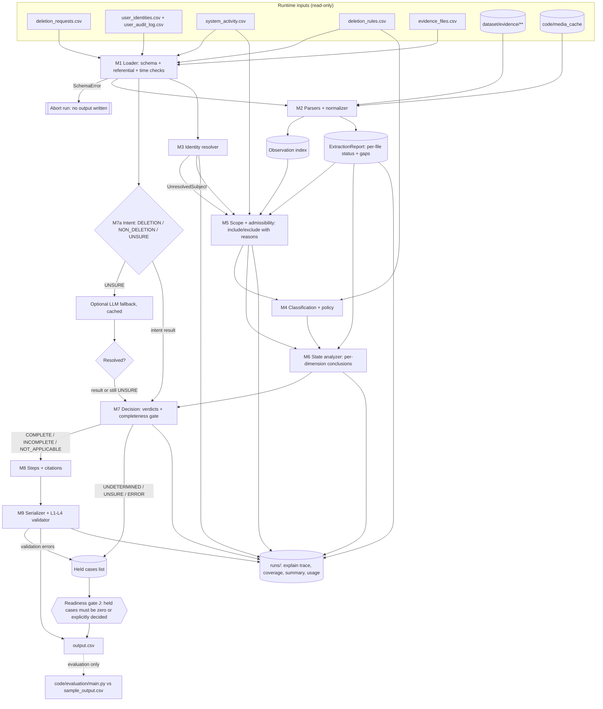

# Implementation Plan — Ghost Data Still Exists Deletion-Audit Agent

Status: **planning document, no code implemented**. Companion analysis: [`code/evaluation/sample_case_analysis.md`](../code/evaluation/sample_case_analysis.md).

Labels used throughout:

| Label | Meaning |
|---|---|
| **[REQ]** | Explicit requirement, quoted or paraphrased from a repository file (file named). |
| **[FACT]** | Verified by inspecting dataset/evidence files or by a script run during analysis. |
| **[PROPOSAL]** | Design decision made in this plan. |
| **[ASSUMPTION]** | Interpretation consistent with all evidence seen, but not stated by the challenge. |
| **[UNRESOLVED]** | Cannot be decided from participant-visible data; handled conservatively and flagged. |

---

## A. Challenge requirements

This section has two kinds of content:

- **Explicit requirements** (A.1–A.3, A.7), each tied to the repository file that states it.
- **Correctness contracts** (A.4–A.6) derived from those requirements. These contracts bind every later section.

A.8 lists decisions and items that are still open. A.9 lists the places in Sections B–J that must be brought in line with this section.

### A.1 Inputs and input contract

#### A.1.1 Input files [REQ: `problem_statement.md` "Files Provided", `AGENTS.md` §6.1–6.2; counts FACT]

| File | Rows | Columns | Role |
|---|---|---|---|
| `dataset/deletion_requests.csv` | 518 | `case_id,email,requested_at,reported_status,reported_at,audit_at,request_text` | Cases to answer (`case_33`–`case_550`, contiguous) |
| `dataset/sample_deletion_requests.csv` | 32 | same | Public sample inputs (`case_01`–`case_32`) |
| `dataset/sample_output.csv` | 32 | `case_id,deletion_status,steps_json` | Reference answers. **Evaluation only** (A.1.2). |
| `dataset/user_identities.csv` | 850 | `user_id,name,email,phone,email_hash,updated_at` | Current identity snapshot |
| `dataset/user_audit_log.csv` | 306 | `audit_id,user_id,event_time,field_name,old_value,new_value` | Historical identity changes |
| `dataset/system_activity.csv` | 4,011 | `activity_id,event_time,event_type,source_system,target_system,resource_id,reported_result,details` | Global operational stream. Every row is a **claim**. |
| `dataset/deletion_rules.csv` | 15 | `rule_id,data_category,condition,required_action` | Policy |
| `dataset/evidence_files.csv` | 94 | `file_id,file_path,origin,captured_at` | Evidence manifest |
| `dataset/evidence/**` | 94 files | 24 `.sql`, 26 `.log`, 28 `.json`, 1 `.txt`, 4 `.pdf`, 11 `.png` | Evidence |
| `dataset/output.csv` | 0 | header only | Template |

`reported_status` ∈ {`COMPLETE`, `PARTIALLY_COMPLETE`, `NOT_STARTED`}. It is "a claim from the existing deletion workflow, not proof of the true state" [REQ: problem_statement "Input"]. `audit_at` is the cutoff: "Use only information available at or before `audit_at`" [REQ: AGENTS §6.2].

#### A.1.2 Reference answers never reach production logic [REQ: AGENTS §4.3, §6.7 — no hardcoded labels or shortcuts] (fixes A1.1)

- Only `code/evaluation/` may open `dataset/sample_output.csv`. Production code under `code/audit/` and `code/main.py` must not reference that path, the string `sample_output`, or any value copied from it.
- The production pipeline treats `sample_deletion_requests.csv` exactly like `deletion_requests.csv`, i.e. as unlabeled input.
- **Enforcement (test):** `test_no_reference_leak` scans every production source file and fails if:
  - `sample_output` appears in it, or
  - a `case_\d+` literal appears in it, or
  - an `evidence_\d+` / `activity_\d+` / `audit_\d+` literal appears in it, or
  - a concrete resource-ID literal matching `\b[a-z_]+_\d+\b` appears outside an allow-list of format examples in docstrings.

  A second test runs the pipeline with `sample_output.csv` made unreadable (path redirected in the test) and asserts identical output.

#### A.1.3 The manifest does not establish case ownership [REQ: AGENTS §6.1, §6.6 — "The manifest does not identify which case or user a file concerns"] (fixes A1.2)

- `evidence_files.csv` supplies only `file_id → path, origin, captured_at`.
- File names and `origin` values are **not** evidence of content or ownership [FACT: `connector_configurations_20260812.json` contains account-profile lookups].
- Case scope is established only through:
  - evidence-based identity linking (Section C.5), and
  - cutoff admissibility rules (Section C.7).

#### A.1.4 Input validation before processing (fixes A1.3)

Row counts alone are insufficient. The loader (M1) must pass **all** checks below before any case is processed. Any failure aborts the run with file, row and column in the message.

| Check | Applies to | Rule |
|---|---|---|
| Header | every CSV | Exact column list and order as in A.1.1 |
| Encoding | every CSV | UTF-8 decodes; no NUL bytes |
| Timestamp format | all `*_at`, `event_time`, `updated_at`, `captured_at` | Strict `^\d{4}-\d{2}-\d{2}T\d{2}:\d{2}:\d{2}Z$`, parsed to aware UTC. [FACT: 0 violations in current data] |
| Request time order | request files | `requested_at ≤ reported_at ≤ audit_at` [FACT: 0 violations] |
| Unique keys | `case_id` (per file), `user_id`, `user_identities.email` (case-insensitive), `audit_id`, `activity_id`, `rule_id`, `file_id`, `file_path` | No duplicates [FACT: all unique] |
| Case-ID set | `deletion_requests.csv` | 518 IDs; format `case_\d+` |
| Enums | `reported_status` | {COMPLETE, PARTIALLY_COMPLETE, NOT_STARTED} |
| | `field_name` | {email, email_hash, phone} |
| | `reported_result` | {SUCCESS, FAILED, PARTIAL} |
| | `required_action` | {DELETE, REDACT, ANONYMIZE, RETAIN} [FACT: observed sets] |
| | `event_type` | Known set; unknown values are logged and treated as uninterpreted claims |
| Identifier formats | identities, audit log | `email_hash` is 64 lowercase hex. `sha256(lower(email)) == email_hash` for every identity row [FACT: 850/850]; a mismatch is a warning, not an abort. |
| Referential | audit log | Every `user_id` exists in `user_identities.csv` |
| Manifest paths | `evidence_files.csv` | Path is relative, resolves inside `dataset/evidence/`, exists, and is a regular file. Every file on disk under `evidence/` is listed in the manifest. [FACT: both hold] |
| Evidence capture header | `.sql` files | The in-file `Captured at` / `snapshot_completed_at` equals the manifest `captured_at`. A mismatch is a warning; the manifest value is used. [FACT: 24/24 match] |
| Rules table | `deletion_rules.csv` | Every `data_category` maps to an entry in the canonical policy table (A.3.2); unknown categories abort |

### A.2 Output contract [REQ: `problem_statement.md` "Required Output", AGENTS §6.3, README "Output"]

- File `output.csv` at the **repository root**. Header exactly `case_id,deletion_status,steps_json`. 518 data rows, one per input `case_id`, no extras.
- `deletion_status` ∈ {`COMPLETE`, `INCOMPLETE`, `NOT_APPLICABLE`}.
- `steps_json` is a valid JSON array. Each element has **exactly** the keys `step_no, phase, system_id, resource_id, operation, state, evidence_id`. Key order and whitespace are ignored; array order is significant.
- `NOT_APPLICABLE` ⇒ `[]` ("because no deletion or deletion verification is authorized").
- `step_no` is consecutive from 1. Phase order is FINDING → REMEDIATION → VERIFICATION. Within a phase, steps follow the operation-table order, then `system_id`, then `resource_id`, ascending [REQ: problem_statement "Rules"; README "Output"].
- `COMPLETE`: "include only verification steps proving the current state". Each step cites a `file_id`, `activity_id` or `audit_id`.
- `INCOMPLETE`: findings (citing evidence), "the complete remediation plan", and the checks that must pass afterward. Remediation and those checks use `evidence_id = ""`.
- Never cite organizer-only truth or evidence captured after the case's `audit_at` [REQ: AGENTS §6.6].

#### A.2.1 Row sort order — single implemented interpretation (fixes A2.2)

Repository sources say only "sorted by `case_id`" [REQ: AGENTS §6.3, problem_statement "Required Output", README "Output" and checklist]. None of them says whether that means numeric or lexicographic order.

Verified facts:

- [FACT] `deletion_requests.csv` is listed in **numeric** ascending order and is **not** lexicographically sorted (`case_99` precedes `case_100`).
- [FACT] `sample_output.csv` uses zero-padded IDs (`case_01`–`case_32`), so it is consistent with both interpretations and does not settle the question.
- The grader parses `steps_json` per row. Whether it matches rows by `case_id` or by position is **not stated** in the repository, so the evaluator's expectation cannot be confirmed from repo files.

**Decision:** implement exactly one order. Rows are written in **ascending numeric order of the integer suffix of `case_id`**, which is identical to the order of `deletion_requests.csv`. The validator enforces only this order.

- Rationale: it is the only order the challenge itself uses for the evaluation inputs, and it is a stable, documented key.
- **Open confirmation (Q-SORT, A.8):** ask the organizers/user whether lexicographic order is expected. If the answer differs, the single sort key is changed in `config.py`. The two orders are never both supported.

### A.3 Canonical operation and treatment tables — single source of truth (fixes A3.1, A3.2, A3.3)

#### A.3.1 `OPERATIONS` [REQ: problem_statement "Allowed Operations", AGENTS §6.4]

The table below is implemented once, in `code/audit/config.py` as `OPERATIONS`. The step builder (M8), the serializer/validator (M9) and the tests all import it; no module may restate these values. Row order **is** the sort order.

| idx | Phase | Operation | State |
|---|---|---|---|
| 0 | FINDING | REPORT_REMAINING_RECORD | PRESENT |
| 1 | FINDING | REPORT_EXPOSED_PII | PRESENT |
| 2 | FINDING | REPORT_ACTIVE_DATA_FLOW | ACTIVE |
| 3 | FINDING | REPORT_RESTORE_RISK | ACTIVE |
| 4 | REMEDIATION | DISABLE_DATA_FLOW | DISABLED |
| 5 | REMEDIATION | BLOCK_RESTORE | BLOCKED |
| 6 | REMEDIATION | DELETE_RECORD | ABSENT |
| 7 | REMEDIATION | REDACT_RECORD | REDACTED |
| 8 | REMEDIATION | ANONYMIZE_RECORD | ANONYMIZED |
| 9 | VERIFICATION | VERIFY_RECORD_ABSENT | ABSENT |
| 10 | VERIFICATION | VERIFY_RECORD_PRESENT | PRESENT |
| 11 | VERIFICATION | VERIFY_RECORD_REDACTED | REDACTED |
| 12 | VERIFICATION | VERIFY_RECORD_ANONYMIZED | ANONYMIZED |
| 13 | VERIFICATION | VERIFY_DATA_FLOW_DISABLED | DISABLED |
| 14 | VERIFICATION | VERIFY_RESTORE_BLOCKED | BLOCKED |

"Do not invent additional phases, operations, or states" [REQ: AGENTS §6.4].

#### A.3.2 `TREATMENTS` — category → policy → finding → remediation → verification

Also defined once in `config.py`. It relates each `deletion_rules.csv` category to the only valid operation chain. The step builder generates from it; the validator checks every chain against it. A step whose enum values are valid but whose chain does not match its resource's category is an error. Valid enums alone do not imply correct remediation (A3.2).

| Category (rule) | Required action | Violating state → finding | Remediation | Final verification | Dependency class |
|---|---|---|---|---|---|
| USER_PROFILE (01), SECONDARY_IDENTIFIER (02), SEARCH_INDEX_ENTRY (03), CACHE_ENTRY (04), SUPPORT_ATTACHMENT (06), USER_EXPORT (09), MARKETING_PROFILE (10) | DELETE | PRESENT → REPORT_REMAINING_RECORD | DELETE_RECORD | VERIFY_RECORD_ABSENT | record change |
| SUPPORT_MESSAGE (05), EMAIL_DELIVERY_LOG (11), ACCOUNT_TOMBSTONE (15) | REDACT | exposed identifiers → REPORT_EXPOSED_PII | REDACT_RECORD | VERIFY_RECORD_REDACTED | record change |
| ANALYTICS_PROFILE (07), PRODUCT_TELEMETRY (08) | ANONYMIZE | attributable → REPORT_EXPOSED_PII | ANONYMIZE_RECORD | VERIFY_RECORD_ANONYMIZED | record change |
| SECURITY_AUDIT_LOG (12), LEGAL_HOLD_RECORD (13) | RETAIN | — (A.4.3) | — | VERIFY_RECORD_PRESENT | none |
| BACKUP_ARCHIVE (14) | RETAIN, restore blocked | restorable → REPORT_RESTORE_RISK | BLOCK_RESTORE | VERIFY_RESTORE_BLOCKED | recreation path |
| DATA_FLOW (no rule row) [FACT: treatment taken from the operation table and samples] | disable | enabled → REPORT_ACTIVE_DATA_FLOW | DISABLE_DATA_FLOW | VERIFY_DATA_FLOW_DISABLED | recreation path |

Required tests, which derive their expectations from `TREATMENTS` and not from enum lists:

- every category produces exactly its chain;
- a mismatched chain (e.g. ANALYTICS_PROFILE with DELETE_RECORD) is rejected unless the resource is classified into a DELETE category with a recorded basis;
- every rule row in `deletion_rules.csv` has exactly one `TREATMENTS` entry.

#### A.3.3 Output order vs remediation dependencies (fixes A3.3)

These are two separate concepts and are validated separately.

- **Output order** is fixed by the explicit sort rule in A.2 (operation index, `system_id`, `resource_id`). It is never altered to express a dependency.
- **Dependency rules** [REQ: AGENTS §6.5]:
  - D1: disable data flows and block unsafe restores before changing dependent records.
  - D2: process downstream copies before their source records when the dependency requires it.

**D1 against the output order.** Every recreation-path remediation (idx 4–5) sorts before every record change (idx 6–8), so D1 is satisfied by construction. The validator still checks it explicitly: no record-change step may precede a recreation-path step for the same case.

**D2 against the output order.** The output order sorts by `system_id`/`resource_id` within an operation, so it can disagree with a downstream→source dependency. [FACT] In every sample, the copy and its source share one `resource_id` (e.g. a replica copy of `account_005`), so no sample exhibits D2.

- [UNRESOLVED Q-DEP] If a run detects a D2 dependency whose resources would sort source-first, the conflict is **not** resolved by reordering. The output follows the explicit sort rule, because it is the more specific instruction and is stated in both problem_statement "Rules" and README "Output".
- The conflict is recorded in the explain trace and counted in the evaluation report, and the user is asked to confirm before final generation.

### A.4 Decision requirements and correctness contracts

#### A.4.1 Explicit decision requirements [REQ: AGENTS §6.5, problem_statement]

- Determine intent first. Access, correction, export, marketing opt-out and other non-deletion requests are `NOT_APPLICABLE`.
- Resolve current and historical identifiers. The request email may be either.
- Reconstruct state at `audit_at`. `reported_status` / `reported_result` are not proof.
- A deletion is complete only when:
  - every relevant copy has the required treatment;
  - every required retained record remains available;
  - retained records contain only permitted identifiers;
  - no active sync, import or restore path can recreate prohibited data.
- `ACCOUNT_TOMBSTONE`: keep the stable subject reference; remove name, email, phone, email hash and any other direct identifier required by the REDACT rule.
- Report every relevant violation and recreation risk supported by participant-visible evidence.

#### A.4.2 Per-resource evaluation states (fixes A4.2)

Internally, each in-scope resource ends with exactly one of three verdicts:

| Verdict | Meaning | Basis |
|---|---|---|
| `COMPLIANT_PROVEN` | The required final state holds at `audit_at` | An admissible observation (A.4.4) that shows the compliant state |
| `VIOLATION_PROVEN` | The required final state does not hold | An admissible observation that shows the violating state |
| `UNKNOWN` | Not determinable | No admissible observation, only claims, or a non-qualifying snapshot |

**"Not found" vs "not observed".** ABSENT may be concluded only from:

- (a) **explicit negative evidence that names the resource**: `rows=0`, `http_status=404`, `status_code: 404`, `result=NOT_FOUND`, or an equivalent field on an observation whose `resource_id` is that resource; or
- (b) a **qualifying scope-aware snapshot** (Section C.8):
  - it declares coverage of the resource's system and collection;
  - it covers every copy table it contains;
  - it is admissible;
  - the resource is missing from it;
  - no later admissible positive observation exists.

An unnamed query miss, a missing mention in an unrelated file, a SUCCESS activity, or a `reported_status` of COMPLETE yields `UNKNOWN`, never ABSENT.

#### A.4.3 Retained records (fixes A4.3)

Retained records are SECURITY_AUDIT_LOG (rule_12), LEGAL_HOLD_RECORD (rule_13) and the archive itself in BACKUP_ARCHIVE (rule_14). For each such in-scope resource:

1. **Does the condition apply?** Evaluate the rule condition from admissible evidence.
   - rule_12: `retention_until > audit_at`.
   - rule_13: `retained_until > audit_at` and no evidence that the hold was released.
   - rule_14: the archive exists; restore access is a separate check.
   - Outcome is `TRUE`, `FALSE` or `UNKNOWN` (field not observed).
2. **Is presence established?** Only by an admissible positive observation (e.g. `rows=1`, `FOUND`, a row present). Otherwise presence is `UNKNOWN`, or `ABSENT` if the A.4.2 rules apply.
3. **Effect on the decision:**

| Condition | Presence | Verdict | Output effect |
|---|---|---|---|
| TRUE | PRESENT | COMPLIANT_PROVEN | VERIFY_RECORD_PRESENT (cited in COMPLETE; `""` in INCOMPLETE) |
| TRUE | ABSENT | VIOLATION_PROVEN, but **no finding operation exists** for a missing retained record | No invented step. The case cannot be COMPLETE (A.4.5). The violation is recorded in the explain trace and reported (Q-RETAIN). |
| TRUE | UNKNOWN | UNKNOWN | Blocks COMPLETE (A.4.5). In INCOMPLETE, a future VERIFY_RECORD_PRESENT check is still listed. |
| FALSE | any | Not a retained record under that rule; no applicable rule row | No step; logged (Q-RETAIN) |
| UNKNOWN | any | UNKNOWN | Blocks COMPLETE |

**Never invent an output operation** to represent a missing-record violation [REQ: AGENTS §6.4].

#### A.4.4 Admissibility (summary; details in C.7)

An observation proves state at `audit_at` only if **both** its file `captured_at ≤ audit_at` **and** its own observation time `≤ audit_at`. Capture time and event time are stored separately and are never substituted for each other. [FACT] evidence_13 and evidence_36 each contain a record dated after the file's own capture time.

Activities and `reported_status` are claims. They never prove state.

#### A.4.5 Completeness gate (fixes A2.1, A4.1)

- **Required resource set** `REQ(case)`: every resource established in scope by a grounded or catalog link (C.5) that has a required final state in `TREATMENTS`.
  - The primary account is always a member.
  - Candidates that are only ambiguously linked (C.6) are **not** members. They are recorded as unresolved scope, and never as proof of completeness.

```text
gate(case):
  V = {r: verdict(r) for r in REQ(case)}
  if any(v == VIOLATION_PROVEN with an expressible finding for v in V):  return INCOMPLETE
  if all(v == COMPLIANT_PROVEN and has_citable_proof(r) for r, v in V): return COMPLETE
  return UNDETERMINED          # internal only; never silently mapped to COMPLETE
```

- **UNKNOWN never counts as compliance.** A required resource whose state is unknown is never silently omitted from a COMPLETE answer.
- **[UNRESOLVED Q-UNDETERMINED]** The output contract has no status for "not provable". INCOMPLETE requires findings that cite evidence, which cannot exist for an unknown state.
- Until the user decides a policy, `UNDETERMINED` cases are:
  - listed in the run summary and the evaluation report, with per-resource reasons;
  - written to `output.csv` only after an explicit, documented decision on their mapping. The final-output readiness check (J) fails while any case is `UNDETERMINED` without such a decision.
- On the public samples, the gate must not change any COMPLETE answer. [FACT] Every expected COMPLETE verification step has citable proof. This is an acceptance test for the gate.

### A.5 Output validation semantics (fixes A2.3, A2.4)

The validator (M9) runs four layers. Layers L3 and L4 need the pipeline's internal case results (scope, observations, links); the validator receives them alongside `output.csv`.

**L1 Structural**

- header and row set;
- JSON parses to a list;
- exact 7 keys per step;
- types (`step_no` int, others str);
- enum values from `OPERATIONS`;
- `phase` and `state` consistent with `operation`.

**L2 Contract**

- sort order (A.2.1, A.3.1);
- consecutive `step_no`;
- `NOT_APPLICABLE` ⇔ `[]`;
- COMPLETE ⇒ VERIFICATION steps only, each with non-empty `evidence_id`;
- INCOMPLETE ⇒ ≥1 FINDING; every FINDING cites evidence; every REMEDIATION/VERIFICATION has `""`.

**L3 Citation meaning** (A2.3). For every non-empty `evidence_id`:

1. The ID exists (`file_id` in the manifest, or a known `activity_id` / `audit_id`).
2. Its time (file `captured_at`, or `event_time` for activities) is ≤ the case's `audit_at`.
3. The cited file contains an observation of **this** `resource_id` that is admissible for state, **or** it is the qualifying omission snapshot for the resource (A.4.2b).
4. That observation **supports the step's state**:
   - findings: PRESENT / exposed identifiers / enabled / restorable;
   - verifications: the compliant state matching the operation.
5. The resource is linked to the case subject by a recorded grounded or catalog link.
6. Activities and audit-log rows are not accepted as proof of state; citing them for a state claim is an error.

**L4 Remediation completeness and dependencies** (A2.4)

- For every `VIOLATION_PROVEN` resource with an expressible finding: exactly one finding with the operation from `TREATMENTS`, and the remediation from `TREATMENTS`.
- No remediation without a finding.
- Verification covers:
  - every remediated resource, with the chained final check;
  - every in-scope retained record (VERIFY_RECORD_PRESENT);
  - the primary account (VERIFY_RECORD_ABSENT);
  - every other member of `REQ(case)`.
- Dependency rule D1 holds. D2 conflicts are reported (A.3.3).
- Every in-scope recreation path (enabled flow, restorable backup) has a finding. A case with an active recreation path can never be COMPLETE.

### A.6 Evaluation-metric contract (fixes A5.4)

- `evaluation_report.md` and `usage_report.md` are **generated** from:
  - the evaluator's output (`code/evaluation/main.py`), and
  - the run's usage counters.
- Each report records the command, timestamp, git commit and input files used.
- Numbers are never typed by hand.
- A metric that cannot be computed (e.g. hidden-test accuracy, or LLM tokens when no LLM call was made) is written as **"not available"** with the reason.
- Cost figures state the price source and its date, and are labelled as estimates.
- No hidden-test score is claimed. Public-sample metrics are labelled as public-sample metrics.

### A.7 Process, logging, packaging and privacy requirements

| Requirement | Source |
|---|---|
| Append-only `log.txt` beside `AGENTS.md`; one entry per turn with populated `tool=` and `model=`; no secrets or personal data | AGENTS §2, §5 |
| Only participant-facing `dataset/` files; no organizer files, hardcoded labels or case-family shortcuts | AGENTS §4, §6.7 |
| Runnable from terminal; deterministic; secrets only from environment variables | AGENTS §6.7 |
| `evaluation_report.md` content (case, step, field, sequence accuracy; ≥3 custom cases; failures and improvements) and `usage_report.md` content (providers/models, calls, tokens, averages, costs, per-model and overall totals) | AGENTS §6.8, problem_statement |
| `code.zip` contents: code, prompts, config, README, reports. Exclusions: no dataset, venvs, caches, nested archives, secrets or real personal data | AGENTS §6.9, README "Packaging" |
| Agent trace ZIP, reviewed and redacted | `agent_trace_instructions.md` |
| Code judge ignores `.csv/.tsv/.json/.jsonl/.sql/.log`; metrics, custom cases and prompts must live in `.md` or source files | README "Evaluation" |

#### A.7.1 Report location — decided (fixes A5.1)

- AGENTS §6.8 and problem_statement say the zip must include `evaluation/evaluation_report.md` and `evaluation/usage_report.md`.
- README (line 99, marked **Important**) requires `code/evaluation/evaluation_report.md` and `code/evaluation/usage_report.md`, "matching `code/evaluation/main.py` in this starter layout".
- README packaging notes explicitly accept this layout: "Keep your evaluation reports in `code/evaluation/` so they are bundled automatically with `code`". The README checklist also lists `code/evaluation/…`.

**Decision:** reports live in `code/evaluation/`. The README is the most specific instruction and matches the starter layout and its packaging command.

Before packaging, the zip listing is checked to contain `code/evaluation/evaluation_report.md` and `code/evaluation/usage_report.md`. A top-level duplicate is **not** created; two copies could diverge.

#### A.7.2 README handling (fixes A5.2)

- The original challenge text in `README.md` is preserved verbatim.
- The solution's setup and run instructions are added as **one clearly delimited section** with the heading "Solution — Setup and Run" and begin/end markers. It contains:
  - prerequisites;
  - environment variables (names only);
  - the exact run, evaluate and test commands;
  - the output location;
  - the flag settings used.
- The addition is made only after the user confirms where it goes (top or bottom of the root README) **[pending Q-README]**. No other edits are made to challenge text.

#### A.7.3 Privacy rules for logs, traces and archives (fixes A5.3)

| Artifact | May contain | Must not contain | Check before submission |
|---|---|---|---|
| `log.txt` (submitted) | User prompts verbatim (secrets → `[REDACTED]`); summaries; file paths in repo; `case_id`, `user_id`, `resource_id`, `file_id` | Dataset emails, phones, names, hashes; API keys/tokens; credentials | Regex scan for email, phone, 64-hex, `sk-`/key patterns; manual review of hits |
| Run explain trace (`run_explain.jsonl`) | Full identifiers needed for debugging | — | **Never packaged or logged**; kept in scratch, deleted after use |
| `evaluation_report.md` / `usage_report.md` | IDs and metrics | Dataset personal values; secrets; sensitive configuration values | Same regex scan |
| `code.zip` | Code, prompts, `.md` reports, README | `dataset/`, explain traces, caches, `.env`, nested archives, personal values | Unzip listing reviewed; regex scan of all text files |
| `agent-trace.zip` | Session JSONL / `/export` files for this challenge | Credentials, auth/config files, unrelated sessions | Staged copy scanned. Session files contain dataset identifiers and the user's account details: redaction, or explicit user approval to include them, is required before upload. The listing is reviewed. |

All dataset persons are fictional [REQ: AGENTS §7], but personal-data handling applies as if they were real (organisation policy, DPDP Act 2023).

### A.8 Decisions and open questions recorded in this section

| ID | Topic | Status |
|---|---|---|
| Q-SORT | Row order | **Decided:** numeric suffix order (A.2.1); organizer confirmation requested |
| Q-REPORTS | Report location | **Decided:** `code/evaluation/` (A.7.1) |
| Q-README | Position of the README addition | Open: user confirmation |
| Q-UNDETERMINED | Output mapping for cases that fail the completeness gate without a proven violation | Open: user decision before final generation (A.4.5) |
| Q-RETAIN | Missing retained record or false retention condition: no output operation exists | Open: recorded, no invented step (A.4.3) |
| Q-DEP | Downstream→source dependency that conflicts with the sort order | Open: none observed; output follows the sort rule; conflict reported (A.3.3) |
| Q-LATE-LINK | Using late-captured files with earlier inner timestamps for identity linking only | Open: see C.7 / I.R3 |

### A.9 Required alignment of Sections B–J (not yet edited)

Section A now overrides the following statements in later sections. They must be updated before implementation of the affected module:

- **F.2** "If a COMPLETE-case resource has no citable proof, it is omitted from the steps and logged" conflicts with A.4.5. Replace with the completeness gate.
- **E** pseudocode, COMPLETE branch: apply `gate()`. Use the verdicts from A.4.2 and the retained-record table in A.4.3.
- **F.3** "[UNRESOLVED] sorted by `case_id`": replace with the A.2.1 decision.
- **F.4** validator: replace with layers L1–L4 (A.5).
- **B.2/B.5**: `config.py` holds `OPERATIONS` and `TREATMENTS` as the single source (A.3). M9 consumes internal case results for L3/L4.
- **D.3** "Retained record missing" and the security-audit/legal-hold bullets: align with A.4.3.
- **G.3** anti-leakage rules: align with the A.1.2 tests.
- **I**: update R14 (Q-RETAIN), R17 (decided), R18 (decided). Add Q-UNDETERMINED and Q-DEP.
- **J**: add the gate check (no undecided `UNDETERMINED` cases), the L3/L4 validator pass, and the privacy scans from A.7.3.

---

## B. Proposed architecture

Section B implements the contracts of Section A: the verdicts of A.4.2, the completeness gate of A.4.5, the validator layers of A.5, and the single source of truth in A.3. Where B.1 changes an option described in Section C, B.8 lists the alignment.

### B.1 Technology and evidence-extraction decisions

#### B.1.1 Deterministic core [PROPOSAL, decided]

The core uses the Python 3.13 standard library only: `csv`, `json`, `sqlite3`, `re`, `hashlib`, `base64`, `zlib`, `struct`, `datetime`, `dataclasses`, `unittest`. [FACT] Python 3.13.9 and SQLite 3.50.4 are available.

No third-party package is required for SQL, JSON, logs, TXT or PDF. No network call happens at run time unless the optional LLM fallback is explicitly enabled (B.1.4).

#### B.1.2 PDF extraction: decided, standard library only

[FACT, verified by a read-only probe on all 4 PDFs]:

- The PDFs are generated documents.
- Their page content streams use `/Filter [/ASCII85Decode /FlateDecode]`.
- Their text is stored as plain literal strings drawn with `(…) Tj` operators.
- The embedded ToUnicode CMaps cover single-byte codes `<00>`–`<7F>`.

Decoding with `base64.a85decode` + `zlib` and parsing `(…) Tj` literals (handling PDF escapes `\n \r \t \b \f \( \) \\ \ddd`) recovered the full text of all 4 PDFs. The resource and user references found match the visual inspection:

| PDF | References recovered |
|---|---|
| `support_001` attachment | `support_001` plus one email |
| Disputed-orders register | `user_08`, `user_12`, `user_17`, `user_21`, `user_24`, `user_29` |
| Compliance journal | `audit_record_003`, `user_03` |
| Customer statement | `user_18` plus one email |

Decision:

- `evidence/pdf_parser.py` implements this extractor. **No `pypdf` dependency.**
- The parser reports failure instead of guessing if a PDF uses an unsupported structure: other filters, hex/`TJ`-array text, or multi-byte CMaps. Future evidence would then show up as a coverage gap (B.3.2), not as silently missing data.

#### B.1.3 PNG extraction: approach decided, provider pending

[FACT] The 11 PNGs contain only `IHDR/IDAT/IEND` chunks, with no embedded text metadata. No OCR engine or image library is installed. Their content therefore requires OCR or a vision model.

**Decided approach: one-time scripted vision extraction into a hash-pinned cache, with a fixed extraction schema.**

Extraction tool, `code/tools/extract_media.py`. This is a separate command and is **not** part of the audit run.

1. It computes the `sha256` of each PNG listed in `evidence_files.csv`.
2. It sends the image to a vision model with the prompt `code/prompts/media_extraction.md`. The prompt asks for a fixed JSON schema: `records[]` with `resource_id`, `system_hint`, `fields{…}`, `identifiers[]`, `timestamps[]`, and `visible_text` verbatim. The model must transcribe, not infer.
3. It writes one cache entry per file to `code/media_cache/<file_id>.json`.
4. It appends a row to `code/media_cache/MANIFEST.md`.

Each cache entry records:

| Field | Purpose |
|---|---|
| `file_id`, `file_path`, `sha256` | Identify the original evidence |
| `extractor` | Provider and model ID |
| `prompt_sha256` | Pins the extraction prompt |
| `extracted_at` | When the extraction ran |
| `schema_version` | Version of the extraction schema |
| `records` | The extracted data |
| `review_status` | `unreviewed` / `spot_checked`, with the reviewer note |

Rules:

- **Reproducibility contract.** At audit run time the pipeline reads only the cache.
  - It re-hashes each PNG and compares it to the cached `sha256`.
  - A mismatch, a missing entry, or an unknown `schema_version` makes that file `EXTRACTION_FAILED` in the coverage report (B.3.2). It is never treated as an empty file.
- **No manual transcription into the cache.** Human review may mark entries `spot_checked` and record discrepancies. Corrections are made by re-running extraction with a revised prompt, never by editing values.
- **Provider and data-sharing approval.** The extraction sends dataset screenshots to an external service. Choosing the provider, model and key is a **user decision (Q-MEDIA-PROVIDER)**. The screenshots are fictional data, but sending data outward still needs approval.
  - The `openai` SDK is already installed [FACT]. A different provider needs its SDK installed, which also needs approval.
- **Gate.** The core pipeline (Stages 0–10) is built and evaluated without image facts. [FACT] No expected public-sample step cites a PNG, and every sample resource that appears in a PNG also appears in text evidence or activity rows.

  However, the PNGs contain grounded links for **evaluation** subjects: `user_11`, `user_13`, `user_14`, `user_16`, `user_18`, `user_20`, `user_22`, `user_03`, `user_17`, and `marketing_001`. Therefore:
  - the media cache is **required before the final 518-case run** (readiness checklist J);
  - until then, every case whose subject has a PNG-only link is reported as affected by the coverage gap.

#### B.1.4 LLM use for request intent: trigger and unavailability rules

The intent classifier returns one of three results, never a bare boolean:

| Result | Trigger (deterministic) | Recorded |
|---|---|---|
| `DELETION` | ≥1 deletion-intent pattern (delete / erase / remove / close + account / personal data; multilingual equivalents) **and** no explicit non-deletion pattern | matched phrases |
| `NON_DELETION` | ≥1 explicit non-deletion pattern: an explicit negation of deletion ("not asking for deletion", "don't delete", "do not close", "not a request to erase", "without removing"), a limiting "only" clause, or a stated non-deletion purpose (correct, change, copy, download, information held, stop promotional, reset login) | matched phrases |
| `UNSURE` | Neither pattern class matched, **both** classes matched in a way the precedence rules below do not resolve, or the text contains a script or language with no pattern coverage | reason |

Precedence:

- An explicit negation of deletion always wins over a deletion verb. "Remove me from marketing lists only" → `NON_DELETION`.
- A limitation that keeps something ("you may keep backups", "keeping an internal reference is fine") does **not** negate deletion. [FACT: such wording appears in samples case_04, 17, 23, 31.]

LLM fallback:

- It is called **only** for `UNSURE`, and only if `AUDIT_LLM_ENABLED=1` and an API key is present in the environment.
- The result is cached in `code/llm_cache/intent/<sha256(text)>.json`. The cache stores the model, prompt hash, raw answer and token counts, and is counted in `usage_report.md`.

If the fallback is unavailable (disabled, no key, error):

- the case keeps intent `UNSURE`;
- it is **not** bypassed: full analysis still runs (B.3.1);
- its final status is withheld by the readiness gate (J) until resolved.

[FACT] On current inputs, all 508 deletion-style texts begin with one of 17 known openers, and the 10 non-deletion texts each contain an explicit negation. The expected `UNSURE` count is 0, and the run reports the actual count.

`CLASSIFY_REQUEST` activities are claims. They are reported as a cross-check in evaluation and never used as decision input.

### B.2 Repository and package layout

The modular design is kept. Each directory below has exactly one role.

| Path | Role | Packaged in `code.zip` | Who writes it | Read by production run |
|---|---|---|---|---|
| `code/main.py`, `code/audit/**` | **Production source** | yes | developer | — |
| `code/prompts/*.md` | Prompts (intent fallback, media extraction) | yes [REQ: README "keep prompts in source code or Markdown"] | developer | only by tools / fallback |
| `code/tools/extract_media.py` | **Generation tool** (not part of the audit run) | yes | developer | no |
| `code/media_cache/` (`*.json`, `MANIFEST.md`) | **Generated runtime input**, hash-pinned to evidence | yes, so the run is reproducible without network | `extract_media.py` only | yes (read-only) |
| `code/llm_cache/` | **Generated runtime input** (intent fallback answers) | yes | pipeline in fallback mode only | yes (read-only unless fallback enabled) |
| `code/evaluation/main.py`, `code/evaluation/custom_cases/` | **Evaluation only** | yes | developer | **never** (A.1.2) |
| `code/evaluation/*.md` (reports, sample analysis) | **Deliverables** | yes [A.7.1] | evaluator + developer narrative | never |
| `code/tests/` | Tests | yes | developer | no |
| `runs/` (repo root, git-ignored) | **Scratch run artifacts**: explain traces, coverage reports, run summaries | **no** (contain dataset identifiers, A.7.3) | pipeline | no |
| `output.csv` (repo root) | **Submission artifact** | separate upload | pipeline | no |
| `docs/IMPLEMENTATION_PLAN.md` | Planning document | **not by default.** The README zip command packs only `README.md` and `code` [FACT]. Inclusion is **Q-DOCS-ZIP**. | developer | no |
| `dataset/` | Challenge input | **never** [REQ] | organizers | yes (read-only) |

Import rules, enforced by a test:

- `code/audit/**` may not import from `code/evaluation/**`, `code/tests/**` or `code/tools/**`.
- `code/tools/**` may import `code/audit/config.py` and the parsers.

Module tree:

```text
code/
  main.py                    # CLI: python code/main.py [--requests PATH] [--out PATH] [--cases ...] [--run-dir runs/<ts>]
  audit/
    config.py                # OPERATIONS, TREATMENTS, flags, system maps, sort key (A.2.1, A.3)
    models.py                # B.4 data model
    errors.py                # error and uncertainty enums (B.3.3, B.4.3)
    loader.py                # M1
    evidence/
      sql_parser.py  json_parser.py  log_parser.py  text_parser.py
      pdf_parser.py          # B.1.2
      media_cache.py         # B.1.3 reader + hash verification
      normalize.py           # identifier extraction / canonicalisation
      index.py               # ObservationIndex + ExtractionReport
    identity.py              # M3
    policy.py                # M4
    scope.py                 # M5
    state.py                 # M6
    intent.py                # B.1.4
    decision.py              # M7
    steps.py                 # M8
    serializer.py            # M9 (L1–L4 validator)
    runlog.py                # M10 runtime part: explain trace, coverage, usage counters
  tools/extract_media.py
  prompts/{intent_classifier.md, media_extraction.md}
  media_cache/   llm_cache/
  evaluation/{main.py, custom_cases/, evaluation_report.md, usage_report.md, sample_case_analysis.md}
  tests/
```

### B.3 Pipeline, failure handling and data flow



Data flow:

1. M1 validates all inputs. Any error aborts before processing.
2. M2 builds the observation index **once**, plus an `ExtractionReport`.
3. Per case:
   - intent;
   - identity, which always runs;
   - scope;
   - classification;
   - state;
   - decision.
4. Cases with an emittable status go to M8/M9.
5. Cases that cannot be decided within the permitted enums go to the **held list**. `output.csv` is written only when the held list is empty or every held case has an explicit, documented decision (A.4.5, J).

#### B.3.1 Q1: where does intent sit, and can a real deletion request be skipped?

Answer:

- Intent is computed first, but it **never short-circuits analysis**.
- Identity, scope, state and decision run for every case. The intent result only changes what M7 is allowed to emit.

| Intent | M7 behaviour |
|---|---|
| `DELETION` | Normal decision |
| `NON_DELETION` (explicit matched phrase recorded) | Emit `NOT_APPLICABLE`, `[]`. The analysis is kept in the explain trace. |
| `UNSURE` after fallback, or fallback unavailable | Case is **held** (UNSURE_INTENT). It is not emitted as NOT_APPLICABLE and not emitted as a deletion decision until resolved. |

Recommended fix:

- The three-way classifier from B.1.4.
- `NOT_APPLICABLE` only when an explicit non-deletion phrase is matched.
- No bypass of analysis.
- A held state for ambiguity.

This prevents a real deletion request from being skipped silently. It also avoids emitting deletion steps for a request that did not authorise deletion.

#### B.3.2 Q2: how is an extraction failure kept visible?

Answer: M2 returns an `ExtractionReport` alongside the index. Downstream modules consult it explicitly.

```text
FileExtraction { file_id, format, status: OK | PARTIAL | FAILED,
                 observations: int, unparsed_units: int, unparsed_samples: [str],
                 known_noise_units: int, reasons: [str] }
```

- `OK`: every unit (row, record, state-bearing log line, PDF text run, cache entry) was parsed.
- `PARTIAL`: some units were not understood. Log lines whose event is on the known-noise list (e.g. `connection_acquired`, `dependency_retry`, `timer_tick`) are counted separately and do **not** make a file PARTIAL.
- `FAILED`: the file could not be parsed. Examples: SQL error, invalid JSON, unsupported PDF structure, media cache missing or hash mismatch.

Effects:

- **M5** records `coverage_gaps` per case: every `FAILED`/`PARTIAL` file that is admissible for the case (by capture time).
- **M6**:
  - A snapshot from a `FAILED`/`PARTIAL` file **cannot** prove absence by omission.
  - A resource whose only potential evidence lies in a gap file gets uncertainty reason `EVIDENCE_GAP`.
  - Absence of data is never inferred from a failed parse.
- **Run-level:** the run summary lists every non-OK file. The final run (J) requires:
  - zero `FAILED` text-evidence files;
  - every `PARTIAL` file reviewed;
  - the media cache complete and hash-valid.

Recommended fix:

- Treat coverage as data, not logging.
- Forbid omission proofs from incomplete files.
- Block final generation on unexplained gaps.

#### B.3.3 Q3: what happens on unresolved identity, parse errors, conflicts and exceptions?

| Situation | Detection | Path | Effect on output |
|---|---|---|---|
| Input schema/referential error | M1 | Abort run | No `output.csv` written |
| Evidence file unparsable | M2 `FAILED` | Coverage gap (B.3.2) | Affected resources `UNKNOWN(EVIDENCE_GAP)`; run blocked at J until fixed |
| Identity unresolved (request email in neither snapshot nor audit log) | M3 → `UnresolvedSubject` | Scope from the request email and its computed `sha256` only; uncertainty `IDENTITY_UNRESOLVED` | Findings are allowed only where the email itself is grounded. A COMPLETE answer is impossible: the primary account cannot be proven without a subject, so the gate fails and the case is held. [FACT: 0 such cases in current inputs] |
| Resource grounded to the subject **and** to another subject | M5 | Kept in scope (e.g. a shared support conversation) with reason `SHARED_RESOURCE` | Treatment per category (rule_05 REDACT for shared messages) |
| Resource grounded only to another subject | M5 | Excluded with reason `LINKED_TO_OTHER_SUBJECT` | None |
| Two admissible observations of the same resource and copy at the same observation time with different states | M6 | Conclusion `UNKNOWN(CONFLICTING_OBSERVATIONS)` with both refs | Blocks COMPLETE; no finding |
| Observations at different times | M6 | Latest admissible wins; earlier ones kept as `superseded` refs | Normal |
| Grounded observation contradicts a catalog claim (`LINK_RESOURCE_IDENTITY`) | M5 | Grounded wins; conflict logged | Normal |
| Category ambiguous across treatments | M4 | `UNKNOWN(CATEGORY_AMBIGUOUS)` | No finding (the operation cannot be chosen); blocks COMPLETE |
| Exception inside one case | M7 wrapper | Case result `ERROR` + traceback in `runs/` | Held; the final run requires zero errors |
| Validator L1–L4 failure | M9 | Case moved to held list with the failing rule | Held |

### B.4 Core data model

#### B.4.1 Evidence references (multiple, with roles)

```python
@dataclass(frozen=True)
class EvidenceRef:
    kind: str                 # "observation" | "activity" | "audit_log" | "omission_snapshot"
    ref_id: str               # obs_id / activity_id / audit_id
    file_id: str | None       # citable id for observations / omission snapshots
    file_captured_at: datetime | None
    observed_at: datetime | None
    locator: str              # table / json path / trace id / line
    role: str                 # PROOF | CONTRARY | SUPERSEDED | LINK | CLAIM | CONTEXT
    admissible: frozenset     # subset of {"state", "citation", "link"} for THIS case's audit_at
```

`Observation` and `Activity` are as in the earlier draft, with `observed_at` and `file_captured_at` kept separate (A.4.4).

#### B.4.2 Independent assessment dimensions

The single mixed `state` is replaced by independent dimensions. Each dimension is a `Conclusion`:

```python
@dataclass
class Conclusion:
    value: str                       # dimension-specific enum, always including "UNKNOWN" and "NOT_APPLICABLE"
    evidence: list[EvidenceRef]      # all refs used: PROOF + CONTRARY + SUPERSEDED + CLAIM
    derivation: str                  # rule id + human-readable explanation, e.g.
                                     # "S-ABSENT-NAMED: latest admissible obs evidence_92#account_service.profile_lookups[3] status_code=404"
    uncertainty: list[str]           # UncertaintyReason values (B.4.3); empty iff value is decided

@dataclass
class ResourceAssessment:
    resource_id: str
    system_id: str                        # canonical owning system
    scope: ScopeDecision                  # included/excluded + reasons + link refs (M5)
    category: Conclusion                  # value = deletion_rules category; derivation shows precedence step used
    existence: Conclusion                 # PRESENT | ABSENT | UNKNOWN            (per copy below)
    copies: dict[str, Conclusion]         # copy_location -> PRESENT | ABSENT | UNKNOWN
    pii_exposure: Conclusion              # EXPOSED | CLEAN | NOT_APPLICABLE | UNKNOWN
    flow_state: Conclusion                # ENABLED | DISABLED | NOT_APPLICABLE | UNKNOWN
    restore_state: Conclusion             # RESTORABLE | BLOCKED | NOT_APPLICABLE | UNKNOWN
    retention_condition: Conclusion       # TRUE | FALSE | NOT_APPLICABLE | UNKNOWN (A.4.3)
    evidence_completeness: Conclusion     # COMPLETE | PARTIAL | NONE (+ gaps) — derived from coverage
    verdict: Verdict                      # computed, see below
```

The verdict is computed from `TREATMENTS[category]` and only the dimensions that treatment needs:

| Required treatment | Dimensions consulted | COMPLIANT_PROVEN when | VIOLATION_PROVEN when |
|---|---|---|---|
| DELETE | existence (all copies) | ABSENT in every known copy | PRESENT in any copy |
| REDACT / TOMBSTONE | existence, pii_exposure | PRESENT and CLEAN (or ABSENT) | PRESENT and EXPOSED |
| ANONYMIZE | existence, pii_exposure | CLEAN (or ABSENT) | EXPOSED |
| RETAIN | retention_condition, existence | condition TRUE and PRESENT | condition TRUE and ABSENT (no output operation; A.4.3) |
| BLOCK_RESTORE | restore_state | BLOCKED | RESTORABLE |
| DISABLE_FLOW | flow_state | DISABLED | ENABLED |

Any consulted dimension `UNKNOWN` ⇒ verdict `UNKNOWN`, with the union of its uncertainty reasons.

```python
@dataclass
class Verdict:
    value: str            # COMPLIANT_PROVEN | VIOLATION_PROVEN | UNKNOWN   (A.4.2)
    reasons: list[str]    # UncertaintyReason values when UNKNOWN
    proof: list[EvidenceRef]   # refs with role PROOF and "citation" admissible (may be several)
    citation: EvidenceRef | None  # the single ref chosen for evidence_id per F.2 rules
```

Multiple proofs are kept. `citation` is the one chosen for output. The others remain in the explain trace, and L3 validation (A.5) checks the chosen one.

#### B.4.3 Uncertainty reasons and their effect on the decision

Defined once in `errors.py`.

| Reason | Meaning | Verdict | Finding? | Effect on case |
|---|---|---|---|---|
| `NO_ADMISSIBLE_OBSERVATION` | No observation admissible for state | UNKNOWN | no | Blocks COMPLETE; listed as a future check in INCOMPLETE |
| `CLAIMS_ONLY` | Only activities / `reported_status` | UNKNOWN | no | as above |
| `POST_CUTOFF_ONLY` | Evidence exists only after `audit_at` | UNKNOWN | no | as above |
| `OBSERVED_AFTER_CAPTURE` | The only relevant observation is dated after its file capture and after `audit_at` | UNKNOWN | no | as above |
| `NONQUALIFYING_OMISSION` | Missing from a snapshot without declared coverage | UNKNOWN | no | as above |
| `EVIDENCE_GAP` | Relevant file FAILED/PARTIAL | UNKNOWN | no | as above; also run-level gate |
| `CONFLICTING_OBSERVATIONS` | Same time, different states | UNKNOWN | no | as above |
| `CATEGORY_AMBIGUOUS` | Treatment cannot be chosen | UNKNOWN | no | as above |
| `RETENTION_CONDITION_UNKNOWN` | Retention field not observed | UNKNOWN | no | as above |
| `RETAINED_RECORD_MISSING` | Required retained record proven absent | VIOLATION_PROVEN | **no operation exists** | Blocks COMPLETE; case held unless other findings make it INCOMPLETE; reported (Q-RETAIN) |
| `WEAK_LINK_ONLY` | Workflow-correlation link only (C.6) | not in `REQ(case)` | no | Logged as unresolved scope; does not block COMPLETE (A.4.5) |
| `IDENTITY_UNRESOLVED` | Case-level | — | — | B.3.3 row |

The case decision (M7) follows A.4.5:

- any expressible `VIOLATION_PROVEN` → INCOMPLETE;
- else all of `REQ(case)` COMPLIANT_PROVEN with a citation → COMPLETE;
- else UNDETERMINED (held).

### B.5 Module contracts

| # | Module | Responsibility | Inputs → Outputs | Failure / uncertainty contract (review fix) |
|---|---|---|---|---|
| M1 | `loader.py` | Schema (A.1.4) **plus referential and timestamp consistency** | `dataset/` → `Dataset` | Referential and consistency checks, listed below. Errors abort; warnings go to the run summary. |
| M2 | `evidence/*` | Parse all evidence into `Observation`s; normalise identifiers; keep capture vs observation time | manifest, files, media cache → `ObservationIndex`, **`ExtractionReport`** | Returns per-file status, counts, unparsed samples and reasons (B.3.2). Never returns "no data" for a failed file. |
| M3 | `identity.py` | Subject + identifier set with provenance | request, identities, audit log → `Subject` \| `UnresolvedSubject` | Defined unresolved path (B.3.3). Validity windows kept for explanation only. |
| M4 | `policy.py` | Category + treatment from `TREATMENTS` | observations, activities, rules → `category: Conclusion` | Precedence (D.1) recorded in `derivation`. **Confidence rules:** (a) explicit `record_type` or collection mapping = decided; (b) content-feature or workflow-hint classification is accepted only if every competing category has the same treatment chain, otherwise `CATEGORY_AMBIGUOUS`; (c) prefix-only or unmatched → `CATEGORY_AMBIGUOUS`. Ambiguity never defaults to a "safe" category. |
| M5 | `scope.py` | Which resources belong to the case; admissibility per ref | subject, index, activities, coverage, all requests → `ScopeDecision` per candidate | **Every candidate gets an include/exclude decision** with reason codes: `GROUNDED_DIRECT`, `GROUNDED_TRACE`, `GROUNDED_FK`, `CATALOG`, `WEAK_LINK_ONLY`, `SHARED_RESOURCE`, `LINKED_TO_OTHER_SUBJECT`, `EARLIER_EPISODE`, `LINK_EVIDENCE_POST_CUTOFF`, `AMBIGUOUS_WORKFLOW`. Each code comes with `EvidenceRef`s. Excluded candidates are kept in the explain trace. |
| M6 | `state.py` | Per-dimension conclusions and verdict | scope, index, coverage, `TREATMENTS` → `ResourceAssessment[]` | **Evidence-completeness check per resource.** A compliant verdict requires PROOF refs admissible for state and citation, and no `EVIDENCE_GAP` on the dimension. UNKNOWN is never upgraded to compliant (A.4.2). |
| M7 | `decision.py`, `intent.py` | Intent + completeness gate | intent, assessments → `CaseDecision{status ∈ {COMPLETE, INCOMPLETE, NOT_APPLICABLE} \| held(reason)}` | **Conservative rules:** only the A.4.5 gate. UNDETERMINED / UNSURE / ERROR become held, never mapped to an enum implicitly. Each emitted status lists the verdicts that justify it. |
| M8 | `steps.py` | Steps from `TREATMENTS`; citation choice | `CaseDecision` → `Step[]` | **Citation relevance:** the chosen ref must be in `verdict.proof`, admissible for citation, name the resource (or be its qualifying omission snapshot), and support the step's state. Otherwise the step is not emitted and the case is held (`CITATION_UNSUPPORTED`). |
| M9 | `serializer.py` | CSV/JSON writing; L1–L4 validation | case results + `output.csv` → errors | **Semantic checks** L3/L4 (A.5) use the internal case results. Writes `output.csv` only when there are zero errors and zero undecided held cases. |
| M10 | `runlog.py` (runtime), `code/evaluation/main.py` (evaluation) | Explain trace, coverage report, usage counters; sample scoring, report generation | results → `runs/<ts>/…`; evaluator → `code/evaluation/*.md` | **Strict separation:** the runtime part never reads `sample_output.csv`. The evaluator imports production code but not vice versa (import-rule test, B.2). Reference answers are read only inside the evaluator; feature flags are set by documented decisions, not by evaluator output at run time (A.1.2). |

M1 referential and consistency checks:

- Every audit-log `user_id` exists.
- **Audit-log chain consistency** per (user, field): sorted by `event_time`, each `old_value` equals the previous `new_value`, and the last `new_value` equals the snapshot value. [FACT: 302 chains, 0 breaks, 0 mismatches; no change is later than the snapshot's `updated_at`.]
- `email_hash` matches `sha256(lower(email))`.
- Every request has `requested_at ≤ reported_at ≤ audit_at`.
- Manifest paths are valid and complete (A.1.4).
- Every evidence `captured_at` lies within [earliest, latest] request/audit window ± a configured margin; a value outside is a warning.
- The SQL in-file capture header equals the manifest.

### B.6 Determinism

- No wall-clock time or randomness in decisions.
- All iteration is over sorted keys.
- JSON is serialized with fixed key order.
- Caches are keyed by content hashes.
- Two runs with identical inputs and caches must produce byte-identical `output.csv` (checked in J).

### B.7 What this section answers from the Section B review

| Review item | Where answered |
|---|---|
| B.1 PDF/PNG unresolved; cache reproducibility; LLM fallback trigger and unavailability | B.1.2, B.1.3, B.1.4 |
| B.2 module count; caches mixed with evaluation; docs vs packaging | B.2 table and import rules (caches moved out of `code/evaluation/`) |
| B.3 Q1 intent position | B.3.1 |
| B.3 Q2 index as critical dependency | B.3.2 |
| B.3 Q3 failure handling | B.3.3 + diagram held path |
| B.4 mixed state; single `state_obs`; underspecified `compliant` | B.4.2, B.4.1, B.4.3 |
| B.5 per-module contract fixes M1–M10 | B.5 |

### B.8 Alignment needed in later sections (not edited in this revision)

- **C.1:** the PDF row becomes "standard-library extractor (B.1.2)". The media option list (M1 `pypdf` / M2 vision) is replaced by B.1.2–B.1.3. The cache path moves from `code/evaluation/media_extractions.md` to `code/media_cache/`.
- **C.5/C.6:** use the M5 reason codes. "Other-subject exclusion" applies only when the resource is not also grounded to this subject (`SHARED_RESOURCE`).
- **E:** pseudocode must use `ResourceAssessment` dimensions, `Verdict`, the held path and the B.3.1 intent handling.
- **F.2:** citation choice reads `verdict.proof` and `verdict.citation`.
- **G:** add tests for `ExtractionReport` effects, B.3.3 rows, import rules, and media cache hash mismatch.
- **H:** add a "PDF stdlib extractor" stage. Media cache generation stays after Stage 10, but becomes a precondition of Stage 13.
- **I/J:** add Q-MEDIA-PROVIDER and Q-DOCS-ZIP, the held-cases gate, and the coverage gate.

---

## C. Evidence and identity resolution

### C.1 Format-specific parsing [FACT for formats; PROPOSAL for handling]

**SQL (24 files).** Execute each file in a fresh in-memory `sqlite3` connection (all files load cleanly [FACT]). Three observed shapes:

| Shape | Tables [FACT] | Handling |
|---|---|---|
| Inventory | `snapshot_scope(origin_system, captured_at)`, `customer_profiles`, `customer_search_documents`, `customer_analytics_profiles`, `support_records`, `customer_exports`, `connector_subscriptions`, `backup_restore_entries`, `security_audit_records` | One observation per row. `system_id` comes from the table → system map. `snapshot_scope` lists the systems the snapshot covers (needed for omission, C.8). |
| Topology replicas | `customer_data_primary`, `customer_data_read_replica`, `customer_data_replica_ap_south/eu_west`, `customer_data_reporting_replica`, `customer_data_failover_replica` with `(resource_id, origin_system, collection_name, record_json, updated_at)` | Parse `record_json` (a nested JSON string). One observation per (row, table). `copy_location` = table name. |
| Direct | `customer_profiles_primary`, `customer_profiles_failover_replica`, `search_documents_primary` | One observation per row; capture `source_resource_id` as `related_ids`. |

- SQL observation time = the file capture. The header `-- Captured at:` / `snapshot_completed_at` matches the manifest for all 24 files [FACT].
- Row `updated_at` is stored as a field, **not** as observation time.

**JSON (28 files).** A recursive walker emits an observation for every dict containing `resource_id` and inherits context keys from ancestors (`captured_at`, `data_store`, `collection`, service/collection keys such as `service_exports.account_service.profile_lookups`).

| Shape [FACT] | Inner time | Notes |
|---|---|---|
| `customer_data_snapshot_bundle_*` → `snapshots[].{captured_at,data_store,collection,records[]}` | snapshot `captured_at` | Collections include `operational_record_history` (with `recorded_at`, `lookup_value`), `support_conversations` (`message_text` with embedded emails), `ticket_attachments` (`uploaded_by`), `backup_catalog`, `retained_order_records`, `deleted_customer_references`. |
| `service_resource_export_*` → `service_exports.{svc}.{coll}[]` | `observed_at` | `status_code` 200/404; `hits.documents[]` nested results (each nested doc is its own observation). |
| manifest/ledger style (`connector_configurations_*`, `customer_export_manifest_*`, `security_audit_ledger_*`) → `records[]` | `recorded_at` | `{system, resource_id, record_type, result, subject_reference}`. **Filenames do not describe content** [FACT: `connector_configurations_20260812.json` contains profile lookups]. |
| `customer_analytics_report_*`, `customer_export_jobs_*` | file `captured_at` | — |

**Logs (26 files), four line formats [FACT]:**

1. `TS level=… service=… key=value …`
2. `TS {json}`
3. syslog `TS <pri>1 host service trace - - key="v" …`
4. cloud-runtime `TS requestId=… function=svc message="k=\"v\" …"`

Additionally, pipe-delimited lines appear in some logs and in the handover TXT.

- Parse every line into `(ts, service, trace_id, kv)`.
- **Group by `trace_id`** (`trace_id`, `requestId`, syslog trace column, `rb-…`, `tr-rp-…`). A trace yields one observation per `resource_id` that appears in a `*_completed` / state-bearing line. It inherits the `lookup_key` / `subject_key` / `subject_ref` / `match_key` / `scan_key` / `correlation_key` from the trace's `*_started` line as **trace-linked identifiers**.
- Observation time = the timestamp of the state-bearing line.
- Lines without `resource_id` and noise events (`connection_acquired`, `dependency_retry`, `cache_lookup`, `timer_tick`, `disk_latency`, …) are ignored.
- **Log level words carry no state** (an `ERROR` line can report `eligible=true`) [FACT].

**Text (`customer_account_handover_20261001.txt`).** Pipe-delimited rows `TS | system | resource_id | record_type | result | subject`.

**PDF (4) / PNG (11).** Media extraction (M1/M2 option) produces the same `Observation` structure with `source_format=pdf|image`. Observation time = the `captured …` / `issued …` timestamp in the document if present, otherwise the file capture.

- Observed content [FACT, inspected visually]:
  - support attachment with customer contact data (`support_001`)
  - customer statement (`user_18`)
  - disputed-orders register (rows with `user_NN`, no resource IDs)
  - compliance journal (`audit_record_003`)
  - consoles for accounts, analytics, connectors, exports, marketing, object storage, search, support, backup, security, deleted-account reference
- **[PROPOSAL]** Committed cache file `code/evaluation/media_extractions.md` (or `.py` data module), generated by `media.py --extract`, containing per-file structured facts and the extraction method. The pipeline reads only the cache at run time (deterministic). Manual transcription is **not** allowed.

### C.2 Preserved metadata [PROPOSAL]

Every `Observation` keeps:

- `file_id` and `file_captured_at`
- `observed_at` and `time_basis` (inner vs file)
- `locator` (table, JSON path, trace id, line number)
- `system_id` and the field it came from
- `resource_id`, `related_ids`
- the raw `record_type` / `collection`
- the canonical fields
- the identifier set, with provenance (`field:email`, `field:lookup_key`, `freetext:message_text`, `trace:started.lookup_key`)
- anomalies

Nothing is collapsed before M5/M6, so admissibility and citation decisions can be made later.

### C.3 Identifier normalisation [PROPOSAL]

| Kind | Normalisation | Match rule |
|---|---|---|
| email | strip, lowercase (evidence contains UPPERCASE variants [FACT]) | exact; word-boundary in free text: `(?<![\w.+-])email(?![\w-])` |
| email_hash | lowercase 64-hex | exact. `sha256(lower(email))` equals `email_hash` for 850/850 users [FACT], so the hash of every historical email can be computed even if not logged. |
| phone | keep `+` and digits only | exact on normalised digits |
| user_id | `user_\d+` | exact with word boundary (substring matching mis-maps `user_43`→`user_430` [FACT]) |
| name | **not used for matching** | names collide across decoys [FACT] |

### C.4 Subject resolution (M3) [PROPOSAL]

```text
resolve(request_email):
  e = norm_email(request_email)
  uid = identities.by_email.get(e)                         -> kind=current
  if not uid: uid = audit_log users whose old/new email == e -> kind=historical
  if not uid: return UnresolvedSubject(identifiers={email:e, hash:sha256(e)})
  ids = current {email, phone, email_hash, user_id}
      ∪ all old/new values from audit_log rows for uid (email, phone, email_hash)
      ∪ {sha256(email) for every email}
  record validity windows from audit_log event_time (for explain only; historical
  identifiers are searched at all times because old systems retain them)
```

- [FACT] All 518 request emails resolve: 418 current, 100 historical. All 32 samples resolve (3 historical: case_10, 29, 30).
- [FACT] One email appears in two evaluation cases (`case_33`, `case_52`) with different cutoffs; each case is evaluated independently.

### C.5 Linking resources to the subject [PROPOSAL]

Link evidence, strongest first. Each link records its supporting observation or activity ID.

| Strength | Mechanism | Example [FACT] |
|---|---|---|
| GROUNDED-direct | The observation for resource R itself contains a subject identifier in an identifying field (`email`, `requester_email`, `owner_email`, `customer_email`, `uploaded_by`, `subject_reference`, `customer_reference`, `user_id`, `lookup_value`, hash fields) or in its free text | `search_001` doc email (case_06); `support_1034.message_text` |
| GROUNDED-trace | Same `trace_id`: the started line keyed by a subject identifier, the completed line names R | case_03 `account_7566` via `rb-085737-009` |
| GROUNDED-fk | R is referenced by a foreign key from a grounded resource (`source_resource_id`) | `search_001.source_resource_id = account_006` |
| CATALOG | `LINK_RESOURCE_IDENTITY` activity names R with a subject identifier. **It is a claim:** used for scope, never as state proof. | `object_19`, `tombstone_17` |
| WORKFLOW (low) | See C.6. Only for resources with no grounded link to anyone. | case_21 `analytics_5335` |

**Negative evidence.** If R has a grounded link to a *different* subject at any admissible time, R is excluded from this case (`excluded[R] = "linked_to_other_subject"`). Look-alike identifiers (`.jr` suffixes, different digits) never match because matching is exact [FACT: case_28 decoy].

**Conflicting claims.** If a CATALOG link conflicts with a grounded observation, the grounded observation wins and the conflict is logged. [FACT] `marketing_001` is linked by activity to one user while the marketing console screenshot shows a different person's identifiers.

### C.6 Identifier-free resources [PROPOSAL + UNRESOLVED]

[FACT] Some required resources never co-occur with any identifier, only with a `deletion_worker` action. Examples: anonymized analytics in case_03/21/25–28 and handcrafted accounts in case_01/02/04/07/08/10. Readback-log adjacency gives the **wrong** answer (case_03) and must not be used.

**Workflow correlation** (explicitly labelled an inference, not an identity link):

```text
workflow_candidates(case):
  W = activities where source_system == "deletion_worker"
        and requested_at <= event_time <= reported_at + 3h
        and event_type in {DELETE_RECORD, REDACT_RECORD, ANONYMIZE_RECORD,
                           DISABLE_DATA_FLOW, BLOCK_RESTORE, CHECK_DATA_FLOW, CHECK_RESTORE_ACCESS}
  drop resources with any grounded link (to anyone)       # they are decided by C.5
  return W
global_assignment(all cases):
  for each candidate resource r: claimants = cases whose W contains r
  if len(claimants) == 1: assign WORKFLOW link to that case
  else: record AMBIGUOUS(r, claimants); assign to none        # conservative default
```

- Flag `workflow_link_mode` ∈ {`off`, `unique_only` (default), `offset_signature`}.
  - `offset_signature` additionally requires the action to match the characteristic offset from `reported_at` observed in samples (e.g. ANONYMIZE ≈ −29 min). It is evaluated on samples but **must be justified before being enabled** because it encodes generator timing rather than identity.
- Ambiguity is known to occur [FACT]: case_03 and evaluation case_44 share `reported_at` and both have an ANONYMIZE at −29 min, 15 s apart. Sample windows contain 1–46 foreign worker actions.
- Effect of omission: a COMPLETE case loses one verification step (status unchanged). An INCOMPLETE case cannot gain a finding from a WORKFLOW link anyway (C.7).

### C.7 Admissibility and cutoff [PROPOSAL]

Capture time and observation time are kept distinct:

```text
admissible_for_state(obs, audit_at):
  return obs.file_captured_at <= audit_at
     and (obs.observed_at or obs.file_captured_at) <= audit_at
     and "observed_after_capture" not in obs.anomalies or obs.observed_at <= audit_at

admissible_for_citation(obs, audit_at) = admissible_for_state(obs, audit_at)

admissible_for_link(obs, audit_at):          # identity/scope only, never state or citation
  if admissible_for_state(obs, audit_at): return True
  if LATE_INNER_LINKING and obs.file_captured_at > audit_at \
     and obs.observed_at is not None and obs.observed_at <= audit_at:
       return True        # e.g. evidence_06 lines 09-16 08:52 for audit 09-16 09:00
  return False
```

- **An event or inner timestamp is never turned into proof of state.** A late-captured file may at most establish *that a resource belongs to the subject* (flag `LATE_INNER_LINKING`, default to be decided after evaluation; see I).
- Post-cutoff evidence is excluded from state and citation unconditionally.
- **Anomaly** [FACT]: `evidence_13` (captured 08-12) holds a record `recorded_at` 08-14 saying `account_1417 FOUND`, after an earlier NOT_FOUND line in the same file. `evidence_36` has the same pattern. Such observations get `anomalies=("observed_after_capture",)` and are only admissible when their own `observed_at <= audit_at`.
- **Activities** are admissible as claims only if `event_time <= audit_at`. They never prove state.

### C.8 Absence by omission [PROPOSAL + UNRESOLVED]

A resource is **ABSENT-by-omission** in snapshot S when:

- (a) S is admissible for state;
- (b) S declares coverage of the resource's system/collection: inventory `snapshot_scope.origin_system`, a bundle snapshot with matching `data_store/collection`, or a direct table such as `customer_profiles_primary`;
- (c) the resource does not appear in that coverage;
- (d) no admissible positive observation of the resource is later than S.

**Replica-aware rule:** when S contains several copies (primary and replica tables), absence requires absence in **every** copy table in S. Presence in any copy means PRESENT [FACT: case_05 failover replica, case_16 read replica].

**[UNRESOLVED]** Which omission snapshot is cited (evidence_54 vs the later evidence_90 for case_04). Default: the latest qualifying snapshot. A variant that prefers snapshots with a populated table of the same collection is evaluated on samples.

---

## D. Policy engine (M4)

### D.1 Category classification [PROPOSAL; mapping evidence FACT]

Classification precedence. The first rule that yields a category wins, and its basis is recorded.

1. Explicit `record_type` [FACT values: USER_PROFILE, ANALYTICS_PROFILE, BACKUP_ARCHIVE, DATA_FLOW, SEARCH_INDEX_ENTRY, SECURITY_AUDIT_LOG, SUPPORT_MESSAGE, USER_EXPORT, LEGAL_HOLD_RECORD, SUPPORT_ATTACHMENT].
2. Collection/table semantics:

   | Collection/table | Category |
   |---|---|
   | `customer_profiles*` | USER_PROFILE |
   | `customer_search_documents`, `search_documents_primary` | SEARCH_INDEX_ENTRY |
   | `customer_analytics_*` with metrics/cohort fields | ANALYTICS_PROFILE |
   | `support_conversations`, `support_records`, `tickets` with message text/excerpt | SUPPORT_MESSAGE |
   | `ticket_attachments`, `attachment_pii_scan`, `storage_class=ticket_attachment`, customer-uploaded document | SUPPORT_ATTACHMENT |
   | `customer_exports`, `customer_export_jobs` | USER_EXPORT |
   | `connector_*` | DATA_FLOW |
   | `backup_*` | BACKUP_ARCHIVE |
   | `security_audit_*` | SECURITY_AUDIT_LOG |
   | `retained_order_records` | LEGAL_HOLD_RECORD |
   | `deleted_customer_references` | ACCOUNT_TOMBSTONE |

3. Content features. Example: a `contact_lookup` with `email_opt_in` keyed only by an identifier hash has no metrics, so it is **not** ANALYTICS_PROFILE. It is SECONDARY_IDENTIFIER (rule_02) or MARKETING_PROFILE (rule_10); both DELETE [FACT: case_12].
4. Workflow operation hint: the `deletion_worker` action type on the resource. It is a claim, used only as a tie-breaker. [FACT] It matches the expected remediation in all 32 samples.
5. Resource-ID prefix: last resort, low confidence, logged.

### D.2 Rule → action mapping [FACT: `deletion_rules.csv`]

| Rule | Category | Condition (as written) | Action | Finding if violated | Remediation | Final verification |
|---|---|---|---|---|---|---|
| rule_01 | USER_PROFILE | Always | DELETE | REMAINING_RECORD | DELETE_RECORD | VERIFY_RECORD_ABSENT |
| rule_02 | SECONDARY_IDENTIFIER | Always | DELETE | REMAINING_RECORD | DELETE_RECORD | VERIFY_RECORD_ABSENT |
| rule_03 | SEARCH_INDEX_ENTRY | Always | DELETE | REMAINING_RECORD | DELETE_RECORD | VERIFY_RECORD_ABSENT |
| rule_04 | CACHE_ENTRY | Always | DELETE | REMAINING_RECORD | DELETE_RECORD | VERIFY_RECORD_ABSENT |
| rule_05 | SUPPORT_MESSAGE | shared customer/agent/order context must be retained | REDACT | EXPOSED_PII | REDACT_RECORD | VERIFY_RECORD_REDACTED |
| rule_06 | SUPPORT_ATTACHMENT | belongs only to the deletion subject | DELETE | REMAINING_RECORD | DELETE_RECORD | VERIFY_RECORD_ABSENT |
| rule_07 | ANALYTICS_PROFILE | still attributable to a user | ANONYMIZE | EXPOSED_PII | ANONYMIZE_RECORD | VERIFY_RECORD_ANONYMIZED |
| rule_08 | PRODUCT_TELEMETRY | still attributable | ANONYMIZE | EXPOSED_PII | ANONYMIZE_RECORD | VERIFY_RECORD_ANONYMIZED |
| rule_09 | USER_EXPORT | Always | DELETE | REMAINING_RECORD | DELETE_RECORD | VERIFY_RECORD_ABSENT |
| rule_10 | MARKETING_PROFILE | Always | DELETE | REMAINING_RECORD | DELETE_RECORD | VERIFY_RECORD_ABSENT |
| rule_11 | EMAIL_DELIVERY_LOG | contains a user email | REDACT | EXPOSED_PII | REDACT_RECORD | VERIFY_RECORD_REDACTED |
| rule_12 | SECURITY_AUDIT_LOG | within retention period | RETAIN | — | — | VERIFY_RECORD_PRESENT |
| rule_13 | LEGAL_HOLD_RECORD | legal hold active | RETAIN | — | — | VERIFY_RECORD_PRESENT [ASSUMPTION] |
| rule_14 | BACKUP_ARCHIVE | restore access can be blocked | RETAIN + block restore | REPORT_RESTORE_RISK | BLOCK_RESTORE | VERIFY_RESTORE_BLOCKED |
| rule_15 | ACCOUNT_TOMBSTONE | account deleted; only stable user_id needed | REDACT | EXPOSED_PII | REDACT_RECORD | VERIFY_RECORD_REDACTED |
| (none) | DATA_FLOW (connector/sync/import) | — | disable | REPORT_ACTIVE_DATA_FLOW | DISABLE_DATA_FLOW | VERIFY_DATA_FLOW_DISABLED |

[FACT] The data-flow row has no rule in `deletion_rules.csv`; the treatment is taken from the operation table and sample answers (case_11, 15, 18, 20, 26–30).

### D.3 Category-specific evaluation [PROPOSAL; FACT where noted]

- **Support message vs attachment.** REDACT when the record is a conversation/ticket with shared context (`message_text`, `message_excerpt`, `message_pii_scan`). DELETE when it is an attachment/file belonging only to the subject (`ticket_attachments`, `attachment_pii_scan`, customer-uploaded PDF, `record_type=SUPPORT_ATTACHMENT`).
  - **[UNRESOLVED]** A support *replica/legacy-contact* copy (case_10, `support_replica.log`) was expected DELETE. Proposal: classify as SECONDARY_IDENTIFIER copy, using the workflow hint as tie-breaker.
  - Redacted state = all `requester_*` / name / email / phone null or `[REDACTED]`. A retained `customer_reference=user_NN` is acceptable [FACT: case_26–28].
- **Email delivery logs / cache / telemetry / marketing.** [FACT] No text-evidence observation exists for `email_delivery_*`, `cache_*`, `telemetry_*`. `marketing_001` and `object_19` appear only in screenshots and `LINK_RESOURCE_IDENTITY`. Handled by the same machinery. With no admissible observation they are UNOBSERVED (no finding, see E).
- **Analytics.** ANONYMIZED iff `user_id/customer_reference/email/phone/email_hash` are all null or the result is `ANONYMIZED`. EXPOSED if any is non-null or the result is `IDENTIFIABLE`.
- **Security audit records.** RETAIN while `retention_until > audit_at` [FACT: all observed are 2031+]. **[UNRESOLVED]** An expired record makes the rule_12 condition false and no rule applies; flag, emit no step.
- **Legal holds.** `legal_hold_*` with `subject_reference`, `retained_until` [FACT, 20 mentions]. RETAIN → VERIFY_RECORD_PRESENT [ASSUMPTION: no sample contains one]. Register PDF rows without a `resource_id` produce no step [FACT: case_08].
- **Backups.** `restore_allowed=1/true`, `eligible=true & deletion_block=false`, or handover result `ACTIVE` → RESTORABLE → REPORT_RESTORE_RISK. `restore_allowed=false/0` or `BLOCKED` → compliant. The archive itself is **never** deleted.
- **Data flows / sync / import.** `enabled=true`, `ACTIVE`, or `connector_heartbeat enabled=true` → ACTIVE. `enabled=false/stopped` or `DISABLED` → compliant.
  - [FACT] `SYNC_RECORD` / `RESTORE_BACKUP` activities are claims of past copying. They justify looking for the recreated copy; the finding comes from the copy's observed presence (case_05, case_10).
  - **[UNRESOLVED]** `RESTORE_BACKUP` (1 row: `backup_9287` repopulated `search_4882`). Proposal: if both resources are in scope and the backup is still restorable at cutoff → RESTORE_RISK + REMAINING for the repopulated record if observed present.
- **Tombstones.** REDACTED iff name/email/phone/email_hash are all null and the stable reference is kept [FACT: case_31/32].
- **Retained record missing.** **[UNRESOLVED]** No operation can express "a required retained record is absent". Proposal: do not emit an invented step; log it, and do not mark COMPLETE solely on other evidence without noting it in the explain trace.

### D.4 Remediation dependency order [REQ + FACT]

The operation-table order (DISABLE → BLOCK → DELETE → REDACT → ANONYMIZE) already satisfies "disable flows and block restores before changing dependent records". [FACT] Every sample's remediation follows the plain table order. The "downstream copies before source" rule is satisfied implicitly because primary and copy share one `resource_id`. **[UNRESOLVED]** No sample shows a cross-resource dependency that would override the table order; none will be implemented unless observed.

---

## E. Case decision algorithm

Terminology inside the algorithm:

- **observed fact**: an admissible `Observation`;
- **claim**: an `Activity` or `reported_status`;
- **proposed action**: remediation;
- **future check**: post-remediation verification.

```text
analyze(case, ctx):
  # 1. Authorisation
  intent = classify_intent(case.request_text)            # E.1
  if intent != DELETION: return Result(case.id, NOT_APPLICABLE, [])

  # 2. Identity
  subj = resolve(case.email)                             # C.4

  # 3. Episode boundary (earlier deletion episodes are out of scope) [FACT: case_17, case_07]
  prior = max(audit_at of other requests (sample+eval inputs) by the same user_id
              with audit_at < case.requested_at, default=-inf)
  episode_start = prior if EPISODE_MODE == "prior_request" else case.requested_at

  # 4. Scope
  links = {}
  for obs in index.by_identifier(subj.ids):
      if admissible_for_link(obs, case.audit_at) and observed_time(obs) > episode_start:
          links[obs.resource_id] += GROUNDED(obs)        # direct / trace
          for r in obs.related_ids: links[r] += GROUNDED_FK(obs)
  for a in activities(type=LINK_RESOURCE_IDENTITY, event_time<=audit_at, > episode_start):
      if a names a subject identifier: links[a.resource_id] += CATALOG(a)
  for r in ctx.workflow_assignment.get(case.id, []): links.setdefault(r, WORKFLOW)
  drop r where linked_to_other_subject(r)                # C.5 negative evidence
  scope = links

  # 5. Per-resource state at audit_at
  assessments = []
  for r in scope:
      cat, basis = classify(r)                           # D.1
      action = required_action(cat, r)                   # D.2 (+ condition checks)
      obs_state = [o for o in index.by_resource(r) if admissible_for_state(o, case.audit_at)]
      state, proof = derive_state(r, cat, obs_state)     # latest per copy_location; omission rule C.8
      claims = [a for a in activities(resource=r) if a.event_time <= case.audit_at]
      assessments.append(Assessment(r, cat, action, state, proof, claims, links[r].strength))

  # 6. Violations (findings require an observed fact; claims never create or cancel a finding)
  findings = []
  for a in assessments:
      if a.state == UNOBSERVED: continue                 # no proof either way -> no finding
      if a.action in {DELETE} and a.state == PRESENT:              findings += (REMAINING_RECORD, a)
      if a.action in {REDACT, ANONYMIZE, TOMBSTONE_REDACT} and a.state == EXPOSED:
                                                                    findings += (EXPOSED_PII, a)
      if a.action == DISABLE_FLOW and a.state == ACTIVE:           findings += (ACTIVE_DATA_FLOW, a)
      if a.action == BLOCK_RESTORE and a.state == RESTORABLE:      findings += (RESTORE_RISK, a)
      # WORKFLOW-linked resources may only contribute verification, never findings
      if a.link_strength == WORKFLOW: drop its finding, log("unsupported identity for finding")

  # 7. Status
  if findings:
      status = INCOMPLETE
      remediation  = [remediation_for(f) for f in findings]                  # proposed actions, evidence ""
      verification = [final_check(a) for a in assessments if in_verification_set(a)]   # future checks, evidence ""
  else:
      status = COMPLETE
      verification = [final_check(a, cite=a.proof) for a in assessments
                      if in_verification_set(a) and a.proof is not None]     # observed facts, cited
  return Result(case.id, status, build_steps(findings, remediation, verification))   # F
```

`in_verification_set(a)` [FACT-derived, H]:

- the primary account (exactly one: the USER_PROFILE resource of the subject's account service; C.6 fallback if only workflow-linked);
- every SECURITY_AUDIT_LOG / LEGAL_HOLD_RECORD in scope;
- every resource with a finding;
- every other in-scope resource with a determinable required final state.

Samples confirm: exactly one account ABSENT in every case; audit PRESENT iff an audit record for the subject exists.

`derive_state` per category:

- **Profiles / search / exports / attachments / secondary**: PRESENT if any copy's latest admissible observation shows existence (`rows>=1`, `status_code 200`, `hit`, `FOUND`, row present, `marker_found=false` with a later write); ABSENT if the latest says not found (`rows=0`, `404`, `NOT_FOUND`, `miss`) or omission (C.8).
- **Messages / tombstones**: EXPOSED vs REDACTED by identifier fields.
- **Analytics**: EXPOSED vs ANONYMIZED.
- **Flows**: ACTIVE vs DISABLED.
- **Backups**: RESTORABLE vs BLOCKED.
- **Retained records**: PRESENT vs ABSENT.

The latest observation is chosen by `observed_at` (inner, else file), tie-broken by `file_captured_at`, then `file_id`.

### E.1 Intent classification [PROPOSAL; inputs FACT]

[FACT] The 508 deletion-style evaluation texts use 17 opening sentences (12 English, 5 in pt/es/fr/ja/ko) plus 40 boilerplate follow-ups. 10 texts (`case_533`–`case_542`) are non-deletion and each states so explicitly. No public sample is NOT_APPLICABLE.

```text
classify_intent(text):
  s = normalize(text)
  neg = any(p.search(s) for p in NON_DELETION_PATTERNS)   # "not asking for deletion", "don't delete",
        # "do not close", "leave the account active", "keep the account", "continue using",
        # "not a request to erase", "without removing", "... only", "copy of", "download",
        # "what personal information", "correct", "change the email", "stop the promotional"
  pos = any(p.search(s) for p in DELETION_PATTERNS)        # delete/erase/remove|close account,
        # exclusão, eliminación/eliminar, suppression, 削除, 삭제 ...
  if pos and not neg: return DELETION
  if neg: return NON_DELETION
  return llm_fallback(text) if LLM_ENABLED else NON_DELETION_UNSURE  # cached; logged; counted
```

- Patterns are generic language patterns, not case IDs.
- `CLASSIFY_REQUEST` activities are claims. They are used only as an evaluation cross-check, never as input to the decision.

---

## F. Output generation (M8, M9)

### F.1 Step construction

```text
OP_INDEX = table A.3 order
STATE = {op: state} from A.3; PHASE = {op: phase}
steps = findings + remediation + verification          # as (op, system_id, resource_id, evidence_id)
dedupe on (op, system_id, resource_id)                  # e.g. account in both finding-verify and base set
steps.sort(key=lambda s: (OP_INDEX[s.op], s.system_id, s.resource_id))
for i, s in enumerate(steps, 1): s.step_no = i; s.phase = PHASE[s.op]; s.state = STATE[s.op]
```

- `system_id` = the canonical owning system of the resource (`account_service`, `search_service`, `analytics_platform`, `support_platform`, `export_service`, `integration_service`, `backup_service`, `security_service`, `identity_service`, … [FACT: values in samples]).
- [FACT] Samples use the owning system even when the observation came from a replica or a `records_assurance` bundle.
- The table/collection → system map is defined in `config.py`. `object_store` vs `export_service` naming is **[UNRESOLVED]** for exports observed via object storage; the samples use `export_service`.
- Sorting is plain Python string comparison (ASCII) on `system_id`, then `resource_id`. [FACT] Lexicographic, e.g. `account_service` < `analytics_platform`.

### F.2 Citation rules

| Step kind | `evidence_id` |
|---|---|
| FINDING | `file_id` of the latest admissible-for-citation observation proving the violating state (latest by `file_captured_at`, then `observed_at`, then `file_id`) [FACT: 70/75 sample citations follow "latest pre-cutoff file mentioning the resource"] |
| VERIFICATION in COMPLETE | `file_id` of the latest admissible observation proving the compliant state; for omission, the qualifying snapshot (C.8) |
| REMEDIATION, VERIFICATION in INCOMPLETE | `""` |

- `activity_id` / `audit_id` are valid citation types [REQ] but are claims or identity history. **[PROPOSAL]** Never cite them as proof of state. No sample cites them.
- If a COMPLETE-case resource has no citable proof, it is omitted from the steps and logged; no uncited verification is emitted.

### F.3 Serialization

- `json.dumps(steps, ensure_ascii=False, separators=(",", ":"))` with fixed key order `step_no, phase, system_id, resource_id, operation, state, evidence_id`. `step_no` is an int; all others are strings.
- `csv.writer(f, quoting=csv.QUOTE_MINIMAL, lineterminator="\n")`, UTF-8 without BOM. The JSON's embedded quotes are doubled by the csv module.
- `NOT_APPLICABLE` → literal `[]`.
- Rows sorted by natural numeric case order, i.e. `int(case_id.split("_")[1])`. **[UNRESOLVED]** "sorted by `case_id`" may mean lexicographic. Natural order matches `deletion_requests.csv` and `sample_output.csv` [FACT: both are listed numerically]. The validator reports both orders, and the decision is documented in the README.
- Failure isolation: an exception in one case is caught; that case gets a conservative row (`NOT_APPLICABLE` only if intent is non-deletion, otherwise `INCOMPLETE` cannot be produced without findings), and the error is logged. The run **fails loudly** (non-zero exit) if any case errored, so a partial file is never silently submitted.

### F.4 Output validator (`validate_output`)

Checks:

- header exact; 518 rows; IDs = set of input IDs; no duplicates; sort order;
- each `steps_json` parses and is a list; each object has exactly the 7 keys;
- enums valid; `state`/`phase` consistent with `operation`; `step_no` consecutive; phase order and within-phase sort;
- `NOT_APPLICABLE` ⇔ `[]`;
- COMPLETE ⇒ only VERIFICATION with non-empty evidence;
- INCOMPLETE ⇒ ≥1 FINDING; FINDINGs cite evidence; others empty;
- every cited ID exists in the manifest and has `captured_at <= audit_at` of that case;
- finding set == remediation set; each remediated resource has the matching verification.

---

## G. Testing and evaluation

### G.1 Unit tests (`code/tests`, stdlib `unittest`) [PROPOSAL]

| Module | Tests |
|---|---|
| M1 loader | header mismatch raises; timestamp parse (Z); duplicate IDs; missing evidence path |
| M2 parsers | one fixture per format (4 log formats, nested `record_json`, `hits.documents`, `snapshots[]`, pipe TXT); trace grouping; free-text email extraction; UPPERCASE email; anomaly flag for observed-after-capture |
| M3 identity | current match; historical match; hash computed for historical email; phone normalisation; `user_43` ≠ `user_430` |
| M4 policy | each rule row → action; precedence order; contact-lookup → DELETE category; support message vs attachment |
| M5 scope | grounded/trace/fk/catalog links; other-subject exclusion; episode boundary; workflow `unique_only` ambiguity → none |
| C.7 admissibility | `captured_at == audit_at` admissible; `+1s` not; late file with early inner time → link only; observed-after-capture record excluded at earlier cutoff |
| M6 state | replica-present ⇒ PRESENT; omission requires scope; latest observation wins; FAILED claim + 404 ⇒ ABSENT |
| M7 decision | no finding ⇒ COMPLETE; finding ⇒ INCOMPLETE; non-deletion ⇒ NOT_APPLICABLE; WORKFLOW link cannot create a finding |
| M8 steps | sort order; dedupe; step numbering; citation choice (latest pre-cutoff) |
| M9 serializer/validator | round-trip CSV with quotes; every validator rule has a failing fixture |
| E.1 intent | all 17 deletion openers + 5 languages; all 10 negated/non-deletion forms; "marketing lists only" ≠ deletion |

### G.2 Integration tests

- Full pipeline on a miniature synthetic dataset (G.5) → exact expected CSV.
- Full real run: 518 rows, validator clean, deterministic (two runs → byte-identical `output.csv`; hash compared).

### G.3 Regression on the 32 public samples (`code/evaluation/main.py`)

Run the pipeline on `sample_deletion_requests.csv` and score against `sample_output.csv`:

| Metric | Definition |
|---|---|
| Case status accuracy | `deletion_status` equal |
| Step-level P/R/F1 | multiset match on `(phase, system_id, resource_id, operation, state, evidence_id)` |
| Field-level accuracy | per field over aligned steps (aligned by `(operation, resource_id)`) |
| Sequence accuracy | exact ordered-list equality per case; also normalised LCS ratio |
| Citation accuracy | evidence_id equality on aligned cited steps |

Each failure is reported with the explain trace and categorised by U-item.

**Anti-leakage rules [PROPOSAL]:**

1. Production code under `code/audit/` must not open `sample_output.csv`; a unit test greps for it.
2. No literal `case_\d+` or specific `resource_id` / `evidence_\d+` constants in production code; a test greps for them.
3. Feature flags are chosen by sample metrics **and** a written justification. A flag that only helps a single case is rejected.
4. Report sample metrics as public-sample metrics only. Never extrapolate a hidden-test score.

### G.4 Edge-case test list

1. Request email historical only (case_10/29/30 style).
2. Identifier only as an old email hash (case_12 style).
3. Two users with similar emails / `.jr` suffix decoy.
4. Evidence captured exactly at `audit_at` (case_09: 08:37 ≤ 09:00; evidence_51 at 12:00 = audit 12:00).
5. File captured after cutoff with inner times before cutoff (evidence_02/06).
6. Observation dated after its file capture (evidence_13/36).
7. FAILED delete claim + 404 evidence → ABSENT (case_25).
8. SUCCESS claim + replica copy or later write → PRESENT (case_05, case_10, case_24).
9. Retained audit record present; legal hold present.
10. Backup restorable via `eligible=true` in an ERROR-level line.
11. Connector enabled only visible in a screenshot (older) vs log (newer).
12. Identifier-free analytics with a unique vs shared workflow window.
13. Same subject with two requests at different cutoffs (`case_33` / `case_52`; earlier-episode exclusion).
14. Non-deletion with deletion words in negation.
15. Subject with no observations at all.

### G.5 Custom evaluation cases (≥3 required) [PROPOSAL]

Synthetic fixtures (fictional data, stored as Python builders, described in `evaluation_report.md`):

- **CC1** historical-email-only remaining search record → INCOMPLETE.
- **CC2** failed-claim + 404 + anonymized analytics with a citation at exactly `audit_at` → COMPLETE.
- **CC3** late-captured file with an early inner observation showing a record present → must **not** create a finding.
- **CC4** "remove me from marketing lists only" → NOT_APPLICABLE.
- **CC5** replica-only copy → REMAINING_RECORD.

---

## H. Implementation roadmap

Each stage is independently testable. **Start with M1 + M2 (loader and evidence normaliser)**: every later module consumes `Observation`s, the formats are fully known, and the cutoff/anomaly facts discovered above can be locked in tests before any decision logic exists.

| Stage | Deliverable | Depends on | Acceptance criteria |
|---|---|---|---|
| 0 | Skeleton package, `config.py` enums, `unittest` runner | — | `python -m unittest` runs; validator enums equal A.3 |
| 1 | M1 loader + schema validation | 0 | All 9 CSVs load; counts equal A.1; 94 manifest paths exist |
| 2 | M2 SQL + JSON parsers | 1 | All 24 SQL + 28 JSON parse; nested `record_json`/`hits` produce observations; anomaly flag set on evidence_13/36 records |
| 3 | M2 log + TXT parsers, trace grouping, identifier extraction | 2 | 4 log formats parsed; each `*_completed` resource line inherits its started-line key; free-text emails found |
| 4 | M9 serializer + validator (early, so every later stage can emit valid files) | 0 | Validator rejects every crafted bad fixture; accepts `sample_output.csv` |
| 5 | M3 identity | 1 | 518/518 and 32/32 emails resolve; historical sets complete |
| 6 | M5 scope + admissibility (no workflow links yet) | 3, 5 | On samples, grounded scope recall reported per case; no excluded-episode resources (case_07, case_17) |
| 7 | M4 policy + M6 state | 6 | State of every sample expected resource that has admissible evidence matches the sample decision |
| 8 | M7 decision + M8 steps + E.1 intent (deterministic) | 7, 4 | Sample evaluator runs; metrics recorded as baseline in `evaluation_report.md` |
| 9 | Evaluator metrics + explain traces | 8 | All G.3 metrics reported; every failure categorised |
| 10 | Workflow-link modes, omission citation variants, `LATE_INNER_LINKING` flag experiments | 9 | Each flag decision justified in the report with before/after metrics, not per-case |
| 11 | Media extraction (after dependency/provider approval) | 3 | Cache produced by script; media observations indexed; affected cases re-evaluated |
| 12 | Custom cases CC1–CC5, edge-case tests | 8 | All pass |
| 13 | Full 518 run, determinism check, `usage_report.md`, README run section | all | Validator clean; byte-identical rerun; usage figures from actual counters |
| 14 | Packaging + trace export | 13 | Zip contents checked against A.5; no dataset/secrets/nested archives |

---

## I. Risks, assumptions and unresolved questions

| # | Issue | Evidence / requirement | Risk | Conservative handling | Validate / resolve |
|---|---|---|---|---|---|
| R1 | Identifier-free resources linked only by workflow timing | case_03/21/25–28 analytics; case_01/02/04/07/08/10 accounts; AGENTS §6.6 grounded links | Missing or wrong-person verification steps | `unique_only` assignment; WORKFLOW links never create findings; log ambiguity | Sample metrics per mode; document justification |
| R2 | Two cases share a workflow window (`reported_at` identical) | case_03 vs eval case_44 | Wrong attribution | Assign to none | None possible from public data |
| R3 | Late-captured file with earlier inner timestamps | evidence_02 (09-17, inner 09-15), evidence_06 (09-18, lines 09-16); 6 sample resources depend on it | Using post-cutoff info; or missing scope | Never for state/citation; link-only under flag `LATE_INNER_LINKING` | Compare flag on/off on samples; confirm interpretation with user |
| R4 | Observation dated after its own file capture | evidence_13 (`account_1417` FOUND 08-14 in an 08-12 file), evidence_36 | False finding before the event happened | Admissible only if `observed_at <= audit_at`; anomaly logged | Unit test |
| R5 | Absence by omission: which snapshot qualifies and is cited | case_01/02/04 cite evidence_54; case_04 could cite evidence_90; case_31 evidence_51 | Wrong citation; false ABSENT if coverage is misread | Require declared coverage; replica-aware; latest qualifying snapshot | Variant comparison on samples |
| R6 | Expected resources absent from every participant file | `audit_record_6645` (case_18), `audit_record_5569` (case_20) | Unavoidable step misses | None; report as known gap | — |
| R7 | Support category ambiguity (REDACT vs DELETE) without `record_type` | case_10 replica copy, case_07 PDF, case_19 message scan | Wrong action / finding op | Precedence D.1; workflow hint as tie-breaker | Per-category confusion matrix on samples |
| R8 | Analytics-system record that is not an analytics profile | case_12 `contact_lookup` | ANONYMIZE instead of DELETE | Content-based classification | Unit test + sample |
| R9 | Episode scoping (earlier requests by the same person) | case_17 (`account_6523`, `tombstone_17`), case_07 (`object_19`); prior eval cases case_46, case_61 | Extra out-of-scope steps, or missing old-but-relevant records | `prior_request` boundary; `requested_at` variant evaluated | Sample metrics; inspect eval subjects with multiple requests |
| R10 | Verification set membership beyond account/audit/findings | Samples never show an already-compliant extra resource in an INCOMPLETE case | Extra or missing verification steps | Include all in-scope resources with a determinable final state | Sample metrics |
| R11 | Account linkage when no identifier links it | case_01/02/04/07/08/10 | Missing mandatory account verification | Grounded first; WORKFLOW fallback only for `account_service` DELETE actions, unique | Sample metrics |
| R12 | Non-deletion detection with no labelled examples | case_533–542 inputs; no NOT_APPLICABLE in samples | 10 cases wrong | Explicit negation patterns; LLM fallback only for unmatched; manual read-through of the 10 inputs | Custom case CC4; report cross-check against `CLASSIFY_REQUEST` claims |
| R13 | Conflicting catalog claim vs observed identity | `marketing_001` LINK activity vs console screenshot | Wrong subject | Grounded observation wins | Explain log |
| R14 | Retained record missing has no output operation | rules 12/13; A.3 enum | Cannot express the violation | No invented step; log; flag | Clarify with user |
| R15 | Expired retention or inactive legal hold | rule_12/13 conditions | Wrong RETAIN | Evaluate the condition; if false, no step and logged | None observed so far |
| R16 | Media extraction requires a dependency or LLM | 4 PDFs, 11 PNGs; no libs installed | Missed links (e.g. `support_001` only in PDF) | Cached, scripted extraction after approval; pipeline still runs without it | Re-run samples with/without media |
| R17 | Report path and README ownership conflict | AGENTS §6.8 vs README | Packaging rejection | `code/evaluation/`; README section added | Confirm with user |
| R18 | `case_id` sort semantics (natural vs lexicographic) | AGENTS §6.3 "Sort rows by case_id" | Ordering penalty | Natural order (matches input files) | Confirm; validator reports both |
| R19 | `system_id` naming for exports/object storage, replicas | samples use owning system | Field mismatch | Canonical owning-system map | Sample field accuracy |
| R20 | `RESTORE_BACKUP` recreation event | activity (1 row) | Missed restore risk | D.3 proposal | Inspect affected eval case once pipeline runs |

---

## J. Final readiness checklist

Before generating the final `output.csv`:

- [ ] `python -m unittest` passes (all modules, edge cases, anti-leakage greps).
- [ ] Sample evaluator run completed; metrics and failure analysis written to `code/evaluation/evaluation_report.md` from the actual run (no estimated numbers).
- [ ] Custom cases CC1–CC5 pass and are documented in the report.
- [ ] Every enabled feature flag has a written justification (not per-case).
- [ ] Production code has no reads of `sample_output.csv` and no case-ID/resource-ID/evidence-ID literals.
- [ ] Media extraction (if enabled) is generated by script, cached, and its provenance documented.
- [ ] Full run on 518 cases: validator reports 0 errors; 518 rows; IDs match input; sorted; JSON valid; enums valid; citations exist and are `≤ audit_at`.
- [ ] Two consecutive runs produce byte-identical `output.csv`.
- [ ] `usage_report.md` filled from the run's actual counters (including "0 LLM calls" if applicable), with providers, models, calls, tokens, averages and costs.
- [ ] Root README has exact setup and run commands; no secrets; `.env` (if any) is uncommitted.

Before packaging:

- [ ] `code.zip` contains `README.md`, `code/` (including `code/evaluation/evaluation_report.md` and `usage_report.md`, plus prompts). It contains no `dataset/`, `__pycache__`, venvs, nested archives, credentials or real PII.
- [ ] Root `output.csv` is final.
- [ ] `log.txt` entries are valid (each has `tool=` and `model=`) and are uploaded as `chat_transcript`.
- [ ] `agent-trace.zip` prepared per `agent_trace_instructions.md`, reviewed for secrets.
- [ ] Untracked directories unrelated to the solution are not included in any archive.
