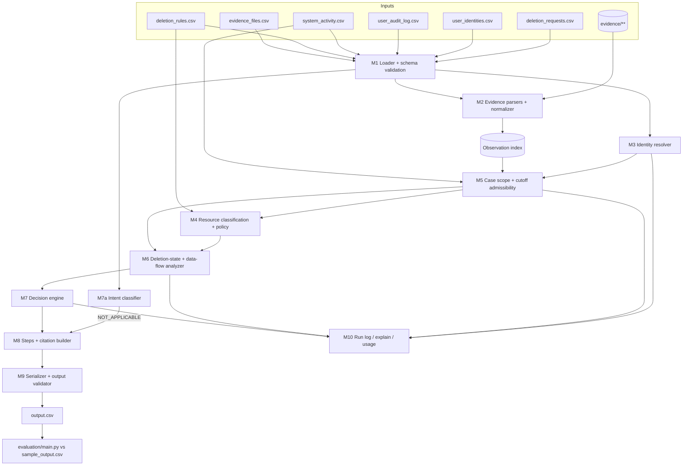

# Implementation Plan — Ghost Data Still Exists Deletion-Audit Agent

Status: **planning document, no code implemented**. Companion analysis: [`code/evaluation/sample_case_analysis.md`](../code/evaluation/sample_case_analysis.md).

Labels used throughout:

| Label | Meaning |
|---|---|
| **[REQ]** | Explicit requirement, quoted or paraphrased from a repository file (file named). |
| **[FACT]** | Verified by inspecting dataset/evidence files or by a script run during analysis. |
| **[PROPOSAL]** | Design decision made in this plan. |
| **[ASSUMPTION]** | Interpretation consistent with all evidence seen, but not stated by the challenge. |
| **[UNRESOLVED]** | Cannot be decided from participant-visible data; handled conservatively and flagged. |

---

## A. Challenge requirements

### A.1 Inputs [REQ: `problem_statement.md`, `AGENTS.md` §6.1–6.2, `README.md`]

| File | Rows [FACT] | Columns | Role |
|---|---|---|---|
| `dataset/deletion_requests.csv` | 518 | `case_id,email,requested_at,reported_status,reported_at,audit_at,request_text` | Cases to answer (`case_33`–`case_550`) |
| `dataset/sample_deletion_requests.csv` | 32 | same | Public samples (`case_01`–`case_32`) |
| `dataset/sample_output.csv` | 32 | `case_id,deletion_status,steps_json` | Reference answers — **evaluation only** |
| `dataset/user_identities.csv` | 850 | `user_id,name,email,phone,email_hash,updated_at` | Current identity snapshot |
| `dataset/user_audit_log.csv` | 306 | `audit_id,user_id,event_time,field_name,old_value,new_value` | Historical changes of `email`, `email_hash`, `phone` |
| `dataset/system_activity.csv` | 4,011 | `activity_id,event_time,event_type,source_system,target_system,resource_id,reported_result,details` | Global operational stream — **claims** |
| `dataset/deletion_rules.csv` | 15 | `rule_id,data_category,condition,required_action` | Policy |
| `dataset/evidence_files.csv` | 94 | `file_id,file_path,origin,captured_at` | Evidence manifest (no case membership) |
| `dataset/evidence/**` | 94 files | 24 `.sql`, 26 `.log`, 28 `.json`, 1 `.txt`, 4 `.pdf`, 11 `.png` | Evidence |
| `dataset/output.csv` | 0 | header only | Template |

`reported_status` ∈ {`COMPLETE`, `PARTIALLY_COMPLETE`, `NOT_STARTED`} and is a claim [REQ]. `audit_at` is the cutoff: "Use only information available at or before `audit_at`" [REQ: AGENTS §6.2].

### A.2 Output [REQ: `problem_statement.md` "Required Output", AGENTS §6.3]

- File `output.csv` at the **repository root**, header exactly `case_id,deletion_status,steps_json`, 518 data rows, one per `case_id`, sorted by `case_id`.
- `deletion_status` ∈ {`COMPLETE`, `INCOMPLETE`, `NOT_APPLICABLE`}.
- `steps_json`: valid JSON array; each object has **exactly** `step_no, phase, system_id, resource_id, operation, state, evidence_id`. Key order and whitespace are ignored; array order is significant.
- `NOT_APPLICABLE` ⇒ `[]`.
- `step_no` is consecutive from 1. Phase order is FINDING → REMEDIATION → VERIFICATION.
- Within a phase: "follow the operation order in the table above, followed by `system_id` and `resource_id` in ascending order" [REQ: problem_statement "Rules"].
- `COMPLETE`: only verification steps, each citing evidence proving the state at `audit_at`.
- `INCOMPLETE`: findings (cite evidence) + full remediation + post-remediation verification. Remediation and verification steps carry `evidence_id = ""`.
- An evidence reference may be a `file_id`, `activity_id`, or `audit_id` [REQ: README "Output"]. Never cite evidence captured after `audit_at` [REQ: AGENTS §6.6].

### A.3 Allowed enums [REQ: problem_statement "Allowed Operations"] — table order defines sort order

| idx | Phase | Operation | State |
|---|---|---|---|
| 0 | FINDING | REPORT_REMAINING_RECORD | PRESENT |
| 1 | FINDING | REPORT_EXPOSED_PII | PRESENT |
| 2 | FINDING | REPORT_ACTIVE_DATA_FLOW | ACTIVE |
| 3 | FINDING | REPORT_RESTORE_RISK | ACTIVE |
| 4 | REMEDIATION | DISABLE_DATA_FLOW | DISABLED |
| 5 | REMEDIATION | BLOCK_RESTORE | BLOCKED |
| 6 | REMEDIATION | DELETE_RECORD | ABSENT |
| 7 | REMEDIATION | REDACT_RECORD | REDACTED |
| 8 | REMEDIATION | ANONYMIZE_RECORD | ANONYMIZED |
| 9 | VERIFICATION | VERIFY_RECORD_ABSENT | ABSENT |
| 10 | VERIFICATION | VERIFY_RECORD_PRESENT | PRESENT |
| 11 | VERIFICATION | VERIFY_RECORD_REDACTED | REDACTED |
| 12 | VERIFICATION | VERIFY_RECORD_ANONYMIZED | ANONYMIZED |
| 13 | VERIFICATION | VERIFY_DATA_FLOW_DISABLED | DISABLED |
| 14 | VERIFICATION | VERIFY_RESTORE_BLOCKED | BLOCKED |

"Do not invent additional phases, operations, or states" [REQ: AGENTS §6.4].

### A.4 Decision requirements [REQ: AGENTS §6.5, problem_statement]

- Determine intent first. Access, correction, export, marketing opt-out and other non-deletion requests are `NOT_APPLICABLE`.
- Resolve current and historical identifiers. The request email may be either.
- Reconstruct state at `audit_at`. Never accept `reported_status` / `reported_result` as proof.
- `COMPLETE` only if:
  - every relevant copy has the required treatment;
  - required retained records remain;
  - retained records keep only permitted identifiers;
  - no active sync/import/restore path can recreate data.
- `ACCOUNT_TOMBSTONE`: keep the stable reference; remove name, email, phone, email hash.
- Remediation: disable flows and block restores before changing dependent records; process downstream copies before sources when a dependency requires it.

### A.5 Process, logging, packaging, evaluation requirements

| Requirement | Source |
|---|---|
| Append-only `log.txt` beside `AGENTS.md`. Entry per turn with `tool=` and `model=`. No secrets or PII. | AGENTS §2, §5 |
| Use only `dataset/` participant files. No organizer files, hardcoded labels, or case-family shortcuts. | AGENTS §4, §6.7 |
| Runnable from terminal, deterministic, secrets from env vars only, README with setup/run. | AGENTS §6.7 |
| `code.zip`: code, prompts, config, README, evaluation reports. No dataset, venvs, caches, nested archives, secrets. | AGENTS §6.9, README "Packaging" |
| `evaluation_report.md`: case-level status accuracy, step- and field-level accuracy, sequence accuracy, ≥3 custom cases, failures and improvements. | AGENTS §6.8, problem_statement |
| `usage_report.md`: providers/models, call counts, input/output tokens, total and average per request, total and per-request cost, per-model and overall totals. | AGENTS §6.8 |
| Agent trace ZIP (`agent-trace.zip`) of session files. | `agent_trace_instructions.md` |
| Code judge ignores `.csv/.json/.sql/.log`. Keep metrics and prompts in `.md` or source. | README "Evaluation" |

**[UNRESOLVED] Report location conflict.** AGENTS §6.8 says `evaluation/…` inside `code.zip`; README says `code/evaluation/…`, and its zip command (`README.md`, `code`) only bundles `code/`. **[PROPOSAL]** Place reports in `code/evaluation/` (README is more specific and matches its packaging command), so they appear in the zip as `code/evaluation/*.md`.

**[UNRESOLVED] README ownership.** The root `README.md` is the challenge README and the submission needs our setup/run README. **[PROPOSAL]** Before packaging, add a clearly marked "Solution: setup and run" section at the top of the root README (subject to user approval) instead of discarding challenge text.

---

## B. Proposed architecture

### B.1 Technology [PROPOSAL]

- **Python 3.13 standard library only for the core** [FACT: Python 3.13.9 and SQLite 3.50.4 available]: `csv`, `json`, `sqlite3`, `re`, `hashlib`, `datetime`, `dataclasses`, `unittest`.
- Rationale: determinism, no install step for the grader, and no new third-party supply-chain surface.
- **Media**: no PDF or image library is installed [FACT: `pypdf`, `fitz`, `PIL` not importable].
  - Option M1 (recommended, needs approval): `pypdf` (pure Python, BSD) for the 4 text-based PDFs.
  - Option M2: one-time vision-model extraction for the 11 PNGs (and PDFs, if M1 is declined). Output goes to a committed `.md`/`.py`-readable cache with provenance.
  - Either option is a dependency/provider decision for the user.
- **LLM use is minimal and optional**: (a) intent fallback for request texts not matched by deterministic rules; (b) media extraction. Both are cached and token-counted for `usage_report.md`. A run with zero LLM calls is valid and must be reported as such.

### B.2 Package layout [PROPOSAL]

```text
code/
  main.py                      # CLI entry: python code/main.py [--requests PATH] [--out PATH] [--cases ...] [--explain]
  audit/
    __init__.py
    config.py                  # paths, feature flags (see I.), enum tables
    models.py                  # dataclasses (B.4)
    loader.py                  # M1
    evidence/
      sql_parser.py            # M2a
      json_parser.py           # M2b
      log_parser.py            # M2c
      text_parser.py           # M2d
      media.py                 # M2e (cache reader + optional extractor)
      normalize.py             # identifier extraction, field canonicalisation
      index.py                 # Observation index
    identity.py                # M3
    policy.py                  # M4
    scope.py                   # M5 (case scoping + admissibility)
    state.py                   # M6
    intent.py                  # part of M7
    decision.py                # M7
    steps.py                   # M8
    serializer.py              # M9
    runlog.py                  # M10 (explain traces, usage counters)
  prompts/
    intent_classifier.md
    media_extraction.md
  evaluation/
    main.py                    # scorer against sample_output.csv (M10)
    custom_cases/              # synthetic fixtures (G.5)
    evaluation_report.md
    usage_report.md
    sample_case_analysis.md    # exists
  tests/
    test_*.py                  # unittest
docs/IMPLEMENTATION_PLAN.md
```

### B.3 Pipeline diagram



Data flow: the evidence index is built **once** for all cases. Everything after M3 runs per case and is pure: `(case, index, activities, identities, rules) → CaseResult`. M10 records an explain trace per case (links used, admissibility decisions, chosen citations), so every decision can be audited.

### B.4 Core data model [PROPOSAL]

```python
@dataclass(frozen=True)
class Observation:
    obs_id: str                 # f"{file_id}#{locator}"
    file_id: str                # evidence_NN
    file_captured_at: datetime  # from evidence_files.csv (validated against in-file header)
    observed_at: datetime | None  # inner time (observed_at/recorded_at/snapshot captured_at/log line ts); None if absent
    time_basis: str             # "inner" | "file"
    source_format: str          # sql|json|log|text|pdf|image
    locator: str                # table / collection path / trace_id / line no
    copy_location: str          # e.g. "account_service:customer_profiles:failover_replica"
    system_id: str | None       # explicit system/data_store/origin_system/service, else None
    resource_id: str            # primary resource the observation describes
    related_ids: tuple[str,...] # foreign keys (e.g. source_resource_id)
    record_type: str | None     # explicit record_type or None
    collection: str | None
    fields: dict                # canonical field -> value (email, phone, email_hash, customer_reference, enabled, restore_allowed, rows, status_code, result, ...)
    identifiers: frozenset      # {("email",v),("phone",v),("hash",v),("user",v)} incl. those found in free text
    presence: str               # PRESENT | ABSENT | UNKNOWN (what this observation says about existence)
    anomalies: tuple[str,...]   # e.g. "observed_after_capture"

@dataclass(frozen=True)
class Activity:      # one row of system_activity.csv — always a CLAIM
    activity_id: str; event_time: datetime; event_type: str; source_system: str
    target_system: str; resource_id: str; reported_result: str; details: str

@dataclass
class Subject:
    user_id: str; request_email_kind: str  # current|historical
    emails: dict[str, tuple[datetime|None, datetime|None]]  # value -> validity window
    phones: dict; hashes: dict

@dataclass
class ResourceAssessment:
    resource_id: str; system_id: str; category: str; category_basis: str
    required_action: str        # DELETE|REDACT|ANONYMIZE|RETAIN|TOMBSTONE_REDACT|DISABLE_FLOW|BLOCK_RESTORE
    link_strength: str          # GROUNDED|CATALOG|WORKFLOW (see C.5)
    state: str                  # PRESENT|ABSENT|EXPOSED|REDACTED|ANONYMIZED|ACTIVE|DISABLED|RESTORABLE|BLOCKED|UNOBSERVED
    state_obs: Observation | None   # admissible observation proving state
    compliant: bool | None
    claims: list[Activity]      # never used as proof
```

### B.5 Module contracts

| # | Module | Responsibility | Inputs | Outputs / interface |
|---|---|---|---|---|
| M1 | `loader.py` | Read CSVs (UTF-8), validate headers and enums, parse ISO-8601 `Z` timestamps to aware UTC, check uniqueness (`case_id`, `user_id`, `file_id`, `activity_id`), check every manifest path exists. | `dataset/` | `Dataset` object; raises `SchemaError` with file+row. |
| M2 | `evidence/*` | Parse every evidence file into `Observation`s; extract identifiers from structured fields **and** free text; record inner vs file time; flag anomalies. | manifest rows, files | `ObservationIndex` with lookups `by_resource`, `by_identifier`, `by_trace`, `by_file`; `scoped_snapshots` (C.8). |
| M3 | `identity.py` | Resolve the request email to a `user_id` (current or historical) and build the full identifier set with validity windows. | request, identities, audit log | `Subject` or `UnresolvedSubject`. |
| M4 | `policy.py` | Classify each resource into a `deletion_rules.csv` category and derive the required action and condition evaluation. | `Observation`s, activities, rules | `classify(resource) -> (category, basis, confidence)`; `required_action(category, context)`. |
| M5 | `scope.py` | Decide which resources belong to this case (links + episode boundary) and which observations are admissible for linking and for state proof. | subject, index, activities, request, other requests | `CaseScope{resources: {rid: LinkInfo}, excluded: {rid: reason}}`; `admissible_for_state(obs, audit_at)`, `admissible_for_link(obs, audit_at)`. |
| M6 | `state.py` | Per in-scope resource, determine state at `audit_at` from admissible observations (replica-aware, omission-aware) and whether it is compliant. | scope, index, policy | `list[ResourceAssessment]`. |
| M7 | `intent.py` + `decision.py` | Authorisation check; final status. | request text, assessments | `Decision{status, findings, remediation, verification}`. |
| M8 | `steps.py` | Build steps from the decision, choose citations, sort, number. | `Decision` | `list[Step]`. |
| M9 | `serializer.py` | Serialize to CSV/JSON deterministically; validate the whole file. | all case results | `output.csv`; `validate_output(path) -> list[Error]`. |
| M10 | `runlog.py`, `evaluation/main.py` | Explain traces, LLM usage counters, sample scoring, report generation. | results, `sample_output.csv` (eval only) | `run_explain.jsonl` (scratch, not packaged), metrics tables for `evaluation_report.md`, `usage_report.md`. |

---

## C. Evidence and identity resolution

### C.1 Format-specific parsing [FACT for formats; PROPOSAL for handling]

**SQL (24 files).** Execute each file in a fresh in-memory `sqlite3` connection (all files load cleanly [FACT]). Three observed shapes:

| Shape | Tables [FACT] | Handling |
|---|---|---|
| Inventory | `snapshot_scope(origin_system, captured_at)`, `customer_profiles`, `customer_search_documents`, `customer_analytics_profiles`, `support_records`, `customer_exports`, `connector_subscriptions`, `backup_restore_entries`, `security_audit_records` | One observation per row. `system_id` comes from the table → system map. `snapshot_scope` lists the systems the snapshot covers (needed for omission, C.8). |
| Topology replicas | `customer_data_primary`, `customer_data_read_replica`, `customer_data_replica_ap_south/eu_west`, `customer_data_reporting_replica`, `customer_data_failover_replica` with `(resource_id, origin_system, collection_name, record_json, updated_at)` | Parse `record_json` (a nested JSON string). One observation per (row, table). `copy_location` = table name. |
| Direct | `customer_profiles_primary`, `customer_profiles_failover_replica`, `search_documents_primary` | One observation per row; capture `source_resource_id` as `related_ids`. |

- SQL observation time = the file capture. The header `-- Captured at:` / `snapshot_completed_at` matches the manifest for all 24 files [FACT].
- Row `updated_at` is stored as a field, **not** as observation time.

**JSON (28 files).** A recursive walker emits an observation for every dict containing `resource_id` and inherits context keys from ancestors (`captured_at`, `data_store`, `collection`, service/collection keys such as `service_exports.account_service.profile_lookups`).

| Shape [FACT] | Inner time | Notes |
|---|---|---|
| `customer_data_snapshot_bundle_*` → `snapshots[].{captured_at,data_store,collection,records[]}` | snapshot `captured_at` | Collections include `operational_record_history` (with `recorded_at`, `lookup_value`), `support_conversations` (`message_text` with embedded emails), `ticket_attachments` (`uploaded_by`), `backup_catalog`, `retained_order_records`, `deleted_customer_references`. |
| `service_resource_export_*` → `service_exports.{svc}.{coll}[]` | `observed_at` | `status_code` 200/404; `hits.documents[]` nested results (each nested doc is its own observation). |
| manifest/ledger style (`connector_configurations_*`, `customer_export_manifest_*`, `security_audit_ledger_*`) → `records[]` | `recorded_at` | `{system, resource_id, record_type, result, subject_reference}`. **Filenames do not describe content** [FACT: `connector_configurations_20260812.json` contains profile lookups]. |
| `customer_analytics_report_*`, `customer_export_jobs_*` | file `captured_at` | — |

**Logs (26 files), four line formats [FACT]:**

1. `TS level=… service=… key=value …`
2. `TS {json}`
3. syslog `TS <pri>1 host service trace - - key="v" …`
4. cloud-runtime `TS requestId=… function=svc message="k=\"v\" …"`

Additionally, pipe-delimited lines appear in some logs and in the handover TXT.

- Parse every line into `(ts, service, trace_id, kv)`.
- **Group by `trace_id`** (`trace_id`, `requestId`, syslog trace column, `rb-…`, `tr-rp-…`). A trace yields one observation per `resource_id` that appears in a `*_completed` / state-bearing line. It inherits the `lookup_key` / `subject_key` / `subject_ref` / `match_key` / `scan_key` / `correlation_key` from the trace's `*_started` line as **trace-linked identifiers**.
- Observation time = the timestamp of the state-bearing line.
- Lines without `resource_id` and noise events (`connection_acquired`, `dependency_retry`, `cache_lookup`, `timer_tick`, `disk_latency`, …) are ignored.
- **Log level words carry no state** (an `ERROR` line can report `eligible=true`) [FACT].

**Text (`customer_account_handover_20261001.txt`).** Pipe-delimited rows `TS | system | resource_id | record_type | result | subject`.

**PDF (4) / PNG (11).** Media extraction (M1/M2 option) produces the same `Observation` structure with `source_format=pdf|image`. Observation time = the `captured …` / `issued …` timestamp in the document if present, otherwise the file capture.

- Observed content [FACT, inspected visually]:
  - support attachment with customer contact data (`support_001`)
  - customer statement (`user_18`)
  - disputed-orders register (rows with `user_NN`, no resource IDs)
  - compliance journal (`audit_record_003`)
  - consoles for accounts, analytics, connectors, exports, marketing, object storage, search, support, backup, security, deleted-account reference
- **[PROPOSAL]** Committed cache file `code/evaluation/media_extractions.md` (or `.py` data module), generated by `media.py --extract`, containing per-file structured facts and the extraction method. The pipeline reads only the cache at run time (deterministic). Manual transcription is **not** allowed.

### C.2 Preserved metadata [PROPOSAL]

Every `Observation` keeps:

- `file_id` and `file_captured_at`
- `observed_at` and `time_basis` (inner vs file)
- `locator` (table, JSON path, trace id, line number)
- `system_id` and the field it came from
- `resource_id`, `related_ids`
- the raw `record_type` / `collection`
- the canonical fields
- the identifier set, with provenance (`field:email`, `field:lookup_key`, `freetext:message_text`, `trace:started.lookup_key`)
- anomalies

Nothing is collapsed before M5/M6, so admissibility and citation decisions can be made later.

### C.3 Identifier normalisation [PROPOSAL]

| Kind | Normalisation | Match rule |
|---|---|---|
| email | strip, lowercase (evidence contains UPPERCASE variants [FACT]) | exact; word-boundary in free text: `(?<![\w.+-])email(?![\w-])` |
| email_hash | lowercase 64-hex | exact. `sha256(lower(email))` equals `email_hash` for 850/850 users [FACT], so the hash of every historical email can be computed even if not logged. |
| phone | keep `+` and digits only | exact on normalised digits |
| user_id | `user_\d+` | exact with word boundary (substring matching mis-maps `user_43`→`user_430` [FACT]) |
| name | **not used for matching** | names collide across decoys [FACT] |

### C.4 Subject resolution (M3) [PROPOSAL]

```text
resolve(request_email):
  e = norm_email(request_email)
  uid = identities.by_email.get(e)                         -> kind=current
  if not uid: uid = audit_log users whose old/new email == e -> kind=historical
  if not uid: return UnresolvedSubject(identifiers={email:e, hash:sha256(e)})
  ids = current {email, phone, email_hash, user_id}
      ∪ all old/new values from audit_log rows for uid (email, phone, email_hash)
      ∪ {sha256(email) for every email}
  record validity windows from audit_log event_time (for explain only; historical
  identifiers are searched at all times because old systems retain them)
```

- [FACT] All 518 request emails resolve: 418 current, 100 historical. All 32 samples resolve (3 historical: case_10, 29, 30).
- [FACT] One email appears in two evaluation cases (`case_33`, `case_52`) with different cutoffs; each case is evaluated independently.

### C.5 Linking resources to the subject [PROPOSAL]

Link evidence, strongest first. Each link records its supporting observation or activity ID.

| Strength | Mechanism | Example [FACT] |
|---|---|---|
| GROUNDED-direct | The observation for resource R itself contains a subject identifier in an identifying field (`email`, `requester_email`, `owner_email`, `customer_email`, `uploaded_by`, `subject_reference`, `customer_reference`, `user_id`, `lookup_value`, hash fields) or in its free text | `search_001` doc email (case_06); `support_1034.message_text` |
| GROUNDED-trace | Same `trace_id`: the started line keyed by a subject identifier, the completed line names R | case_03 `account_7566` via `rb-085737-009` |
| GROUNDED-fk | R is referenced by a foreign key from a grounded resource (`source_resource_id`) | `search_001.source_resource_id = account_006` |
| CATALOG | `LINK_RESOURCE_IDENTITY` activity names R with a subject identifier. **It is a claim:** used for scope, never as state proof. | `object_19`, `tombstone_17` |
| WORKFLOW (low) | See C.6. Only for resources with no grounded link to anyone. | case_21 `analytics_5335` |

**Negative evidence.** If R has a grounded link to a *different* subject at any admissible time, R is excluded from this case (`excluded[R] = "linked_to_other_subject"`). Look-alike identifiers (`.jr` suffixes, different digits) never match because matching is exact [FACT: case_28 decoy].

**Conflicting claims.** If a CATALOG link conflicts with a grounded observation, the grounded observation wins and the conflict is logged. [FACT] `marketing_001` is linked by activity to one user while the marketing console screenshot shows a different person's identifiers.

### C.6 Identifier-free resources [PROPOSAL + UNRESOLVED]

[FACT] Some required resources never co-occur with any identifier, only with a `deletion_worker` action. Examples: anonymized analytics in case_03/21/25–28 and handcrafted accounts in case_01/02/04/07/08/10. Readback-log adjacency gives the **wrong** answer (case_03) and must not be used.

**Workflow correlation** (explicitly labelled an inference, not an identity link):

```text
workflow_candidates(case):
  W = activities where source_system == "deletion_worker"
        and requested_at <= event_time <= reported_at + 3h
        and event_type in {DELETE_RECORD, REDACT_RECORD, ANONYMIZE_RECORD,
                           DISABLE_DATA_FLOW, BLOCK_RESTORE, CHECK_DATA_FLOW, CHECK_RESTORE_ACCESS}
  drop resources with any grounded link (to anyone)       # they are decided by C.5
  return W
global_assignment(all cases):
  for each candidate resource r: claimants = cases whose W contains r
  if len(claimants) == 1: assign WORKFLOW link to that case
  else: record AMBIGUOUS(r, claimants); assign to none        # conservative default
```

- Flag `workflow_link_mode` ∈ {`off`, `unique_only` (default), `offset_signature`}.
  - `offset_signature` additionally requires the action to match the characteristic offset from `reported_at` observed in samples (e.g. ANONYMIZE ≈ −29 min). It is evaluated on samples but **must be justified before being enabled** because it encodes generator timing rather than identity.
- Ambiguity is known to occur [FACT]: case_03 and evaluation case_44 share `reported_at` and both have an ANONYMIZE at −29 min, 15 s apart. Sample windows contain 1–46 foreign worker actions.
- Effect of omission: a COMPLETE case loses one verification step (status unchanged). An INCOMPLETE case cannot gain a finding from a WORKFLOW link anyway (C.7).

### C.7 Admissibility and cutoff [PROPOSAL]

Capture time and observation time are kept distinct:

```text
admissible_for_state(obs, audit_at):
  return obs.file_captured_at <= audit_at
     and (obs.observed_at or obs.file_captured_at) <= audit_at
     and "observed_after_capture" not in obs.anomalies or obs.observed_at <= audit_at

admissible_for_citation(obs, audit_at) = admissible_for_state(obs, audit_at)

admissible_for_link(obs, audit_at):          # identity/scope only, never state or citation
  if admissible_for_state(obs, audit_at): return True
  if LATE_INNER_LINKING and obs.file_captured_at > audit_at \
     and obs.observed_at is not None and obs.observed_at <= audit_at:
       return True        # e.g. evidence_06 lines 09-16 08:52 for audit 09-16 09:00
  return False
```

- **An event or inner timestamp is never turned into proof of state.** A late-captured file may at most establish *that a resource belongs to the subject* (flag `LATE_INNER_LINKING`, default to be decided after evaluation; see I).
- Post-cutoff evidence is excluded from state and citation unconditionally.
- **Anomaly** [FACT]: `evidence_13` (captured 08-12) holds a record `recorded_at` 08-14 saying `account_1417 FOUND`, after an earlier NOT_FOUND line in the same file. `evidence_36` has the same pattern. Such observations get `anomalies=("observed_after_capture",)` and are only admissible when their own `observed_at <= audit_at`.
- **Activities** are admissible as claims only if `event_time <= audit_at`. They never prove state.

### C.8 Absence by omission [PROPOSAL + UNRESOLVED]

A resource is **ABSENT-by-omission** in snapshot S when:

- (a) S is admissible for state;
- (b) S declares coverage of the resource's system/collection: inventory `snapshot_scope.origin_system`, a bundle snapshot with matching `data_store/collection`, or a direct table such as `customer_profiles_primary`;
- (c) the resource does not appear in that coverage;
- (d) no admissible positive observation of the resource is later than S.

**Replica-aware rule:** when S contains several copies (primary and replica tables), absence requires absence in **every** copy table in S. Presence in any copy means PRESENT [FACT: case_05 failover replica, case_16 read replica].

**[UNRESOLVED]** Which omission snapshot is cited (evidence_54 vs the later evidence_90 for case_04). Default: the latest qualifying snapshot. A variant that prefers snapshots with a populated table of the same collection is evaluated on samples.

---

## D. Policy engine (M4)

### D.1 Category classification [PROPOSAL; mapping evidence FACT]

Classification precedence. The first rule that yields a category wins, and its basis is recorded.

1. Explicit `record_type` [FACT values: USER_PROFILE, ANALYTICS_PROFILE, BACKUP_ARCHIVE, DATA_FLOW, SEARCH_INDEX_ENTRY, SECURITY_AUDIT_LOG, SUPPORT_MESSAGE, USER_EXPORT, LEGAL_HOLD_RECORD, SUPPORT_ATTACHMENT].
2. Collection/table semantics:

   | Collection/table | Category |
   |---|---|
   | `customer_profiles*` | USER_PROFILE |
   | `customer_search_documents`, `search_documents_primary` | SEARCH_INDEX_ENTRY |
   | `customer_analytics_*` with metrics/cohort fields | ANALYTICS_PROFILE |
   | `support_conversations`, `support_records`, `tickets` with message text/excerpt | SUPPORT_MESSAGE |
   | `ticket_attachments`, `attachment_pii_scan`, `storage_class=ticket_attachment`, customer-uploaded document | SUPPORT_ATTACHMENT |
   | `customer_exports`, `customer_export_jobs` | USER_EXPORT |
   | `connector_*` | DATA_FLOW |
   | `backup_*` | BACKUP_ARCHIVE |
   | `security_audit_*` | SECURITY_AUDIT_LOG |
   | `retained_order_records` | LEGAL_HOLD_RECORD |
   | `deleted_customer_references` | ACCOUNT_TOMBSTONE |

3. Content features. Example: a `contact_lookup` with `email_opt_in` keyed only by an identifier hash has no metrics, so it is **not** ANALYTICS_PROFILE. It is SECONDARY_IDENTIFIER (rule_02) or MARKETING_PROFILE (rule_10); both DELETE [FACT: case_12].
4. Workflow operation hint: the `deletion_worker` action type on the resource. It is a claim, used only as a tie-breaker. [FACT] It matches the expected remediation in all 32 samples.
5. Resource-ID prefix: last resort, low confidence, logged.

### D.2 Rule → action mapping [FACT: `deletion_rules.csv`]

| Rule | Category | Condition (as written) | Action | Finding if violated | Remediation | Final verification |
|---|---|---|---|---|---|---|
| rule_01 | USER_PROFILE | Always | DELETE | REMAINING_RECORD | DELETE_RECORD | VERIFY_RECORD_ABSENT |
| rule_02 | SECONDARY_IDENTIFIER | Always | DELETE | REMAINING_RECORD | DELETE_RECORD | VERIFY_RECORD_ABSENT |
| rule_03 | SEARCH_INDEX_ENTRY | Always | DELETE | REMAINING_RECORD | DELETE_RECORD | VERIFY_RECORD_ABSENT |
| rule_04 | CACHE_ENTRY | Always | DELETE | REMAINING_RECORD | DELETE_RECORD | VERIFY_RECORD_ABSENT |
| rule_05 | SUPPORT_MESSAGE | shared customer/agent/order context must be retained | REDACT | EXPOSED_PII | REDACT_RECORD | VERIFY_RECORD_REDACTED |
| rule_06 | SUPPORT_ATTACHMENT | belongs only to the deletion subject | DELETE | REMAINING_RECORD | DELETE_RECORD | VERIFY_RECORD_ABSENT |
| rule_07 | ANALYTICS_PROFILE | still attributable to a user | ANONYMIZE | EXPOSED_PII | ANONYMIZE_RECORD | VERIFY_RECORD_ANONYMIZED |
| rule_08 | PRODUCT_TELEMETRY | still attributable | ANONYMIZE | EXPOSED_PII | ANONYMIZE_RECORD | VERIFY_RECORD_ANONYMIZED |
| rule_09 | USER_EXPORT | Always | DELETE | REMAINING_RECORD | DELETE_RECORD | VERIFY_RECORD_ABSENT |
| rule_10 | MARKETING_PROFILE | Always | DELETE | REMAINING_RECORD | DELETE_RECORD | VERIFY_RECORD_ABSENT |
| rule_11 | EMAIL_DELIVERY_LOG | contains a user email | REDACT | EXPOSED_PII | REDACT_RECORD | VERIFY_RECORD_REDACTED |
| rule_12 | SECURITY_AUDIT_LOG | within retention period | RETAIN | — | — | VERIFY_RECORD_PRESENT |
| rule_13 | LEGAL_HOLD_RECORD | legal hold active | RETAIN | — | — | VERIFY_RECORD_PRESENT [ASSUMPTION] |
| rule_14 | BACKUP_ARCHIVE | restore access can be blocked | RETAIN + block restore | REPORT_RESTORE_RISK | BLOCK_RESTORE | VERIFY_RESTORE_BLOCKED |
| rule_15 | ACCOUNT_TOMBSTONE | account deleted; only stable user_id needed | REDACT | EXPOSED_PII | REDACT_RECORD | VERIFY_RECORD_REDACTED |
| (none) | DATA_FLOW (connector/sync/import) | — | disable | REPORT_ACTIVE_DATA_FLOW | DISABLE_DATA_FLOW | VERIFY_DATA_FLOW_DISABLED |

[FACT] The data-flow row has no rule in `deletion_rules.csv`; the treatment is taken from the operation table and sample answers (case_11, 15, 18, 20, 26–30).

### D.3 Category-specific evaluation [PROPOSAL; FACT where noted]

- **Support message vs attachment.** REDACT when the record is a conversation/ticket with shared context (`message_text`, `message_excerpt`, `message_pii_scan`). DELETE when it is an attachment/file belonging only to the subject (`ticket_attachments`, `attachment_pii_scan`, customer-uploaded PDF, `record_type=SUPPORT_ATTACHMENT`).
  - **[UNRESOLVED]** A support *replica/legacy-contact* copy (case_10, `support_replica.log`) was expected DELETE. Proposal: classify as SECONDARY_IDENTIFIER copy, using the workflow hint as tie-breaker.
  - Redacted state = all `requester_*` / name / email / phone null or `[REDACTED]`. A retained `customer_reference=user_NN` is acceptable [FACT: case_26–28].
- **Email delivery logs / cache / telemetry / marketing.** [FACT] No text-evidence observation exists for `email_delivery_*`, `cache_*`, `telemetry_*`. `marketing_001` and `object_19` appear only in screenshots and `LINK_RESOURCE_IDENTITY`. Handled by the same machinery. With no admissible observation they are UNOBSERVED (no finding, see E).
- **Analytics.** ANONYMIZED iff `user_id/customer_reference/email/phone/email_hash` are all null or the result is `ANONYMIZED`. EXPOSED if any is non-null or the result is `IDENTIFIABLE`.
- **Security audit records.** RETAIN while `retention_until > audit_at` [FACT: all observed are 2031+]. **[UNRESOLVED]** An expired record makes the rule_12 condition false and no rule applies; flag, emit no step.
- **Legal holds.** `legal_hold_*` with `subject_reference`, `retained_until` [FACT, 20 mentions]. RETAIN → VERIFY_RECORD_PRESENT [ASSUMPTION: no sample contains one]. Register PDF rows without a `resource_id` produce no step [FACT: case_08].
- **Backups.** `restore_allowed=1/true`, `eligible=true & deletion_block=false`, or handover result `ACTIVE` → RESTORABLE → REPORT_RESTORE_RISK. `restore_allowed=false/0` or `BLOCKED` → compliant. The archive itself is **never** deleted.
- **Data flows / sync / import.** `enabled=true`, `ACTIVE`, or `connector_heartbeat enabled=true` → ACTIVE. `enabled=false/stopped` or `DISABLED` → compliant.
  - [FACT] `SYNC_RECORD` / `RESTORE_BACKUP` activities are claims of past copying. They justify looking for the recreated copy; the finding comes from the copy's observed presence (case_05, case_10).
  - **[UNRESOLVED]** `RESTORE_BACKUP` (1 row: `backup_9287` repopulated `search_4882`). Proposal: if both resources are in scope and the backup is still restorable at cutoff → RESTORE_RISK + REMAINING for the repopulated record if observed present.
- **Tombstones.** REDACTED iff name/email/phone/email_hash are all null and the stable reference is kept [FACT: case_31/32].
- **Retained record missing.** **[UNRESOLVED]** No operation can express "a required retained record is absent". Proposal: do not emit an invented step; log it, and do not mark COMPLETE solely on other evidence without noting it in the explain trace.

### D.4 Remediation dependency order [REQ + FACT]

The operation-table order (DISABLE → BLOCK → DELETE → REDACT → ANONYMIZE) already satisfies "disable flows and block restores before changing dependent records". [FACT] Every sample's remediation follows the plain table order. The "downstream copies before source" rule is satisfied implicitly because primary and copy share one `resource_id`. **[UNRESOLVED]** No sample shows a cross-resource dependency that would override the table order; none will be implemented unless observed.

---

## E. Case decision algorithm

Terminology inside the algorithm:

- **observed fact**: an admissible `Observation`;
- **claim**: an `Activity` or `reported_status`;
- **proposed action**: remediation;
- **future check**: post-remediation verification.

```text
analyze(case, ctx):
  # 1. Authorisation
  intent = classify_intent(case.request_text)            # E.1
  if intent != DELETION: return Result(case.id, NOT_APPLICABLE, [])

  # 2. Identity
  subj = resolve(case.email)                             # C.4

  # 3. Episode boundary (earlier deletion episodes are out of scope) [FACT: case_17, case_07]
  prior = max(audit_at of other requests (sample+eval inputs) by the same user_id
              with audit_at < case.requested_at, default=-inf)
  episode_start = prior if EPISODE_MODE == "prior_request" else case.requested_at

  # 4. Scope
  links = {}
  for obs in index.by_identifier(subj.ids):
      if admissible_for_link(obs, case.audit_at) and observed_time(obs) > episode_start:
          links[obs.resource_id] += GROUNDED(obs)        # direct / trace
          for r in obs.related_ids: links[r] += GROUNDED_FK(obs)
  for a in activities(type=LINK_RESOURCE_IDENTITY, event_time<=audit_at, > episode_start):
      if a names a subject identifier: links[a.resource_id] += CATALOG(a)
  for r in ctx.workflow_assignment.get(case.id, []): links.setdefault(r, WORKFLOW)
  drop r where linked_to_other_subject(r)                # C.5 negative evidence
  scope = links

  # 5. Per-resource state at audit_at
  assessments = []
  for r in scope:
      cat, basis = classify(r)                           # D.1
      action = required_action(cat, r)                   # D.2 (+ condition checks)
      obs_state = [o for o in index.by_resource(r) if admissible_for_state(o, case.audit_at)]
      state, proof = derive_state(r, cat, obs_state)     # latest per copy_location; omission rule C.8
      claims = [a for a in activities(resource=r) if a.event_time <= case.audit_at]
      assessments.append(Assessment(r, cat, action, state, proof, claims, links[r].strength))

  # 6. Violations (findings require an observed fact; claims never create or cancel a finding)
  findings = []
  for a in assessments:
      if a.state == UNOBSERVED: continue                 # no proof either way -> no finding
      if a.action in {DELETE} and a.state == PRESENT:              findings += (REMAINING_RECORD, a)
      if a.action in {REDACT, ANONYMIZE, TOMBSTONE_REDACT} and a.state == EXPOSED:
                                                                    findings += (EXPOSED_PII, a)
      if a.action == DISABLE_FLOW and a.state == ACTIVE:           findings += (ACTIVE_DATA_FLOW, a)
      if a.action == BLOCK_RESTORE and a.state == RESTORABLE:      findings += (RESTORE_RISK, a)
      # WORKFLOW-linked resources may only contribute verification, never findings
      if a.link_strength == WORKFLOW: drop its finding, log("unsupported identity for finding")

  # 7. Status
  if findings:
      status = INCOMPLETE
      remediation  = [remediation_for(f) for f in findings]                  # proposed actions, evidence ""
      verification = [final_check(a) for a in assessments if in_verification_set(a)]   # future checks, evidence ""
  else:
      status = COMPLETE
      verification = [final_check(a, cite=a.proof) for a in assessments
                      if in_verification_set(a) and a.proof is not None]     # observed facts, cited
  return Result(case.id, status, build_steps(findings, remediation, verification))   # F
```

`in_verification_set(a)` [FACT-derived, H]:

- the primary account (exactly one: the USER_PROFILE resource of the subject's account service; C.6 fallback if only workflow-linked);
- every SECURITY_AUDIT_LOG / LEGAL_HOLD_RECORD in scope;
- every resource with a finding;
- every other in-scope resource with a determinable required final state.

Samples confirm: exactly one account ABSENT in every case; audit PRESENT iff an audit record for the subject exists.

`derive_state` per category:

- **Profiles / search / exports / attachments / secondary**: PRESENT if any copy's latest admissible observation shows existence (`rows>=1`, `status_code 200`, `hit`, `FOUND`, row present, `marker_found=false` with a later write); ABSENT if the latest says not found (`rows=0`, `404`, `NOT_FOUND`, `miss`) or omission (C.8).
- **Messages / tombstones**: EXPOSED vs REDACTED by identifier fields.
- **Analytics**: EXPOSED vs ANONYMIZED.
- **Flows**: ACTIVE vs DISABLED.
- **Backups**: RESTORABLE vs BLOCKED.
- **Retained records**: PRESENT vs ABSENT.

The latest observation is chosen by `observed_at` (inner, else file), tie-broken by `file_captured_at`, then `file_id`.

### E.1 Intent classification [PROPOSAL; inputs FACT]

[FACT] The 508 deletion-style evaluation texts use 17 opening sentences (12 English, 5 in pt/es/fr/ja/ko) plus 40 boilerplate follow-ups. 10 texts (`case_533`–`case_542`) are non-deletion and each states so explicitly. No public sample is NOT_APPLICABLE.

```text
classify_intent(text):
  s = normalize(text)
  neg = any(p.search(s) for p in NON_DELETION_PATTERNS)   # "not asking for deletion", "don't delete",
        # "do not close", "leave the account active", "keep the account", "continue using",
        # "not a request to erase", "without removing", "... only", "copy of", "download",
        # "what personal information", "correct", "change the email", "stop the promotional"
  pos = any(p.search(s) for p in DELETION_PATTERNS)        # delete/erase/remove|close account,
        # exclusão, eliminación/eliminar, suppression, 削除, 삭제 ...
  if pos and not neg: return DELETION
  if neg: return NON_DELETION
  return llm_fallback(text) if LLM_ENABLED else NON_DELETION_UNSURE  # cached; logged; counted
```

- Patterns are generic language patterns, not case IDs.
- `CLASSIFY_REQUEST` activities are claims. They are used only as an evaluation cross-check, never as input to the decision.

---

## F. Output generation (M8, M9)

### F.1 Step construction

```text
OP_INDEX = table A.3 order
STATE = {op: state} from A.3; PHASE = {op: phase}
steps = findings + remediation + verification          # as (op, system_id, resource_id, evidence_id)
dedupe on (op, system_id, resource_id)                  # e.g. account in both finding-verify and base set
steps.sort(key=lambda s: (OP_INDEX[s.op], s.system_id, s.resource_id))
for i, s in enumerate(steps, 1): s.step_no = i; s.phase = PHASE[s.op]; s.state = STATE[s.op]
```

- `system_id` = the canonical owning system of the resource (`account_service`, `search_service`, `analytics_platform`, `support_platform`, `export_service`, `integration_service`, `backup_service`, `security_service`, `identity_service`, … [FACT: values in samples]).
- [FACT] Samples use the owning system even when the observation came from a replica or a `records_assurance` bundle.
- The table/collection → system map is defined in `config.py`. `object_store` vs `export_service` naming is **[UNRESOLVED]** for exports observed via object storage; the samples use `export_service`.
- Sorting is plain Python string comparison (ASCII) on `system_id`, then `resource_id`. [FACT] Lexicographic, e.g. `account_service` < `analytics_platform`.

### F.2 Citation rules

| Step kind | `evidence_id` |
|---|---|
| FINDING | `file_id` of the latest admissible-for-citation observation proving the violating state (latest by `file_captured_at`, then `observed_at`, then `file_id`) [FACT: 70/75 sample citations follow "latest pre-cutoff file mentioning the resource"] |
| VERIFICATION in COMPLETE | `file_id` of the latest admissible observation proving the compliant state; for omission, the qualifying snapshot (C.8) |
| REMEDIATION, VERIFICATION in INCOMPLETE | `""` |

- `activity_id` / `audit_id` are valid citation types [REQ] but are claims or identity history. **[PROPOSAL]** Never cite them as proof of state. No sample cites them.
- If a COMPLETE-case resource has no citable proof, it is omitted from the steps and logged; no uncited verification is emitted.

### F.3 Serialization

- `json.dumps(steps, ensure_ascii=False, separators=(",", ":"))` with fixed key order `step_no, phase, system_id, resource_id, operation, state, evidence_id`. `step_no` is an int; all others are strings.
- `csv.writer(f, quoting=csv.QUOTE_MINIMAL, lineterminator="\n")`, UTF-8 without BOM. The JSON's embedded quotes are doubled by the csv module.
- `NOT_APPLICABLE` → literal `[]`.
- Rows sorted by natural numeric case order, i.e. `int(case_id.split("_")[1])`. **[UNRESOLVED]** "sorted by `case_id`" may mean lexicographic. Natural order matches `deletion_requests.csv` and `sample_output.csv` [FACT: both are listed numerically]. The validator reports both orders, and the decision is documented in the README.
- Failure isolation: an exception in one case is caught; that case gets a conservative row (`NOT_APPLICABLE` only if intent is non-deletion, otherwise `INCOMPLETE` cannot be produced without findings), and the error is logged. The run **fails loudly** (non-zero exit) if any case errored, so a partial file is never silently submitted.

### F.4 Output validator (`validate_output`)

Checks:

- header exact; 518 rows; IDs = set of input IDs; no duplicates; sort order;
- each `steps_json` parses and is a list; each object has exactly the 7 keys;
- enums valid; `state`/`phase` consistent with `operation`; `step_no` consecutive; phase order and within-phase sort;
- `NOT_APPLICABLE` ⇔ `[]`;
- COMPLETE ⇒ only VERIFICATION with non-empty evidence;
- INCOMPLETE ⇒ ≥1 FINDING; FINDINGs cite evidence; others empty;
- every cited ID exists in the manifest and has `captured_at <= audit_at` of that case;
- finding set == remediation set; each remediated resource has the matching verification.

---

## G. Testing and evaluation

### G.1 Unit tests (`code/tests`, stdlib `unittest`) [PROPOSAL]

| Module | Tests |
|---|---|
| M1 loader | header mismatch raises; timestamp parse (Z); duplicate IDs; missing evidence path |
| M2 parsers | one fixture per format (4 log formats, nested `record_json`, `hits.documents`, `snapshots[]`, pipe TXT); trace grouping; free-text email extraction; UPPERCASE email; anomaly flag for observed-after-capture |
| M3 identity | current match; historical match; hash computed for historical email; phone normalisation; `user_43` ≠ `user_430` |
| M4 policy | each rule row → action; precedence order; contact-lookup → DELETE category; support message vs attachment |
| M5 scope | grounded/trace/fk/catalog links; other-subject exclusion; episode boundary; workflow `unique_only` ambiguity → none |
| C.7 admissibility | `captured_at == audit_at` admissible; `+1s` not; late file with early inner time → link only; observed-after-capture record excluded at earlier cutoff |
| M6 state | replica-present ⇒ PRESENT; omission requires scope; latest observation wins; FAILED claim + 404 ⇒ ABSENT |
| M7 decision | no finding ⇒ COMPLETE; finding ⇒ INCOMPLETE; non-deletion ⇒ NOT_APPLICABLE; WORKFLOW link cannot create a finding |
| M8 steps | sort order; dedupe; step numbering; citation choice (latest pre-cutoff) |
| M9 serializer/validator | round-trip CSV with quotes; every validator rule has a failing fixture |
| E.1 intent | all 17 deletion openers + 5 languages; all 10 negated/non-deletion forms; "marketing lists only" ≠ deletion |

### G.2 Integration tests

- Full pipeline on a miniature synthetic dataset (G.5) → exact expected CSV.
- Full real run: 518 rows, validator clean, deterministic (two runs → byte-identical `output.csv`; hash compared).

### G.3 Regression on the 32 public samples (`code/evaluation/main.py`)

Run the pipeline on `sample_deletion_requests.csv` and score against `sample_output.csv`:

| Metric | Definition |
|---|---|
| Case status accuracy | `deletion_status` equal |
| Step-level P/R/F1 | multiset match on `(phase, system_id, resource_id, operation, state, evidence_id)` |
| Field-level accuracy | per field over aligned steps (aligned by `(operation, resource_id)`) |
| Sequence accuracy | exact ordered-list equality per case; also normalised LCS ratio |
| Citation accuracy | evidence_id equality on aligned cited steps |

Each failure is reported with the explain trace and categorised by U-item.

**Anti-leakage rules [PROPOSAL]:**

1. Production code under `code/audit/` must not open `sample_output.csv`; a unit test greps for it.
2. No literal `case_\d+` or specific `resource_id` / `evidence_\d+` constants in production code; a test greps for them.
3. Feature flags are chosen by sample metrics **and** a written justification. A flag that only helps a single case is rejected.
4. Report sample metrics as public-sample metrics only. Never extrapolate a hidden-test score.

### G.4 Edge-case test list

1. Request email historical only (case_10/29/30 style).
2. Identifier only as an old email hash (case_12 style).
3. Two users with similar emails / `.jr` suffix decoy.
4. Evidence captured exactly at `audit_at` (case_09: 08:37 ≤ 09:00; evidence_51 at 12:00 = audit 12:00).
5. File captured after cutoff with inner times before cutoff (evidence_02/06).
6. Observation dated after its file capture (evidence_13/36).
7. FAILED delete claim + 404 evidence → ABSENT (case_25).
8. SUCCESS claim + replica copy or later write → PRESENT (case_05, case_10, case_24).
9. Retained audit record present; legal hold present.
10. Backup restorable via `eligible=true` in an ERROR-level line.
11. Connector enabled only visible in a screenshot (older) vs log (newer).
12. Identifier-free analytics with a unique vs shared workflow window.
13. Same subject with two requests at different cutoffs (`case_33` / `case_52`; earlier-episode exclusion).
14. Non-deletion with deletion words in negation.
15. Subject with no observations at all.

### G.5 Custom evaluation cases (≥3 required) [PROPOSAL]

Synthetic fixtures (fictional data, stored as Python builders, described in `evaluation_report.md`):

- **CC1** historical-email-only remaining search record → INCOMPLETE.
- **CC2** failed-claim + 404 + anonymized analytics with a citation at exactly `audit_at` → COMPLETE.
- **CC3** late-captured file with an early inner observation showing a record present → must **not** create a finding.
- **CC4** "remove me from marketing lists only" → NOT_APPLICABLE.
- **CC5** replica-only copy → REMAINING_RECORD.

---

## H. Implementation roadmap

Each stage is independently testable. **Start with M1 + M2 (loader and evidence normaliser)**: every later module consumes `Observation`s, the formats are fully known, and the cutoff/anomaly facts discovered above can be locked in tests before any decision logic exists.

| Stage | Deliverable | Depends on | Acceptance criteria |
|---|---|---|---|
| 0 | Skeleton package, `config.py` enums, `unittest` runner | — | `python -m unittest` runs; validator enums equal A.3 |
| 1 | M1 loader + schema validation | 0 | All 9 CSVs load; counts equal A.1; 94 manifest paths exist |
| 2 | M2 SQL + JSON parsers | 1 | All 24 SQL + 28 JSON parse; nested `record_json`/`hits` produce observations; anomaly flag set on evidence_13/36 records |
| 3 | M2 log + TXT parsers, trace grouping, identifier extraction | 2 | 4 log formats parsed; each `*_completed` resource line inherits its started-line key; free-text emails found |
| 4 | M9 serializer + validator (early, so every later stage can emit valid files) | 0 | Validator rejects every crafted bad fixture; accepts `sample_output.csv` |
| 5 | M3 identity | 1 | 518/518 and 32/32 emails resolve; historical sets complete |
| 6 | M5 scope + admissibility (no workflow links yet) | 3, 5 | On samples, grounded scope recall reported per case; no excluded-episode resources (case_07, case_17) |
| 7 | M4 policy + M6 state | 6 | State of every sample expected resource that has admissible evidence matches the sample decision |
| 8 | M7 decision + M8 steps + E.1 intent (deterministic) | 7, 4 | Sample evaluator runs; metrics recorded as baseline in `evaluation_report.md` |
| 9 | Evaluator metrics + explain traces | 8 | All G.3 metrics reported; every failure categorised |
| 10 | Workflow-link modes, omission citation variants, `LATE_INNER_LINKING` flag experiments | 9 | Each flag decision justified in the report with before/after metrics, not per-case |
| 11 | Media extraction (after dependency/provider approval) | 3 | Cache produced by script; media observations indexed; affected cases re-evaluated |
| 12 | Custom cases CC1–CC5, edge-case tests | 8 | All pass |
| 13 | Full 518 run, determinism check, `usage_report.md`, README run section | all | Validator clean; byte-identical rerun; usage figures from actual counters |
| 14 | Packaging + trace export | 13 | Zip contents checked against A.5; no dataset/secrets/nested archives |

---

## I. Risks, assumptions and unresolved questions

| # | Issue | Evidence / requirement | Risk | Conservative handling | Validate / resolve |
|---|---|---|---|---|---|
| R1 | Identifier-free resources linked only by workflow timing | case_03/21/25–28 analytics; case_01/02/04/07/08/10 accounts; AGENTS §6.6 grounded links | Missing or wrong-person verification steps | `unique_only` assignment; WORKFLOW links never create findings; log ambiguity | Sample metrics per mode; document justification |
| R2 | Two cases share a workflow window (`reported_at` identical) | case_03 vs eval case_44 | Wrong attribution | Assign to none | None possible from public data |
| R3 | Late-captured file with earlier inner timestamps | evidence_02 (09-17, inner 09-15), evidence_06 (09-18, lines 09-16); 6 sample resources depend on it | Using post-cutoff info; or missing scope | Never for state/citation; link-only under flag `LATE_INNER_LINKING` | Compare flag on/off on samples; confirm interpretation with user |
| R4 | Observation dated after its own file capture | evidence_13 (`account_1417` FOUND 08-14 in an 08-12 file), evidence_36 | False finding before the event happened | Admissible only if `observed_at <= audit_at`; anomaly logged | Unit test |
| R5 | Absence by omission: which snapshot qualifies and is cited | case_01/02/04 cite evidence_54; case_04 could cite evidence_90; case_31 evidence_51 | Wrong citation; false ABSENT if coverage is misread | Require declared coverage; replica-aware; latest qualifying snapshot | Variant comparison on samples |
| R6 | Expected resources absent from every participant file | `audit_record_6645` (case_18), `audit_record_5569` (case_20) | Unavoidable step misses | None; report as known gap | — |
| R7 | Support category ambiguity (REDACT vs DELETE) without `record_type` | case_10 replica copy, case_07 PDF, case_19 message scan | Wrong action / finding op | Precedence D.1; workflow hint as tie-breaker | Per-category confusion matrix on samples |
| R8 | Analytics-system record that is not an analytics profile | case_12 `contact_lookup` | ANONYMIZE instead of DELETE | Content-based classification | Unit test + sample |
| R9 | Episode scoping (earlier requests by the same person) | case_17 (`account_6523`, `tombstone_17`), case_07 (`object_19`); prior eval cases case_46, case_61 | Extra out-of-scope steps, or missing old-but-relevant records | `prior_request` boundary; `requested_at` variant evaluated | Sample metrics; inspect eval subjects with multiple requests |
| R10 | Verification set membership beyond account/audit/findings | Samples never show an already-compliant extra resource in an INCOMPLETE case | Extra or missing verification steps | Include all in-scope resources with a determinable final state | Sample metrics |
| R11 | Account linkage when no identifier links it | case_01/02/04/07/08/10 | Missing mandatory account verification | Grounded first; WORKFLOW fallback only for `account_service` DELETE actions, unique | Sample metrics |
| R12 | Non-deletion detection with no labelled examples | case_533–542 inputs; no NOT_APPLICABLE in samples | 10 cases wrong | Explicit negation patterns; LLM fallback only for unmatched; manual read-through of the 10 inputs | Custom case CC4; report cross-check against `CLASSIFY_REQUEST` claims |
| R13 | Conflicting catalog claim vs observed identity | `marketing_001` LINK activity vs console screenshot | Wrong subject | Grounded observation wins | Explain log |
| R14 | Retained record missing has no output operation | rules 12/13; A.3 enum | Cannot express the violation | No invented step; log; flag | Clarify with user |
| R15 | Expired retention or inactive legal hold | rule_12/13 conditions | Wrong RETAIN | Evaluate the condition; if false, no step and logged | None observed so far |
| R16 | Media extraction requires a dependency or LLM | 4 PDFs, 11 PNGs; no libs installed | Missed links (e.g. `support_001` only in PDF) | Cached, scripted extraction after approval; pipeline still runs without it | Re-run samples with/without media |
| R17 | Report path and README ownership conflict | AGENTS §6.8 vs README | Packaging rejection | `code/evaluation/`; README section added | Confirm with user |
| R18 | `case_id` sort semantics (natural vs lexicographic) | AGENTS §6.3 "Sort rows by case_id" | Ordering penalty | Natural order (matches input files) | Confirm; validator reports both |
| R19 | `system_id` naming for exports/object storage, replicas | samples use owning system | Field mismatch | Canonical owning-system map | Sample field accuracy |
| R20 | `RESTORE_BACKUP` recreation event | activity (1 row) | Missed restore risk | D.3 proposal | Inspect affected eval case once pipeline runs |

---

## J. Final readiness checklist

Before generating the final `output.csv`:

- [ ] `python -m unittest` passes (all modules, edge cases, anti-leakage greps).
- [ ] Sample evaluator run completed; metrics and failure analysis written to `code/evaluation/evaluation_report.md` from the actual run (no estimated numbers).
- [ ] Custom cases CC1–CC5 pass and are documented in the report.
- [ ] Every enabled feature flag has a written justification (not per-case).
- [ ] Production code has no reads of `sample_output.csv` and no case-ID/resource-ID/evidence-ID literals.
- [ ] Media extraction (if enabled) is generated by script, cached, and its provenance documented.
- [ ] Full run on 518 cases: validator reports 0 errors; 518 rows; IDs match input; sorted; JSON valid; enums valid; citations exist and are `≤ audit_at`.
- [ ] Two consecutive runs produce byte-identical `output.csv`.
- [ ] `usage_report.md` filled from the run's actual counters (including "0 LLM calls" if applicable), with providers, models, calls, tokens, averages and costs.
- [ ] Root README has exact setup and run commands; no secrets; `.env` (if any) is uncommitted.

Before packaging:

- [ ] `code.zip` contains `README.md`, `code/` (including `code/evaluation/evaluation_report.md` and `usage_report.md`, plus prompts). It contains no `dataset/`, `__pycache__`, venvs, nested archives, credentials or real PII.
- [ ] Root `output.csv` is final.
- [ ] `log.txt` entries are valid (each has `tool=` and `model=`) and are uploaded as `chat_transcript`.
- [ ] `agent-trace.zip` prepared per `agent_trace_instructions.md`, reviewed for secrets.
- [ ] Untracked directories unrelated to the solution are not included in any archive.
