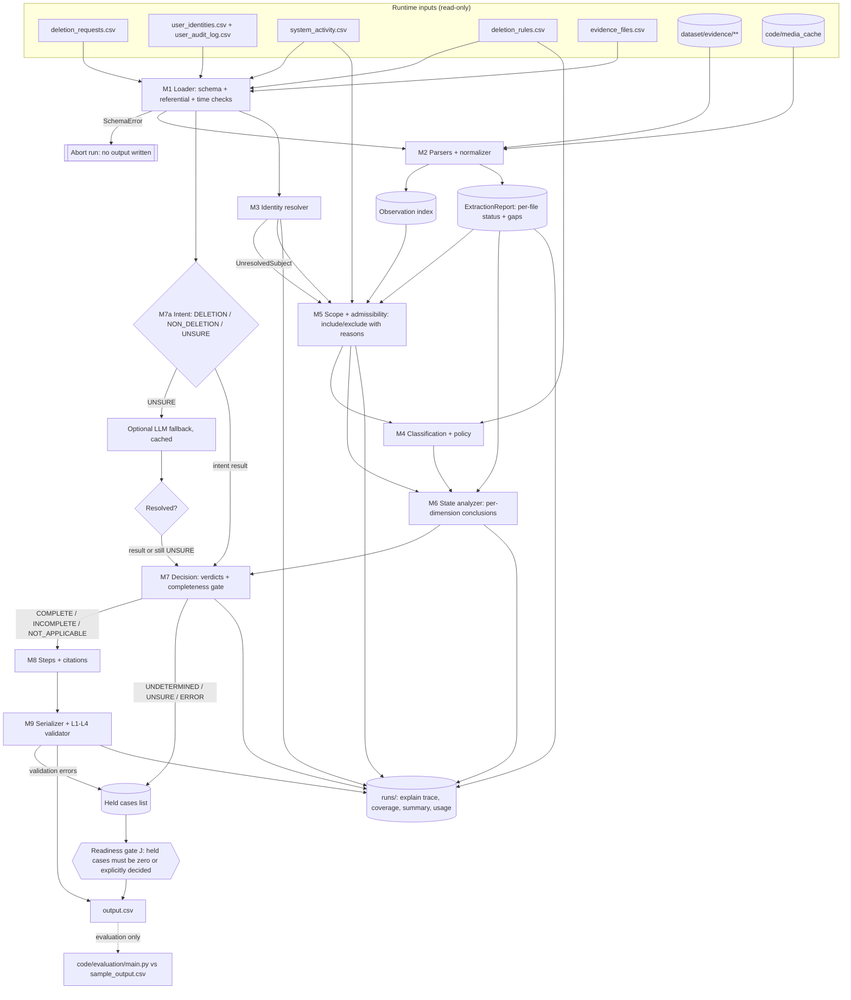

# Implementation Plan — Ghost Data Still Exists Deletion-Audit Agent

Status: **planning document, no code implemented**. Companion analysis: [`code/evaluation/sample_case_analysis.md`](../code/evaluation/sample_case_analysis.md).

Labels used throughout:

| Label | Meaning |
|---|---|
| **[REQ]** | Explicit requirement, quoted or paraphrased from a repository file (file named). |
| **[FACT]** | Verified by inspecting dataset/evidence files or by a script run during analysis. |
| **[PROPOSAL]** | Design decision made in this plan. |
| **[ASSUMPTION]** | Interpretation consistent with all evidence seen, but not stated by the challenge. |
| **[UNRESOLVED]** | Cannot be decided from participant-visible data; handled conservatively and flagged. |

---

## A. Challenge requirements

This section has two kinds of content:

- **Explicit requirements** (A.1–A.3, A.7), each tied to the repository file that states it.
- **Correctness contracts** (A.4–A.6) derived from those requirements. These contracts bind every later section.

A.8 lists decisions and items that are still open. A.9 lists the places in Sections B–J that must be brought in line with this section.

### A.1 Inputs and input contract

#### A.1.1 Input files [REQ: `problem_statement.md` "Files Provided", `AGENTS.md` §6.1–6.2; counts FACT]

| File | Rows | Columns | Role |
|---|---|---|---|
| `dataset/deletion_requests.csv` | 518 | `case_id,email,requested_at,reported_status,reported_at,audit_at,request_text` | Cases to answer (`case_33`–`case_550`, contiguous) |
| `dataset/sample_deletion_requests.csv` | 32 | same | Public sample inputs (`case_01`–`case_32`) |
| `dataset/sample_output.csv` | 32 | `case_id,deletion_status,steps_json` | Reference answers. **Evaluation only** (A.1.2). |
| `dataset/user_identities.csv` | 850 | `user_id,name,email,phone,email_hash,updated_at` | Current identity snapshot |
| `dataset/user_audit_log.csv` | 306 | `audit_id,user_id,event_time,field_name,old_value,new_value` | Historical identity changes |
| `dataset/system_activity.csv` | 4,011 | `activity_id,event_time,event_type,source_system,target_system,resource_id,reported_result,details` | Global operational stream. Every row is a **claim**. |
| `dataset/deletion_rules.csv` | 15 | `rule_id,data_category,condition,required_action` | Policy |
| `dataset/evidence_files.csv` | 94 | `file_id,file_path,origin,captured_at` | Evidence manifest |
| `dataset/evidence/**` | 94 files | 24 `.sql`, 26 `.log`, 28 `.json`, 1 `.txt`, 4 `.pdf`, 11 `.png` | Evidence |
| `dataset/output.csv` | 0 | header only | Template |

`reported_status` ∈ {`COMPLETE`, `PARTIALLY_COMPLETE`, `NOT_STARTED`}. It is "a claim from the existing deletion workflow, not proof of the true state" [REQ: problem_statement "Input"]. `audit_at` is the cutoff: "Use only information available at or before `audit_at`" [REQ: AGENTS §6.2].

#### A.1.2 Reference answers never reach production logic [REQ: AGENTS §4.3, §6.7 — no hardcoded labels or shortcuts] (fixes A1.1)

- Only `code/evaluation/` may open `dataset/sample_output.csv`. Production code under `code/audit/` and `code/main.py` must not reference that path, the string `sample_output`, or any value copied from it.
- The production pipeline treats `sample_deletion_requests.csv` exactly like `deletion_requests.csv`, i.e. as unlabeled input.
- **Enforcement (test):** `test_no_reference_leak` scans every production source file and fails if:
  - `sample_output` appears in it, or
  - a `case_\d+` literal appears in it, or
  - an `evidence_\d+` / `activity_\d+` / `audit_\d+` literal appears in it, or
  - a concrete resource-ID literal matching `\b[a-z_]+_\d+\b` appears outside an allow-list of format examples in docstrings.

  A second test runs the pipeline with `sample_output.csv` made unreadable (path redirected in the test) and asserts identical output.

#### A.1.3 The manifest does not establish case ownership [REQ: AGENTS §6.1, §6.6 — "The manifest does not identify which case or user a file concerns"] (fixes A1.2)

- `evidence_files.csv` supplies only `file_id → path, origin, captured_at`.
- File names and `origin` values are **not** evidence of content or ownership [FACT: `connector_configurations_20260812.json` contains account-profile lookups].
- Case scope is established only through:
  - evidence-based identity linking (Section C.5), and
  - cutoff admissibility rules (Section C.7).

#### A.1.4 Input validation before processing (fixes A1.3)

Row counts alone are insufficient. The loader (M1) must pass **all** checks below before any case is processed. Any failure aborts the run with file, row and column in the message.

| Check | Applies to | Rule |
|---|---|---|
| Header | every CSV | Exact column list and order as in A.1.1 |
| Encoding | every CSV | UTF-8 decodes; no NUL bytes |
| Timestamp format | all `*_at`, `event_time`, `updated_at`, `captured_at` | Strict `^\d{4}-\d{2}-\d{2}T\d{2}:\d{2}:\d{2}Z$`, parsed to aware UTC. [FACT: 0 violations in current data] |
| Request time order | request files | `requested_at ≤ reported_at ≤ audit_at` [FACT: 0 violations] |
| Unique keys | `case_id` (per file), `user_id`, `user_identities.email` (case-insensitive), `audit_id`, `activity_id`, `rule_id`, `file_id`, `file_path` | No duplicates [FACT: all unique] |
| Case-ID set | `deletion_requests.csv` | 518 IDs; format `case_\d+` |
| Enums | `reported_status` | {COMPLETE, PARTIALLY_COMPLETE, NOT_STARTED} |
| | `field_name` | {email, email_hash, phone} |
| | `reported_result` | {SUCCESS, FAILED, PARTIAL} |
| | `required_action` | {DELETE, REDACT, ANONYMIZE, RETAIN} [FACT: observed sets] |
| | `event_type` | Known set; unknown values are logged and treated as uninterpreted claims |
| Identifier formats | identities, audit log | `email_hash` is 64 lowercase hex. `sha256(lower(email)) == email_hash` for every identity row [FACT: 850/850]; a mismatch is a warning, not an abort. |
| Referential | audit log | Every `user_id` exists in `user_identities.csv` |
| Manifest paths | `evidence_files.csv` | Path is relative, resolves inside `dataset/evidence/`, exists, and is a regular file. Every file on disk under `evidence/` is listed in the manifest. [FACT: both hold] |
| Evidence capture header | `.sql` files | The in-file `Captured at` / `snapshot_completed_at` equals the manifest `captured_at`. A mismatch is a warning; the manifest value is used. [FACT: 24/24 match] |
| Rules table | `deletion_rules.csv` | Every `data_category` maps to an entry in the canonical policy table (A.3.2); unknown categories abort |

### A.2 Output contract [REQ: `problem_statement.md` "Required Output", AGENTS §6.3, README "Output"]

- File `output.csv` at the **repository root**. Header exactly `case_id,deletion_status,steps_json`. 518 data rows, one per input `case_id`, no extras.
- `deletion_status` ∈ {`COMPLETE`, `INCOMPLETE`, `NOT_APPLICABLE`}.
- `steps_json` is a valid JSON array. Each element has **exactly** the keys `step_no, phase, system_id, resource_id, operation, state, evidence_id`. Key order and whitespace are ignored; array order is significant.
- `NOT_APPLICABLE` ⇒ `[]` ("because no deletion or deletion verification is authorized").
- `step_no` is consecutive from 1. Phase order is FINDING → REMEDIATION → VERIFICATION. Within a phase, steps follow the operation-table order, then `system_id`, then `resource_id`, ascending [REQ: problem_statement "Rules"; README "Output"].
- `COMPLETE`: "include only verification steps proving the current state". Each step cites a `file_id`, `activity_id` or `audit_id`.
- `INCOMPLETE`: findings (citing evidence), "the complete remediation plan", and the checks that must pass afterward. Remediation and those checks use `evidence_id = ""`.
- Never cite organizer-only truth or evidence captured after the case's `audit_at` [REQ: AGENTS §6.6].

#### A.2.1 Row sort order — single implemented interpretation (fixes A2.2)

Repository sources say only "sorted by `case_id`" [REQ: AGENTS §6.3, problem_statement "Required Output", README "Output" and checklist]. None of them says whether that means numeric or lexicographic order.

Verified facts:

- [FACT] `deletion_requests.csv` is listed in **numeric** ascending order and is **not** lexicographically sorted (`case_99` precedes `case_100`).
- [FACT] `sample_output.csv` uses zero-padded IDs (`case_01`–`case_32`), so it is consistent with both interpretations and does not settle the question.
- The grader parses `steps_json` per row. Whether it matches rows by `case_id` or by position is **not stated** in the repository, so the evaluator's expectation cannot be confirmed from repo files.

**Decision:** implement exactly one order. Rows are written in **ascending numeric order of the integer suffix of `case_id`**, which is identical to the order of `deletion_requests.csv`. The validator enforces only this order.

- Rationale: it is the only order the challenge itself uses for the evaluation inputs, and it is a stable, documented key.
- **Decided (A.8.1 Q-SORT).** Organizer confirmation is the external follow-up X-SORT-CONFIRM. The plan does not claim it was obtained. If organizers specify otherwise, only `config.ROW_SORT_KEY` changes. The two orders are never both supported.

### A.3 Canonical operation and treatment tables — single source of truth (fixes A3.1, A3.2, A3.3)

#### A.3.1 `OPERATIONS` [REQ: problem_statement "Allowed Operations", AGENTS §6.4]

The table below is implemented once, in `code/audit/config.py` as `OPERATIONS`. The step builder (M8), the serializer/validator (M9) and the tests all import it; no module may restate these values. Row order **is** the sort order.

| idx | Phase | Operation | State |
|---|---|---|---|
| 0 | FINDING | REPORT_REMAINING_RECORD | PRESENT |
| 1 | FINDING | REPORT_EXPOSED_PII | PRESENT |
| 2 | FINDING | REPORT_ACTIVE_DATA_FLOW | ACTIVE |
| 3 | FINDING | REPORT_RESTORE_RISK | ACTIVE |
| 4 | REMEDIATION | DISABLE_DATA_FLOW | DISABLED |
| 5 | REMEDIATION | BLOCK_RESTORE | BLOCKED |
| 6 | REMEDIATION | DELETE_RECORD | ABSENT |
| 7 | REMEDIATION | REDACT_RECORD | REDACTED |
| 8 | REMEDIATION | ANONYMIZE_RECORD | ANONYMIZED |
| 9 | VERIFICATION | VERIFY_RECORD_ABSENT | ABSENT |
| 10 | VERIFICATION | VERIFY_RECORD_PRESENT | PRESENT |
| 11 | VERIFICATION | VERIFY_RECORD_REDACTED | REDACTED |
| 12 | VERIFICATION | VERIFY_RECORD_ANONYMIZED | ANONYMIZED |
| 13 | VERIFICATION | VERIFY_DATA_FLOW_DISABLED | DISABLED |
| 14 | VERIFICATION | VERIFY_RESTORE_BLOCKED | BLOCKED |

"Do not invent additional phases, operations, or states" [REQ: AGENTS §6.4].

#### A.3.2 `TREATMENTS` — category → policy → finding → remediation → verification

Also defined once in `config.py`. It relates each `deletion_rules.csv` category to the only valid operation chain. The step builder generates from it; the validator checks every chain against it. A step whose enum values are valid but whose chain does not match its resource's category is an error. Valid enums alone do not imply correct remediation (A3.2).

| Category (rule) | Required action | Violating state → finding | Remediation | Final verification | Dependency class |
|---|---|---|---|---|---|
| USER_PROFILE (01), SECONDARY_IDENTIFIER (02), SEARCH_INDEX_ENTRY (03), CACHE_ENTRY (04), SUPPORT_ATTACHMENT (06), USER_EXPORT (09), MARKETING_PROFILE (10) | DELETE | PRESENT → REPORT_REMAINING_RECORD | DELETE_RECORD | VERIFY_RECORD_ABSENT | record change |
| SUPPORT_MESSAGE (05), EMAIL_DELIVERY_LOG (11), ACCOUNT_TOMBSTONE (15) | REDACT | exposed identifiers → REPORT_EXPOSED_PII | REDACT_RECORD | VERIFY_RECORD_REDACTED | record change |
| ANALYTICS_PROFILE (07), PRODUCT_TELEMETRY (08) | ANONYMIZE | attributable → REPORT_EXPOSED_PII | ANONYMIZE_RECORD | VERIFY_RECORD_ANONYMIZED | record change |
| SECURITY_AUDIT_LOG (12), LEGAL_HOLD_RECORD (13) | RETAIN | — (A.4.3) | — | VERIFY_RECORD_PRESENT | none |
| BACKUP_ARCHIVE (14) | RETAIN, restore blocked | restorable → REPORT_RESTORE_RISK | BLOCK_RESTORE | VERIFY_RESTORE_BLOCKED | recreation path |
| DATA_FLOW (no rule row) [FACT: treatment taken from the operation table and samples] | disable | enabled → REPORT_ACTIVE_DATA_FLOW | DISABLE_DATA_FLOW | VERIFY_DATA_FLOW_DISABLED | recreation path |

Required tests, which derive their expectations from `TREATMENTS` and not from enum lists:

- every category produces exactly its chain;
- a mismatched chain (e.g. ANALYTICS_PROFILE with DELETE_RECORD) is rejected unless the resource is classified into a DELETE category with a recorded basis;
- every rule row in `deletion_rules.csv` has exactly one `TREATMENTS` entry.

#### A.3.3 Output order vs remediation dependencies (fixes A3.3)

These are two separate concepts and are validated separately.

- **Output order** is fixed by the explicit sort rule in A.2 (operation index, `system_id`, `resource_id`). It is never altered to express a dependency.
- **Dependency rules** [REQ: AGENTS §6.5]:
  - D1: disable data flows and block unsafe restores before changing dependent records.
  - D2: process downstream copies before their source records when the dependency requires it.

**D1 against the output order.** Every recreation-path remediation (idx 4–5) sorts before every record change (idx 6–8), so D1 is satisfied by construction. The validator still checks it explicitly: no record-change step may precede a recreation-path step for the same case.

**D2 against the output order.** The output order sorts by `system_id`/`resource_id` within an operation, so it can disagree with a downstream→source dependency. [FACT] In every sample, the copy and its source share one `resource_id` (e.g. a replica copy of `account_005`), so no sample exhibits D2.

- **Decided (A.8.1 Q-DEP).** If a run detects a D2 dependency whose resources would sort source-first, the conflict is **not** resolved by reordering. The output follows the explicit sort rule, because it is the more specific instruction and is stated in both problem_statement "Rules" and README "Output".
- The conflict is recorded as `DEPENDENCY_ORDER_CONFLICT` in the explain trace and the evaluation report. Non-conflicting dependencies (D1) are still enforced.

### A.4 Decision requirements and correctness contracts

#### A.4.1 Explicit decision requirements [REQ: AGENTS §6.5, problem_statement]

- Determine intent first. Access, correction, export, marketing opt-out and other non-deletion requests are `NOT_APPLICABLE`.
- Resolve current and historical identifiers. The request email may be either.
- Reconstruct state at `audit_at`. `reported_status` / `reported_result` are not proof.
- A deletion is complete only when:
  - every relevant copy has the required treatment;
  - every required retained record remains available;
  - retained records contain only permitted identifiers;
  - no active sync, import or restore path can recreate prohibited data.
- `ACCOUNT_TOMBSTONE`: keep the stable subject reference; remove name, email, phone, email hash and any other direct identifier required by the REDACT rule.
- Report every relevant violation and recreation risk supported by participant-visible evidence.

#### A.4.2 Per-resource evaluation states (fixes A4.2)

Internally, each in-scope resource ends with exactly one of three verdicts:

| Verdict | Meaning | Basis |
|---|---|---|
| `COMPLIANT_PROVEN` | The required final state holds at `audit_at` | An admissible observation (A.4.4) that shows the compliant state |
| `VIOLATION_PROVEN` | The required final state does not hold | An admissible observation that shows the violating state |
| `UNKNOWN` | Not determinable | No admissible observation, only claims, or a non-qualifying snapshot |

**"Not found" vs "not observed".** ABSENT may be concluded only from:

- (a) **explicit negative evidence that names the resource**: `rows=0`, `http_status=404`, `status_code: 404`, `result=NOT_FOUND`, or an equivalent field on an observation whose `resource_id` is that resource; or
- (b) a **qualifying scope-aware snapshot** (Section C.8):
  - it declares coverage of the resource's system and collection;
  - it covers every copy table it contains;
  - it is admissible;
  - the resource is missing from it;
  - no later admissible positive observation exists.

An unnamed query miss, a missing mention in an unrelated file, a SUCCESS activity, or a `reported_status` of COMPLETE yields `UNKNOWN`, never ABSENT.

#### A.4.3 Retained records (fixes A4.3)

Retained records are SECURITY_AUDIT_LOG (rule_12), LEGAL_HOLD_RECORD (rule_13) and the archive itself in BACKUP_ARCHIVE (rule_14). For each such in-scope resource:

1. **Does the condition apply?** Evaluate the rule condition from admissible evidence.
   - rule_12: `retention_until > audit_at`.
   - rule_13: `retained_until > audit_at` and no evidence that the hold was released.
   - rule_14: the archive exists; restore access is a separate check.
   - Outcome is `TRUE`, `FALSE` or `UNKNOWN` (field not observed).
2. **Is presence established?** Only by an admissible positive observation (e.g. `rows=1`, `FOUND`, a row present). Otherwise presence is `UNKNOWN`, or `ABSENT` if the A.4.2 rules apply.
3. **Effect on the decision:**

| Condition | Presence | Verdict | Output effect |
|---|---|---|---|
| TRUE | PRESENT | COMPLIANT_PROVEN | VERIFY_RECORD_PRESENT (cited in COMPLETE; `""` in INCOMPLETE) |
| TRUE | ABSENT | VIOLATION_PROVEN, but **no finding operation exists** | No invented step and no `VERIFY_RECORD_PRESENT`. The case is **held** with `RETAINED_RECORD_MISSING`, even if other findings exist (A.8.1 Q-RETAIN). |
| TRUE | UNKNOWN | UNKNOWN | Blocks COMPLETE and INCOMPLETE emission (E.4.2); the case is held with its uncertainty reason |
| FALSE | any | `UNKNOWN(POLICY_GAP)`: the supplied rule does not apply and no alternative is given | The case is held (A.8.1 Q-RETENTION-EXPIRED / Q-HOLD-EXPIRED) |
| UNKNOWN | any | `UNKNOWN(CONDITION_UNKNOWN)` | The case is held (A.8.1 Q-RETENTION-UNOBSERVED, strict) |

**Never invent an output operation** to represent a missing-record violation [REQ: AGENTS §6.4].

#### A.4.4 Admissibility (summary; details in C.7)

An observation proves state at `audit_at` only if **both** its file `captured_at ≤ audit_at` **and** its own observation time `≤ audit_at`. Capture time and event time are stored separately and are never substituted for each other. [FACT] evidence_13 and evidence_36 each contain a record dated after the file's own capture time.

Activities and `reported_status` are claims. They never prove state.

#### A.4.5 Completeness gate (fixes A2.1, A4.1)

- **Required resource set** `REQ(case)`: every resource established in scope by a grounded or catalog link (C.5) that has a required final state in `TREATMENTS`.
  - The primary account is always a member.
  - Candidates that are only ambiguously linked (C.6) are **not** members. They are recorded as unresolved scope, and never as proof of completeness.

The authoritative gate is **E.4.2**. In summary:

- COMPLETE only if every `REQ` member is `COMPLIANT_PROVEN` with a single-observation citation;
- INCOMPLETE only if there is an expressible violation and no `REQ` member is UNKNOWN;
- everything else is held.

- **UNKNOWN never counts as compliance.** A required resource whose state is unknown is never silently omitted from a COMPLETE answer.
- **Decided (A.8.1 Q-UNDETERMINED).** The output contract has no status for "not provable", so such cases stay on the internal held path.
- Held cases are listed in the held report and the evaluation report with per-resource reasons. They are never written to `output.csv` unless X-HELD-MAPPING authorizes a mapping (A.8.2–A.8.3, F.3.2).
- [FACT] Under the decided rules, some public-sample COMPLETE answers become held (A.8.3: case_01, 02, 04 and 31 are projected). Those are measured and reported at Stage 11. They are not tuned away.

### A.5 Output validation semantics (fixes A2.3, A2.4)

The authoritative, complete validator specification is **F.4**. This subsection summarises it.

The validator (M9) runs four layers. Layers L3 and L4 need the pipeline's internal case results (scope, observations, links); the validator receives them alongside `output.csv`.

**L1 Structural**

- header and row set;
- JSON parses to a list;
- exact 7 keys per step;
- types (`step_no` int, others str);
- enum values from `OPERATIONS`;
- `phase` and `state` consistent with `operation`.

**L2 Contract**

- sort order (A.2.1, A.3.1);
- consecutive `step_no`;
- `NOT_APPLICABLE` ⇔ `[]`;
- COMPLETE ⇒ VERIFICATION steps only, each with non-empty `evidence_id`;
- INCOMPLETE ⇒ ≥1 FINDING; every FINDING cites evidence; every REMEDIATION/VERIFICATION has `""`.

**L3 Citation meaning** (A2.3). For every non-empty `evidence_id`:

1. The ID exists (`file_id` in the manifest, or a known `activity_id` / `audit_id`).
2. Its time (file `captured_at`, or `event_time` for activities) is ≤ the case's `audit_at`.
3. The cited file contains an observation of **this** `resource_id` that is admissible for state, **or** it is the qualifying omission snapshot for the resource (A.4.2b).
4. That observation **supports the step's state**:
   - findings: PRESENT / exposed identifiers / enabled / restorable;
   - verifications: the compliant state matching the operation.
5. The resource is linked to the case subject by a recorded grounded or catalog link.
6. Activities and audit-log rows are not accepted as proof of state; citing them for a state claim is an error.

**L4 Remediation completeness and dependencies** (A2.4)

- For every `VIOLATION_PROVEN` resource with an expressible finding: exactly one finding with the operation from `TREATMENTS`, and the remediation from `TREATMENTS`.
- No remediation without a finding.
- Verification covers:
  - every remediated resource, with the chained final check;
  - every in-scope retained record (VERIFY_RECORD_PRESENT);
  - the primary account (VERIFY_RECORD_ABSENT);
  - every other member of `REQ(case)`.
- Dependency rule D1 holds. D2 conflicts are reported (A.3.3).
- Every in-scope recreation path (enabled flow, restorable backup) has a finding. A case with an active recreation path can never be COMPLETE.

### A.6 Evaluation-metric contract (fixes A5.4)

- `evaluation_report.md` and `usage_report.md` are **generated** from:
  - the evaluator's output (`code/evaluation/main.py`), and
  - the run's usage counters.
- Each report records the command, timestamp, git commit and input files used.
- Numbers are never typed by hand.
- A metric that cannot be computed (e.g. hidden-test accuracy, or LLM tokens when no LLM call was made) is written as **"not available"** with the reason.
- Cost figures state the price source and its date, and are labelled as estimates.
- No hidden-test score is claimed. Public-sample metrics are labelled as public-sample metrics.

### A.7 Process, logging, packaging and privacy requirements

| Requirement | Source |
|---|---|
| Append-only `log.txt` beside `AGENTS.md`; one entry per turn with populated `tool=` and `model=`; no secrets or personal data | AGENTS §2, §5 |
| Only participant-facing `dataset/` files; no organizer files, hardcoded labels or case-family shortcuts | AGENTS §4, §6.7 |
| Runnable from terminal; deterministic; secrets only from environment variables | AGENTS §6.7 |
| `evaluation_report.md` content (case, step, field, sequence accuracy; ≥3 custom cases; failures and improvements) and `usage_report.md` content (providers/models, calls, tokens, averages, costs, per-model and overall totals) | AGENTS §6.8, problem_statement |
| `code.zip` contents: code, prompts, config, README, reports. Exclusions: no dataset, venvs, caches, nested archives, secrets or real personal data | AGENTS §6.9, README "Packaging" |
| Agent trace ZIP, reviewed and redacted | `agent_trace_instructions.md` |
| Code judge ignores `.csv/.tsv/.json/.jsonl/.sql/.log`; metrics, custom cases and prompts must live in `.md` or source files | README "Evaluation" |

#### A.7.1 Report location — decided (fixes A5.1)

- AGENTS §6.8 and problem_statement say the zip must include `evaluation/evaluation_report.md` and `evaluation/usage_report.md`.
- README (line 99, marked **Important**) requires `code/evaluation/evaluation_report.md` and `code/evaluation/usage_report.md`, "matching `code/evaluation/main.py` in this starter layout".
- README packaging notes explicitly accept this layout: "Keep your evaluation reports in `code/evaluation/` so they are bundled automatically with `code`". The README checklist also lists `code/evaluation/…`.

**Decision:** reports live in `code/evaluation/`. The README is the most specific instruction and matches the starter layout and its packaging command.

Before packaging, the zip listing is checked to contain `code/evaluation/evaluation_report.md` and `code/evaluation/usage_report.md`. A top-level duplicate is **not** created; two copies could diverge.

#### A.7.2 README handling (fixes A5.2)

- The original challenge text in `README.md` is preserved verbatim.
- The solution's setup and run instructions are added as **one clearly delimited section** with the heading "Solution — Setup and Run" and begin/end markers. It contains:
  - prerequisites;
  - environment variables (names only);
  - the exact run, evaluate and test commands;
  - the output location;
  - the flag settings used.
- **Decided (A.8.1 Q-README):** the section is appended at the **bottom** of the root README at Stage 13. No other edits are made to the challenge text.

#### A.7.3 Privacy rules for logs, traces and archives (fixes A5.3)

| Artifact | May contain | Must not contain | Check before submission |
|---|---|---|---|
| `log.txt` (submitted) | User prompts verbatim (secrets → `[REDACTED]`); summaries; file paths in repo; `case_id`, `user_id`, `resource_id`, `file_id` | Dataset emails, phones, names, hashes; API keys/tokens; credentials | Regex scan for email, phone, 64-hex, `sk-`/key patterns; manual review of hits |
| Run explain trace (`run_explain.jsonl`) | Full identifiers needed for debugging | — | **Never packaged or logged**; kept in scratch, deleted after use |
| `evaluation_report.md` / `usage_report.md` | IDs and metrics | Dataset personal values; secrets; sensitive configuration values | Same regex scan |
| `code.zip` | Code, prompts, `.md` reports, README | `dataset/`, explain traces, caches, `.env`, nested archives, personal values | Unzip listing reviewed; regex scan of all text files |
| `agent-trace.zip` | Session JSONL / `/export` files for this challenge | Credentials, auth/config files, unrelated sessions | Staged copy scanned. Session files contain dataset identifiers and the user's account details: redaction, or explicit user approval to include them, is required before upload. The listing is reviewed. |

All dataset persons are fictional [REQ: AGENTS §7], but personal-data handling applies as if they were real (organisation policy, DPDP Act 2023).

### A.8 Decision register

This register is the single authoritative place for decisions. Other sections reference its IDs. "User" means the project owner's decisions recorded on 2026-10-25.

#### A.8.1 Decided

| ID | Decision | Source | Constraints |
|---|---|---|---|
| Q-SORT | Rows are written in ascending numeric order of the `case_id` suffix, which matches the order of `deletion_requests.csv`. Implemented once as `config.ROW_SORT_KEY` (A.2.1, F.3.3). | user (Q16) | The plan does not claim organizer confirmation. Confirmation is the external follow-up X-SORT-CONFIRM and does not block implementation. |
| Q-REPORTS | Reports go in `code/evaluation/evaluation_report.md` and `code/evaluation/usage_report.md` (A.7.1). | plan; README lines 99/145 | — |
| Q-UNDETERMINED / held path | Conservative held path. No new output status. Held results are never mapped to COMPLETE, INCOMPLETE or NOT_APPLICABLE. The held report and the all-or-nothing writer (F.3.2) are implemented as planned. | user (Q1) | After the first complete analysis run (Stage 11), report the held count, every held case ID, its reason and its evidence gap. Reason-specific mappings or extra evidence work are decided only after that review (X-HELD-MAPPING). No root `output.csv` while held cases remain. |
| Q-WEAK-VERIFY / primary-account basis | **No.** Workflow-only candidates are not grounded links. They never produce findings, remediation or verification. A required primary account without an independently grounded basis keeps the case held. | user (Q2) | Identity requirements are not weakened to match samples. |
| Q-LATE-LINK | **Yes, link-only.** Late-captured evidence with inner time ≤ `audit_at` may support identity/scope links under `admissible_for_link` (C.7). It never proves state, never verifies state, and is never cited. | user | Provenance is preserved; separation is tested (C.7, G.1). |
| Q-RETENTION-UNOBSERVED | **Strict.** If `retention_until` cannot be established from admissible evidence, the rule_12 condition is `UNKNOWN(CONDITION_UNKNOWN)` and the case is held. Existence alone does not imply retention. | user (Q3) | Projected to hold case_31 (F.6). |
| Q-SPLIT-PROOF | **Option 2.** A COMPLETE verification step must be supported by a **single admissible observation** that independently proves the entire state the step claims. A state establishable only by combining observations is `UNKNOWN(PROOF_NOT_SINGLE_OBSERVATION)` for the completeness gate. | user (Q4) | No partial citation. The `CITATION_UNSUPPORTED` path is retired, but such a case is still held via UNKNOWN (D.3.3, F.2.3). |
| Q-VERIFICATION-SET-INCOMPLETE | **Held.** If any required resource is UNKNOWN, the case is held even when another resource has a proven violation (E.4.2). | user (Q5) | No INCOMPLETE that omits a required check. |
| Q-EPISODE | `EPISODE_MODE = prior_request` (E.2.2) | user (Q6) | Earlier-episode exclusion is tested (G.4 E-14). |
| Q-RETAIN | A required retained record (including a tombstone's stable reference) **proven absent** → the case is held with `RETAINED_RECORD_MISSING`. This applies **even if other findings exist**. No remediation is invented, and no `VERIFY_RECORD_PRESENT` is emitted for it. The reason is recorded in the explain trace and the held report. Presence or condition only UNKNOWN → blocks COMPLETE with its own uncertainty reason. | user (Q7) | D.3.9, E.4.2 |
| Q-RETENTION-EXPIRED | Expired security-audit retention → `UNKNOWN(POLICY_GAP)` → held. No new treatment. A test is required even though the current data has no case (D.3.4). | user (Q8) | — |
| Q-HOLD-EXPIRED | Expired or released legal hold → `POLICY_GAP` → held, unless participant-visible policy clearly establishes the treatment. No new operation (D.3.5). | user (Q9) | — |
| Q-DEP | The output sort contract takes precedence over downstream→source ordering. The order is unchanged; `DEPENDENCY_ORDER_CONFLICT` is reported and tested. Non-conflicting dependencies (D1) are still enforced. | user (Q10) | A.3.3, D.4.2, F.1.4 |
| Q-TRACE-KEY-LINK | **Keep enabled** under the strict C.5.2 conditions (trace request key attributes to the subject, the state line names the resource, no conflicting own identifier). Do not broaden. | user (Stage 7 instruction) | `config.TRACE_KEY_LINKS = True` |
| Q-COPY-SCOPE | **Keep `resource` mode** (`config.COPY_SCOPE = "resource"`): absence is checked in the copies where this resource was observed, plus primary. The `collection` mode is not forced unless an approved policy explicitly requires collection-wide coverage. [FACT] `collection` adds 33 `PROOF_NOT_SINGLE_OBSERVATION`; violations are identical. | user (Stage 7 review) | Tested: `test_copy_scope_single_observation_rule` |
| Q-SUBJECT-SCOPED-COVERAGE | **Approved.** A record missing from a bundle snapshot or inventory extract is absence evidence only when that file establishes coverage for the same subject. Direct SQL table dumps stay full-table coverage. Reason: the broader reading gives false ABSENT and false COMPLIANT (evidence_51 / case_24 `account_5334`). | user (Stage 7 review) | Regression test kept: `test_omission_direct_table_and_subject_scoped_bundle` |
| Q-IDENTIFYING-FIELDS | **Not added.** `subject_selector` and `matched_value` are not Stage 6 link fields. First prove which entity each field identifies and what the relationship means. Until then the scope rules stay unchanged; `matched_value` remains exposure evidence only for resources already in scope. | user (Stage 7 review) | Locked by `test_selector_and_scan_fields_are_not_link_fields` |
| Q-RESTORE-AUTH-SIGNAL | **`decision=deny` alone is insufficient.** A deny decision does not show that the restore is actually blocked. It counts as proof only when the evidence independently establishes the restore operation, the relevant target and an effective denial/block state. Until then it gives no restore reading. | user (Stage 7 review) | Locked by `test_restore_deny_alone_is_not_blocked` |
| Q-SHARED-CONTEXT-WORDS | **Keep `config.SHARED_CONTEXT_WORDS` conservative.** Phrases such as "account access" are not added without evidence review. An UNKNOWN (e.g. case_27 `support_4707`) is safer than an unsupported redaction decision. A phrase can be added only after its meaning is validated against existing evidence, together with targeted tests. | user (Stage 7 review) | Locked by `test_unlisted_phrase_keeps_shared_context_unknown` |
| Q-ABSENT-NONDELETE-VERIFY | **`VERIFY_RECORD_ABSENT` is allowed only when** (1) one admissible, resource-specific observation — or the approved C.8 omission snapshot (Q-SUBJECT-SCOPED-COVERAGE, Q-COPY-SCOPE) — proves absence at `audit_at` by itself; (2) absence is the policy's required end state, i.e. the treatment action is DELETE; (3) the citation and resource mapping pass F.2. **Absence is never compliant** when the policy requires another end state: REDACT / ANONYMIZE / DISABLE resources proven absent → `UNKNOWN(POLICY_GAP)` → held; an absent `ACCOUNT_TOMBSTONE` → `RETAINED_RECORD_MISSING` (Q-RETAIN); retained records and backups were already handled this way. Absence is never inferred from workflow claims, failed operations, missing observations or unsupported coverage. The single-observation proof rule is unchanged. Step construction refuses any absence proof cited for a non-absence verification (`CITATION_STATE_MISMATCH`). [FACT] 0 resources in current data were compliant by absence under a non-DELETE policy, so the inspect output is unchanged. | user (Stage 8 review) | Tests: `test_absence_is_compliant_only_for_a_delete_end_state`, `test_claims_and_failures_never_prove_absence`, `test_verify_absent_positive_single_resource_specific_negative`, `test_absence_cannot_prove_a_redacted_state`, `test_absence_proof_never_cited_for_another_end_state` |
| Q-INTENT-LEXICON | **Keep the Stage 8 intent lexicon as a provisional [ASSUMPTION].** It is tested on synthetic texts only and is never tuned against `sample_output.csv` or sample expected answers. Genuinely uncertain intent stays `UNSURE` → held (`UNSURE_INTENT`); the LLM fallback stays off (Q-INTENT-LLM). | user (Stage 8 review) | `code/audit/intent.py`; `code/tests/test_intent.py` |
| Q-D-ASSUMPTIONS | **Provisionally approved, still labelled [ASSUMPTION], each tested:** (a) legacy contact index → SECONDARY_IDENTIFIER / DELETE; (b) rule_05 shared-context indicators; (c) rule_14 restore-block condition TRUE unless admissible evidence shows blocking is impossible; (d) handover "no direct identifier" counts as CLEARED slots **only when that evidence actually states it for that record**, and a missing field is never proof; (e) connector → target-system map; (f) `VERIFY_RECORD_PRESENT` for a required legal-hold record when its condition and presence are proven | user (Q11) | Never presented as challenge requirements or verified facts |
| Q-SYSTEM-ALIASES | `profile_service → account_service` and `support_replica → support_platform` | user (Q12) | Centralised in `config.SYSTEM_ALIASES`; applied only below explicit owner fields (F.1.3); tested |
| Q-OWNER-RESOLUTION | Owner (`system_id`) resolution order: (1) explicit, valid owner field; (2) evidence-backed alias; (3) `reporter_service` that **exactly** equals a recognized canonical system ID. Never from prefixes, partial matches, similar names or timing. Absent, conflicting or ambiguous → `SYSTEM_AMBIGUOUS`. | user (Stage 4 instruction) | Scoped to owner resolution only; `reporter_service` is never an identity link. Canonical IDs = `config.CANONICAL_SYSTEMS` (F.1.3). Tested. |
| Q-MEDIA-PROVIDER | OpenAI preferred. **Screenshot transmission is not authorized.** No vision API call is made. Missing or unverified PNG extraction is an explicit coverage gap (`EVIDENCE_GAP`). | user (Q13) | Before the final run, report the available vision-capable model options and request explicit approval (X-MEDIA-TRANSMISSION) |
| Q-INTENT-LLM | `AUDIT_LLM_ENABLED=0` by default. A deterministic `UNSURE` keeps the case held, with the reason reported. No LLM call unless separately authorized. | user (Q14) | — |
| Q-README | The original challenge text is preserved. A clearly delimited "Solution — Setup and Run" section is appended at the **bottom** of the root README. | user (Q15) | Added at Stage 13 |
| Q-DOCS-ZIP | `docs/` is excluded from `code.zip`. It stays repository-only, because there is no separate submission slot. | user rule + packaging text | See the packaging check below |

**Packaging check behind Q-DOCS-ZIP** [FACT: exact text inspected]:

- `code.zip` contents: "Runnable solution, prompts, configuration, `README.md`, and `evaluation/` reports" (README line 122; AGENTS line 363; problem_statement line 145).
- Packaging command: `README.md` and `code` only (README lines 134, 140).
- Exclusion list: `dataset/`, venvs, caches, nested archives, secrets, personal data (README lines 146–147; AGENTS line 368). `docs/` is neither listed as permitted nor listed as excluded.
- Submission items: `code.zip`, `output.csv`, `chat_transcript`, AI interview. There is no slot for separate documents.

#### A.8.2 Remaining external or evidence-dependent items

Only items that cannot be decided inside the plan remain here.

| ID | Item | Blocks |
|---|---|---|
| X-SORT-CONFIRM | Organizer confirmation of the numeric `case_id` order | Nothing in implementation; noted at submission |
| X-MEDIA-TRANSMISSION | (1) Report the vision-capable OpenAI models actually available to the account; (2) obtain explicit approval to transmit the 11 screenshots | Stage 12 (media cache); until then PNG facts are `EVIDENCE_GAP` |
| X-HELD-MAPPING | After the first complete analysis run, the user reviews the held list and either authorizes reason-specific mappings or extra evidence work, or accepts that no compliant `output.csv` exists | Stage 13 (final output) |

#### A.8.3 Blocking conflict: held cases vs the 518-row contract

- [REQ] `output.csv` must contain exactly 518 rows, each with one of three statuses.
- The decided held path (Q-UNDETERMINED) forbids representing held cases with an invented or mapped status.

If ≥1 case is held, a compliant `output.csv` cannot be produced. The writer then:

1. writes `runs/<ts>/staging_output.csv` and `runs/<ts>/held_report.md`;
2. exits non-zero;
3. leaves any existing root `output.csv` untouched and flags it as stale (F.3.2).

Projected from the analysis, not a measured run, at least case_01, 02, 04, 07, 08, 10 (primary account without a grounded link) and case_31 (retention unobserved) will be held. Stage 11 measures the actual list, and X-HELD-MAPPING decides the next step.

#### A.8.4 Canonical reason codes

Defined once in `errors.py`. Sections B–G use only these names.

| Kind | Codes |
|---|---|
| Held reasons (case level) | `UNSURE_INTENT`, `IDENTITY_UNRESOLVED`, `IDENTITY_AMBIGUOUS`, `REQUIRED_RESOURCE_UNRESOLVED`, `VERIFICATION_SET_INCOMPLETE`, `RETAINED_RECORD_MISSING`, `SYSTEM_AMBIGUOUS`, `VALIDATION_FAILED`, `ERROR`, `INTERNAL_INCONSISTENCY` |
| Uncertainty reasons (resource level, verdict UNKNOWN) | `NO_ADMISSIBLE_OBSERVATION`, `CLAIMS_ONLY`, `POST_CUTOFF_ONLY`, `OBSERVED_AFTER_CAPTURE`, `NONQUALIFYING_OMISSION`, `EVIDENCE_GAP`, `CONFLICTING_OBSERVATIONS`, `CATEGORY_AMBIGUOUS`, `CATEGORY_UNGROUNDED`, `CONDITION_UNKNOWN`, `POLICY_GAP`, `FIELD_COVERAGE_INCOMPLETE`, `LABEL_ONLY`, `PROOF_NOT_SINGLE_OBSERVATION` |
| Scope codes | `GROUNDED_DIRECT`, `GROUNDED_TRACE`, `GROUNDED_FK`, `CATALOG`, `CONTAINS_SUBJECT_PII`, `SHARED_RESOURCE`, `OWNERSHIP_CHANGED`, `CATALOG_CONTRADICTED`, `LINKED_TO_OTHER_SUBJECT`, `EARLIER_EPISODE`, `WEAK_LINK_ONLY`, `AMBIGUOUS_WORKFLOW` |
| Report notes | `DEPENDENCY_ORDER_CONFLICT`, `RESOLVED_BY_QUALITY`, `TREATMENT_EQUIVALENT`, `HISTORICAL_VALUE_AFTER_CHANGE`, `PRE_ASSOCIATION_HIT`, `LINK_EVIDENCE_POST_CUTOFF`, `PHONE_UNCANONICAL`, `HASH_UNVERIFIED`, `AMBIGUOUS_IDENTIFIER` |
| Retired | `CITATION_UNSUPPORTED` (replaced by `PROOF_NOT_SINGLE_OBSERVATION`, Q-SPLIT-PROOF); `RETENTION_CONDITION_UNKNOWN` (replaced by `CONDITION_UNKNOWN`) |

### A.9 Alignment status

The cross-section alignment pass was completed on 2026-10-25 after the A.8.1 decisions. Where sections overlap, the authoritative locations are:

| Topic | Authoritative location |
|---|---|
| Decisions | A.8.1 |
| Reason codes | A.8.4 |
| Completeness gate | E.4.2 (A.4.5 summarises) |
| Verification set | E.5 |
| Citation rules | F.2 |
| Validator | F.4 (A.5 summarises) |
| Writer and held path | F.3.2 |
| Roadmap | H |
| Risks | I |
| Readiness | J |

The per-section "alignment needed" lists (B.8, C.9, D.6, E.8, F.6, G.6) have been closed. The contradiction check done after the pass is recorded in A.9.1.

#### A.9.1 Post-alignment contradiction check

The full document was searched for stale decision wording, retired codes, conflicting gate logic, and stage numbering. Results:

- **Resolved during the pass:**
  - A.4.3 vs Q-RETAIN: retained-record table rows aligned.
  - A.4.5 vs E.4.2: the gate now refers to E.4.2.
  - B.1.4 vs E.1.2: an explicit negation no longer wins automatically.
  - B.4.3 "listed as a future check in INCOMPLETE" vs E.4.2: an UNKNOWN member now holds the case.
  - E.4.2: `RETAINED_RECORD_MISSING` now holds even with other violations.
  - D.3.3 rule 1 (combined slots) vs Q-SPLIT-PROOF: single observation now required.
  - F.2.1 `VERIFY_RECORD_PRESENT` condition source aligned.
- **Remaining (cannot be resolved inside the plan):** only the A.8.2 items and the A.8.3 run-level conflict. Neither is a contradiction between sections; both depend on external approval or on run results.

---

## B. Proposed architecture

Section B implements the contracts of Section A: the verdicts of A.4.2, the completeness gate of A.4.5, the validator layers of A.5, and the single source of truth in A.3. Where B.1 changes an option described in Section C, B.8 lists the alignment.

### B.1 Technology and evidence-extraction decisions

#### B.1.1 Deterministic core [PROPOSAL, decided]

The core uses the Python 3.13 standard library only: `csv`, `json`, `sqlite3`, `re`, `hashlib`, `base64`, `zlib`, `struct`, `datetime`, `dataclasses`, `unittest`. [FACT] Python 3.13.9 and SQLite 3.50.4 are available.

No third-party package is required for SQL, JSON, logs, TXT or PDF. No network call happens at run time unless the optional LLM fallback is explicitly enabled (B.1.4).

#### B.1.2 PDF extraction: decided, standard library only

[FACT, verified by a read-only probe on all 4 PDFs]:

- The PDFs are generated documents.
- Their page content streams use `/Filter [/ASCII85Decode /FlateDecode]`.
- Their text is stored as plain literal strings drawn with `(…) Tj` operators.
- The embedded ToUnicode CMaps cover single-byte codes `<00>`–`<7F>`.

Decoding with `base64.a85decode` + `zlib` and parsing `(…) Tj` literals (handling PDF escapes `\n \r \t \b \f \( \) \\ \ddd`) recovered the full text of all 4 PDFs. The resource and user references found match the visual inspection:

| PDF | References recovered |
|---|---|
| `support_001` attachment | `support_001` plus one email |
| Disputed-orders register | `user_08`, `user_12`, `user_17`, `user_21`, `user_24`, `user_29` |
| Compliance journal | `audit_record_003`, `user_03` |
| Customer statement | `user_18` plus one email |

Decision:

- `evidence/pdf_parser.py` implements this extractor. **No `pypdf` dependency.**
- The parser reports failure instead of guessing if a PDF uses an unsupported structure: other filters, hex/`TJ`-array text, or multi-byte CMaps. Future evidence would then show up as a coverage gap (B.3.2), not as silently missing data.

#### B.1.3 PNG extraction: approach decided, transmission not authorized

[FACT] The 11 PNGs contain only `IHDR/IDAT/IEND` chunks, with no embedded text metadata. No OCR engine or image library is installed. Their content therefore requires OCR or a vision model.

**Decided approach: one-time scripted vision extraction into a hash-pinned cache, with a fixed extraction schema.**

Extraction tool, `code/tools/extract_media.py`. This is a separate command and is **not** part of the audit run.

1. It computes the `sha256` of each PNG listed in `evidence_files.csv`.
2. It sends the image to a vision model with the prompt `code/prompts/media_extraction.md`. The prompt asks for a fixed JSON schema: `records[]` with `resource_id`, `system_hint`, `fields{…}`, `identifiers[]`, `timestamps[]`, and `visible_text` verbatim. The model must transcribe, not infer.
3. It writes one cache entry per file to `code/media_cache/<file_id>.json`.
4. It appends a row to `code/media_cache/MANIFEST.md`.

Each cache entry records:

| Field | Purpose |
|---|---|
| `file_id`, `file_path`, `sha256` | Identify the original evidence |
| `extractor` | Provider and model ID |
| `prompt_sha256` | Pins the extraction prompt |
| `extracted_at` | When the extraction ran |
| `schema_version` | Version of the extraction schema |
| `records` | The extracted data |
| `review_status` | `unreviewed` / `spot_checked`, with the reviewer note |

Rules:

- **Reproducibility contract.** At audit run time the pipeline reads only the cache.
  - It re-hashes each PNG and compares it to the cached `sha256`.
  - A mismatch, a missing entry, or an unknown `schema_version` makes that file `EXTRACTION_FAILED` in the coverage report (B.3.2). It is never treated as an empty file.
- **No manual transcription into the cache.** Human review may mark entries `spot_checked` and record discrepancies. Corrections are made by re-running extraction with a revised prompt, never by editing values.
- **Provider and data-sharing approval (A.8.1 Q-MEDIA-PROVIDER).** OpenAI is the preferred provider. **Transmission of the screenshots is not authorized**, and no vision API call is made. Before the final run, the available vision-capable models are reported and explicit approval is requested (X-MEDIA-TRANSMISSION).
  - The `openai` SDK is already installed [FACT]. A different provider needs its SDK installed, which also needs approval.
- **Gate.** The core pipeline (Stages 0–11) is built and evaluated without image facts. [FACT] No expected public-sample step cites a PNG, and every sample resource that appears in a PNG also appears in text evidence or activity rows.

  However, the PNGs contain grounded links for **evaluation** subjects: `user_11`, `user_13`, `user_14`, `user_16`, `user_18`, `user_20`, `user_22`, `user_03`, `user_17`, and `marketing_001`. Therefore:
  - the media cache is **required before the final 518-case run** (readiness checklist J);
  - until then, every case whose subject has a PNG-only link is reported as affected by the coverage gap.

#### B.1.4 LLM use for request intent: trigger and unavailability rules

The intent classifier returns one of three results, never a bare boolean:

| Result | Trigger (deterministic) | Recorded |
|---|---|---|
| `DELETION` | ≥1 deletion-intent pattern (delete / erase / remove / close + account / personal data; multilingual equivalents) **and** no explicit non-deletion pattern | matched phrases |
| `NON_DELETION` | Determined by the clause-scoped rules of **E.1.1–E.1.2**. A bare "only" or purpose word never decides alone. | matched clauses |
| `UNSURE` | Neither pattern class matched, **both** classes matched in a way the precedence rules below do not resolve, or the text contains a script or language with no pattern coverage | reason |

Precedence:

- Precedence is defined in E.1.2. A deletion request plus a deletion negation gives `UNSURE`. A negation scoped to a subset ("not my orders") is a `SCOPE_LIMIT`, not a negation of deletion. "Remove me from marketing lists only" → `NON_DELETION` (`MARKETING_ONLY`).
- A limitation that keeps something ("you may keep backups", "keeping an internal reference is fine") does **not** negate deletion. [FACT: such wording appears in samples case_04, 17, 23, 31.]

LLM fallback:

- It is called **only** for `UNSURE`, and only if `AUDIT_LLM_ENABLED=1` and an API key is present. **Default `AUDIT_LLM_ENABLED=0`** (A.8.1 Q-INTENT-LLM); no LLM call happens unless separately authorized.
- The result is cached in `code/llm_cache/intent/<sha256(text)>.json`. The cache stores the model, prompt hash, raw answer and token counts, and is counted in `usage_report.md`.

If the fallback is unavailable (disabled, no key, error):

- the case keeps intent `UNSURE`;
- it is **not** bypassed: full analysis still runs (B.3.1);
- its final status is withheld by the readiness gate (J) until resolved.

[FACT] On current inputs, all 508 deletion-style texts begin with one of 17 known openers, and the 10 non-deletion texts each contain an explicit negation. The expected `UNSURE` count is 0, and the run reports the actual count.

`CLASSIFY_REQUEST` activities are claims. They are reported as a cross-check in evaluation and never used as decision input.

### B.2 Repository and package layout

The modular design is kept. Each directory below has exactly one role.

| Path | Role | Packaged in `code.zip` | Who writes it | Read by production run |
|---|---|---|---|---|
| `code/main.py`, `code/audit/**` | **Production source** | yes | developer | — |
| `code/prompts/*.md` | Prompts (intent fallback, media extraction) | yes [REQ: README "keep prompts in source code or Markdown"] | developer | only by tools / fallback |
| `code/tools/extract_media.py` | **Generation tool** (not part of the audit run) | yes | developer | no |
| `code/media_cache/` (`*.json`, `MANIFEST.md`) | **Generated runtime input**, hash-pinned to evidence | yes, so the run is reproducible without network | `extract_media.py` only | yes (read-only) |
| `code/llm_cache/` | **Generated runtime input** (intent fallback answers) | yes | pipeline in fallback mode only | yes (read-only unless fallback enabled) |
| `code/evaluation/main.py`, `code/evaluation/custom_cases/` | **Evaluation only** | yes | developer | **never** (A.1.2) |
| `code/evaluation/*.md` (reports, sample analysis) | **Deliverables** | yes [A.7.1] | evaluator + developer narrative | never |
| `code/tests/` | Tests | yes | developer | no |
| `runs/` (repo root, git-ignored) | **Scratch run artifacts**: explain traces, coverage reports, run summaries | **no** (contain dataset identifiers, A.7.3) | pipeline | no |
| `output.csv` (repo root) | **Submission artifact** | separate upload | pipeline | no |
| `docs/IMPLEMENTATION_PLAN.md` | Planning document | **no** (A.8.1 Q-DOCS-ZIP; repository-only) | developer | no |
| `dataset/` | Challenge input | **never** [REQ] | organizers | yes (read-only) |

Import rules, enforced by a test:

- `code/audit/**` may not import from `code/evaluation/**`, `code/tests/**` or `code/tools/**`.
- `code/tools/**` may import `code/audit/config.py` and the parsers.

Module tree:

```text
code/
  main.py                    # CLI: python code/main.py [--requests PATH] [--out PATH] [--cases ...] [--run-dir runs/<ts>]
  audit/
    config.py                # OPERATIONS, TREATMENTS, flags, system maps, sort key (A.2.1, A.3)
    models.py                # B.4 data model
    errors.py                # error and uncertainty enums (B.3.3, B.4.3)
    loader.py                # M1
    evidence/
      sql_parser.py  json_parser.py  log_parser.py  text_parser.py
      pdf_parser.py          # B.1.2
      media_cache.py         # B.1.3 reader + hash verification
      normalize.py           # identifier extraction / canonicalisation
      index.py               # ObservationIndex + ExtractionReport
    identity.py              # M3
    policy.py                # M4
    scope.py                 # M5
    state.py                 # M6
    intent.py                # B.1.4
    decision.py              # M7
    steps.py                 # M8
    serializer.py            # M9 (L1–L4 validator)
    runlog.py                # M10 runtime part: explain trace, coverage, usage counters
  tools/extract_media.py
  prompts/{intent_classifier.md, media_extraction.md}
  media_cache/   llm_cache/
  evaluation/{main.py, custom_cases/, evaluation_report.md, usage_report.md, sample_case_analysis.md}
  tests/
```

### B.3 Pipeline, failure handling and data flow



Data flow:

1. M1 validates all inputs. Any error aborts before processing.
2. M2 builds the observation index **once**, plus an `ExtractionReport`.
3. Per case:
   - intent;
   - identity, which always runs;
   - scope;
   - classification;
   - state;
   - decision.
4. Cases with an emittable status go to M8/M9.
5. Cases that cannot be decided within the permitted enums go to the **held list**. `output.csv` is written only when the held list is empty or every held case has an explicit, documented decision (A.4.5, J).

#### B.3.1 Q1: where does intent sit, and can a real deletion request be skipped?

Answer:

- Intent is computed first, but it **never short-circuits analysis**.
- Identity, scope, state and decision run for every case. The intent result only changes what M7 is allowed to emit.

| Intent | M7 behaviour |
|---|---|
| `DELETION` | Normal decision |
| `NON_DELETION` (explicit matched phrase recorded) | Emit `NOT_APPLICABLE`, `[]`. The analysis is kept in the explain trace. |
| `UNSURE` after fallback, or fallback unavailable | Case is **held** (UNSURE_INTENT). It is not emitted as NOT_APPLICABLE and not emitted as a deletion decision until resolved. |

Recommended fix:

- The three-way classifier from B.1.4.
- `NOT_APPLICABLE` only when an explicit non-deletion phrase is matched.
- No bypass of analysis.
- A held state for ambiguity.

This prevents a real deletion request from being skipped silently. It also avoids emitting deletion steps for a request that did not authorise deletion.

#### B.3.2 Q2: how is an extraction failure kept visible?

Answer: M2 returns an `ExtractionReport` alongside the index. Downstream modules consult it explicitly.

```text
FileExtraction { file_id, format, status: OK | PARTIAL | FAILED,
                 observations: int, unparsed_units: int, unparsed_samples: [str],
                 known_noise_units: int, reasons: [str] }
```

- `OK`: every unit (row, record, state-bearing log line, PDF text run, cache entry) was parsed.
- `PARTIAL`: some units were not understood. Log lines whose event is on the known-noise list (e.g. `connection_acquired`, `dependency_retry`, `timer_tick`) are counted separately and do **not** make a file PARTIAL.
- `FAILED`: the file could not be parsed. Examples: SQL error, invalid JSON, unsupported PDF structure, media cache missing or hash mismatch.

Effects:

- **M5** records `coverage_gaps` per case: every `FAILED`/`PARTIAL` file that is admissible for the case (by capture time).
- **M6**:
  - A snapshot from a `FAILED`/`PARTIAL` file **cannot** prove absence by omission.
  - A resource whose only potential evidence lies in a gap file gets uncertainty reason `EVIDENCE_GAP`.
  - Absence of data is never inferred from a failed parse.
- **Run-level:** the run summary lists every non-OK file. The final run (J) requires:
  - zero `FAILED` text-evidence files;
  - every `PARTIAL` file reviewed;
  - the media cache complete and hash-valid.

Recommended fix:

- Treat coverage as data, not logging.
- Forbid omission proofs from incomplete files.
- Block final generation on unexplained gaps.

#### B.3.3 Q3: what happens on unresolved identity, parse errors, conflicts and exceptions?

| Situation | Detection | Path | Effect on output |
|---|---|---|---|
| Input schema/referential error | M1 | Abort run | No `output.csv` written |
| Evidence file unparsable | M2 `FAILED` | Coverage gap (B.3.2) | Affected resources `UNKNOWN(EVIDENCE_GAP)`; run blocked at J until fixed |
| Identity unresolved (request email in neither snapshot nor audit log) | M3 → `UnresolvedSubject` | Scope from the request email and its computed `sha256` only; uncertainty `IDENTITY_UNRESOLVED` | Findings are allowed only where the email itself is grounded. A COMPLETE answer is impossible: the primary account cannot be proven without a subject, so the gate fails and the case is held. [FACT: 0 such cases in current inputs] |
| Resource grounded to the subject **and** to another subject | M5 | Kept in scope (e.g. a shared support conversation) with reason `SHARED_RESOURCE` | Treatment per category (rule_05 REDACT for shared messages) |
| Resource grounded only to another subject | M5 | Excluded with reason `LINKED_TO_OTHER_SUBJECT` | None |
| Two admissible observations of the same resource and copy at the same observation time with different states | M6 | Conclusion `UNKNOWN(CONFLICTING_OBSERVATIONS)` with both refs | Blocks COMPLETE; no finding |
| Observations at different times | M6 | Latest admissible wins; earlier ones kept as `superseded` refs | Normal |
| Grounded observation contradicts a catalog claim (`LINK_RESOURCE_IDENTITY`) | M5 | Grounded wins; conflict logged | Normal |
| Category ambiguous across treatments | M4 | `UNKNOWN(CATEGORY_AMBIGUOUS)` | No finding (the operation cannot be chosen); blocks COMPLETE |
| Exception inside one case | M7 wrapper | Case result `ERROR` + traceback in `runs/` | Held; the final run requires zero errors |
| Validator L1–L4 failure | M9 | Case moved to held list with the failing rule | Held `VALIDATION_FAILED` |
| Conflicting explicit owner systems for a resource | M8 (F.1.3) | `SYSTEM_AMBIGUOUS` | Held |
| Required retained record proven absent | M6/M7 | `RETAINED_RECORD_MISSING` | Held, even with other findings (Q-RETAIN) |
| State provable only by combining observations | M6 | `UNKNOWN(PROOF_NOT_SINGLE_OBSERVATION)` | Held via the gate (Q-SPLIT-PROOF) |

### B.4 Core data model

#### B.4.1 Evidence references (multiple, with roles)

```python
@dataclass(frozen=True)
class EvidenceRef:
    kind: str                 # "observation" | "activity" | "audit_log" | "omission_snapshot"
    ref_id: str               # obs_id / activity_id / audit_id
    file_id: str | None       # citable id for observations / omission snapshots
    file_captured_at: datetime | None
    observed_at: datetime | None
    locator: str              # table / json path / trace id / line
    role: str                 # PROOF | CONTRARY | SUPERSEDED | LINK | CLAIM | CONTEXT
    admissible: frozenset     # subset of {"state", "citation", "link"} for THIS case's audit_at
```

`Observation` and `Activity` are as in the earlier draft, with `observed_at` and `file_captured_at` kept separate (A.4.4).

#### B.4.2 Independent assessment dimensions

The single mixed `state` is replaced by independent dimensions. Each dimension is a `Conclusion`:

```python
@dataclass
class Conclusion:
    value: str                       # dimension-specific enum, always including "UNKNOWN" and "NOT_APPLICABLE"
    evidence: list[EvidenceRef]      # all refs used: PROOF + CONTRARY + SUPERSEDED + CLAIM
    derivation: str                  # rule id + human-readable explanation, e.g.
                                     # "S-ABSENT-NAMED: latest admissible obs evidence_92#account_service.profile_lookups[3] status_code=404"
    uncertainty: list[str]           # UncertaintyReason values (B.4.3); empty iff value is decided

@dataclass
class ResourceAssessment:
    resource_id: str
    system_id: str                        # canonical owning system
    scope: ScopeDecision                  # included/excluded + reasons + link refs (M5)
    category: Conclusion                  # value = deletion_rules category; derivation shows precedence step used
    existence: Conclusion                 # PRESENT | ABSENT | UNKNOWN            (per copy below)
    copies: dict[str, Conclusion]         # copy_location -> PRESENT | ABSENT | UNKNOWN
    pii_exposure: Conclusion              # EXPOSED | CLEAN | NOT_APPLICABLE | UNKNOWN
    flow_state: Conclusion                # ENABLED | DISABLED | NOT_APPLICABLE | UNKNOWN
    restore_state: Conclusion             # RESTORABLE | BLOCKED | NOT_APPLICABLE | UNKNOWN
    retention_condition: Conclusion       # TRUE | FALSE | NOT_APPLICABLE | UNKNOWN (A.4.3)
    evidence_completeness: Conclusion     # COMPLETE | PARTIAL | NONE (+ gaps) — derived from coverage
    verdict: Verdict                      # computed, see below
```

The verdict is computed from `TREATMENTS[category]` and only the dimensions that treatment needs:

| Required treatment | Dimensions consulted | COMPLIANT_PROVEN when | VIOLATION_PROVEN when |
|---|---|---|---|
| DELETE | existence (all copies) | ABSENT in every known copy | PRESENT in any copy |
| REDACT / TOMBSTONE | existence, pii_exposure | PRESENT and CLEAN (or ABSENT) | PRESENT and EXPOSED |
| ANONYMIZE | existence, pii_exposure | CLEAN (or ABSENT) | EXPOSED |
| RETAIN | retention_condition, existence | condition TRUE and PRESENT | condition TRUE and ABSENT (no output operation; A.4.3) |
| BLOCK_RESTORE | restore_state | BLOCKED | RESTORABLE |
| DISABLE_FLOW | flow_state | DISABLED | ENABLED |

Any consulted dimension `UNKNOWN` ⇒ verdict `UNKNOWN`, with the union of its uncertainty reasons.

```python
@dataclass
class Verdict:
    value: str            # COMPLIANT_PROVEN | VIOLATION_PROVEN | UNKNOWN   (A.4.2)
    reasons: list[str]    # UncertaintyReason values when UNKNOWN
    proof: list[EvidenceRef]   # refs with role PROOF and "citation" admissible (may be several)
    citation: EvidenceRef | None  # the single ref chosen for evidence_id per F.2 rules
```

Multiple proofs are kept. `citation` is the one chosen for output. The others remain in the explain trace, and L3 validation (A.5) checks the chosen one.

#### B.4.3 Uncertainty reasons and their effect on the decision

Defined once in `errors.py`.

| Reason | Meaning | Verdict | Finding? | Effect on case |
|---|---|---|---|---|
| `NO_ADMISSIBLE_OBSERVATION` | No observation admissible for state | UNKNOWN | no | Blocks COMPLETE **and** INCOMPLETE emission; the case is held (E.4.2) |
| `CLAIMS_ONLY` | Only activities / `reported_status` | UNKNOWN | no | as above |
| `POST_CUTOFF_ONLY` | Evidence exists only after `audit_at` | UNKNOWN | no | as above |
| `OBSERVED_AFTER_CAPTURE` | The only relevant observation is dated after its file capture and after `audit_at` | UNKNOWN | no | as above |
| `NONQUALIFYING_OMISSION` | Missing from a snapshot without declared coverage | UNKNOWN | no | as above |
| `EVIDENCE_GAP` | Relevant file FAILED/PARTIAL | UNKNOWN | no | as above; also run-level gate |
| `CONFLICTING_OBSERVATIONS` | Same time, different states | UNKNOWN | no | as above |
| `CATEGORY_AMBIGUOUS` | Treatment cannot be chosen | UNKNOWN | no | as above |
| `CONDITION_UNKNOWN` | Rule condition field not observed (e.g. `retention_until`) | UNKNOWN | no | as above (Q-RETENTION-UNOBSERVED strict) |
| `POLICY_GAP` | Rule condition FALSE and no alternative rule (D.2.4) | UNKNOWN | no | as above |
| `CATEGORY_UNGROUNDED` | Only prefix/workflow signals for category | UNKNOWN | no | as above |
| `FIELD_COVERAGE_INCOMPLETE` | A required identifier slot was not observed | UNKNOWN | no | as above |
| `LABEL_ONLY` | Status label without field evidence | UNKNOWN | no | as above |
| `PROOF_NOT_SINGLE_OBSERVATION` | Compliant state provable only by combining observations | UNKNOWN | no | as above (Q-SPLIT-PROOF) |
| `RETAINED_RECORD_MISSING` | Required retained record proven absent | VIOLATION_PROVEN | **no operation exists** | The case is **always held** (Q-RETAIN) |
| `WEAK_LINK_ONLY` | Workflow-correlation link only (C.6) | not in `REQ(case)` | no | No step (Q-WEAK-VERIFY = No). The case is held if it is the primary account's only basis or shows a violation (C.6 a/b). |
| `IDENTITY_UNRESOLVED` | Case-level | — | — | B.3.3 row |

The case decision (M7) follows **E.4.2**. All codes are registered in A.8.4.

### B.5 Module contracts

| # | Module | Responsibility | Inputs → Outputs | Failure / uncertainty contract (review fix) |
|---|---|---|---|---|
| M1 | `loader.py` | Schema (A.1.4) **plus referential and timestamp consistency** | `dataset/` → `Dataset` | Referential and consistency checks, listed below. Errors abort; warnings go to the run summary. |
| M2 | `evidence/*` | Parse all evidence into `Observation`s; normalise identifiers; keep capture vs observation time | manifest, files, media cache → `ObservationIndex`, **`ExtractionReport`** | Returns per-file status, counts, unparsed samples and reasons (B.3.2). Never returns "no data" for a failed file. |
| M3 | `identity.py` | Subject + identifier set with provenance | request, identities, audit log → `Subject` \| `UnresolvedSubject` | Defined unresolved path (B.3.3). Validity windows kept for explanation only. |
| M4 | `policy.py` | Category + treatment from `TREATMENTS` | observations, activities, rules → `category: Conclusion` | Precedence (D.1) recorded in `derivation`. **Confidence rules:** (a) explicit `record_type` or collection mapping = decided; (b) content-feature or workflow-hint classification is accepted only if every competing category has the same treatment chain, otherwise `CATEGORY_AMBIGUOUS`; (c) prefix-only or unmatched → `CATEGORY_AMBIGUOUS`. Ambiguity never defaults to a "safe" category. |
| M5 | `scope.py` | Which resources belong to the case; admissibility per ref | subject, index, activities, coverage, all requests → `ScopeDecision` per candidate | **Every candidate gets an include/exclude decision** with reason codes: `GROUNDED_DIRECT`, `GROUNDED_TRACE`, `GROUNDED_FK`, `CATALOG`, `WEAK_LINK_ONLY`, `SHARED_RESOURCE`, `LINKED_TO_OTHER_SUBJECT`, `EARLIER_EPISODE`, `LINK_EVIDENCE_POST_CUTOFF`, `AMBIGUOUS_WORKFLOW`. Each code comes with `EvidenceRef`s. Excluded candidates are kept in the explain trace. |
| M6 | `state.py` | Per-dimension conclusions and verdict | scope, index, coverage, `TREATMENTS` → `ResourceAssessment[]` | **Evidence-completeness check per resource.** A compliant verdict requires PROOF refs admissible for state and citation, and no `EVIDENCE_GAP` on the dimension. UNKNOWN is never upgraded to compliant (A.4.2). |
| M7 | `decision.py`, `intent.py` | Intent + completeness gate | intent, assessments → `CaseDecision{status ∈ {COMPLETE, INCOMPLETE, NOT_APPLICABLE} \| held(reason)}` | **Conservative rules:** only the A.4.5 gate. UNDETERMINED / UNSURE / ERROR become held, never mapped to an enum implicitly. Each emitted status lists the verdicts that justify it. |
| M8 | `steps.py` | Steps from `TREATMENTS`; citation choice | `CaseDecision` → `Step[]` | **Citation relevance:** the chosen ref must be in `verdict.proof`, admissible for citation, name the resource (or be its qualifying omission snapshot), and support the step's state. A state provable only by combining observations is already `UNKNOWN(PROOF_NOT_SINGLE_OBSERVATION)` (Q-SPLIT-PROOF), so the gate holds the case before M8. |
| M9 | `serializer.py` | CSV/JSON writing; L1–L4 validation | case results + `output.csv` → errors | **Semantic checks** L3/L4 (A.5) use the internal case results. Writes `output.csv` only when there are zero errors and zero undecided held cases. |
| M10 | `runlog.py` (runtime), `code/evaluation/main.py` (evaluation) | Explain trace, coverage report, usage counters; sample scoring, report generation | results → `runs/<ts>/…`; evaluator → `code/evaluation/*.md` | **Strict separation:** the runtime part never reads `sample_output.csv`. The evaluator imports production code but not vice versa (import-rule test, B.2). Reference answers are read only inside the evaluator; feature flags are set by documented decisions, not by evaluator output at run time (A.1.2). |

M1 referential and consistency checks:

- Every audit-log `user_id` exists.
- **Audit-log chain consistency** per (user, field): sorted by `event_time`, each `old_value` equals the previous `new_value`, and the last `new_value` equals the snapshot value. [FACT: 302 chains, 0 breaks, 0 mismatches; no change is later than the snapshot's `updated_at`.]
- `email_hash` matches `sha256(lower(email))`.
- Every request has `requested_at ≤ reported_at ≤ audit_at`.
- Manifest paths are valid and complete (A.1.4).
- Every evidence `captured_at` lies within [earliest, latest] request/audit window ± a configured margin; a value outside is a warning.
- The SQL in-file capture header equals the manifest.

### B.6 Determinism

- No wall-clock time or randomness in decisions.
- All iteration is over sorted keys.
- JSON is serialized with fixed key order.
- Caches are keyed by content hashes.
- Two runs with identical inputs and caches must produce byte-identical `output.csv` (checked in J).

### B.7 What this section answers from the Section B review

| Review item | Where answered |
|---|---|
| B.1 PDF/PNG unresolved; cache reproducibility; LLM fallback trigger and unavailability | B.1.2, B.1.3, B.1.4 |
| B.2 module count; caches mixed with evaluation; docs vs packaging | B.2 table and import rules (caches moved out of `code/evaluation/`) |
| B.3 Q1 intent position | B.3.1 |
| B.3 Q2 index as critical dependency | B.3.2 |
| B.3 Q3 failure handling | B.3.3 + diagram held path |
| B.4 mixed state; single `state_obs`; underspecified `compliant` | B.4.2, B.4.1, B.4.3 |
| B.5 per-module contract fixes M1–M10 | B.5 |

### B.8 Alignment status

Aligned with A.8.1 on 2026-10-25 (A.9). Section B now reflects Q-MEDIA-PROVIDER (B.1.3), Q-INTENT-LLM (B.1.4), Q-DOCS-ZIP (B.2) and the A.8.4 reason codes (B.3.3, B.4.3).

---

## C. Evidence and identity resolution

Section C implements three things from earlier sections:

- the evidence side of the A.4.2 verdicts;
- the scope reason codes of M5 (B.5);
- the coverage contract of B.3.2.

It separates three questions that the earlier draft blended together:

1. **Normalisation**: is this string the same identifier?
2. **Association**: did this identifier belong to the subject, and when?
3. **Linkage**: does this record belong to the subject, or contain the subject's data?

A normalised match is only a **candidate**. It never proves linkage on its own.

### C.1 Format-specific parsing [FACT for formats; PROPOSAL for handling]

**SQL (24 files).** Each file is executed in a fresh in-memory `sqlite3` connection; all 24 load cleanly [FACT]. Every SQL file's header (`-- Captured at:` / `snapshot_completed_at`) equals the manifest `captured_at` [FACT: 24/24].

| Shape | Tables [FACT] | Handling | Coverage declared (C.8) |
|---|---|---|---|
| Inventory (`customer_data_inventory_*`) | `snapshot_scope(origin_system, captured_at)` plus `customer_profiles`, `customer_search_documents`, `customer_analytics_profiles`, `support_records`, `customer_exports`, `connector_subscriptions`, `backup_restore_entries`, `security_audit_records` | One observation per row; `system_id` from the table → system map | **System-level**: the systems listed in `snapshot_scope` |
| Topology extracts (`customer_data_{read,failover,reporting}_replica_*`, `customer_data_regional_replicas_*`) | `customer_data_primary` plus one or more replica tables, each `(resource_id, origin_system, collection_name, record_json, updated_at)` | Parse nested `record_json`; one observation per (row, table); `copy_location` = table | **None for omission.** [FACT] Every primary table holds exactly 10 `security_audit_events`, and `customer_profiles` appears only in replica tables, never in a primary table. These are curated drift extracts, not complete tables. |
| Direct tables (`customer_accounts_failover_replica_*`, `customer_search_primary_*`) | `customer_profiles_primary`, `customer_profiles_failover_replica`, `search_documents_primary` | One observation per row; `source_resource_id` → `related_ids` (relationship `DERIVED_FROM`, C.5) | **Collection-level**: each table covers its named collection for its named copy |

Row `updated_at` is stored as a field, not as observation time. SQL observation time is the file capture.

**JSON (28 files).** A recursive walker emits one observation per dict containing `resource_id`. It inherits context (`captured_at`, `data_store`, `collection`, service/collection keys) from ancestors.

| Shape [FACT] | Inner time | Notes | Coverage declared |
|---|---|---|---|
| `customer_data_snapshot_bundle_*` → `snapshots[].{captured_at, data_store, collection, records[]}` | snapshot `captured_at` | Includes `operational_record_history` (`recorded_at`, `lookup_value`), `support_conversations` (`message_text` may embed emails; `[REDACTED]` marker), `ticket_attachments` (`uploaded_by`), `backup_catalog`, `retained_order_records`, `deleted_customer_references` | **Collection-level** per snapshot entry, including explicit empty `records: []` [FACT: evidence_07, 31, 51] |
| `service_resource_export_*` → `service_exports.{svc}.{coll}[]` | `observed_at` | `status_code` 200/404; `index_queries` hold `query` **and** `hits.documents[]`. The query value is the lookup key, not the document's content (C.5.2). | None |
| Ledger style (`connector_configurations_*`, `customer_export_manifest_*`, `security_audit_ledger_*`) → `records[]` | `recorded_at` | `{system, resource_id, record_type, result, subject_reference}`. **Filenames do not describe content** [FACT]. | None |
| `customer_analytics_report_*`, `customer_export_jobs_*` | file `captured_at` | — | None |

**Logs (26 files), four line formats [FACT]:** `key=value`, `TS {json}`, syslog, cloud-runtime (`requestId=… message="…"`). Pipe-delimited rows also appear, and the handover TXT uses the same pipe layout.

- Lines are grouped by trace ID (`trace_id`, `requestId`, syslog trace column, `rb-…`, `tr-rp-…`).
- One observation is emitted per `resource_id` on a state-bearing line (`*_completed`, `*_evaluated`, `connector_heartbeat`, `message_pii_scan`, `deletion_marker_check`, `record_lookup`, …). Its observation time is that line's timestamp.
- Keys from the trace's `*_started` line (`lookup_key`, `subject_key`, `subject_ref`, `match_key`, `scan_key`) and any `correlation_key` are attached as **trace keys**, with relationship `TRACE_KEY` (C.5).
- Known-noise events (`connection_acquired`, `dependency_retry`, `cache_lookup`, `timer_tick`, `disk_latency`, …) are counted as noise for the `ExtractionReport` (B.3.2).
- Log level words carry no state [FACT].

**PDF (4).** Standard-library extractor (B.1.2). The text runs become observations attached to the resource IDs they name. Observation time is the in-document `captured …` / `issued …` timestamp if present, otherwise the file capture. The disputed-orders register has no resource IDs, so it yields context only, never a step [FACT].

**PNG (11).** Read from `code/media_cache/` after hash verification (B.1.3). Each cached record becomes an observation with `source_format=image`. A missing or mismatched cache entry is `FAILED` in the `ExtractionReport`, not "no data".

### C.2 Provenance preservation and its tests

Every `Observation` keeps the following unchanged:

- `file_id`, `file_captured_at`, and the **raw** capture string;
- `observed_at`, the **raw** inner timestamp string, and `time_basis` (`inner` | `file`);
- `locator` (table, JSON path, trace ID + line numbers, PDF run index, cache record index);
- `system_id` with the field it came from;
- `resource_id`, `related_ids` with relationship types;
- raw `record_type` / `collection`;
- the field map with **raw values** and, separately, normalised values;
- identifiers as `IdentifierHit{kind, raw, normalised, field, relationship, locator}`;
- anomalies.

Normalisation **adds** normalised values. It never replaces raw values, timestamps or provenance.

Downstream rule: admissibility (C.7), citation (F.2) and validation (A.5 L3) read only these preserved fields. They never re-derive time or source from normalised data.

Tests (`test_provenance.py`):

1. For every parser, round-trip each fixture so that the raw timestamp strings equal the source text, and `file_captured_at` equals the manifest value.
2. Normalising an observation leaves `raw` fields, `locator`, `file_id` and both timestamps byte-identical.
3. An observation with no inner time has `observed_at=None` and `time_basis="file"`; it is never filled with the file time.
4. A nested hit (`hits.documents[]`) keeps the parent query and its own locator separately.
5. Trace keys are stored with relationship `TRACE_KEY` and never merged into the record's own fields.

### C.3 Identifier normalisation (candidate matching only)

| Kind | Normalisation | Candidate match | Facts |
|---|---|---|---|
| email | trim; lowercase | Exact equality on a field value. In free text, a bounded match `(?<![\w.+-])…(?![\w-])`. | Evidence contains UPPERCASE variants [FACT] |
| email_hash | lowercase 64-hex | Exact | Contract below |
| phone | **canonical form = the exact digit sequence including country code and leading `+`** (separators removed); the raw string is kept | Exact canonical equality. **No** trunk-prefix stripping, no country-code inference, no partial or suffix matching. | [FACT] All 1,034 identity phones (current + historical) start with `+` and include a country code. 0 canonical collisions between users. Every phone string in evidence whose canonical form matches a known phone also matches its raw format; 3 phone-like strings in evidence belong to no known user. |
| user_id | `user_\d+` | Exact with word boundary | Substring matching mis-maps `user_43`→`user_430` [FACT] |
| name | not normalised for matching | **Never** a match key | Names collide with decoys [FACT] |

If a future phone lacks `+`, it is not matched. It is recorded as `PHONE_UNCANONICAL`, which avoids country-code guessing.

**Hash contract.**

- Current identities: `email_hash == sha256(utf8(lower(trim(email))))` [FACT: 850/850].
- Historical identities: for every audit-log event where the `email` and `email_hash` fields change at the same `(user_id, event_time)`, `sha256(old email) == old hash` and `sha256(new email) == new hash` [FACT: 107/107 pairs, 0 mismatches, 0 unpaired].
- M1 enforces both checks. A mismatch is not auto-corrected: that identity's hash becomes `HASH_UNVERIFIED` and is used only as a recorded value, never computed.
- Computed hashes are used only for emails whose pairing is verified.

**Normalisation vs link confidence.** A normalised match creates an `IdentifierHit` (a candidate). Whether the hit links the *record* to the subject depends on the field's relationship type and on the conflict rules (C.5).

### C.4 Subject resolution and identifier association (M3)

```text
resolve(request_email):
  e = norm_email(request_email)
  owners = association_index.owners_of(("email", e))   # all users that ever held e, with windows
  if len(owners) == 1: uid = owners[0]; kind = "current" if current_email(uid)==e else "historical"
  elif len(owners) > 1: return AmbiguousSubject(e, owners)    # identifier reused → held
  else: return UnresolvedSubject(email=e, hash=sha256(e))
  associations = for each identifier value ever held by uid (current + audit-log old/new):
                   Association{kind, value, user_id, valid_from, valid_to, source: snapshot|audit_id}
```

**Association windows are used, not just explained.**

- `valid_from`/`valid_to` come from audit-log `event_time`. The current snapshot value is open-ended from its last change.
- [FACT] Audit-log chains are consistent: 302 chains, 0 breaks, and the last value equals the snapshot.

| Situation | Treatment |
|---|---|
| Identifier ever held by exactly one user [FACT: true for every identifier in the dataset — 0 values shared by >1 user] | A hit is attributable to that user **at any observation time**. Old systems keep historical values, so a hit dated after `valid_to` is expected and accepted, with the note `HISTORICAL_VALUE_AFTER_CHANGE`. |
| Identifier held by more than one user (reuse/reassignment) | A hit is attributable only if its observation time falls inside exactly one owner's window. Otherwise the hit is `AMBIGUOUS_IDENTIFIER` and creates no link. |
| Hit dated before the identifier's `valid_from` for its only owner | Accepted with the note `PRE_ASSOCIATION_HIT`. It is logged for review, because it may indicate data entry before the change was recorded. |

**Association vs ownership.** An association proves only that the identifier belonged to the subject. Whether a record is in scope is decided in C.5, from the field relationship of the hit.

**Unresolved or ambiguous subject — output rule.**

- `UnresolvedSubject` and `AmbiguousSubject` never produce a COMPLETE answer: the primary account cannot be proven, so the A.4.5 gate fails. The case is **held** with reason `IDENTITY_UNRESOLVED` / `IDENTITY_AMBIGUOUS`.
- If intent is `NON_DELETION`, the output is `NOT_APPLICABLE`, `[]`. Identity is irrelevant to that output.
- Otherwise the case is held (A.8.1 Q-UNDETERMINED). It is reported at Stage 11, and any mapping requires X-HELD-MAPPING.
- Findings may still be computed for diagnostics, using only `RECORD_FIELD` hits on the request email/hash.
- [FACT] 0 such cases in current inputs: 518/518 and 32/32 resolve to exactly one user (418 current, 100 historical; samples 29 current, 3 historical).

`case_33` and `case_52` share an email, and are evaluated independently at their own cutoffs [FACT].

#### C.4.1 Stage 5 implementation notes (`code/audit/identity.py`)

- **Association timelines.** For each user and field (`email`, `email_hash`, `phone`), the first audit row's `old_value` runs from an unknown start to the first change, and each `new_value` runs to the next change. The last value equals the snapshot; the loader enforces this. Each association records its source `audit_id`, or `snapshot`. `user_id` is an open-ended association.
- **Cutoff (`as_of`).** An association whose window starts after `as_of` is treated as not known at `as_of`. It is excluded from the subject's identifiers and from `owners_of`. [FACT] No request's user has an identity change after its `audit_at`, so this does not change current results. It is tested with synthetic data.
- **Computed hashes.** These are added only for emails whose recorded email/hash pairing verified (C.3). An unverified pair keeps the recorded hash with `hash_verified=False`, and no hash is computed for it.
- **Attribution.** Statuses are `ATTRIBUTED`, `AMBIGUOUS_IDENTIFIER` (reuse with no single containing window), `UNKNOWN_IDENTIFIER` (no user ever held it) and `UNMATCHABLE` (no canonical form). Notes: `HISTORICAL_VALUE_AFTER_CHANGE`, `PRE_ASSOCIATION_HIT`. Attribution says whose identifier a hit is. It does **not** decide record ownership or scope (C.5, Stage 6).
- **Explicit identity claims.** `LINK_RESOURCE_IDENTITY` details are parsed with the two exact templates observed. Each claim gets a status:
  - `CONSISTENT`: email owner equals the claimed user;
  - `CONFLICTING`: different owner, or the parsed resource differs from the activity's resource;
  - `UNKNOWN_EMAIL`;
  - `UNKNOWN_USER`.

  Unparsed details are listed, never guessed. Claims after `as_of` are excluded. Claims stay CLAIMs (C.5.2).
- **Conflict detection.** A record whose own identifiers attribute to more than one user is reported as an identity conflict. This is the input to C.5.3 I3/I4.
- **Not used as identity:** `reporter_service`, manifest `origin`, resource prefixes, trace/query keys on their own, and timing.
- [FACT, Stage 5 run]
  - All 550 request emails resolve: 447 current, 103 historical. 0 unresolved, 0 ambiguous.
  - All 12 catalog claims are `CONSISTENT`.
  - Identifier hits: 2,278 `ATTRIBUTED` (229 with `HISTORICAL_VALUE_AFTER_CHANGE`) and 38 `UNKNOWN_IDENTIFIER`. The unknown hits are decoys, for example 18 `.jr` look-alikes and evidence_54 users absent from the identity table.
  - 0 record-level identity conflicts.
  - Known gap: the `marketing_001` claim-vs-screenshot conflict noted in C.5.3 I5 cannot be checked while PNGs are an `EVIDENCE_GAP`.

### C.5 Linking records to the subject

#### C.5.1 Link object

Every link is stored as:

```python
@dataclass(frozen=True)
class Link:
    resource_id: str
    subject: str                 # user_id
    relationship: str            # see C.5.2
    confidence: str              # STRONG | MEDIUM | CANDIDATE
    source: EvidenceRef          # observation / activity / audit row that carries it
    observed_at: datetime | None # time of the supporting observation (or activity event_time)
    identifier: IdentifierHit | None
    notes: tuple[str, ...]       # e.g. HISTORICAL_VALUE_AFTER_CHANGE, LINK_EVIDENCE_POST_CUTOFF
```

#### C.5.2 Relationship types and confidence

| Relationship | Meaning | Confidence | Example [FACT] |
|---|---|---|---|
| `RECORD_FIELD` | The resource's **own** record has a subject identifier in an identifying field: `email`, `requester_email`, `owner_email`, `customer_email`, `uploaded_by`, `user_id`, `customer_reference`, `subject_reference`, `lookup_value`, hash fields | STRONG | `search_001` document email (case_06); `tombstone_9178` (case_32) |
| `TRACE_KEY` | The resource is named on a trace's state-bearing line, and the trace's started line was keyed by a subject identifier. **Only if** the state-bearing line carries no own identifier field that names a *different* subject. If it carries its own identifier, that is evaluated as `RECORD_FIELD` and takes precedence. | STRONG | `account_7566` via `rb-085737-009` (case_03) |
| `FREE_TEXT_MENTION` | A subject identifier appears inside free text (`message_text`, `message_excerpt`, PDF/PNG visible text) of the resource's record | MEDIUM. **The record contains the subject's personal data.** That justifies scope for PII treatment (REDACT/DELETE per category), but not ownership. | `support_1034.message_text` |
| `QUERY_KEY_ONLY` | The subject identifier is the **query/lookup value**, and the returned document has its own identifier fields | **No link**, unless the document's own fields match (`RECORD_FIELD`). A query for X that returns a document for Y does not link Y's document to X. | search hits in `service_resource_export_*` |
| `DERIVED_FROM` (foreign key) | Record A (STRONG-linked) has `source_resource_id = B` | MEDIUM link for **B**. A's own linkage is unchanged. If B is itself STRONG-linked to another subject, the FK creates no link (it may be a shared/indirect source). | `search_001 → account_006` [FACT: `source_resource_id` is the only FK field, 3 rows] |
| `CATALOG_CLAIM` | A `LINK_RESOURCE_IDENTITY` activity names the resource with a subject identifier | MEDIUM. A claim: usable for scope, never for state or citation. | `object_19`, `tombstone_17` |
| `WORKFLOW_CANDIDATE` | Deletion-workflow activity correlation (C.6) | CANDIDATE. Not a link; never proof. | case_21 `analytics_5335` |

Links whose supporting evidence is admissible only via `LATE_INNER_LINKING` (C.7) carry the note `LINK_EVIDENCE_POST_CUTOFF`. They have the same relationship type but are flagged in reports.

#### C.5.3 Inclusion, exclusion and conflict rules (deterministic)

For each candidate resource R and case subject S, consider:

- `L_S` = admissible links of R to S;
- `L_O` = admissible STRONG/MEDIUM links of R to other subjects.

| Rule | Condition | Decision (M5 reason code) |
|---|---|---|
| I1 | `L_S` contains a STRONG link, and `L_O` is empty | Include: `GROUNDED_DIRECT` / `GROUNDED_TRACE` |
| I2 | `L_S` contains only MEDIUM links, and `L_O` is empty | Include: `GROUNDED_FK` / `CATALOG` / `CONTAINS_SUBJECT_PII` |
| I3 | `L_S` non-empty **and** `L_O` non-empty, with overlapping observation times (both identifiers in the same or same-time observations) | Include: `SHARED_RESOURCE`. Treatment per category (e.g. rule_05 REDACT for shared conversations). Only S's identifiers are evaluated for exposure. |
| I4 | `L_S` and `L_O` both non-empty, at **different** times (ownership or content changed) | Include: `OWNERSHIP_CHANGED`. Existence/exposure are judged from the **latest admissible observation**, considering only S's identifiers. If S's identifiers are absent there, exposure is CLEAN for S. Both link sets are recorded. |
| I5 | `L_S` contains only `CATALOG_CLAIM`, and `L_O` contains a STRONG link contradicting it | Exclude: `CATALOG_CONTRADICTED`. Logged. [FACT: `marketing_001` activity claim vs a screenshot showing a different identity] |
| E1 | `L_S` empty, `L_O` non-empty | Exclude: `LINKED_TO_OTHER_SUBJECT` |
| E2 | `L_S` non-empty, but every link predates the subject's previous deletion episode boundary (E, episode rule) | Exclude: `EARLIER_EPISODE` |
| E3 | Only `WORKFLOW_CANDIDATE` | Not included in scope. Recorded as unresolved candidate `WEAK_LINK_ONLY` (C.6). |

Exclusion is never applied from a single conflicting hit without these rules.

[FACT] Across all single-resource observations in the current evidence, no resource co-occurs with identifiers of more than one known subject, so I3/I4 do not arise today. They are specified so that a future occurrence is handled deterministically and visibly.

#### C.5.4 Stage 6 implementation notes (`code/audit/scope.py`, `code/audit/admissibility.py`)

- **Admissibility.** The C.7 functions are implemented exactly as written, with explicit branches. `admissibility_set` gives the B.4.1 `EvidenceRef.admissible` set. Activities are admissible as claims only if `event_time ≤ audit_at`.
- **Subject links.** A link needs **both** of these:
  - the observation is `admissible_for_link` at the case's `audit_at`;
  - the hit's identity attribution (C.4.1) is `ATTRIBUTED` to the subject at the observation's time. Ambiguous or unknown identifiers never link.

  Link types:

  | Relationship | Confidence | Condition |
  |---|---|---|
  | `RECORD_FIELD` | STRONG | Subject identifier in an identifying field of the record |
  | `FREE_TEXT_MENTION` | MEDIUM | Subject identifier in free text of the record |
  | `TRACE_KEY` | STRONG | Only when `config.TRACE_KEY_LINKS` is on **and** the record's own identifier fields do not attribute to another user (C.5.2) |
  | `DERIVED_FROM` | MEDIUM | For the FK target of a STRONG-linked record |
  | `CATALOG_CLAIM` | MEDIUM | `CONSISTENT` claims only, at or before `audit_at` |

  Query keys never link.
- **Other-subject links** for C.5.3 are read from the candidate resource's own admissible observations and from consistent catalog claims naming another user.
- **Decision rules** I1–I5 and E1–E2 are applied as in C.5.3:
  - "overlapping" = a shared source observation or an identical observation time;
  - every decision keeps its links and reason code, for included and excluded resources alike.
- **Episode.** `prior_request`: `episode_start` is the latest `audit_at` of another request (sample or evaluation input) by the same resolved user that is earlier than this `requested_at`. Links at or before it are `EARLIER_EPISODE`.
- **Workflow candidates.** C.6 runs globally over all 550 inputs. Resources grounded to anyone are dropped first. A unique claimant gives `WEAK_LINK_ONLY` (`workflow_candidates`); several claimants give `AMBIGUOUS_WORKFLOW`. Neither ever enters scope.
- **Never identity:** `reporter_service`, manifest `origin`, prefixes, timing, query keys.
- [FACT, Stage 6 run on 550 inputs]
  - Included resources: `GROUNDED_DIRECT` 1,187; `GROUNDED_TRACE` 282; `CATALOG` 10; `CONTAINS_SUBJECT_PII` 2; `GROUNDED_FK` 1.
  - Excluded: `EARLIER_EPISODE` 4 (case_33 `export_1260`; case_07 `object_19`; case_17 `account_6523`, `tombstone_17`); `WEAK_LINK_ONLY` 1; `AMBIGUOUS_WORKFLOW` 2,715 resource-case pairs. 436 of the 437 workflow-claimed resources have more than one claimant.
  - **281 included resources rest only on `TRACE_KEY` links**, see Q-TRACE-KEY-LINK in A.8.1 (decided: keep enabled).
  - **195 included resources have only late-captured (link-only) links**, so their state cannot be proven at the cutoff. Sample examples: case_09 `account_3960` and `audit_record_4902`; case_23/24/29/30 audit records; case_26 `account_5684`.
  - 12 cases have no in-scope resource: case_01, 02, 04 and the non-deletion inputs case_534–542. Intent is not applied until Stage 8.

### C.6 Identifier-free resources and workflow candidates

[FACT] Some resources expected in sample answers never co-occur with any identifier. Their only connection is a `deletion_worker` activity:

- anonymised analytics in case_03, 21, 25–28;
- handcrafted primary accounts in case_01, 02, 04, 07, 08, 10.

Readback-log adjacency gives the wrong answer (case_03) and is not used.

**Candidate generation (not proof):**

```text
workflow_candidates(case):
  W = activities with source_system == "deletion_worker"
        and case.requested_at <= event_time <= case.reported_at + WINDOW   # WINDOW = 3h, a heuristic
        and event_time <= case.audit_at
        and event_type in {DELETE_RECORD, REDACT_RECORD, ANONYMIZE_RECORD, DISABLE_DATA_FLOW,
                           BLOCK_RESTORE, CHECK_DATA_FLOW, CHECK_RESTORE_ACCESS}
  drop resources that have any STRONG/MEDIUM link to anyone       # decided by C.5
  return W

global_candidates(all cases):                         # computed over all 550 inputs (sample + eval)
  for r in union(W): claimants[r] = cases whose W contains r
  unique[r] = claimants[r][0] if len(claimants[r]) == 1 else None
```

- `workflow_link_mode = unique_only`: the default and the only mode enabled. A uniquely claimed resource becomes a `WORKFLOW_CANDIDATE` of that case. It is **never** a link, never proof of ownership, and never the basis of a finding.
- `offset_signature`: disabled. It encodes timing patterns that may come from data generation rather than identity. It may be measured in evaluation only.
- The window and the event-type set are heuristics, labelled as such in the code and reports.

**Effect on completeness.** This addresses the risk that a missing link silently drops a required resource.

- Before any COMPLETE decision, M7 checks **unresolved required resources** for the case:
  - **(a) Primary account not established by a C.5 link.** The account is required (A.4.5), and if its only basis is a `WORKFLOW_CANDIDATE`, it is unresolved and the gate fails: the case is held with `REQUIRED_RESOURCE_UNRESOLVED`.
  - **(b) Workflow candidates with a proven violating state.** A candidate whose admissible evidence shows a violation could be the subject's prohibited data. The case cannot be COMPLETE and is held.
  - **(c) Workflow candidates with compliant or unknown state.** These do not block, because no evidence ties them to the subject. They are listed in the case's unresolved-scope report.
- **Decided (A.8.1 Q-WEAK-VERIFY = No):** a workflow candidate never appears in any step.
- **Impact on samples** (to be measured, not assumed):
  - Rule (a) holds the six handcrafted-style sample cases whose primary account has no C.5 link: case_01, 02, 04, 07, 08, 10.
  - Q-WEAK-VERIFY = No omits the anonymised-analytics verification step in case_03, 21, 25–28.

  These are expected public-sample losses of the decided conservative rules. They are measured at Stage 10–11 and are not tuned away (G.3.3).

### C.7 Admissibility and cutoff (corrected)

The earlier pseudocode contained a precedence bug: Python's `and` binds tighter than `or`. A trailing `… or obs.observed_at <= audit_at` could therefore return True for a file captured **after** the cutoff. The functions are rewritten with explicit branches:

```python
def time_of(obs) -> datetime:
    """Observation time used for cutoff checks: inner time if present, else file capture."""
    return obs.observed_at if obs.observed_at is not None else obs.file_captured_at

def admissible_for_state(obs, audit_at) -> bool:
    if obs.file_captured_at is None:                 # manifest guarantees presence; defensive
        return False
    if obs.file_captured_at > audit_at:              # post-cutoff file: never proves state
        return False
    if "observed_after_capture" in obs.anomalies:    # inner time later than its own file capture
        return False                                 # provenance inconsistent -> not state proof
    if time_of(obs) > audit_at:                      # observation itself after cutoff
        return False
    return True

def admissible_for_citation(obs, audit_at) -> bool:
    return admissible_for_state(obs, audit_at)        # identical by design (A.2)

def admissible_for_link(obs, audit_at, late_inner_linking: bool) -> bool:
    if admissible_for_state(obs, audit_at):
        return True
    if not late_inner_linking:
        return False
    if obs.observed_at is None:                      # no inner time -> cannot pre-date the cutoff
        return False
    if obs.observed_at > audit_at:
        return False
    if "observed_after_capture" in obs.anomalies:
        return False
    return obs.file_captured_at > audit_at           # late file, inner time <= cutoff: link only
```

Activities are admissible as claims only if `event_time <= audit_at`. Activity times are never used as `observed_at` of an observation.

**Enforcement of "link-only".** This is the LATE_INNER_LINKING policy: a late-captured file may help identify a resource, but must never prove its state.

1. `EvidenceRef.admissible` (B.4.1) is computed once per case from these functions.
2. M6 builds conclusions only from refs with `"state"` in `admissible`.
3. M8 picks citations only from refs with `"citation"`.
4. Validator L3 independently re-checks `file_captured_at <= audit_at` for every cited ID.
5. A test asserts that no `Conclusion.evidence` with role `PROOF` has `"state"` missing from `admissible`.

`late_inner_linking` is enabled for **linking only** (A.8.1 Q-LATE-LINK). It never affects `admissible_for_state` or `admissible_for_citation`.

**Tests (`test_admissibility.py`)**, each against all three functions:

| # | Fixture | state | citation | link (flag off / on) |
|---|---|---|---|---|
| 1 | capture < audit, inner < audit | ✔ | ✔ | ✔ / ✔ |
| 2 | capture == audit (boundary), inner == audit | ✔ | ✔ | ✔ / ✔ |
| 3 | capture < audit, inner > audit | ✘ | ✘ | ✘ / ✘ |
| 4 | capture > audit, inner < audit (evidence_06 pattern) | ✘ | ✘ | ✘ / ✔ |
| 5 | capture > audit, inner > audit | ✘ | ✘ | ✘ / ✘ |
| 6 | capture > audit, inner missing | ✘ | ✘ | ✘ / ✘ |
| 7 | capture < audit, inner missing (time = capture) | ✔ | ✔ | ✔ / ✔ |
| 8 | anomaly: inner > capture, both < audit (evidence_13/36 pattern) | ✘ | ✘ | ✘ / ✘ |
| 9 | anomaly: inner > capture, capture < audit < inner | ✘ | ✘ | ✘ / ✘ |
| 10 | capture 1 s after audit | ✘ | ✘ | ✘ / depends on inner |

### C.8 Absence by omission (coverage-first, deterministic)

#### C.8.1 Coverage units

A **coverage unit** is `(file_id, system_id, collection, copy_location, level, observed_at)`. It is declared only by:

| Level | Source [FACT] | Unit |
|---|---|---|
| `COLLECTION` | Bundle snapshot entry `{data_store, collection, records[]}`, including explicit empty lists | `(data_store, collection, "primary")` at snapshot `captured_at` |
| `COLLECTION` | Direct SQL table named for its collection and copy: `customer_profiles_primary`, `customer_profiles_failover_replica`, `search_documents_primary` | `(system, collection, copy)` from the table name |
| `SYSTEM` | Inventory `snapshot_scope.origin_system` | `(system, inventory table mapped to that system, "primary")` |
| none | Topology extracts, service exports, ledgers, logs, PDFs, PNGs | No coverage. They can show presence or explicit negatives, but never omission. |

Coverage rules:

- A unit covers only its own `(system, collection, copy)`.
  - A `customer_search_documents` snapshot says nothing about `customer_profiles`.
  - A primary unit says nothing about a replica.
- Units from files whose `ExtractionReport` status is not `OK` are discarded (B.3.2).

#### C.8.2 Selection and decision algorithm

```text
existence_by_omission(R, case):
  units = [u for u in coverage_units
           if u.system == R.system and u.collection == R.collection
           and admissible_for_state(u.as_observation, case.audit_at)]
  if not units: return UNKNOWN("NONQUALIFYING_OMISSION")

  # 1) coverage first: prefer COLLECTION-level over SYSTEM-level
  best_level = "COLLECTION" if any(u.level == "COLLECTION" for u in units) else "SYSTEM"
  cand = [u for u in units if u.level == best_level]
  # 2) then recency, with deterministic tie-breaks
  S = max(cand, key=lambda u: (u.observed_at, u.file_captured_at, u.file_id))
  if R in S.records: return PRESENT(S)            # not an omission
  # 3) replica-aware: S proves absence only for the copies it covers
  absent_copies = {u.copy for u in units_of_same_file(S) if R not in u.records}
  for copy in known_copies(R.collection):         # copies seen in ANY admissible observation of this collection
      latest = latest_admissible_observation(R, copy, case.audit_at)
      if latest and latest.time > S.observed_at and latest.shows_present: return PRESENT(latest)
      if copy not in absent_copies and latest and latest.shows_present:  return PRESENT(latest)
  # 4) any later positive observation of R anywhere overrides
  if exists admissible positive observation of R with time > S.observed_at: return PRESENT(that)
  return ABSENT(S, covered_copies=absent_copies)
```

- **Coverage before recency.** Recency decides only among snapshots of the best available coverage level. The latest snapshot does not win if its coverage is weaker.
- **Replica-aware.** A primary-only absence never overrides a replica copy observed present at or after the snapshot. It also never overrides a replica present earlier with no later replica coverage. [FACT] case_05: present in the failover replica, absent in the primary. case_16: present only in the read replica.
- **Explicit negatives take precedence.** A named negative (`404`, `rows=0`, `NOT_FOUND`) later than S is used as the proof instead (A.4.2a). An omission is used only when no later explicit evidence exists.

**Testing against known cases** (the samples are a test oracle, not a rule source). Measured with a read-only probe on the four sample cases whose expected proof is an omission snapshot:

| Case | Expected citation | Latest qualifying unit of any level | Coverage-first rule |
|---|---|---|---|
| case_01 | evidence_54 | evidence_54 | evidence_54 |
| case_02 | evidence_54 | evidence_54 | evidence_54 |
| case_04 | evidence_54 | **evidence_90** (inventory, system-level) | evidence_54 |
| case_31 | evidence_51 | evidence_51 | evidence_51 |

- [FACT for the probe] Coverage-first matches 4/4. Latest-of-any-level matches 3/4.
- [ASSUMPTION] Ranking collection-level above system-level is justified independently of the samples: a system-level scope does not state which collections or copies were captured in full.
- It remains a hypothesis to re-test in Stage 7 unit tests and the Stage 10 evaluation. If later evidence contradicts it, the rule is revised in `config.py` (one place), not patched per case.

### C.9 Alignment status

Aligned with A.8.1 on 2026-10-25 (A.9). Q-WEAK-VERIFY, Q-LATE-LINK and the unresolved-identity output rule are now decided. C.7's functions are the source for B.4.1 `EvidenceRef.admissible`, F.2.1 check 2 and G.1 admissibility tests.

---

## D. Policy engine (M4)

Section D decides **which policy treatment applies** to each in-scope resource. It does not decide whether a resource belongs to the subject (Section C) or what the resource's state is (M6). The engine keeps four decisions separate, and each has its own recorded basis:

| Decision | Owner | Input | Output | May use workflow activities? |
|---|---|---|---|---|
| 1. Identity / scope | M5 (C.5–C.6) | links | `ScopeDecision` | Only as `WORKFLOW_CANDIDATE` (C.6), never as proof |
| 2. Category | M4 (D.1) | observations of the resource | `category: Conclusion` | Only inside tie-breaker T-WF (D.1.3) |
| 3. Policy treatment + condition | M4 (D.2) | category + condition evidence | `Treatment` + `condition: Conclusion` | No |
| 4. State / verdict | M6 (B.4.2) | admissible observations | dimensions + `Verdict` | No (activities are claims) |

Every decision carries `basis`, `confidence`, `evidence: [EvidenceRef]`, and `conflicts: [Signal]`, so each can be audited independently.

Labels follow the document convention: [REQ], [FACT], [PROPOSAL], [ASSUMPTION], [UNRESOLVED].

### D.1 Category classification

#### D.1.1 Signals and tiers

A **signal** is one piece of evidence suggesting a category:

`Signal{category, tier, source: EvidenceRef, observed_at, detail}`

| Tier | Signal type | Examples [FACT where observed] | Grounded? |
|---|---|---|---|
| T1 | Explicit `record_type` field | Handover TXT, ledgers, `operational_record_history`, `record_lookup` logs. Values seen: USER_PROFILE, SEARCH_INDEX_ENTRY, ANALYTICS_PROFILE, SUPPORT_MESSAGE, SUPPORT_ATTACHMENT, USER_EXPORT, SECURITY_AUDIT_LOG, LEGAL_HOLD_RECORD, BACKUP_ARCHIVE, DATA_FLOW | yes |
| T2 | **Specific** collection, table or event semantics | `ticket_attachments`, `storage_class=ticket_attachment`, `attachment_pii_scan`/`attachment_scan_started`, `support_conversations`, `message_pii_scan`, `customer_analytics_reports` (with metrics/cohort), `customer_search_documents`, `customer_profiles*`, `customer_export_jobs`/`customer_exports`, `connector_*`, `backup_*`, `security_audit_*`, `retained_order_records`, `deleted_customer_references`, `contact_lookup` / `legacy_contact_index` (D.3.1) | yes |
| T3 | **Generic** container | Inventory `support_records` (every support item is forced into one schema with `message_excerpt`) and service-export `tickets`. [FACT] `support_2315` appears as `support_records` in evidence_87 and as `ticket_attachments` in evidence_12. | yes, weak |
| T-WF | `deletion_worker` operation type on the resource (DELETE / REDACT / ANONYMIZE) | activity rows | **no: a claim** |
| T-PFX | Resource-ID prefix (`support_`, `analytics_`, …) | — | **no: naming convention** |

Each signal maps to a category through one table in `config.py` (`CATEGORY_SIGNALS`). Tests are generated from that table.

#### D.1.2 Resolution algorithm (deterministic)

```text
classify(R):
  S = all signals for R from observations admissible for STATE at audit_at   # C.7
      (+ T-WF claims with event_time <= audit_at; + T-PFX)
  grounded = [s for s in S if s.tier in {T1, T2, T3}]
  if not grounded:
      return Conclusion(UNKNOWN, reason=CATEGORY_UNGROUNDED, conflicts=S)   # prefix/workflow alone never decide
  top = min tier present in grounded            # T1 strongest
  cats = {s.category for s in grounded if s.tier == top}
  if len(cats) == 1:
      result = the single category; confidence = HIGH if top in {T1,T2} else MEDIUM
  elif same_treatment_chain(cats):              # e.g. SECONDARY_IDENTIFIER vs MARKETING_PROFILE (both DELETE)
      result = lexicographically smallest category in cats; confidence = MEDIUM; note TREATMENT_EQUIVALENT
  else:
      result = tie_break_T_WF(cats, S)          # D.1.3; may return UNKNOWN
  record every signal whose category != result as a conflict (all tiers, including T-WF and T-PFX)
  return result
```

Rules:

- **Lower tiers never override higher tiers.** A T3 `support_records` row never overrides a T2 `ticket_attachments` row. A T-WF claim never overrides any grounded signal.
- **Time.** Signals from all admissible observations count. A category is a property of the record type and is not expected to change over time. If two T1/T2 signals disagree at different times, that is a conflict and is not resolved by recency. [FACT: no such T1/T2 disagreement in current data.]
- **Prefix (T-PFX)** is only a consistency check. A mismatch between prefix and category is recorded as a conflict (e.g. the `analytics_9914` contact lookup, D.3.1) but changes nothing.

#### D.1.3 Tie-breaker T-WF (the only permitted use of workflow hints)

`tie_break_T_WF(cats, S)` returns a category only if **all** of the following hold:

1. Two or more grounded signals at the **same** top tier disagree, so grounded evidence already narrowed the choice to the set `cats`.
2. Exactly one admissible T-WF claim exists for R, and its operation maps to exactly one category chain within `cats`.
3. The case-level identity link of R is not itself a `WORKFLOW_CANDIDATE`. Workflow hints may not both place a resource in scope and choose its category.

When it succeeds: confidence = LOW, basis `TIE_BREAK_WORKFLOW_CLAIM`. Otherwise it returns `UNKNOWN(CATEGORY_AMBIGUOUS)`. A workflow hint is therefore never the sole basis of a category decision.

#### D.1.4 Effect of ambiguity

- `category = UNKNOWN` (reason `CATEGORY_AMBIGUOUS` or `CATEGORY_UNGROUNDED`) means the treatment is unknown, so the verdict is `UNKNOWN` (B.4.3).
- Consequences:
  - no finding is emitted, because the operation cannot be chosen;
  - the resource stays in `REQ(case)`, so the A.4.5 gate blocks COMPLETE and the case is held;
  - **there is no default category**, in particular none whose treatment would make the resource compliant.
- LOW-confidence categories (T-WF tie-break) are allowed but reported. The evaluation report lists each one.

### D.2 Treatments and conditions

#### D.2.1 Single authoritative table

The category → treatment chain is **`TREATMENTS` in A.3.2** (`config.py`). Section D adds the **condition definitions** below as `CONDITIONS` in the same file. No other module restates either table. Unit tests and validator L4 (A.5) are generated from these two tables.

#### D.2.2 Supplied rules vs supplemental mappings

| Source | Entries | Status |
|---|---|---|
| `deletion_rules.csv` rule_01 … rule_15 | 15 categories × required action | **Supplied policy [REQ]**. M1 validates that every row has a `TREATMENTS` entry. |
| `DATA_FLOW` (connectors / sync / import jobs) | No row in `deletion_rules.csv` [FACT] | **Supplemental, challenge-specific mapping [PROPOSAL]**. Derived from explicit requirements, not from sample outputs. |

Basis of the DATA_FLOW mapping:

- problem_statement: "no active sync, import, or restore path can recreate the data";
- AGENTS §6.4 defines `REPORT_ACTIVE_DATA_FLOW / ACTIVE`, `DISABLE_DATA_FLOW / DISABLED` and `VERIFY_DATA_FLOW_DISABLED / DISABLED`.

Mapping for DATA_FLOW:

- finding `REPORT_ACTIVE_DATA_FLOW` (state ACTIVE) when the flow is ENABLED;
- remediation `DISABLE_DATA_FLOW` (DISABLED);
- verification `VERIFY_DATA_FLOW_DISABLED` (DISABLED).

It is marked `source="SUPPLEMENTAL"` in `TREATMENTS`. No dataset file is modified, and no operation, phase or state is added.

Scope: the mapping applies only to flows linked to the subject (C.5, e.g. `customer_email` / `customer_reference` of the connector). A flow serving many customers with no subject link is not in scope.

#### D.2.3 Formal condition definitions

Every condition evaluates to `TRUE | FALSE | UNKNOWN` at `audit_at`, using only observations admissible for state (C.7). A `FALSE` result means the supplied rule **does not apply**. That is **not** compliance (D.2.4).

| Rule | Condition text | Evidence fields and accepted values | TRUE | FALSE | UNKNOWN |
|---|---|---|---|---|---|
| 01–04, 09, 10 | Always | — | always | — | — |
| 05 SUPPORT_MESSAGE | shared customer, agent or order context must be retained | `ticket_id`; order reference (`ORD-…`) or order/delivery wording in `message_text`/`message_excerpt`; agent/bot sender; another subject's identifiers in the record | any indicator present | explicit evidence that the conversation contains only subject-owned content and no ticket/order/agent context (none observed) | record unobserved, or text not available |
| 06 SUPPORT_ATTACHMENT | belongs only to the deletion subject | `uploaded_by` / owner = subject identifier, and no other subject's identifier in the record; a catalog claim "belongs only to … no other subject" counts as supporting context, not proof | subject owner and no other subject | another subject's identifier present | owner field missing |
| 07 ANALYTICS_PROFILE, 08 PRODUCT_TELEMETRY | still attributable to a user | Identifier slots: `user_id`/`customer_reference`, `email`, `phone`, `email_hash`, plus free-text identifiers. Semantics in D.3.3. | any slot populated with a subject identifier | all four slots observed cleared (D.3.3) | any slot not observed |
| 11 EMAIL_DELIVERY_LOG | log contains a user email | recipient / to / email fields and free text | subject email present | email fields observed cleared | unobserved |
| 12 SECURITY_AUDIT_LOG | within the supplied retention period | `retention_until` (ISO-8601) | `retention_until > audit_at` | `retention_until <= audit_at` | field not observed |
| 13 LEGAL_HOLD_RECORD | a supplied legal hold is active | `retained_until`; release / ended signals (none observed) | `retained_until > audit_at` and no admissible release signal | `retained_until <= audit_at`, or an admissible release signal | `retained_until` not observed |
| 14 BACKUP_ARCHIVE | restore access can be blocked | absence of evidence that blocking is impossible | default TRUE [ASSUMPTION: the dataset contains no signal stating that blocking is impossible] | explicit evidence that blocking is impossible (none observed) | — |
| 15 ACCOUNT_TOMBSTONE | account deleted and only the stable user_id is needed | `account_status`; the subject's primary-account verdict | `account_status=DELETED`, or the primary account is ABSENT | `account_status` ACTIVE | neither observed |

Facts relevant to these conditions:

- [FACT] All observed `retention_until` values are 2031-12-31 to 2034-09-30. All `retained_until` values are 2033-12-31. All of them are later than every `audit_at` (max 2026-10-01).
- [FACT] The only legal-hold signal besides dates is `access="allowed"`. It is not a release signal.

Missing or conflicting condition evidence:

- **Field not observed** → `UNKNOWN(CONDITION_UNKNOWN)`.
- **Two admissible observations at the same observation time disagree** → `UNKNOWN(CONFLICTING_OBSERVATIONS)`.
- **Different times** → the latest admissible value wins, and the earlier ones are recorded as `SUPERSEDED`.
- Indicator lists (rule_05 context indicators, rule_14 default) are [ASSUMPTION]s, provisionally approved under Q-D-ASSUMPTIONS (b)–(c). They are listed in `CONDITIONS` with that label and have edge tests.
- **Single-observation rule (Q-SPLIT-PROOF).** For a COMPLETE proof, the condition evidence (e.g. `retention_until`) must be in the **same** observation as the presence proof. Otherwise the result is `UNKNOWN(PROOF_NOT_SINGLE_OBSERVATION)`.

#### D.2.4 When a condition is FALSE or UNKNOWN

| Condition result | Meaning | Verdict | Effect |
|---|---|---|---|
| TRUE | Supplied rule applies | per treatment | normal |
| FALSE | The supplied rule for this category does not apply, and the rules give **no** alternative action | `UNKNOWN(POLICY_GAP)` | Not compliant by default. Resource stays in `REQ(case)`, so the gate blocks COMPLETE and the case is held. Reported. |
| UNKNOWN | Condition cannot be evaluated | `UNKNOWN(CONDITION_UNKNOWN)` | same |

`POLICY_GAP` and `CONDITION_UNKNOWN` are added to the B.4.3 uncertainty list. That is a cross-section alignment item, D.6.

### D.3 Category-specific evaluation

#### D.3.1 Support records: message, attachment, legacy/replica copy (Problem D5)

| Category | Grounded criteria (T1/T2) | Treatment |
|---|---|---|
| SUPPORT_ATTACHMENT | `record_type=SUPPORT_ATTACHMENT`; collection `ticket_attachments`; `storage_class=ticket_attachment`; events `attachment_scan_started` / `attachment_pii_scan`; a document whose content shows customer upload of a file (e.g. PDF "uploader customer", file properties) | rule_06 DELETE (if the D.2.3 condition is TRUE) |
| SUPPORT_MESSAGE | `record_type=SUPPORT_MESSAGE`; collection `support_conversations`; event `message_pii_scan` / `message_read`; `support_ticket_read` with `requester_*` fields | rule_05 REDACT (if TRUE) |
| SECONDARY_IDENTIFIER [ASSUMPTION] | Contact/identifier indexes: source `legacy_contact_index`, `contact_query_*`, `contact_lookup_*` records keyed by an identifier, with no conversation text and no file | rule_02 DELETE |
| T3 only (`support_records`, `tickets`) | Generic container. By itself it does not decide message vs attachment. | Combined per D.1.2. If T3 is the only grounded tier and gives `SUPPORT_MESSAGE`-like fields (`message_excerpt`), it yields SUPPORT_MESSAGE with confidence MEDIUM. |

- [FACT] 7 support resources carry both message-type and attachment-type signals, e.g. `support_2315`: a T3 `support_records` excerpt plus a T2 `ticket_attachments` row. Under D.1.2 the T2 attachment signal wins, and the T3 excerpt is recorded as a conflict.
- The legacy-contact mapping to SECONDARY_IDENTIFIER is an [ASSUMPTION] based on record content (an identifier index entry, not a message or file). It is **not** based on the workflow's DELETE claim for that resource. Samples are consistent with it (case_10 `support_002`, case_12 `analytics_9914`), but they are a check, not the reason.
- If evidence cannot distinguish the categories, the result is `CATEGORY_AMBIGUOUS` → UNKNOWN → completeness gate (A.4.5).

#### D.3.2 Unobserved categories: email delivery, cache, telemetry, marketing, object storage (Problem D6)

- [FACT] No text evidence contains observations of `email_delivery_*`, `cache_*` or `telemetry_*`. `marketing_001` and `object_19` appear only in screenshots and `LINK_RESOURCE_IDENTITY` activities. Their activity rows (`SEND_EMAIL`, `REFRESH_CACHE`, `CREATE_EXPORT`, …) never name a subject.
- Such a resource enters scope only via C.5 links. Activities that merely mention the resource never create a link.
- If in scope, the verdict is computed from admissible observations only. **"Not observed" is `UNKNOWN(NO_ADMISSIBLE_OBSERVATION)`, never ABSENT** (A.4.2). A `DELETE_RECORD SUCCESS` activity or a `LINK_RESOURCE_IDENTITY` activity is a claim and leaves the verdict UNKNOWN.
- An in-scope unobserved resource is a member of `REQ(case)`. It therefore **blocks COMPLETE** (held). In an INCOMPLETE case it appears only as a future verification check, never as a finding (no proof of violation).
- Images become observations only through the hash-verified media cache (B.1.3). Until the cache exists, image-only resources are `EVIDENCE_GAP`.

#### D.3.3 Analytics and telemetry anonymization semantics (Problem D7)

Identifier **slots** checked:

| Slot | Field names accepted |
|---|---|
| reference | `user_id` or `customer_reference` |
| email | `email` |
| phone | `phone` |
| hash | `email_hash` |
| free text | any free-text field |

Slot state per observation:

| Slot state | Meaning |
|---|---|
| `POPULATED` | field present with a non-null value, other than `[REDACTED]` / empty |
| `CLEARED` | field present with `null`, `"null"`, empty or `[REDACTED]` |
| `NOT_OBSERVED` | field absent from this observation's shape |

[FACT] Analytics observation shapes differ:

- 145 + 89 JSON/SQL records and 39 log records expose all four slots;
- 19 log records expose only `email` and `phone`;
- 53 observations expose no slot.

So **missing ≠ null**.

Rules:

1. **ANONYMIZED (compliant).** A **single admissible observation** shows every slot `CLEARED`, and no later admissible observation shows any slot `POPULATED`. Slots proven only by **different** observations give `UNKNOWN(PROOF_NOT_SINGLE_OBSERVATION)` (A.8.1 Q-SPLIT-PROOF).
2. **EXPOSED (violation).** Any slot is `POPULATED` with a value associated with the subject (C.4) in the latest admissible observation for that slot. A populated value belonging to someone else is a C.5 conflict, not exposure of this subject.
3. **Field-level evidence outranks labels.** A result label `ANONYMIZED` in an observation where any slot is `POPULATED` is recorded as `CONTRARY` evidence, and rule 2 applies. [FACT: 0 such contradictions in current data.]
4. **Label with field context [ASSUMPTION, Q-D-ASSUMPTIONS (d)].** The handover form `ANALYTICS_PROFILE | ANONYMIZED | no direct identifier` counts as all slots `CLEARED` **only for the record on that line, and only because the line explicitly states "no direct identifier"**. A missing field is never proof. A bare label without such a statement is `UNKNOWN(LABEL_ONLY)`.
5. Any slot `NOT_OBSERVED` in the proving observation → `UNKNOWN(FIELD_COVERAGE_INCOMPLETE)`.

Check against the public samples' anonymised analytics:

- case_03 readback: 4 slots null.
- case_04 analytics report: `user_id`, `email`, `phone`, `email_hash` null.
- case_21, 25–28 service export: 4 slots null.

All satisfy rule 1. This is only a consistency check; the rules above are derived from rule_07, not from the samples.

#### D.3.4 Security audit records after retention expiry (Problem D8)

- The supplied rule_12 requires RETAIN only "within the supplied retention period". `deletion_rules.csv` defines **no** action for a SECURITY_AUDIT_LOG after expiry.
- Outcome: condition FALSE → `UNKNOWN(POLICY_GAP)` (D.2.4). No step is emitted for the record. It stays in `REQ(case)`, so the gate holds the case and the gap is reported as **Q-RETENTION-EXPIRED**. No action is invented: neither delete nor retain.
- [FACT] No observed audit record has `retention_until <= audit_at` for any case, so this path is currently not exercised.

#### D.3.5 Legal holds (Problem D9)

Supplied: rule_13 says RETAIN when "a supplied legal hold is active" [REQ]. The following are **[ASSUMPTION]s**, untested by any public sample:

- (a) An active hold's record is verified with `VERIFY_RECORD_PRESENT`. This is the only permitted operation expressing "retained record still exists", and it mirrors rule_12 handling.
- (b) "Active" is defined as in D.2.3.

| Situation | Verdict | Output effect |
|---|---|---|
| Active hold, record PRESENT | COMPLIANT_PROVEN | `VERIFY_RECORD_PRESENT` (cited in COMPLETE; future check in INCOMPLETE) |
| Active hold, record proven ABSENT | VIOLATION_PROVEN, `RETAINED_RECORD_MISSING` | D.3.9 |
| Active hold, presence unknown | UNKNOWN | gate holds COMPLETE |
| Hold expired / released | `UNKNOWN(POLICY_GAP)` | as D.3.4, Q-HOLD-EXPIRED |
| Hold condition field missing | `UNKNOWN(CONDITION_UNKNOWN)` | gate |
| Register-only mention (PDF rows `ORD-… / user_NN` without `resource_id`) | context only | no step; the subject's legal-hold resources come only from records with `resource_id` [FACT: disputed-orders register] |

The lack of sample coverage is recorded as a validation gap in the evaluation report. It is not evidence that (a) is right.

#### D.3.6 Backups and restore risk (Problem D10)

Policy (rule_14): the archive is **retained**; restore access must be blocked.

- **DELETE_RECORD is never proposed for a `BACKUP_ARCHIVE`.** The validator rejects it (L4).
- Required remediation when restorable: `BLOCK_RESTORE` → verification `VERIFY_RESTORE_BLOCKED`.

Current restore capability is read **only from admissible observations** of the backup at `audit_at`:

| Signal (per observation) [FACT: values seen] | Reading |
|---|---|
| `restore_allowed ∈ {1, true}` | RESTORABLE |
| `restore_allowed ∈ {0, false}` | BLOCKED |
| `eligible=true` and `deletion_block=false` (`restore_candidate_evaluated`) | RESTORABLE |
| `deletion_block=true` | BLOCKED |
| handover `BACKUP_ARCHIVE \| ACTIVE` | RESTORABLE |
| handover `BACKUP_ARCHIVE \| BLOCKED` | BLOCKED |
| `archive_present=true` | existence only, no restore reading |

Precedence and conflicts:

1. Within **one observation**, if readings disagree (e.g. `restore_allowed=false` with `eligible=true, deletion_block=false`) → `UNKNOWN(CONFLICTING_OBSERVATIONS)` for that observation.
2. Across observations, the latest admissible observation wins. At the same observation time, disagreement → UNKNOWN.
3. **Claims are separate.** These activity rows never set `restore_state`:
   - `CHECK_RESTORE_ACCESS` ("can still be restored");
   - `BLOCK_RESTORE SUCCESS`;
   - `RESTORE_BACKUP` (a past restore event).

   They are recorded as `CLAIM` refs. A past restore is evidence that recreation happened once (D.3.7). It is not evidence of current capability.
4. Log level (`ERROR` on an `eligible=true` line) is ignored [FACT].

#### D.3.7 Recreated resources after restore or synchronisation (Problem D11)

`RESTORE_BACKUP` and `SYNC_RECORD` activities are **investigation triggers**. They name a source and a target. [FACT] `activity_3387`: `backup_9287` "repopulated downstream resource `search_4882`".

```text
on RESTORE_BACKUP / SYNC_RECORD claim (event_time <= audit_at) with source B and target T:
  record DependencyEdge(upstream=B, downstream=T, type=RESTORES|REPLICATES, basis=CLAIM(activity_id))
  T is evaluated like any other candidate:
     in scope only via C.5 links (the activity is not a link);
     REMAINING finding only if an admissible observation shows T PRESENT (C.7, A.4.2)
  B is evaluated independently (D.3.6) at audit_at:
     RESTORE_RISK finding only if B is RESTORABLE by admissible observation
```

[FACT] Worked trace (an evaluation-case subject, not a sample):

- evidence_01 (captured 09-15) has trace `tr-0859867` keyed by the subject's email naming `search_4882 result=hit`. That gives a `TRACE_KEY` link, and the resource is PRESENT.
- Trace `tr-5638333` names `backup_9287 eligible=true deletion_block=false`, so the backup is RESTORABLE.
- Both findings would arise from evidence, not from the activity.

Representation (no duplicates, no omissions):

- Each resource gets exactly one finding of its own type:
  - `REPORT_RESTORE_RISK` for B;
  - `REPORT_REMAINING_RECORD` for T.
- Each gets exactly one remediation (`BLOCK_RESTORE` for B, `DELETE_RECORD` for T) and one verification.
- The dependency "block restore before deleting the restored copy" is satisfied by the operation order (idx 5 before idx 6) and checked by D.4.
- If T is PRESENT but B is BLOCKED: only T's finding. If B is RESTORABLE but T is ABSENT or unknown: only B's finding (T may appear as a future check if in `REQ`).

#### D.3.8 Account tombstones (Problem D12)

[FACT] All 18 tombstone observations expose the same fields: `subject_reference`, `name`, `email`, `phone`, `email_hash`, `account_status`. evidence_52 holds tombstones in both a primary and a failover table.

Slot semantics follow D.3.3: `POPULATED` / `CLEARED` / `NOT_OBSERVED`.

| Outcome | Condition |
|---|---|
| COMPLIANT (REDACTED) | `subject_reference` POPULATED (stable reference kept) **and** `name`, `email`, `phone`, `email_hash` all CLEARED, in **every** known copy (replica-aware, C.8.2), using the latest admissible observation per copy |
| VIOLATION (EXPOSED) | Any prohibited field POPULATED in any copy → `REPORT_EXPOSED_PII` → `REDACT_RECORD` → `VERIFY_RECORD_REDACTED` |
| UNKNOWN | Any prohibited field NOT_OBSERVED in some copy (`FIELD_COVERAGE_INCOMPLETE`), or conflicting same-time observations |
| Stable reference missing | `subject_reference` CLEARED. Over-redaction of a reference that rule_15 says to keep: no permitted operation restores it, so `RETAINED_RECORD_MISSING` (D.3.9) |

#### D.3.9 Missing required retained record (Problem D13)

**Internal representation:**

- verdict `VIOLATION_PROVEN`, reason `RETAINED_RECORD_MISSING`;
- `expressible=False`: no finding operation exists;
- the evidence refs proving absence.

Applies to:

- an audit record within retention;
- an active legal hold;
- a tombstone reference (D.3.8);
- a backup archive proven deleted.

**Reconciliation with the output contract and the A.4.5 gate:**

1. No new operation, phase or state is invented [REQ: AGENTS §6.4].
2. The case **cannot be COMPLETE**: a required retained record is not available [REQ: A.4.1].
3. **Decided (A.8.1 Q-RETAIN):** the case is **held** with `RETAINED_RECORD_MISSING` **even if other expressible findings exist**. No `VERIFY_RECORD_PRESENT` is emitted for a record proven absent.
4. The reason, the absence proof and the affected record are written to the explain trace and the held report. The case is never emitted as COMPLETE or INCOMPLETE.

[FACT] No retained record proven absent has been observed in public samples, so this path is not yet exercised.

### D.4 Remediation dependencies (Problem D14)

Output **sorting** (A.2, A.3.1) and remediation **dependencies** are separate structures, validated separately.

#### D.4.1 Dependency edges

```python
@dataclass(frozen=True)
class DependencyEdge:
    upstream: str          # resource whose remediation must come first
    downstream: str
    type: str              # RECREATES (flow -> record), RESTORES (backup -> record),
                           # REPLICATES (source -> copy), DERIVED_FROM (source -> derived record)
    basis: EvidenceRef     # observation (e.g. source_resource_id, connector target) or CLAIM (activity)
    rule: str              # D1 or D2
```

Edges are created **only from explicit evidence or claims**:

| Edge | Created from |
|---|---|
| `RESTORES` | `RESTORE_BACKUP` activities |
| `REPLICATES` | `SYNC_RECORD` activities naming source and target |
| `DERIVED_FROM` | `source_resource_id` foreign keys [FACT: 3 rows] |
| `RECREATES` | a connector whose observation names the subject and a target system |

The connector-to-target-system mapping from `connector_name` (e.g. `analytics_identity_bridge` → `analytics_platform`, `support_profile_sync` → `support_platform`) is an [ASSUMPTION] table in `config.py`.

Claims may create edges because edges affect only ordering validation, never scope or state.

**Copies.**

- A replica copy sharing the same `resource_id` is a `copy_location` inside one resource (C.8). [FACT: this is the only pattern seen.]
- Copies with **different** resource IDs are linked only through an explicit `REPLICATES` / `DERIVED_FROM` edge. Equality of resource IDs is never assumed.

#### D.4.2 Rules and validation

- **D1** [REQ: AGENTS §6.5]: for every edge of type `RECREATES` or `RESTORES` where both ends have remediation, the upstream remediation (`DISABLE_DATA_FLOW` / `BLOCK_RESTORE`) must precede the downstream record change in the emitted step list.
  - Operation indices 4–5 always sort before 6–8, so D1 holds by construction.
  - Validator L4 still checks every edge and fails on violation. This guards against future table changes.
- **D2** [REQ: AGENTS §6.5]: for `REPLICATES` / `DERIVED_FROM` edges where both ends get a record-change remediation, the downstream copy should be processed before its source.
  - If the A.2 sort places the source first (e.g. `account_service` < `search_service`), **the output follows the A.2 sort**, the explicit ordering contract.
  - The pair is reported as `DEPENDENCY_ORDER_CONFLICT` in the run summary and the evaluation report (Q-DEP).
  - Steps are never reordered against the contract.
- Unrelated resources (no edge) have no dependency constraint.

#### D.4.3 Tests

- **Cross-resource:**
  - flow + record both remediated → D1 holds;
  - backup + restored search record → BLOCK before DELETE;
  - edges created from activity claims do not create scope links.
- **Multiple copies:**
  - same `resource_id` in primary + replica → one resource, one step set;
  - replica-only presence → REMAINING;
  - different IDs with an explicit `REPLICATES` edge → two resources plus one edge.
- **Conflicting order:**
  - a `DERIVED_FROM` pair whose sort order puts the source first → output order unchanged, `DEPENDENCY_ORDER_CONFLICT` reported;
  - a crafted step list violating D1 → validator L4 error.
- **Prohibited actions:** DELETE on BACKUP_ARCHIVE, SECURITY_AUDIT_LOG or LEGAL_HOLD_RECORD → L4 error.

### D.5 Section D validation checklist

| Requirement | Where satisfied |
|---|---|
| Each condition has a definition and an uncertainty path | D.2.3, D.2.4 |
| Category conflicts and weak classifications handled explicitly | D.1.2–D.1.4 |
| Unknown state cannot become compliance | D.1.4, D.2.4, D.3.2, D.3.3 rule 5, D.3.8, D.3.9 |
| Activities never prove state | D.3.2, D.3.6 item 3, D.3.7 |
| Consistent retention, backup, restore, tombstone and data-flow treatment | D.2.2, D.3.4–D.3.9 |
| Dependencies validated independently of sorting | D.4 |
| No new operations, phases or states | D.2.2, D.3.9; all outputs use A.3.1 rows only |
| Identity, category, policy and state kept separate | D intro table, D.1.3 rule 3 |

### D.6 Alignment status

Aligned with A.8.1 on 2026-10-25 (A.9). The decisions now applied here are Q-SPLIT-PROOF (D.3.3 rule 1), Q-RETAIN (D.3.9), Q-RETENTION-EXPIRED (D.3.4), Q-HOLD-EXPIRED (D.3.5), Q-DEP (D.4.2) and Q-D-ASSUMPTIONS (D.2.3, D.3.1, D.3.3 rule 4). New reason codes are registered in A.8.4.

### D.7 Stage 7 implementation notes (`code/audit/policy.py`, `code/audit/state.py`)

- **Reading only admissible evidence.** Only observations `admissible_for_state` at the case cutoff are read. Activity rows (`DELETE_RECORD SUCCESS`, `BLOCK_RESTORE`, `CHECK_*`, `RESTORE_BACKUP`, `LINK_RESOURCE_IDENTITY`) are attached as claims and never read as state. HTTP codes, `rows`, `result` labels and flags are interpreted only inside an admissible observation that names the resource.
- **Existence readings and E.3.1 quality.**

  | Quality | Readings |
  |---|---|
  | Q2 | `rows`, `http_status`/`status_code` 200/404, `result` FOUND/hit/IDENTIFIABLE/… vs NOT_FOUND/miss |
  | Q3 | Hit counts; event lines that name the resource without a completed read (scans, heartbeats, checks) |
  | Q1 | Record content (rows, bundle records, completed reads, documents) |

  Latest per copy wins. A same-time disagreement is resolved by quality when one side is the stronger tier (`RESOLVED_BY_QUALITY`); otherwise it is `CONFLICTING_OBSERVATIONS`.
- **Copies and omission.**
  - Any copy present → PRESENT.
  - All copies absent and proven by one source → ABSENT.
  - Otherwise `PROOF_NOT_SINGLE_OBSERVATION`.
  - Copy scope follows `config.COPY_SCOPE` (Q-COPY-SCOPE).
  - Omission uses C.8.2 coverage-first selection. Bundle and inventory units are subject-scoped (Q-SUBJECT-SCOPED-COVERAGE).
- **Classification.** D.1 tiers are T1 `record_type`, T2 collection/event/document markers, T3 `support_records`/`tickets`. A T-WF claim is only a constrained tie-breaker. Prefixes are recorded as signals and never decide.
  - Contact lookups and legacy contact index entries map to SECONDARY_IDENTIFIER (Q-D-ASSUMPTIONS a).
  - PDF observations carry `document_text` (whole document) for category markers only. It is not an identifier field.
- **Conditions.**

  | Rules | Treatment of the condition |
  |---|---|
  | rule_05 | Shared-context indicators (ticket id, approved context words, another subject in the record); else UNKNOWN |
  | rule_06 | Owner fields (`uploaded_by`, `owner_email`, `requester_email`, handover `subject`, `subject_reference`) |
  | rule_15 | `account_status` |
  | rule_14 | TRUE by assumption (c) |
  | rules 07/08/11 | Violation predicates, evaluated as PII exposure |
  | rules 12/13 | Need presence **and** the retention date in the same observation (Q3 strict, Q4) |
  | FALSE (rules 05/06/15) | `POLICY_GAP` |

- **PII.** A single observation must show all required slots CLEARED (Q4). Exposure comes from:
  - a slot populated with a subject identifier;
  - free text mentioning the subject;
  - a PII scan `matched_value` attributed to the subject;
  - a handover `IDENTIFIABLE` row whose identifier column is the subject's.

  Handover `ANONYMIZED | no direct identifier` counts as cleared (Q-D-ASSUMPTIONS d). A bare label is `LABEL_ONLY`.
- **Tombstone.** All four prohibited slots cleared plus `subject_reference` populated. A cleared reference gives `RETAINED_RECORD_MISSING` (unexpressible).
- **Backups and flows.** Readings follow D.3.6/D.2.2. Contradictory signals in one observation → `CONFLICTING_OBSERVATIONS`. A proven-absent archive gives `RETAINED_RECORD_MISSING`.
- [FACT, Stage 7 run: 1,482 in-scope resource assessments over 550 inputs, copy scope `resource`]
  - Verdicts: `COMPLIANT_PROVEN` 324, `VIOLATION_PROVEN` 637, `UNKNOWN` 521.
  - UNKNOWN reasons:
    - `CONDITION_UNKNOWN` 306: security audit retention unobserved 214, support shared context 87, attachment owner 4, legal hold 1;
    - `POST_CUTOFF_ONLY` 191;
    - `LABEL_ONLY` 11;
    - `FIELD_COVERAGE_INCOMPLETE` 6;
    - `NO_ADMISSIBLE_OBSERVATION` 6;
    - `CATEGORY_UNGROUNDED` 1.
  - `RETAINED_RECORD_MISSING`: 0. In-scope resources with an ambiguous owner: 7.

---

## E. Case decision algorithm

Section E combines the contracts already defined into one per-case algorithm. Those contracts are:

- A.4 verdicts and the completeness gate;
- the A.8 decisions;
- the B.1.4 three-way intent;
- the B.4 assessment dimensions;
- the C.4–C.8 identity, link, admissibility and omission rules;
- the D.1–D.4 classification, condition and dependency rules.

It introduces no new rules about evidence. Where it needs a rule that does not exist yet, the rule is labelled.

Every value in the algorithm is tagged with one of four kinds. These tags are carried into the explain trace:

| Kind | Meaning | Example |
|---|---|---|
| **OBSERVED** | Fact from an observation admissible for state (C.7) | `status_code=404` in evidence_92 |
| **CLAIM** | Activity row, `reported_status`, `CLASSIFY_REQUEST`, `LINK_RESOURCE_IDENTITY` | `DELETE_RECORD SUCCESS` |
| **PROPOSED** | Remediation step (future action) | `DELETE_RECORD` on a search entry |
| **FUTURE_CHECK** | Post-remediation verification (future check) | `VERIFY_RECORD_ABSENT` with `evidence_id=""` |

Only OBSERVED values can prove a state or support a citation.

### E.1 Intent classification (scoped, three-way)

#### E.1.1 Clause analysis

The request text is split into sentences, then into clauses at `,`, `;`, `but`, `and`, `except`, and their equivalents in the five observed non-English languages (pt, es, fr, ja, ko [FACT]). Each clause is assigned at most one **clause type**. Each type requires both a trigger and an **object in scope**:

| Clause type | Trigger | Object required | Examples [FACT where marked] |
|---|---|---|---|
| `DELETE_REQUEST` | delete, erase, remove, close, deletion, permanently delete; multilingual equivalents | the account, profile, personal data / information, "me", or records linked to the account | the 17 opening sentences of the evaluation texts [FACT]; case_01–20, 22–24 |
| `DELETION_FOLLOWUP` | verify, check, confirm, audit, inspect, tell me whether, finish, complete | a **prior or in-progress deletion** of the account or its data ("I deleted my account", "was deleted", "deletion was complete", "my request failed", "the profile is gone") | case_21, 25, 26, 27, 28 [FACT: their expected answers are not NOT_APPLICABLE] |
| `SCOPE_LIMIT` | keep, retain, may stay, only, except, not (object-scoped) | a **subset** of data: anonymous statistics, backups, security records, the deleted-account reference, a shared conversation, orders/invoices, a named record | case_04, 17, 19, 23, 31, 32; case_28 "do not treat that record as mine" [FACT] |
| `DELETION_NEGATION` | not asking for deletion, don't/do not delete, do not close, not a request to erase, without removing, keep the account as it is, leave the account active, continue using | the **account, the deletion itself, or "any"/"all" records** | case_533–542 [FACT] |
| `OTHER_PURPOSE` | correct, change, update, replace, copy of, download, portable format, what information do you hold, stop promotional, reset login, invoices | an account attribute, data copy, marketing communication or login | case_533–542 [FACT] |
| `MARKETING_ONLY` | remove / unsubscribe / stop + "marketing" / "promotional", **with** an "only" scoping the removal to marketing | marketing lists | case_538 "remove me from marketing lists only" [FACT] |

**Scope of negation and "only".** A negation or "only" applies to the object of its own clause. It does not apply to the whole request.

- "Delete only my account, not my orders" gives `DELETE_REQUEST(account)` and `SCOPE_LIMIT(orders)`. The result is DELETION, with a recorded scope limit.
- "Remove me from marketing lists only" gives `MARKETING_ONLY`. "Remove" has object *marketing lists*, not the account, so it is not a `DELETE_REQUEST`.

#### E.1.2 Decision table (precedence is explicit; no single pattern decides alone)

| Clauses present | Result |
|---|---|
| (`DELETE_REQUEST` or `DELETION_FOLLOWUP`) and no `DELETION_NEGATION` | **DELETION**. `SCOPE_LIMIT` clauses are recorded as case notes. They never change the policy: retention and redaction still come from `deletion_rules.csv`. |
| `DELETION_NEGATION`, no `DELETE_REQUEST`, no `DELETION_FOLLOWUP` | **NON_DELETION** |
| (`OTHER_PURPOSE` or `MARKETING_ONLY`), no `DELETE_REQUEST`, no `DELETION_FOLLOWUP` | **NON_DELETION** |
| (`DELETE_REQUEST` or `DELETION_FOLLOWUP`) **and** `DELETION_NEGATION` | **UNSURE** (contradictory scope) |
| No typed clause, or unsupported language/script | **UNSURE** |

- `UNSURE` goes to the optional LLM fallback (B.1.4) when it is enabled and a key is present. If the case is still `UNSURE` after that, it is **held** with reason `UNSURE_INTENT` (A.8.3).
- `NON_DELETION_UNSURE` from the earlier draft is removed. A disabled LLM never produces NON_DELETION.

The intent result restricts what M7 may emit (B.3.1). Identity, scope and state analysis still run for every case and are kept in the explain trace.

#### E.1.3 Intent tests

- All 17 deletion openers and all 5 languages → DELETION.
- The 10 non-deletion texts (case_533–542) → NON_DELETION.
- Samples case_21, 25–28 → DELETION via `DELETION_FOLLOWUP`.
- Samples case_04, 17, 19, 23, 28, 31, 32 → DELETION with recorded `SCOPE_LIMIT`.
- Synthetic mixed-intent cases:

| Text | Expected |
|---|---|
| "delete only my account, not my orders" | DELETION + limit |
| "close my account but do not delete my invoices" | DELETION + limit |
| "please delete everything — actually, don't close the account" | UNSURE |
| "I'm not asking you to keep anything; delete it all" | DELETION. "not … keep" is not a deletion negation. |
| An empty or unsupported-language text | UNSURE |

- `CLASSIFY_REQUEST` activities are compared to the result in the evaluation report only. They are never inputs.

### E.2 Identity, episode and scope

#### E.2.1 Identity branch

```text
subj = resolve(case.email)                      # C.4
if subj is UnresolvedSubject or AmbiguousSubject:
    trace.note(IDENTITY_UNRESOLVED | IDENTITY_AMBIGUOUS)
    if intent == NON_DELETION: return emit(NOT_APPLICABLE, [])      # identity irrelevant to that output
    return hold(case, reason=IDENTITY_UNRESOLVED | IDENTITY_AMBIGUOUS)   # normal analysis stops (A.8.3)
```

Diagnostics may still list `RECORD_FIELD` hits on the request email/hash, but they never produce output. [FACT] 0 cases currently take this branch.

#### E.2.2 Episode boundary (evidence-based choice)

Two candidate modes:

- `prior_request`: links observed after the `audit_at` of the subject's latest earlier request belong to this case.
- `requested_at`: only links observed at or after this request's `requested_at` belong to this case.

**Decided: `prior_request`** (A.8.1 Q-EPISODE). The reasoning comes from the requirements and evidence, not from sample scores:

1. A deletion request covers the subject's personal data that exists at the time of the request. An observation's date is when a system *looked*, not when the data was created. Under `requested_at`, an export observed in June and never re-observed would drop out of an August request. That would be under-reporting, contrary to AGENTS §6.5 ("report every relevant policy violation").
2. Resources observed before an earlier request's `audit_at` were within that earlier case's audit. Re-auditing them under a later case mixes two episodes.

[FACT] Only 3 subjects have more than one request:

- user_07: case_61 → case_07;
- user_17: case_46 → case_17;
- user_18: case_52 → case_33.

So the mode affects only case_07, case_17 and case_33. For subjects with a single request there is no lower boundary under `prior_request`.

[FACT] In the two affected samples, the excluded items are the same under both modes:

- case_07: `object_19`, linked 02-13, before prior audit 02-14;
- case_17: `account_6523` and `tombstone_17`, linked 03-10, before prior audit 03-11.

The samples therefore cannot distinguish the modes. The choice rests on reasons 1–2.

Required test: a synthetic subject with an export observed between the prior audit and the current `requested_at`. It must be in scope under `prior_request`.

#### E.2.3 Scope

```text
links = collect C.5 links for subj from observations admissible_for_link(…, late_inner_linking=True)   # A.8 Q-LATE-LINK
        with link time > episode_start                      # E.2.2
for R in candidates(links):
    decision = apply C.5.3 rules I1–I5 / E1–E3              # each with reason code + EvidenceRef list
    trace.scope[R] = decision                               # included AND excluded are both recorded
scope = {R | decision.included}
workflow = C.6 global unique-claim candidates for this case # not links; never in scope (A.8 Q-WEAK-VERIFY = No)
```

Exclusion uses only the C.5.3 rules. Shared, time-dependent and contradicted links follow I3/I4/I5. The reason is always preserved.

### E.3 Per-resource assessment

```text
for R in scope:
    cat      = classify(R)                          # D.1 — Conclusion with basis, confidence, conflicts
    treat    = TREATMENTS[cat] if cat known else None
    cond     = evaluate CONDITIONS[cat] at audit_at # D.2.3 — TRUE | FALSE | UNKNOWN
    dims     = derive dimensions                    # B.4.2: existence(+copies), pii_exposure, flow_state,
                                                    #        restore_state, retention_condition, evidence_completeness
                                                    #        from OBSERVED refs only; CLAIM refs attached, never used
    verdict  = verdict_from(treat, cond, dims)      # B.4.2 table + D.2.4 (FALSE/UNKNOWN -> UNKNOWN(POLICY_GAP|CONDITION_UNKNOWN))
```

#### E.3.1 Conflicting observations

This addresses the fact that a tie-breaker is not the same as trust.

1. **Different copies are not conflicts.** Each `copy_location` gets its own conclusion (C.8.2). Presence in any copy is PRESENT.
2. **Different observation times, same copy.** The latest OBSERVED value wins. Earlier values are kept as `SUPERSEDED`. Recency applies only between OBSERVED values: a CLAIM never supersedes an observation.
3. **Same observation time, same copy, different values.**
   - First, a provenance check. If both come from the **same trace or record** and one line is a `*_started` / request line while the other is the `*_completed` / result line, the result line is the observation and the other is not a state reading at all. This is a parser concern, so no conflict exists.
   - Otherwise, evidence quality is compared:

| Quality | Observation type |
|---|---|
| Q1 | Direct record read of the resource with field values (SQL row, bundle record, readback/`*_completed` line with fields) |
| Q2 | Explicit per-resource lookup result (`status_code`, `rows`, `FOUND`/`NOT_FOUND` in handover/ledger/`record_lookup`) |
| Q3 | Aggregate or derived reading (scan summaries, nested search hits) |

   - A **higher-quality reading wins only if the lower one is a different source type that is known to summarise the higher** (Q2/Q3 vs Q1). The decision is recorded as `RESOLVED_BY_QUALITY`.
   - In every other case (same quality, or no summarising relation) → `UNKNOWN(CONFLICTING_OBSERVATIONS)`. No tie-breaker decides it.
   - The tie-break `(observed_at, file_captured_at, file_id)` is used **only to order equal, agreeing observations** for citation (F.2). It is never used to resolve disagreement.
4. [FACT] 14 resources have multiple differing state readings inside one file (e.g. `account_1417` in evidence_13). The one inspected (`account_1417`: NOT_FOUND then FOUND two days later) differs by observation time, so it falls under rule 2. The other 13 are not yet inspected. Stage 7 counts any true equal-time conflicts.

#### E.3.2 Missing evidence

- A resource with no admissible OBSERVED evidence for a consulted dimension has verdict `UNKNOWN(NO_ADMISSIBLE_OBSERVATION | CLAIMS_ONLY | POST_CUTOFF_ONLY | EVIDENCE_GAP | FIELD_COVERAGE_INCOMPLETE | …)` (B.4.3, D.3.3).
- The old `UNOBSERVED → skip` behaviour is removed. An UNKNOWN resource stays in every set it belongs to (E.5), and it is never treated as compliant.

### E.4 Final status

#### E.4.1 Sets

```text
REQ        = { R in scope : R has a required final state }                       # all in-scope resources whose
             ∪ { PRIMARY_ACCOUNT_SLOT }                                          # category/treatment demands one
PROVEN_OK  = { R in REQ : verdict == COMPLIANT_PROVEN and verdict.citation }
VIOLATING  = { R in REQ : verdict == VIOLATION_PROVEN and expressible(R) }       # has a finding operation
UNEXPRESSIBLE = { R in REQ : verdict == VIOLATION_PROVEN and not expressible(R) }# e.g. RETAINED_RECORD_MISSING
UNRESOLVED = { R in REQ : verdict == UNKNOWN }
             ∪ { R in scope : category UNKNOWN }        # treatment unknown => required final state unknown
             ∪ { PRIMARY_ACCOUNT_SLOT if no USER_PROFILE resource of the subject is in scope }   # C.6 (a)
WF_VIOLATING = { workflow candidates (C.6) with an OBSERVED violating state }    # C.6 (b)
```

Rules for these sets:

- `REQ` does **not** shrink when a state is unknown.
- A resource whose category is unknown is counted in `UNRESOLVED`, so it cannot vanish from the decision.
- The primary-account slot is satisfied by every in-scope USER_PROFILE resource of the subject. In every sample, exactly one is expected [FACT].

#### E.4.2 Decision

```text
decide(intent, sets):
  if intent == NON_DELETION:                        return emit(NOT_APPLICABLE, [])
  if intent == UNSURE:                              return hold(UNSURE_INTENT)
  if sets.UNEXPRESSIBLE:                            return hold(RETAINED_RECORD_MISSING)       # Q-RETAIN: always held
  if sets.VIOLATING:
      if sets.UNRESOLVED:                           return hold(VERIFICATION_SET_INCOMPLETE)   # Q5 / E.5
      return emit(INCOMPLETE, findings+remediation+verification)                # E.5, F
  # no expressible violation
  if sets.WF_VIOLATING:                             return hold(REQUIRED_RESOURCE_UNRESOLVED)  # C.6 (b)
  if sets.UNRESOLVED:                               return hold(REQUIRED_RESOURCE_UNRESOLVED | <reasons>)
  if REQ == PROVEN_OK:                              return emit(COMPLETE, cited verification)
  return hold(INTERNAL_INCONSISTENCY)               # unreachable by construction; asserts in tests
```

**COMPLETE** requires all of the following. An empty findings list is never enough.

- every member of `REQ`, including the primary-account slot, is `COMPLIANT_PROVEN` with an admissible citation;
- `UNRESOLVED` is empty;
- `UNEXPRESSIBLE` is empty;
- `WF_VIOLATING` is empty;
- no in-scope recreation path is ENABLED or RESTORABLE. These would be `VIOLATING` anyway, because DATA_FLOW and BACKUP_ARCHIVE are in `REQ`.

In the five-resource example (four proven compliant, marketing profile UNKNOWN), the marketing profile is in `UNRESOLVED`, so the case is held. It is not COMPLETE.

**INCOMPLETE** requires all of the following:

- ≥1 expressible proven violation;
- **every** `REQ` member has a determinable required final state, so the verification phase can list a check for each (E.5).

If a `REQ` member is UNRESOLVED, the status INCOMPLETE would be true, but the output would omit a required check. The case is therefore held with `VERIFICATION_SET_INCOMPLETE` (decided: A.8.1 Q-VERIFICATION-SET-INCOMPLETE).

**NOT_APPLICABLE** only comes from an explicit NON_DELETION intent (E.1.2).

#### E.4.3 Held cases and the CSV contract

`hold(reason)` records the case in the held list with its reason, its sets, and evidence refs. **The internal held status is never serialized into `output.csv`.**

The serializer receives only `emit(...)` results. The writer applies the A.8.3 rule:

- the root `output.csv` is written only when the held count is 0;
- otherwise the non-held rows go to `runs/<ts>/staging_output.csv`, the run exits non-zero, and the held list is printed;
- final generation then waits for the user's decision after reviewing the Stage 11 held report (A.8.2 X-HELD-MAPPING).

[FACT, projected from Sections C/A.8, not a measured run] At least case_01, 02, 04, 07, 08, 10 would be held under the current decisions. So this conflict with the 518-row contract is expected to occur.

### E.5 Verification set

Three sets are kept explicitly separate, and the verification phase is built from `REQ`, not from the set of resources with known state.

| Set | Meaning | Used for |
|---|---|---|
| `REQ` | Resources that **require** verification: every in-scope resource with a required final state, plus the primary-account slot | Defines which checks must exist |
| `PROVEN_OK ∪ VIOLATING ∪ UNEXPRESSIBLE` | Resources whose state was **established** | COMPLETE citations (`PROVEN_OK`); findings (`VIOLATING`) |
| `UNRESOLVED` | Resources whose evidence is **missing or conflicting**, or whose category/treatment is unknown | Blocks COMPLETE; blocks INCOMPLETE emission (E.4.2) |

Building verification steps:

```text
verification(case, status):
  if status == COMPLETE:
      return [ VERIFY_<final state of TREATMENTS[R]>(R, evidence_id = R.verdict.citation.file_id) for R in REQ ]
             # REQ == PROVEN_OK here, so every step has an OBSERVED citation
  if status == INCOMPLETE:
      return [ VERIFY_<final state of TREATMENTS[R]>(R, evidence_id = "") for R in REQ ]
             # FUTURE_CHECKs: includes violating, already-compliant, and retained (VERIFY_RECORD_PRESENT) members;
             # UNRESOLVED is empty here by E.4.2, so no member lacks a determinable final state
```

Consequences:

- The verification set never shrinks because a state is unknown. A case with an unknown member is held instead of being emitted with fewer checks.
- Retained records (audit, legal hold) appear as `VERIFY_RECORD_PRESENT` in both statuses.
- A held case's would-be verification list, plus the list of missing checks, is written to the held report so the user can judge it.

### E.6 Complete per-case procedure

```text
analyze(case, ctx):
  intent = classify_intent(case.request_text)                       # E.1 (+ cached LLM fallback for UNSURE)
  subj   = resolve(case.email)                                       # C.4
  if subj unresolved/ambiguous:            -> E.2.1 branch
  episode_start = episode_boundary(subj, case, mode=Q-EPISODE)      # E.2.2
  scope, excluded, workflow = build_scope(subj, case, episode_start) # E.2.3, C.5.3, C.6
  for R in scope: assess(R)                                          # E.3: classify, condition, dimensions, verdict
  for W in workflow: assess_state_only(W)                            # only to detect WF_VIOLATING (C.6 b); no steps
  sets = build_sets(scope, workflow)                                 # E.4.1
  result = decide(intent, sets)                                      # E.4.2
  if result is emit(INCOMPLETE):
      findings    = [finding_op(R)  for R in sets.VIOLATING]        # OBSERVED, cited (F.2)
      remediation = [remed_op(R)    for R in sets.VIOLATING]        # PROPOSED, evidence ""
      checks      = verification(case, INCOMPLETE)                   # FUTURE_CHECK, evidence ""
      validate_dependencies(remediation, edges(scope))               # D.4 — independent of sort
  if result is emit(COMPLETE):
      checks      = verification(case, COMPLETE)                     # OBSERVED, cited
  steps = build_steps(...)                                           # F: A.3.1 sort, numbering, dedupe
  validate L1–L4 (A.5); on failure -> hold(VALIDATION_FAILED)
  trace.write(case, intent, subj, scope, excluded, workflow, assessments, sets, result)
  return result
```

### E.7 Tests for Section E

1. **Gate tests.** Each test checks one rule; they are not tied to sample outputs.
   - Five-resource fixture with one UNKNOWN → held, not COMPLETE.
   - All proven compliant → COMPLETE with one citation per `REQ` member.
   - One violation plus one UNKNOWN → held `VERIFICATION_SET_INCOMPLETE`.
   - One violation, all others determinable → INCOMPLETE with a check for every `REQ` member.
   - Category UNKNOWN resource → held.
   - Primary-account slot empty → held.
   - Workflow candidate with an observed violation → held. A compliant workflow candidate produces no step.
2. **Intent tests** as in E.1.3.
3. **Identity branch.** An unresolved subject with DELETION intent → held. The same subject with NON_DELETION → NOT_APPLICABLE.
4. **Episode.** The E.2.2 synthetic export test. A prior-request subject's earlier resources are excluded with `EARLIER_EPISODE`.
5. **Conflicts.**
   - Equal-time disagreement with the same quality → UNKNOWN.
   - Q2 summary vs Q1 record → `RESOLVED_BY_QUALITY`.
   - A CLAIM never supersedes an OBSERVED value.
6. **Serialization guard.** Any held result reaching the serializer raises. With ≥1 held case, the root `output.csv` is not written and the exit code is non-zero.

### E.8 Alignment status

Aligned with A.8.1 on 2026-10-25 (A.9). E.4.2 is the authoritative gate; A.4.5 summarises it. The decisions now applied here are Q-EPISODE (E.2.2), Q-VERIFICATION-SET-INCOMPLETE and Q-RETAIN (E.4.2), and Q-INTENT-LLM (E.1.2).

### E.9 Stage 8 implementation notes (`code/audit/intent.py`, `code/audit/decision.py`)

Scope per the Stage 8 instruction: intent, sets, gate **and** step construction with a per-case schema check. Everything stays in memory. Writing `output.csv`, the staging file, the held report, and the run-level L1/L3/L4 validator (including D.4 dependency edges) remain Stage 9.

- **Intent (E.1).** Deterministic clause typing; one type per clause; a negation or "only" applies to its own clause. Lexicons cover English and the five observed languages (pt, es, fr, ja, ko). An unsupported language or no typed clause → `UNSURE` → held `UNSURE_INTENT` (the LLM fallback stays off, Q-INTENT-LLM). `DELETION_FOLLOWUP` is recorded when the text references a prior or in-progress deletion together with a verify/check/finish-type action, and only when no `DELETION_NEGATION` clause exists. Scope limits are recorded as case notes and never change policy. [ASSUMPTION, provisional — A.8.1 Q-INTENT-LEXICON] The trigger, object, negation and subset word lists are a lexicon choice. They are tested on synthetic texts and never tuned to sample answers.
- **Sets (E.4.1).** A resource with a known category is in `REQ`. A resource with an unknown category is in `UNRESOLVED` only. The primary-account slot is satisfied by any in-scope `USER_PROFILE` resource. Unique workflow candidates are assessed state-only; a VIOLATION puts them in `WF_VIOLATING`. Candidates never produce steps.
- **Gate (E.4.2).** Implemented as written. The identity branch (E.2.1) and `hold(ERROR)` for any exception (F.3.1) are in `CaseAnalyzer.analyze`.
- **Steps (F.1–F.2).**
  - Operations come from `TREATMENTS`; phase and state are looked up from `OPERATIONS`.
  - Output order is `(OPERATIONS index, system_id, resource_id)`, then `step_no` 1..n.
  - Citations are the single proof source of the Stage 7 verdict, mapped to its manifest `file_id` (an omission proof cites its snapshot file) and re-checked against `audit_at`.
  - `system_id` comes from owner resolution; an unresolved owner on any `REQ` member → held `SYSTEM_AMBIGUOUS`.
  - DELETE on a `NEVER_DELETE` category, a non-single proof, a late citation or any schema error → held `VALIDATION_FAILED`.
  - Q-ABSENT-NONDELETE-VERIFY (A.8.1, decided after Stage 8 review): absence proves compliance only for a DELETE end state. Stage 7 marks absent REDACT / ANONYMIZE / DISABLE resources `UNKNOWN(POLICY_GAP)` and an absent tombstone `RETAINED_RECORD_MISSING`. Step construction additionally refuses any absence proof cited for a non-absence verification.
- **Per-case schema check.** `validate_steps` covers the status set, the exact seven keys and types, operation/phase/state consistency, consecutive numbering, sort order, uniqueness, evidence rules per status, manifest `file_id` membership and capture ≤ `audit_at`.
- **Run facts [FACT, Stage 8 inspect run].**
  - Intent: 508 DELETION, 10 NON_DELETION and 0 UNSURE on evaluation inputs; 32 DELETION on samples, with 7 recording scope limits.
  - Evaluation inputs: emitted COMPLETE 34, INCOMPLETE 10, NOT_APPLICABLE 10; **held 464** (VERIFICATION_SET_INCOMPLETE 327, REQUIRED_RESOURCE_UNRESOLVED 137); no VALIDATION_FAILED, SYSTEM_AMBIGUOUS or ERROR holds.
  - Unresolved members behind the holds: `NO_IN_SCOPE_USER_PROFILE` 333 (most subjects' account rows are identifier-free and reachable only through workflow claims shared by several cases, which the approved rules exclude), CONDITION_UNKNOWN 289, POST_CUTOFF_ONLY 185, LABEL_ONLY 11, FIELD_COVERAGE_INCOMPLETE 6, NO_ADMISSIBLE_OBSERVATION 5, CATEGORY_UNGROUNDED 1.
  - Samples (evaluation-only comparison): 3 emitted, 29 held. case_05 matches exactly. case_03 and case_26 match on status (COMPLETE) but omit one anonymized analytics record each, which carries no identifier and is linked only by workflow claims shared by 3 and 10 cases. False-COMPLETE count is 0.
  - This confirms the A.8.3 conflict: the held count is far above 0, so Stage 9 will not create the root `output.csv` until X-HELD-MAPPING is decided.

---

## F. Output generation (M8, M9)

Section F turns emitted case decisions into steps and the CSV, and validates them. It consumes **only** `emit(COMPLETE | INCOMPLETE | NOT_APPLICABLE, …)` results from E.4.2. A `hold(…)` result never reaches M8 or M9 (E.4.3).

F adds no evidence rules. It applies those already defined:

- admissibility: C.7;
- identity and links: C.4–C.5;
- omission coverage: C.8;
- categories, treatments and conditions: D;
- sets and the gate: E.4–E.5;
- the operation table: A.3.1.

### F.1 Step generation

#### F.1.1 Inputs and invariants

`build_steps(decision)` receives:

- the status;
- the case sets (`REQ`, `PROVEN_OK`, `VIOLATING`; E.4.1);
- each resource's `ResourceAssessment` (B.4.2).

It enforces, and raises `StepBuildError` on violation (the case then goes to `hold(VALIDATION_FAILED)`):

1. **No silent omission.**
   - For COMPLETE: one verification step per member of `REQ`, i.e. `len(verification_steps) == len(REQ)`.
   - For INCOMPLETE: one finding + one remediation per member of `VIOLATING`, and one verification per member of `REQ`.
   - There is no "omit and log" path. The earlier F.2 rule "a COMPLETE-case resource with no citable proof is omitted" is **removed**.
2. **COMPLETE proof.** Every `REQ` member is `COMPLIANT_PROVEN` and has a citation that meets F.2. Otherwise `decide()` would not have emitted COMPLETE. Here it is re-asserted, not re-decided.
3. **Unresolved resources** cannot appear in an emitted case. E.4.2 holds every case where `UNRESOLVED`, `UNEXPRESSIBLE` or `WF_VIOLATING` is non-empty. F never invents a step, finding or citation for them, and never drops them to make a case emittable.
4. **No duplicates.** `(operation, system_id, resource_id)` is unique within a case. A duplicate indicates a logic error and is not deduplicated silently.

#### F.1.2 Step content

| Field | Rule |
|---|---|
| `operation` | From `TREATMENTS[category]` (A.3.2). Findings use the violation's finding op; remediation and verification use the chain. |
| `phase`, `state` | Looked up from `OPERATIONS` (A.3.1) by operation. Never set independently. |
| `resource_id` | The in-scope resource ID exactly as observed in evidence (no normalisation of case or format) |
| `system_id` | Canonical owning system (F.1.3) |
| `evidence_id` | F.2. FINDING and COMPLETE verification cite a file; REMEDIATION and INCOMPLETE verification use `""`. |
| `step_no` | Assigned after sorting (F.1.4) |

**Proposed vs performed.**

- Every REMEDIATION step is a **PROPOSED** future action (E kinds). It is generated only from `VIOLATING`.
- An activity reporting that remediation already happened (e.g. `DISABLE_DATA_FLOW SUCCESS`, `BLOCK_RESTORE SUCCESS`, `REDACT_RECORD SUCCESS`) is a **CLAIM**:
  - it never produces a step;
  - it never removes a needed step;
  - it never serves as a citation.
- A performed remediation is recognised only through an OBSERVED compliant state, e.g. `enabled=false` in an admissible observation. That observation, not the activity, is what a COMPLETE verification cites.

#### F.1.3 `system_id` determination

[FACT] In the 32 samples every resource prefix maps to exactly one `system_id`:

| Prefix | `system_id` |
|---|---|
| `account` | `account_service` |
| `analytics` | `analytics_platform` |
| `backup` | `backup_service` |
| `export` | `export_service` |
| `tombstone` | `identity_service` |
| `data_flow` | `integration_service` |
| `search` | `search_service` |
| `audit_record` | `security_service` |
| `support` | `support_platform` |

[FACT] The log `service=` field is often the **reporting** service, not the owner. Examples:

- `profile_service` appears 300 times with `account_*` resources;
- `downstream_delivery_service`, `search_index_service` and `readback_collector` emit `record_lookup` lines that carry a separate `system="account_service"` field;
- `support_replica` reports `support_*` resources.

Precedence (A.8.1 Q-OWNER-RESOLUTION), implemented once in `audit/ownership.py`, with constants in `config`:

1. **Explicit, valid owner field** on the observation: `system`, `data_store`, `origin_system`, or the owning table of a SQL row. The value must be in `config.CANONICAL_SYSTEMS`. A non-canonical value is recorded and ignored.
2. **Evidence-backed alias** of `reporter_service` (`config.SYSTEM_ALIASES`: `profile_service → account_service`, `support_replica → support_platform`; [ASSUMPTION], approved).
3. **`reporter_service` exactly equal** to a canonical system ID.
4. **Never decides:** prefix map (above), partial or similar names, timing. The prefix map is a consistency check only.

`config.CANONICAL_SYSTEMS` = the ten values that appear as explicit owner fields in participant evidence [FACT, Stage 4 survey]: `account_service`, `analytics_platform`, `backup_service`, `export_service`, `identity_service`, `integration_service`, `legal_service`, `search_service`, `security_service`, `support_platform`.

Activity `target_system` values are claims and are not used to extend this list.

| Outcome | Result |
|---|---|
| Rule 1 values across the resource's observations agree | `system_id` = that value (basis `EXPLICIT`) |
| Rule 1 values disagree | `SYSTEM_AMBIGUOUS` → the case is held (A.8.4) |
| Rule 1 present, rules 2/3 disagree with it | Rule 1 wins; the disagreement is recorded as a note. [FACT] This happens 74 times in current data, always with a non-canonical reporter such as `search_index_service`. |
| Rule 1 absent; rules 2 ∪ 3 give exactly one system | `system_id` = that system (basis `ALIAS` or `REPORTER_EXACT`) |
| Rule 1 absent; rules 2 ∪ 3 give more than one system | `SYSTEM_AMBIGUOUS` → held |
| Nothing from rules 1–3 | `SYSTEM_AMBIGUOUS` → held |

`reporter_service` is used **only** for owner resolution. It never creates an identity link or scope membership (C.5).

#### F.1.4 Output order vs action dependencies

- **Output order** [REQ: problem_statement "Rules"; README "Output"]: sort by `(OPERATIONS index of operation, system_id, resource_id)` using plain code-point string comparison, then number steps 1..n. This is the only order written to the CSV.
- **Action dependencies** (D.4) are validated separately on the same step list:
  - D1 (disable/block before dependent record changes): violation → validator error.
  - D2 (downstream before source): conflict → `DEPENDENCY_ORDER_CONFLICT` reported. The output order is **not** changed (Q-DEP).
- The two are never merged. No step is moved to satisfy a dependency, and no dependency is dropped to satisfy the sort.

### F.2 Evidence citations

#### F.2.1 Candidate filter

A citation candidate for step *s* on resource *R* must pass **all** checks below, in this order. The checks reuse the C/D functions; they do not re-implement them.

| # | Check | Source of truth |
|---|---|---|
| 1 | The ref is OBSERVED evidence from a manifest file. Activities (`activity_id`), audit-log rows (`audit_id`), reported statuses and workflow assignments are rejected as state proof. | E kinds, B.4.1 `kind` |
| 2 | `admissible_for_citation(obs, audit_at)`: file `captured_at ≤ audit_at`, observation time ≤ `audit_at`, no `observed_after_capture` anomaly. Late-captured link-only evidence (Q-LATE-LINK) is rejected here. | C.7 |
| 3 | **Resource identity.** The observation's `resource_id` equals R, **or** the ref is the C.8.2-selected omission snapshot whose coverage unit matches R's `(system, collection)` and every covered copy | C.1, C.8 |
| 4 | **Subject identity.** R is in scope for this case's subject through a C.5 link (`RECORD_FIELD`, `TRACE_KEY`, `FREE_TEXT_MENTION`, `DERIVED_FROM` or `CATALOG_CLAIM`; not `WORKFLOW_CANDIDATE`). The link may come from a different file than the citation (e.g. an omission snapshot carries no identifier). | C.5, A.8 Q-WEAK-VERIFY |
| 5 | **Meaning.** The observation, read by the same derivation as M6 (B.4.2, D.3), shows exactly the state the step claims. | B.4.2, D.3 |
| 6 | The ref is a `PROOF` ref of the verdict that produced the step, not `SUPERSEDED` or `CONTRARY`. | B.4.2 `Verdict.proof` |

What check 5 means for each step type:

| Step | The observation must show |
|---|---|
| FINDING `REPORT_REMAINING_RECORD` | Presence in at least one copy |
| FINDING `REPORT_EXPOSED_PII` | A populated subject identifier slot (D.3.3, D.3.8) |
| FINDING `REPORT_ACTIVE_DATA_FLOW` | `enabled=true` or equivalent |
| FINDING `REPORT_RESTORE_RISK` | A RESTORABLE reading (D.3.6) |
| `VERIFY_RECORD_ABSENT` | An explicit named negative (A.4.2a), or a qualifying omission (C.8) |
| `VERIFY_RECORD_PRESENT` | Presence **and** the retention condition TRUE (D.2.3), both shown by the **same** observation (Q-SPLIT-PROOF). Otherwise the state is UNKNOWN and the case is held. |
| `VERIFY_RECORD_REDACTED` | All prohibited slots CLEARED and the stable reference present (D.3.8). For support messages, requester identifiers CLEARED (D.3.1). |
| `VERIFY_RECORD_ANONYMIZED` | All four slots CLEARED (D.3.3) |
| `VERIFY_DATA_FLOW_DISABLED` | `enabled=false` or equivalent |
| `VERIFY_RESTORE_BLOCKED` | A BLOCKED reading |

#### F.2.2 Selection among valid candidates

Only after the filter, select `max(candidates, key=(observed_time, file_captured_at, file_id))`. Here `observed_time` = inner time, else file capture. This is the "latest pre-cutoff observation proving the state" rule. [FACT] It agrees with 70/75 sample citations, and the other 5 are explained by omission/PDF (`sample_case_analysis.md` §3.4).

The tie-break orders only candidates that **agree**. Disagreeing candidates were already turned into UNKNOWN by E.3.1.

For omission proofs, the candidate is the single snapshot chosen by C.8.2 (coverage level first, then recency). F.2.2 does not override that choice.

#### F.2.3 Single-file proof requirement

`evidence_id` holds one ID. Therefore:

- A COMPLETE verification step must cite **one** observation that by itself proves the full claimed state.
  - Example: a single analytics observation in which all four slots are CLEARED.
  - Example: a single audit-record observation showing presence and `retention_until`.
- If the state is establishable only by **combining** observations, the state is `UNKNOWN(PROOF_NOT_SINGLE_OBSERVATION)` already in M6 (D.3.3, D.2.3). The completeness gate then holds the case.
- **Decided (A.8.1 Q-SPLIT-PROOF, option 2).** No partial citation is ever used. The retired `CITATION_UNSUPPORTED` path is replaced by this UNKNOWN; it does not remove the held outcome.

### F.3 Serialization and failure handling

#### F.3.1 Row status rules

| Case outcome | Written row |
|---|---|
| `emit(NOT_APPLICABLE)` (only from explicit NON_DELETION intent, E.1.2) | `case_id,NOT_APPLICABLE,[]` |
| `emit(COMPLETE)` | Verification-only steps, all cited |
| `emit(INCOMPLETE)` (only with ≥1 genuine `VIOLATING` resource, E.4.2) | Findings (cited) + remediation (`""`) + verification (`""`) |
| `hold(any reason)`, including processing errors | **No row is written.** The case goes to the held report. |

Failure handling:

- The earlier "failure isolation → conservative row" rule is **removed**. An exception inside a case becomes `hold(ERROR)` with the traceback stored in `runs/`.
- Errors are **never** mapped to INCOMPLETE (that would need a fabricated finding) or to NOT_APPLICABLE (that would misstate intent).
- No finding, citation or step is ever created to make a case representable.

#### F.3.2 The 518-row contract

The output must have exactly 518 rows with permitted statuses [REQ]. Held cases cannot be honestly represented [A.8 Q-UNDETERMINED]. So the writer is all-or-nothing:

```text
write_output(results):
  emitted = [r for r in results if r.is_emit]
  held    = [r for r in results if r.is_hold]
  write runs/<ts>/staging_output.csv with emitted rows (same format, for inspection)
  write runs/<ts>/held_report.md with every held case: reason codes, REQ / UNRESOLVED sets, evidence refs,
        and the would-be steps where computable  (case_id/resource_id/file_id only; no personal values, A.7.3)
  if held or len(emitted) != 518 or validate(staging) has errors:
      print diagnostic (counts by held reason, first validator errors)
      exit(non-zero)                      # root output.csv is NOT created or overwritten
  else:
      atomically replace <repo>/output.csv with the staging file; exit(0)
```

- The root `output.csv` therefore either satisfies the full contract or does not exist from that run.
- A previous `output.csv` is not overwritten by a failing run. The diagnostic states that it is stale.
- Changing this behaviour, e.g. writing a partial file, requires authorization (A.8.3).

#### F.3.3 Encoding and determinism

| Aspect | Rule |
|---|---|
| CSV | `csv.writer`, `QUOTE_MINIMAL`, `lineterminator="\n"`, UTF-8 without BOM, header `case_id,deletion_status,steps_json` |
| JSON | `json.dumps(steps, ensure_ascii=False, separators=(",", ":"))`, keys emitted in the order `step_no, phase, system_id, resource_id, operation, state, evidence_id`; `step_no` int, other fields str |
| Escaping | Embedded quotes are doubled by the csv module. No other escaping. A round-trip test parses each written cell back and compares it to the step list. |
| Empty array | The literal `[]` |
| Row order | **Q-SORT decision (A.2.1), stated once in `config.ROW_SORT_KEY`**: ascending integer suffix of `case_id`. The writer and the validator both import this key. |
| Malformed evidence | Never reaches the writer. Parse failures are `EVIDENCE_GAP` (B.3.2) and lead to UNKNOWN verdicts, which lead to holds. |
| Determinism | No time-dependent or random values in rows. The staging-file hash of two runs with identical inputs and caches must match (J). |

[FACT] Public samples use zero-padded IDs (`case_01`–`case_32`), so their order is identical under numeric and lexicographic sorting. The evaluation inputs (`case_33`–`case_550`) are listed in numeric order in `deletion_requests.csv`. The sample file therefore neither confirms nor contradicts the decision. The organizer confirmation requested under Q-SORT stays open.

### F.4 Validator (M9)

Rules are generated from `OPERATIONS`, `TREATMENTS`, `CONDITIONS` and `ROW_SORT_KEY`, and from the C/D/E functions. The validator does not keep its own copy of any rule.

**L1 Structural**

1. Header exactly `case_id,deletion_status,steps_json`.
2. Exactly 518 data rows.
3. The `case_id` set equals the input set; no duplicates.
4. Rows are in `ROW_SORT_KEY` order.
5. `deletion_status` ∈ the three permitted values.
6. `steps_json` parses as a JSON array.
7. Each element has exactly the 7 keys with the right types.
8. `operation` is valid, and `phase` and `state` equal the `OPERATIONS` lookup.

**L2 Contract**

1. `step_no` is consecutive from 1.
2. Steps are in (operation index, `system_id`, `resource_id`) order.
3. No duplicate `(operation, system_id, resource_id)`.
4. `NOT_APPLICABLE` ⇔ `[]`.
5. COMPLETE has only VERIFICATION steps, and every one has a non-empty `evidence_id`.
6. INCOMPLETE has ≥1 FINDING; every FINDING has a non-empty `evidence_id`; every REMEDIATION and VERIFICATION has `""`.

**L3 Citation meaning** (uses the internal case result: scope, assessments, refs)

For every non-empty `evidence_id`, all six F.2.1 checks hold:

- the ID is a manifest `file_id` (not an activity or audit ID);
- capture ≤ `audit_at`;
- an admissible observation of that resource is in the file (or it is the qualifying omission snapshot);
- the resource is linked to the case subject by a C.5 link;
- the observation supports the step's state;
- the ref is a `PROOF` ref.

**L4 Policy completeness and dependencies**

1. FINDING set = REMEDIATION set = `VIOLATING`. Each chain matches `TREATMENTS[category]`.
2. VERIFICATION set = `REQ`. Each verification op is the chain's final verification. `VERIFY_RECORD_PRESENT` is used only for retained categories with condition TRUE.
3. COMPLETE ⇒ `REQ == PROVEN_OK`, and `UNRESOLVED`, `UNEXPRESSIBLE` and `WF_VIOLATING` are empty.
4. INCOMPLETE ⇒ `VIOLATING` is non-empty and `UNRESOLVED` is empty. Each finding's verdict is `VIOLATION_PROVEN` with OBSERVED proof. No finding exists without one.
5. Prohibited actions: no DELETE on BACKUP_ARCHIVE, SECURITY_AUDIT_LOG or LEGAL_HOLD_RECORD. No REMEDIATION on a resource absent from `VIOLATING`.
6. D.4 dependencies: D1 violations are errors; D2 conflicts are reported.
7. No step references a resource that is not in scope or is only a workflow candidate.

**Run-level checks**

1. Held count = 0.
2. Emitted rows + held = input count.
3. No `FAILED` text-evidence file and a valid media cache (B.3.2, B.1.3), or each gap explicitly accepted.

Any L1–L4 or run-level failure blocks writing the root `output.csv` (F.3.2).

**Independence caveat.** L3/L4 reuse the pipeline's own C/D/E functions, so a bug in a shared function can pass validation. This is mitigated by:

- function-level unit tests against hand-built fixtures (G);
- the public-sample evaluator (G.3);
- a structural re-read of the written CSV through L1/L2 alone, using only the file, without internal state.

### F.5 What Section F guarantees (acceptance criteria)

| Criterion | Mechanism |
|---|---|
| No false COMPLETE | COMPLETE is only emitted when E.4.2 proves every `REQ` member with an F.2-valid single-file citation; re-checked by F.1.1(1–2) and L4(2–3). An unknown or unresolved member leads to a hold, never an omission. |
| No fabricated findings after errors | Errors become `hold(ERROR)` (F.3.1). Findings come only from `VIOLATING` with OBSERVED proof (L4(4)). |
| Consistent output and validation contract | One `OPERATIONS` / `TREATMENTS` / `ROW_SORT_KEY` source; all-or-nothing writer (F.3.2); L1–L4 + run-level checks (F.4) |
| Claims never prove state | F.2.1 check 1, F.1.2 proposed-vs-performed rule, L3 |

### F.6 Alignment status

Aligned with A.8.1 on 2026-10-25 (A.9). The decisions now applied here are:

- Q-SPLIT-PROOF (F.2.3);
- Q-RETENTION-UNOBSERVED (F.2.1, strict);
- Q-SYSTEM-ALIASES (F.1.3);
- Q-SORT (F.3.3);
- Q-DEP (F.1.4).

The three-status vs held conflict and the 518-row conflict are handled by the F.3.2 writer. They remain run-level items (A.8.3, X-HELD-MAPPING), not contradictions between sections.

[FACT] For `VERIFY_RECORD_PRESENT`, 6 of the 7 audit records cited in COMPLETE samples carry `retention_until` in the cited file. `audit_record_6909` (case_31) has none in any participant file, so under Q3 that case is held.

### F.7 Stage 9 implementation notes (`code/audit/serializer.py`, `code/audit/dependencies.py`)

- **Command.** `python code/main.py stage [--run-dir PATH]` processes the 518 evaluation requests. It writes **only** to `runs/<UTC yyyymmddThhmmssZ>/` (or the given directory; the repository root is refused). The root `output.csv` is never written by Stage 9. Promotion to the root file is left to the Stage 13 final run.
- **Run directory contents.**
  - `staging_output.partial.csv` when any case is held or the row count is not 518; `staging_output.csv` only when every case is emitted and valid. It contains emitted rows only, in `ROW_SORT_KEY` order, with nothing padded or fabricated.
  - `held_report.md` and `held_cases.json`: each held case with its reasons, the unresolved members (`resource_id`, reason codes, category, owner system) and the set sizes. They contain identifiers and codes only, no personal values.
  - `validation_report.md` and `run_summary.json`.
- **Validation.**
  - Per emitted case: the per-case schema check (L1.5–L1.8, L2) plus **L3** (F.2.1 checks 1–6) and **L4** (L4.1–L4.7). A case that fails is **demoted to held `VALIDATION_FAILED`**, reported with its errors, and never staged.
  - File level: the staging file is re-read from text alone (L1/L2, including numeric sort, duplicates and unexpected IDs), and every staged row is round-trip compared with its result.
  - Run level: duplicate, missing or unexpected results; held count = 0; emitted + held = inputs; evidence gaps accepted.
- **Exit codes** (`config`): `EXIT_OK=0` (complete and valid; still no root write in this stage), `EXIT_HELD=3` (held cases remain), `EXIT_INVALID=4` (any validation, coverage or round-trip error).
- **D.4 edges** (validation only; never scope, state or step content):
  - `DERIVED_FROM` from `source_resource_id`;
  - `RECREATES` from an admissible connector observation whose `connector_name` / `destination` maps to a target system (Q-D-ASSUMPTIONS (e), `config.CONNECTOR_TARGETS` / `DESTINATION_TARGETS`, exact values only);
  - `RESTORES` from admissible `RESTORE_BACKUP` claims naming the downstream resource in `details`;
  - `REPLICATES` from admissible `SYNC_RECORD` claims. These name only the source **system**, so the edge is system-level: from that system's in-scope resources to the claimed resource.
  - Both ends must be in the case scope. D1 violations are L4 errors; D2 conflicts are reported as `DEPENDENCY_ORDER_CONFLICT` and the contract order is kept (Q-DEP).
- **Run facts [FACT, Stage 9 staging run `runs/20261025T024207Z`].**
  - 518 inputs: emitted COMPLETE 34, INCOMPLETE 10, NOT_APPLICABLE 10; held 464 (VERIFICATION_SET_INCOMPLETE 327, REQUIRED_RESOURCE_UNRESOLVED 137).
  - The staging file is partial with 54 rows. File errors 0, run errors 0, cases failing L1–L4 0, dependency-order conflicts 0.
  - Edges found across all 550 inputs (evaluation + samples): RECREATES 34, DERIVED_FROM 1. In emitted cases, one RECREATES edge has both ends remediated, and D1 holds.
  - Run-level checks: held = 0 FAIL; emitted + held = inputs PASS; evidence gaps accepted FAIL (11 PNG gaps).
  - Exit code 3. The staging sha256 matched an earlier identical run (deterministic).
- **`.gitignore` (pending approval).** No `.gitignore` exists in the repository. Run artifacts contain dataset identifiers (A.7.3) and must not be committed or packaged. Proposed rule: a new root `.gitignore` containing `/runs/`. It has not been created.

---

## G. Testing and evaluation

Section G defines how the rules of Sections A–F are tested and how the pipeline is evaluated. It adds no decision rules. Every expected outcome below is derived from an approved rule, and the rule is cited. Where a rule is still open (A.8.2, F.6), the test is written against the **current conservative rule** and marked so. It changes only if that rule is formally changed.

Test framework: standard-library `unittest` (B.1.1). All fixtures are synthetic and fictional:

- emails use the reserved `example.org` domain;
- user IDs are `user_9xxx`;
- resource IDs are `<prefix>_9xxxx`.

Fixtures never copy dataset rows.

### G.1 Unit tests by module

Each row lists the rule under test and its required failing or negative fixtures. A test passes only if **both** the decision and the supporting evidence refs match.

| Module | Tests | Rule |
|---|---|---|
| M1 loader | Exact header mismatch aborts; strict timestamp regex (Z, seconds); duplicate keys; manifest path outside `dataset/evidence/`; file on disk missing from manifest; audit-log chain break; hash mismatch → warning `HASH_UNVERIFIED`; request time-order violation | A.1.4, B.5 M1 |
| M2 parsers | One fixture per format: 4 log formats + pipe rows, nested `record_json`, `hits.documents[]`, bundle `snapshots[]` with an explicit empty `records`, inventory `snapshot_scope`, stdlib PDF (ASCII85+Flate, escaped literals), media cache hit, media cache SHA mismatch → `FAILED`; noise-only log lines do not make a file `PARTIAL`; unparseable SQL → `FAILED` | C.1, B.1.2–B.1.3, B.3.2 |
| C.2 provenance | Raw timestamps byte-identical after normalisation; `observed_at=None` keeps `time_basis="file"`; trace keys stored as `TRACE_KEY`, not record fields; nested hits keep the parent query separately | C.2 |
| C.3 normalisation | UPPERCASE email equals lowercase; phone canonical equality only (no trunk-prefix or suffix match; missing `+` → `PHONE_UNCANONICAL`); `user_43` ≠ `user_430`; names never match; free-text bounded match | C.3 |
| M3 identity | Current-email subject; historical-email subject; identifier held by two users → `AmbiguousSubject`; unknown email → `UnresolvedSubject`; hit after `valid_to` accepted with `HISTORICAL_VALUE_AFTER_CHANGE`; hit with overlapping reuse windows → `AMBIGUOUS_IDENTIFIER` | C.4 |
| C.5 links | One test per relationship type; `QUERY_KEY_ONLY` creates no link when the hit document's own email differs; the trace key is overridden by the line's own identifier field; FK to a resource STRONG-linked to another subject → no link; rules I1–I5 and E1–E3 each with one fixture, including shared (I3) and ownership-changed (I4); every exclusion carries its reason | C.5.2–C.5.3 |
| C.6 workflow | A unique claimant becomes a `WORKFLOW_CANDIDATE`, **not** a link; a shared claimant is not assigned; a candidate never appears in any step (Q-WEAK-VERIFY = No); a candidate with an observed violation causes a hold | C.6, A.8.1 |
| C.7 admissibility | All 10 rows of the C.7 table, for `admissible_for_state`, `admissible_for_citation` and `admissible_for_link` with the flag on and off. Plus an assertion that no `PROOF` ref in any conclusion lacks `"state"` admissibility. | C.7, A.8.1 Q-LATE-LINK |
| C.8 omission | Collection-level beats system-level even if older; snapshot of collection X does not prove absence in collection Y; primary-only absence + replica presence → PRESENT; topology extract gives no omission; a later named negative replaces the omission proof; snapshot from a `PARTIAL` file is discarded | C.8 |
| M4 classify | Tier precedence (T2 beats T3; T-WF never beats grounded); same-tier conflict with the same treatment → `TREATMENT_EQUIVALENT`; same-tier conflict with different treatment and an eligible T-WF → LOW-confidence tie-break; no T-WF → `CATEGORY_AMBIGUOUS`; prefix-only → `CATEGORY_UNGROUNDED`; T-WF tie-break refused when the resource is itself only a workflow candidate | D.1 |
| D.2 conditions | For **each** rule row: TRUE, FALSE and UNKNOWN fixtures. FALSE → `POLICY_GAP`, not compliant. DATA_FLOW supplemental chain. Expired retention, expired hold. | D.2.3–D.2.4, D.3.4–D.3.5 |
| D.3 category semantics | Analytics slot states (`POPULATED` / `CLEARED` / `NOT_OBSERVED`); `ANONYMIZED` label + populated slot → EXPOSED; bare label → `LABEL_ONLY`; tombstone with the reference cleared → `RETAINED_RECORD_MISSING`; backup signal conflict in one observation → UNKNOWN; past `RESTORE_BACKUP` claim does not set `restore_state`; support T2 attachment beats T3 excerpt; legacy contact index → SECONDARY_IDENTIFIER [ASSUMPTION test] | D.3 |
| D.4 dependencies | D1 violation → validator error; D2 conflict → reported, order unchanged; claim-derived edges do not create scope links; different resource IDs need an explicit `REPLICATES` edge | D.4.3 |
| E.1 intent | E.1.3 list, including mixed-intent fixtures and the UNSURE → held route with the LLM disabled | E.1 |
| E.3 conflicts | Same-time, same-quality disagreement → UNKNOWN; Q2 summary vs Q1 record → `RESOLVED_BY_QUALITY`; claim never supersedes an observation; started/completed lines of one trace are not a conflict | E.3.1 |
| **M7 decision (gate)** | See G.1.1. This **replaces** the earlier "no finding ⇒ COMPLETE" test, which is withdrawn. | E.4.2, A.4.5 |
| M8 steps | `len(verify) == len(REQ)` for COMPLETE and INCOMPLETE; duplicate key raises; activity "performed" claims produce no step; `system_id` precedence and `SYSTEM_AMBIGUOUS` hold; sort order from `OPERATIONS`; numbering | F.1 |
| F.2 citations | One failing fixture per check 1–6 (activity ID rejected; late file rejected; other resource; workflow-only resource; observation that does not show the claimed state; `SUPERSEDED` ref); proof only by combining observations → `UNKNOWN(PROOF_NOT_SINGLE_OBSERVATION)` → held (Q-SPLIT-PROOF) | F.2, D.3.3 |
| M9 writer/validator | Each L1–L4 rule has a failing fixture; CSV round-trip with quotes; `[]` literal; `ROW_SORT_KEY` used by both writer and validator; held result passed to the writer raises | F.3–F.4 |

#### G.1.1 Decision-gate tests (M7)

Each test uses a fixture whose sets are built from observations, not injected directly. That way the test exercises E.4.1.

| # | Fixture | Expected | Rule |
|---|---|---|---|
| D-1 | All `REQ` members `COMPLIANT_PROVEN`, each with a single-file citation | COMPLETE, one cited verification per `REQ` member | E.4.2 |
| D-2 | Four members proven compliant; one member with no admissible observation (the E.4 marketing-profile example) | **held** `REQUIRED_RESOURCE_UNRESOLVED`, **not** COMPLETE | E.4.2 |
| D-3 | No findings because every member is UNKNOWN | held, not COMPLETE | E.4.2 |
| D-4 | One expressible violation, others determinable | INCOMPLETE; verification count = `|REQ|` | E.4.2, E.5 |
| D-5 | One violation + one UNKNOWN member | held `VERIFICATION_SET_INCOMPLETE` | E.4.2 |
| D-6 | One `RETAINED_RECORD_MISSING`, with or without other violations | held `RETAINED_RECORD_MISSING` | D.3.9, Q-RETAIN |
| D-7 | Primary-account slot empty (account only a workflow candidate) | held `REQUIRED_RESOURCE_UNRESOLVED` | C.6(a) |
| D-8 | Category-ambiguous member | held | D.1.4 |
| D-9 | Equal-time conflicting observations on a member | held (UNKNOWN `CONFLICTING_OBSERVATIONS`) | E.3.1 |
| D-10 | Unresolved identity + DELETION intent | held `IDENTITY_UNRESOLVED` | E.2.1 |
| D-11 | Unresolved identity + NON_DELETION intent | NOT_APPLICABLE `[]` | E.2.1 |
| D-12 | UNSURE intent, LLM disabled | held `UNSURE_INTENT` | E.1.2 |
| D-13 | Exception raised inside assessment | held `ERROR`; no INCOMPLETE or NOT_APPLICABLE row | F.3.1 |

#### G.1.2 Identity expectations on the real dataset

- Unit tests assert **function behaviour** only, per C.4.
- They do not assert that every dataset email resolves.
- The current counts (518/518 and 32/32 resolve; 418 current / 100 historical [FACT, C.4]) are recorded as **observed data metrics** in the run summary and the evaluation report.
- If a future input contains an unresolvable email, the correct behaviour is a hold (D-10). That is **not** a test failure.

### G.2 Integration tests

The successful path and the held path are tested separately (F.3.2, A.8.3).

| # | Scenario | Input | Expected |
|---|---|---|---|
| I-1 | **Successful run** | Synthetic mini-dataset (N cases) in which every case resolves to COMPLETE, INCOMPLETE or NOT_APPLICABLE | Root `output.csv` with exactly N rows; validator L1–L4 clean; exit 0. A second run is **byte-identical** (SHA-256 of the file compared). |
| I-2 | **Held run** | Same dataset plus one case built to be held (e.g. G.5 CC3) | **No** root `output.csv` created; `runs/<ts>/staging_output.csv` has N rows; `held_report.md` lists the held case with reason and sets; non-zero exit; the diagnostic prints counts by reason |
| I-3 | Held run with a pre-existing `output.csv` | As I-2, with an older `output.csv` present | The older file is **unchanged** (hash compared); the diagnostic says it is stale |
| I-4 | Validator failure | Fault-injected step builder producing an L2 violation | Same as I-2 (`VALIDATION_FAILED`), no root file |
| I-5 | Leakage guard | Run I-1 with `sample_output.csv` absent or unreadable | Identical output hash (G.3.3) |
| I-6 | Real data, current state | `dataset/` as provided | Expected to follow the **held path**: at least case_01, 02, 04, 07, 08, 10 and case_31 are projected to be held (A.8.3, F.6). The test asserts that the behaviour is the held path whenever held > 0. It does **not** assert a row count of 518 in that case. |
| I-7 | Real data, final | Only after held = 0 or an authorized A.8.3 decision | 518 rows, validator clean, byte-identical rerun |

### G.3 Evaluation on public samples (`code/evaluation/main.py`)

The evaluator runs the production pipeline on `sample_deletion_requests.csv` with the full dataset context. It then compares the emitted results and held list to `sample_output.csv`.

#### G.3.1 Step alignment (unambiguous)

Per case:

1. Steps are keyed by `K = (operation, system_id, resource_id)`. Within one output the key must be unique (F.1.1(4)). [FACT] It is unique in all 32 sample answers.
2. If either side contains duplicate keys anyway (a defect being evaluated), the *k*-th occurrence on one side is paired with the *k*-th occurrence on the other. Extra occurrences are unmatched.
3. **Strict match** = same `K` **and** same `phase`, `state` and `evidence_id`.
4. For field-level diagnostics, a second alignment uses `K' = (resource_id, phase)`, which is also unique in all sample answers [FACT], with the same occurrence rule. It is used to report *which* field differs (`operation`, `system_id`, `state`, `evidence_id`) when `K` differs.

#### G.3.2 Metrics

All are reported per case and in aggregate, labelled **public-sample metrics**. No hidden-test score is estimated or claimed.

| Metric | Definition |
|---|---|
| Status accuracy | Emitted status = expected status, over all 32 cases. A held case counts as **not correct**. It is also reported in a separate `HELD` column of the confusion matrix. |
| Status confusion matrix | Expected {COMPLETE, INCOMPLETE, NOT_APPLICABLE} × predicted {same three + HELD} |
| **False-COMPLETE count** (safety) | Predicted COMPLETE where expected ≠ COMPLETE. Also, an internal invariant check: predicted COMPLETE where any `REQ` member lacks an F.2-valid citation. **Must be 0**; any non-zero is a defect. |
| Step precision / recall / F1 | Strict matches (G.3.1 rule 3) over predicted / expected steps. Held cases contribute 0 predicted steps. |
| Field accuracy | Per field over `K'`-aligned pairs |
| Sequence accuracy | Exact ordered equality of the step list per case; also a normalised LCS ratio |
| Citation accuracy | `evidence_id` equality over `K`-aligned FINDING and COMPLETE-verification steps |
| **Invalid-citation count** | Predicted citations failing any F.2.1 check, or with `captured_at > audit_at`. Must be 0. [FACT] The sample answers themselves have 0 citations after cutoff. |
| **Required-resource coverage** | Per case: \|predicted step resources ∩ expected step resources\| / \|expected step resources\|. This is a diagnostic proxy: the expected answers are used only in evaluation. Also the internal ratio \|`REQ` with a decided verdict\| / \|`REQ`\|. |
| **Unresolved-resource count** | Size of `UNRESOLVED` per case, by reason code |
| **Held-case rate** | Held cases / total, by reason |
| Unexpected-resource count | Predicted step resources not in the expected answer (over-scoping diagnostic) |

#### G.3.3 Anti-leakage

1. **Primary control: access separation.**
   - The loader (M1) opens only an allow-list of input files. `sample_output.csv` is not on it, and an attempt raises.
   - The evaluator passes no expected values into the pipeline.
   - Tests:
     - the loader rejects the path;
     - I-5 gives identical output with the file absent;
     - an import-rule test confirms `code/audit/**` does not import `code/evaluation/**` (B.2).
2. **Supplementary control: grep.** Production sources must contain no `sample_output`, `case_\d+`, `evidence_\d+`, `activity_\d+` or `audit_\d+` literals, and no resource-ID literals outside an allow-listed format example. Grep alone is not considered sufficient: it can miss indirect leakage and can flag harmless strings. A hit triggers review, not automatic acceptance or rejection.
3. **Change control for rules and flags.** Every flag value or rule change needs a written entry: the general rule it implements, the edge-case tests that cover it, and its effect on public-sample metrics.
   - A change justified **only** by improved sample metrics is rejected.
   - A change that improves any sample case by weakening identity linkage (C.4–C.6), cutoff admissibility (C.7), coverage (C.8) or evidence requirements (D, F.2) is rejected. Examples: enabling workflow-only steps, accepting a late file as state proof.
   - The A.8.1 decisions are fixed inputs to evaluation, not variables to tune.

### G.4 Edge cases: expected decision and required evidence

Each edge case asserts the decision **and** the evidence conditions that justify it.

| # | Edge case | Expected decision | Evidence conditions asserted | Rule |
|---|---|---|---|---|
| E-1 | Request email is historical only | Subject resolved as historical | Association to `audit_id` with window; the matched resource link uses the historical email via `RECORD_FIELD` | C.4, C.5.2 |
| E-2 | Identifier only as an old email hash | Link via `RECORD_FIELD` (hash slot) | The hash equals `sha256(old email)` and is paired in the audit log | C.3, C.4 |
| E-3 | Look-alike email (`.jr` suffix, digit change) | No link | No `IdentifierHit` for the look-alike; the document is excluded with no reason needed (never a candidate) | C.3, C.5.2 |
| E-4 | Evidence captured exactly at `audit_at` | Admissible for state and citation | `captured_at == audit_at` and observation time ≤ `audit_at` | C.7 row 2 |
| E-5 | File captured after `audit_at`, inner time before | Link allowed; **no** state, **no** citation | Link carries `LINK_EVIDENCE_POST_CUTOFF`; the resource's state dimensions are UNKNOWN unless other admissible evidence exists; no step cites the file | C.7 row 4, A.8.1 |
| E-6 | Observation dated after its own file capture | Not admissible for state, citation or link | `observed_after_capture` anomaly present | C.7 rows 8–9 |
| E-7 | FAILED delete claim + 404 | ABSENT **only if** the 404 is a named negative (A.4.2a): the 404 line names the resource, the observation is admissible for state, the resource is linked to the subject, no later admissible positive observation exists in any copy, and the file passed extraction | Each condition asserted. A 404 that does not name the resource, or one superseded by a later replica row, gives UNKNOWN or PRESENT, respectively. The FAILED claim is attached as `CLAIM` and unused. | A.4.2, C.8.2, E.3.1 |
| E-8 | SUCCESS delete claim + replica row present later | PRESENT → REMAINING | Replica copy observation admissible and later than any absence proof | C.8.2 |
| E-9 | Audit record with `retention_until > audit_at` | `VERIFY_RECORD_PRESENT` | The single cited observation shows the record and `retention_until` (F.2.3) | D.2.3, F.2.3 |
| E-10 | Audit record present, retention field never observed | held (Q-RETENTION-UNOBSERVED, strict) | Condition `UNKNOWN(CONDITION_UNKNOWN)` | D.2.3, A.8.1 |
| E-11 | Backup `eligible=true deletion_block=false` on an ERROR-level line | RESTORABLE → RESTORE_RISK | Log level ignored; same observation has no contrary `restore_allowed=false` | D.3.6 |
| E-12 | Connector enabled in an older screenshot, disabled in a newer log | DISABLED (compliant) | Newer admissible observation wins; the screenshot is used only if the media cache is valid | E.3.1, B.1.3 |
| E-13 | Identifier-free analytics with a unique workflow claimant | Not in scope; no step; unresolved-scope report entry | `WORKFLOW_CANDIDATE` only | C.6, A.8.1 |
| E-14 | Same subject, two requests | The later case excludes earlier-episode links with `EARLIER_EPISODE` | Link times vs the prior `audit_at` (Q-EPISODE = `prior_request`) | E.2.2 |
| E-15 | Non-deletion text containing deletion words in negation | NOT_APPLICABLE | Matched `DELETION_NEGATION` clause recorded | E.1 |
| E-16 | Subject with no admissible observations at all | held | Primary-account slot UNKNOWN | E.4.1 |
| E-17 | Same-time conflicting observations | UNKNOWN → held | Both refs kept, roles `PROOF`/`CONTRARY` not assigned | E.3.1 |

### G.5 Custom evaluation cases (≥3 required; 5 specified)

Each case is a self-contained fictional mini-dataset built by a Python builder in `code/evaluation/custom_cases/`. It is documented in `evaluation_report.md` with every field below.

Common to all five cases:

- `requested_at = 2026-05-01T10:00:00Z`;
- `reported_at = 2026-05-02T10:00:00Z`;
- `audit_at = 2026-05-10T12:00:00Z`, unless stated otherwise.

Expected outcomes are derived from the cited rules and are re-derived if a rule changes.

#### CC1 — Historical-email-only remaining search entry → INCOMPLETE

| Element | Specification |
|---|---|
| Request | email `old.cc1@example.org`; text "Please permanently delete my account." |
| Identity | `user_9001`, current email `new.cc1@example.org`. Audit-log rows (`email`, `email_hash`) at 2026-01-10 change old → new; hashes = sha256 of each email. |
| Evidence (all captured 2026-05-08) | (a) Readback log trace: started `lookup_key=new.cc1@example.org`, completed `resource_id=account_90001 rows=0 http_status=404`. (b) Bundle snapshot `search_service/customer_search_documents`: `search_90001` with `email=old.cc1@example.org`. (c) Ledger record `audit_record_90001 subject_reference=user_9001 retention_until=2030-12-31T23:59:59Z result=FOUND`. |
| Links | account: `TRACE_KEY`; search: `RECORD_FIELD` (historical email); audit: `RECORD_FIELD` (`user_id`) |
| `REQ` | `account_90001` (USER_PROFILE, DELETE), `search_90001` (SEARCH_INDEX_ENTRY, DELETE), `audit_record_90001` (SECURITY_AUDIT_LOG, RETAIN, condition TRUE) |
| Verdicts | account COMPLIANT (named 404); search VIOLATION (present); audit COMPLIANT (present + retention in the same observation) |
| Expected | INCOMPLETE: F `REPORT_REMAINING_RECORD search_90001` [cites (b)]; R `DELETE_RECORD search_90001`; V `VERIFY_RECORD_ABSENT account_90001`, `VERIFY_RECORD_ABSENT search_90001`, `VERIFY_RECORD_PRESENT audit_record_90001` (all `""`), sorted per A.3.1 |
| Rules | C.4, C.5.2, D.2.3, E.4.2, E.5, F.2 |

#### CC2 — Fully proven compliant case with a misleading FAILED claim → COMPLETE

| Element | Specification |
|---|---|
| Request | `cc2@example.org`; "Please erase my account and personal data." |
| Identity | `user_9002`, current email, no history |
| Claims | Activity `DELETE_RECORD account_90002 FAILED` at 2026-05-02 (claim; must be ignored as proof) |
| Evidence | (a) Service export captured **exactly 2026-05-10T12:00:00Z** (= `audit_at`): `profile_lookups` `account_90002 status_code=404`, plus `analytics_profiles` `analytics_90002` with `customer_reference=null, email=null, phone=null, email_hash=null`. (b) Ledger captured 2026-05-09: `audit_record_90002 subject_reference=user_9002 retention_until=2031-12-31T23:59:59Z FOUND`. (c) Activity `LINK_RESOURCE_IDENTITY analytics_90002 … cc2@example.org and user_9002` at 2026-05-01. (d) Readback log captured 2026-05-09: started `lookup_key=cc2@example.org`, completed `resource_id=account_90002 rows=0 http_status=404`. |
| Links | account: `TRACE_KEY` via (d), keyed by `cc2@example.org` (the export in (a) carries no identifier, so it supplies state, not identity); analytics: `CATALOG_CLAIM` (c), MEDIUM, grounded per C.5.2 (not a workflow candidate); audit: `RECORD_FIELD` |
| `REQ` | the three resources above. Primary-account slot filled. |
| Verdicts | account COMPLIANT (named negatives in (d) and (a); the latest admissible one, (a) at the boundary time, is cited — C.7 row 2, F.2.2); analytics COMPLIANT (all 4 slots CLEARED in **one** observation, D.3.3 / F.2.3); audit COMPLIANT (presence + retention in one observation) |
| Expected | COMPLETE with exactly three verification steps: `VERIFY_RECORD_ABSENT account_90002` [cites (a)], `VERIFY_RECORD_PRESENT audit_record_90002` [cites (b)], `VERIFY_RECORD_ANONYMIZED analytics_90002` [cites (a)] |
| Negative variant CC2-n | Remove `email_hash` from the analytics observation (slot `NOT_OBSERVED`) → held `REQUIRED_RESOURCE_UNRESOLVED`, not COMPLETE |
| Rules | A.4.5, C.7, D.3.3, E.4.2, F.2.1–F.2.3 |

#### CC3 — Late-captured evidence cannot create a finding or citation → held

| Element | Specification |
|---|---|
| Request | `cc3@example.org`; "Please delete my account." |
| Identity | `user_9003` |
| Evidence | (a) Admissible readback (captured 2026-05-08): `account_90003` 404 via `TRACE_KEY`. (b) Log file **captured 2026-05-12** (after `audit_at`) whose line at 2026-05-09 shows `search_90003 result=hit` in a trace keyed by `cc3@example.org`. No other evidence mentions `search_90003`. |
| Links | account: `TRACE_KEY`; search: `TRACE_KEY` with note `LINK_EVIDENCE_POST_CUTOFF` (link-only, A.8.1 Q-LATE-LINK) |
| `REQ` | account, search |
| Verdicts | account COMPLIANT; search **UNKNOWN** (`POST_CUTOFF_ONLY`: the only state evidence is in the late file) |
| Expected | **held** `REQUIRED_RESOURCE_UNRESOLVED`. Assertions: no `REPORT_REMAINING_RECORD` for `search_90003`; no step cites file (b); the case is absent from staging output and present in the held report. |
| Rules | C.7, A.8.1, E.4.2, F.2.1 check 2 |

#### CC4 — Marketing-only request → NOT_APPLICABLE

| Element | Specification |
|---|---|
| Request | `cc4@example.org`; "Please remove me from marketing lists only. I still want order receipts." |
| Identity | `user_9004` (resolvable; irrelevant to the output) |
| Evidence | A profile present (status 200) and a marketing profile present, to show that evidence does not change the result |
| Expected | NOT_APPLICABLE, `[]`. Intent clauses: `MARKETING_ONLY`, `SCOPE_LIMIT`. No `DELETE_REQUEST` (the object of "remove" is marketing lists). |
| Rules | E.1.1–E.1.2 |

#### CC5 — Replica-only copy of the profile → INCOMPLETE

| Element | Specification |
|---|---|
| Request | `cc5@example.org`; "Please close my account and delete my data." |
| Identity | `user_9005` |
| Evidence | SQL dump (captured 2026-05-09) with collection-level tables `customer_profiles_primary` (no `account_90005` row) and `customer_profiles_failover_replica` (row `account_90005, user_9005, cc5@example.org, ACTIVE`). No audit record exists for the subject. |
| Links | account: `RECORD_FIELD` (`user_id` and email in the replica row) |
| Policy | USER_PROFILE, rule_01 DELETE ("Always") |
| `REQ` | `account_90005` only |
| Verdicts | existence: primary copy ABSENT (C.8 collection coverage), replica copy PRESENT → resource PRESENT → VIOLATION |
| Expected | INCOMPLETE: F `REPORT_REMAINING_RECORD account_90005` [cites the dump]; R `DELETE_RECORD account_90005`; V `VERIFY_RECORD_ABSENT account_90005` |
| Conditional note | If the approved rules change (e.g. C.8 coverage levels), the expected result is re-derived from the new rule, not kept for its own sake. |
| Rules | C.8.2, D.2.2, E.4.2 |

### G.6 Alignment status

The earlier G statements ("no finding ⇒ COMPLETE", "all emails resolve" as an assertion, the unconditional 518-row run, ambiguous alignment, grep-only leakage) were withdrawn or replaced in G.1–G.3. Tests that depended on open decisions now follow the A.8.1 decisions:

- Q-SPLIT-PROOF: F.2 and CC2-n expect `PROOF_NOT_SINGLE_OBSERVATION` → held;
- Q-RETENTION-UNOBSERVED: E-10 expects held (strict);
- Q-EPISODE: E-14 uses `prior_request`;
- Q-D-ASSUMPTIONS: each assumption has its own edge test.

### G.7 Stage 10 implementation notes (`code/evaluation/`)

- **Command.** `python code/evaluation/main.py [--stage-run runs/<ts>] [--out-dir DIR]`.
  - It is offline and deterministic, and makes no model calls.
  - It writes `metrics.json` and `evaluation_metrics.md` to a **new** directory (default `runs/<UTC ts>_evaluation`).
  - It refuses the repository root and the Stage 9 run directory as targets. It never writes root `output.csv`, and never writes inside a Stage 9 run directory.
  - Exit 0 only when false-COMPLETE = 0, invalid citations = 0, every custom case passes, and the Stage 9 staged rows are reproduced with their artifacts unchanged.
- **Modules.**
  - `evaluation/metrics.py`: G.3.1 occurrence-based alignment on `K` and `K'`, and the G.3.2 metrics.
  - `evaluation/custom_cases/builders.py`: fictional mini-datasets for CC1–CC5 plus CC2-n, with expectations derived from the G.5 rules.
  - `evaluation/custom_cases/runner.py`: runs each case through the production pipeline and the L1–L4 checks.
  - `sample_output.csv` is read only by the evaluator (A.1.2). Production imports nothing from `evaluation/`; the leakage test is unchanged.
- **(C) Stage 9 run evaluation is read-only.**
  - The staging file is re-validated from text (L1/L2), and missing rows are checked to equal the held set.
  - The 518 evaluation requests are re-run in memory to confirm byte-identical staged rows.
  - The L3/L4 invariants are re-checked.
  - The SHA-256 of every Stage 9 artifact is compared before and after.
  - `evaluation_report.md` and `usage_report.md` in `code/evaluation/` remain Stage 13 deliverables (A.6, A.7.1).
- **G.4 edge-case coverage (tests).**

  | Edge case | Test |
  |---|---|
  | E-1 | `test_identity.test_current_and_historical_emails`, `test_scope.test_historical_identifier_links` |
  | E-2 | `test_identity.test_association_windows_and_provenance` |
  | E-3 | `test_evaluation.test_e3_lookalike_emails_never_attribute` (new) |
  | E-4, E-5, E-6 | `test_admissibility.test_rows`, `test_late_link_never_grants_state_or_citation`, `test_scope.test_late_file_links_only_with_note` |
  | E-7 | `test_state.test_named_negative_absent_single_proof_claims_ignored` |
  | E-8 | `test_state.test_replica_presence_beats_primary_absence` |
  | E-9, E-10 | `test_state.test_retention_same_observation`, `test_decision.test_d2_*` |
  | E-11 | `test_evaluation.test_e11_log_level_never_changes_restore_state` (new) |
  | E-12 | `test_state.test_flows` — newer observation wins. The screenshot part is not testable while X-MEDIA-TRANSMISSION is open. |
  | E-13 | `test_scope.test_unique_shared_and_grounded`, `test_decision.test_workflow_candidate_*` |
  | E-14 | `test_scope.test_prior_request_boundary` |
  | E-15 | `test_intent.TestNonDeletion` |
  | E-16 | `test_decision.test_d7_*` |
  | E-17 | `test_decision.test_d9_*` |

- **Post-review fixes (approved after the Stage 10 review).**
  - **Provenance.** `meta` now records `git_dirty`, `dirty_paths` (`git status --porcelain -- code`, excluding `__pycache__`) and `code_fingerprint`. The fingerprint is the SHA-256 of every `code/**/*.py`, taken from relative path plus content before the run starts. `evaluation_metrics.md` states whether the recorded commit identifies the executed code.
    - [FACT] The run `20261025T050029Z_evaluation` recorded commit 386f8a6 while the Stage 10 code was still uncommitted. That commit therefore does **not** identify the code that produced those metrics.
    - A clean-tree evaluator run, after the owner commits, gives the authoritative provenance.
  - **Held-case scoring.** In `metrics.case_metrics`, a held case now always scores `sequence_exact=False`, `sequence_lcs_ratio=0.0` and `resource_coverage=0.0`. Before the fix, a held case with an empty expected list (expected NOT_APPLICABLE) scored 1.0. An emitted case that matches is unchanged.
    - [FACT] The samples contain no expected NOT_APPLICABLE, so the public-sample metrics are unchanged (verified by re-running the evaluator into the session scratchpad).
  - Tests: `test_held_case_never_scores_even_against_empty_expected`, `test_fingerprint_is_stable_and_dirty_state_is_reported`.
- **Run facts [FACT, `runs/20261025T050029Z_evaluation`; recorded commit 386f8a6 does not contain the executed Stage 10 code — see the provenance fix above].**
  - Public samples: status accuracy 0.0938 (3/32); false-COMPLETE 0; COMPLETE invariant failures 0; invalid citations 0; held rate 0.9062.
  - Steps: precision 1.0, recall 0.0518, F1 0.0985 (10 of 193 expected steps strictly matched). Field accuracy 1.0 on every aligned pair. Citation accuracy 1.0.
  - Sequences: exact 0.0312; mean LCS 0.0781. Internal REQ-decided ratio 0.7922.
  - Custom cases: CC1, CC2, CC2-n, CC3, CC4 and CC5 all pass.
  - **CC4 deviation, reported and not tuned:** the plan expects clauses `MARKETING_ONLY` and `SCOPE_LIMIT`. The provisional lexicon (Q-INTENT-LEXICON) detects only `MARKETING_ONLY`; "I still want order receipts" is not typed. The status (NOT_APPLICABLE) is correct.
  - Stage 9 run `20261025T024207Z`: 54 staged rows reproduced byte-for-byte in memory; 464 held; invalid citations 0; artifacts unchanged.

---

## H. Implementation roadmap

Each stage is small enough to inspect and test on its own. A stage starts only when its dependencies pass their acceptance criteria.

- Test command for every stage: `python -m unittest discover -s code/tests -t code -v`. The `code/` directory is the import root; the package is `audit`, which avoids the standard-library module name `code`.
- Stages 0–3 are authorized. Later stages wait for review.

| Stage | Deliverable | Depends on | Acceptance criteria |
|---|---|---|---|
| 0 | Package skeleton (`code/audit/…`, `code/tests/`), `config.py` (`OPERATIONS`, `TREATMENTS` with the SUPPLEMENTAL `DATA_FLOW` marker, category list, decided flags from A.8.1, `ROW_SORT_KEY`, `SYSTEM_ALIASES`, collection→system map, noise events, input-file allow-list), `errors.py` (A.8.4 codes), `models.py`, test runner | — | `OPERATIONS` equals A.3.1 row-for-row. Every `deletion_rules.csv` category has a `TREATMENTS` entry. Flags equal A.8.1. Leakage tests pass (no `sample_output` in production code; `audit` does not import evaluation/tests/tools). |
| 1 | M1 loader (A.1.4, B.5 M1) | 0 | Real dataset loads with 0 errors; row counts reported; each check has a failing fixture; `sample_output.csv` rejected by the allow-list |
| 2 | SQL + JSON parsers → `Observation`s, coverage units, inner times, anomaly flags, nested hits, `FileExtraction` | 1 | All 24 SQL and 28 JSON files parse with a status and counts. SQL header vs manifest checked. The evidence_13/36 anomalies are flagged. Provenance tests pass. |
| 3 | Log + TXT parsers (4 line formats + pipe), trace grouping, trace keys, identifier extraction (C.3) | 2 | All 26 logs and the TXT parse. Any non-OK status is explained. Started-line keys are attached as `TRACE_KEY`. Free-text identifiers are found. Normalisation keeps raw values. |
| 4 | Stdlib PDF extractor (B.1.2) with page-level provenance; local media-cache reader with SHA/prompt/schema verification (B.1.3, no external calls); `ObservationIndex`; owner resolution (F.1.3, Q-OWNER-RESOLUTION) | 3 | 4 PDFs OK. 11 PNGs reported as `EVIDENCE_GAP` until an authorized cache exists. Index lookups deterministic, with no merging of observations. Owner-resolution tests pass. |
| 5 | M3 identity + associations (C.4, C.4.1): timelines, `as_of` cutoff, attribution, catalog-claim parsing, record-level conflicts | 1, 4 | 518/518 and 32/32 resolution reported as data metrics; reuse/ambiguity, cutoff, unverified-hash, catalog-status and conflict fixtures pass |
| 6 | M5 links, scope rules I1–I5/E1–E3, admissibility (C.7), workflow candidates (C.6), episode (`prior_request`) — see C.5.4 | 4, 5 | C.7 ten-row table tests; every included/excluded resource has a reason code; trace-key flag on/off, late-link, cutoff, anomaly, catalog, shared/ownership-changed, episode and workflow fixtures pass |
| 7 | M4 classification (D.1), conditions (D.2), dimensions and verdicts (B.4, D.3, single-observation proof), omission (C.8), conflicts (E.3.1) — see D.7 | 6 | Unit tests for D.1–D.3, C.8 and E.3.1; Q-D-ASSUMPTIONS edge tests; copy-scope and subject-scoped coverage tests |
| 8 | Intent (E.1), sets and gate (E.4–E.5), and — per the Stage 8 instruction — step construction, citations and system resolution (F.1–F.2) with a per-case schema check (F.4 L1.5–L1.8, L2); in memory only — see E.9 | 7 | G.1.1 gate tests D-1…D-13; E.1.3 intent tests; step order/numbering/citation and validator negative fixtures |
| 9 | Serializer, run-level validator (L1 file checks, L3 citation meaning, L4 policy completeness incl. D.4 dependency edges), staged writer under `runs/` (no root output), held report (F.3–F.4) — see F.7 | 8 | F/G.1 tests; partial-staging, held-report, duplicate/missing-case, file-schema, dependency and non-zero-exit tests |
| 10 | Evaluator and metrics (G.3), custom cases CC1–CC5 (G.5), edge cases (G.4) — see G.7 | 9 | Metrics computed from an actual run; false-COMPLETE = 0; invalid citations = 0 |
| 11 | **First complete analysis run** on real data | 10 | Staging file and held report produced; **no root `output.csv`**. Held count, case IDs, reasons and evidence gaps reported to the user (Q1). |
| 12 | Media extraction (B.1.3) | 11 + X-MEDIA-TRANSMISSION | Only after explicit approval and a confirmed model; cache hash-verified; affected cases re-run |
| 13 | Final run | 11 (+12 if approved) + X-HELD-MAPPING | Held = 0, or an authorized mapping applied; validator clean; byte-identical rerun; `usage_report.md` and `evaluation_report.md` generated; README bottom section added (Q-README) |
| 14 | Packaging and trace export | 13 | J checklist passes |

## I. Risks, assumptions and unresolved questions

| # | Issue | Evidence / requirement | Risk | Handling (decided) | Validation |
|---|---|---|---|---|---|
| R1 | Identifier-free resources | C.6; samples case_03/21/25–28 | Missing verification steps | Workflow-only candidates never produce steps (Q-WEAK-VERIFY = No) | G.1 C.6 tests; public-sample loss reported |
| R2 | Primary account without a grounded link | case_01/02/04/07/08/10 | Held cases | Case held (Q2) | Stage 11 held report |
| R3 | Late-captured files | evidence_02, evidence_06 | Using post-cutoff evidence as proof | Link-only (Q-LATE-LINK) | C.7 tests 4–6 |
| R4 | Observation dated after its own capture | evidence_13, evidence_36 | False findings | Not admissible (C.7) | Stage 2 anomaly test |
| R5 | Omission snapshot selection | C.8; case_04 | Wrong citation or false ABSENT | Coverage-first, replica-aware | C.8 tests; four-case oracle |
| R6 | Expected resources absent from all files | case_18/20 audit records | Unavoidable misses | None possible | Reported |
| R7 | Support category ambiguity | D.3.1; `support_2315` | Wrong action | Tiered classification; ambiguity → UNKNOWN → held | D.1/D.3.1 tests |
| R8 | Contact-lookup records in analytics | case_12 | ANONYMIZE instead of DELETE | Q-D-ASSUMPTIONS (a) | Edge test |
| R9 | Retention unobserved | case_31 | Held | Strict (Q3) | E-10 |
| R10 | Combined-observation proof | D.3.3 | False COMPLETE | Single observation (Q4) | F.2 tests, CC2-n |
| R11 | Retained record missing | D.3.9 | No operation to express it | Held (Q7) | D-6 tests |
| R12 | Intent ambiguity | E.1; 10 non-deletion inputs | Wrong NOT_APPLICABLE | Clause-scoped classifier; UNSURE → held; LLM off (Q14) | E.1.3 tests |
| R13 | Media gap | 11 PNGs; transmission not authorized | Missing links for evaluation subjects | `EVIDENCE_GAP` reported (Q13) | Coverage report |
| R14 | System naming | F.1.3 | Field mismatch | Explicit owner → alias → exact canonical reporter (Q12, Q-OWNER-RESOLUTION); else `SYSTEM_AMBIGUOUS` | `test_ownership.py` |
| R15 | Held vs 518 rows | A.8.3 | No compliant output | All-or-nothing writer; X-HELD-MAPPING | I-2…I-7 |
| R16 | Sort interpretation | Q-SORT | Ordering penalty | Numeric (Q16) | X-SORT-CONFIRM |
| R17 | Shared-function validation blind spots | F.4 caveat | Validator passes buggy logic | Fixture unit tests + sample evaluator | G |
| R18 | `RESTORE_BACKUP` recreation | D.3.7 | Missed risk | Claim triggers an investigation; findings only from observations | D.3.7 tests |

## J. Final readiness checklist

Before the final `output.csv` (Stage 13):

- [ ] `python -m unittest discover -s code/tests -t code` passes (all modules, gate, intent, edge and integration tests).
- [ ] The evaluator ran. `evaluation_report.md` was generated from the actual run. False-COMPLETE = 0 and invalid citations = 0.
- [ ] CC1–CC5 pass and are documented.
- [ ] Coverage: zero `FAILED` text-evidence files. The PNG gap is either resolved by an authorized, hash-verified cache or explicitly accepted by the user.
- [ ] Held count is 0, or X-HELD-MAPPING was decided and applied as authorized.
- [ ] Validator L1–L4 and run-level checks are clean; 518 rows in `ROW_SORT_KEY` order.
- [ ] Two runs produce byte-identical output.
- [ ] `usage_report.md` comes from actual counters (including "0 LLM calls" if so).
- [ ] No `sample_output.csv` access from production code (leakage tests). No case/evidence ID literals.
- [ ] The README "Solution — Setup and Run" section is appended at the bottom; the challenge text is unchanged.
- [ ] X-SORT-CONFIRM status is noted.

Before packaging (Stage 14):

- [ ] `code.zip` = `README.md` + `code/` (including `code/evaluation/*.md`, prompts, `media_cache/` if any). It contains no `docs/`, `dataset/`, `runs/`, caches, `.env`, nested archives or personal values.
- [ ] Privacy regex scan (A.7.3) of `log.txt`, the reports and the zip contents is reviewed.
- [ ] `log.txt` entries are valid (`tool=`, `model=`). `agent-trace.zip` is staged, scanned and approved.
